# Web SSH 第五阶段详细实施计划

- 编写日期：2026-11-16；S6 方案 B 第一轮定点修订：2026-11-18；第二轮定点修订：2026-11-18。
- 状态：S6 方案 B 第二轮定点修订稿；D1、D2、D3 的 A 方案保持冻结，S6 所有权按用户 2026-11-18 明确裁决的方案 B 细化，并补齐 Pane ready/failed 握手、Pane 级操作门禁、身份代次和 C1/C2 边界。S5-C1/S5-C2 已完成并冻结，S6 只消费现有接口。Binding终止和Writer准入设计保持既有修订，等待人工复审；未开始编码。
- 阶段：会话管理与跨设备接管。
- 首轮代码检查基线：`8dc739d90034abb16bd60009d21e3af944654c7e`。第二轮文档基线：分支 `codex/第五阶段`，HEAD `feb0ac5`；本轮开始暂存区为空，工作区保留上一轮文档改动及未跟踪的 S6 编码前检查报告、第一轮修订报告和第二轮只读审查报告，均原样保护。
- 本轮只修订本文件中与 S6 方案 B 直接相关的设计内容，并新增本轮修订报告。不修改业务代码、测试代码、API/协议、S5 冻结契约、S7/S8 既定范围、CSS、依赖或构建配置，不安装依赖，不提交、推送或执行分支整合。本轮开始前工作区保留未跟踪的 S6 编码前检查报告、第一轮修订报告和第二轮只读审查报告，本轮均不改写。
- 用户本次确认：第四阶段、UI 状态提示残留修复及最新部署真实环境验证已经完成。第四阶段报告仍是当时“本地完成、生产待验”的历史记录；本计划不擅自改写它，也不将用户确认扩大为第五阶段已验收。

## 1. 阶段目标、非目标与交付边界

交付活动 Session 列表 API、独立会话管理 UI、跨终端标签/浏览器/设备发现与管理、用户明确发起的 `mode=takeover`、唯一有效 Binding 的原子替换、被接管端停止与反馈，以及与关闭、登出、SSH 退出、离线回收、旧连接阻塞的竞争处理。

第五阶段复用原 SSH Connection、Shell、PTY 和 OutputBuffer，不创建替代 SSH。普通 `attach` 用于首次绑定、第四阶段自动恢复和两步人工恢复；`takeover` 是用户确认的主动替换意图。页面刷新、可见性变化、列表刷新、网络 online、自动恢复均不得触发 takeover。

非目标：历史会话归档/重命名、分页或排序 API、服务端状态过滤参数、重启恢复、跨进程协调、屏幕快照、Redis/消息队列、轮询服务、新状态管理库、依赖升级、全套第六阶段视觉和移动端改版。关闭本地标签、关闭远端 Session、主动接管是三项独立操作。

本计划按冻结契约及用户确认的D1–D3 A方案给出实施与验收步骤；S6 所有权按用户 2026-11-18 明确裁决的方案 B 细化：SessionManager 只发出打开事件，HomePage 完成 Session ID 同步登记并创建候选 Pane，候选 Pane 初始化完成、绑定 SessionTakeover 并发出匹配的 `ready` 后，主动接管流程所有权移交给该 Pane；SessionManager 卸载或视图切换不取消已移交的流程。该裁决只细化 D3=A 的所有权，不改变 D1/D2/D3 的产品选择，也不改变 S5 连接契约。终止竞态和发送准入修订仍须人工复审。产品选择已确认不等于编码已获授权。

## 2. 完整阅读依据、术语与权威边界

首轮编写直接分段读完下列Markdown全文，原型检查会话页面、标签及相关交互代码；第二轮定向复核当前Binding.Done/end、Detach、Reader、Writer、Terminate与架构§3.1，并按用户指出的问题修订。代码用于定位实现差距，不覆盖设计。

| 文档 | 实际读取范围与本阶段重点 |
|---|---|
| [核心需求](web-ssh-design-development-plan.md) | 全文 §1–19；重点 §5 认证、§6 Session、§7 配置、§9 会话 UI、§10 UI、§11.1/11.2/11.4–11.7 API/错误、§12 存储、§18 验收 |
| [WebSocket 协议](web-ssh-websocket-protocol.md) | 全文 §1–9，含完整 tracker/协调器参考代码；重点 §2 bind、§3 线序、§4.4/4.5、§5 期限、§6/7 输出与恢复、§8 竞争示例 |
| [架构](web-ssh-architecture-implementation-plan.md) | 全文 §1–12；重点 §3.1 锁、§4 生命周期、§5.1/5.2 凭证与提交、§6 操作门、§7.4/7.5 Writer/Supervisor、§8.1 登出、§9/10 存储/退出 |
| [总体实施阶段](web-ssh-implementation-stages.md) | 全文 §1–10；重点 §5 基础、§6 第四阶段、§7 第五阶段、§10 追踪与交付 |
| [第四阶段计划](stage-4-implementation-plan.md) | 全文 §1–21；重点 §4 所有者、§6–8 恢复、§10/11 Promise/stop/dispose、§13 登出、§15 错误/查询、§21 已解决问题 |
| [第四阶段报告](stage-4-implementation-report.md) | 全文 §1–15；实现位置、测试证据及历史环境边界 |
| [第三阶段报告](stage-3-implementation-report.md) | 全文 §1–14；Session/Binding/WS 基础、attach-only 范围及真实网络测试方法 |
| [v2 原型](web-ssh-prototype-v2.html) | 会话管理布局、状态筛选、已有标签定位、独立关闭确认；演示数组和立即切换状态不作为业务算法 |

术语：Session 是后端托管的远端会话；WebAuthSession 是一次独立登录；Binding 属于一条 WS、固定一个 generation；候选 WS 已升级但尚未提交 Binding；提交点是架构 §5.2 的唯一原子操作；Pane 是本页终端标签组件；TerminalClient 是该 Pane 的唯一连接/恢复协调器；SessionRecovery 是原 Pane 的人工 attach 候选及人工恢复详情所有者，不拥有 takeover 详情；SessionTakeover 是候选 Pane/原 Pane 主动接管流程的唯一所有者，负责详情、确认、取消并调用既有 TerminalClient；PaneOperationGate 是 Pane 内协调 Recovery/Takeover 的本地 lease 门禁，不是全局锁或队列；`paneKey`/`paneInstanceId` 标识一次 Pane 实例；HomePage 只负责 Session ID 唯一登记、候选 Pane 创建/定位、ready/failed 匹配和页面生命周期，不持有详情或确认候选；SessionManager 只负责列表展示、筛选、刷新和发出打开事件。

本地查询序号、任务 ID、页面生命周期标识、terminalEpoch 均不是 binding_generation。列表/详情中的 generation 只是某次查询快照；自动任务只接受自己校验通过的 bind_success 更新代次。

**标记规则：**“冻结”表示原权威文档已规定；“实施细化”表示计划在既有契约内落实的代码职责；“用户已确认 Dn=A”仅指本轮用户明确选择的D1–D3，依据见§21。内部接口伪代码仍是供复审的实施设计，不冒充已实现代码或新增用户裁决。两个历史BLOCKER不重新开启。

## 3. 当前实现、第五阶段接入点与差异

以下路径相对仓库根目录，符号定位对应上述 HEAD；后续编码先重新检查 Git 和代码，不能照搬历史行号。

| 当前文件/符号 | 已核对事实 | 第五阶段增量 |
|---|---|---|
| `backend/internal/session/session.go`：Manager、Find/Get、viewLocked、Close/Sweep/reap、StopAt | 内存索引；Get 二次排除 CLOSED；关闭/离线/元数据/名额回收已存在；无 List | 增加 List，复用 View 与逐对象锁，不读 SQLite 活动行 |
| `backend/internal/session/binding.go`：credential、Prepare、canAttach、Attach | Prepare 仅接受 attach；credential 没有 mode；canAttach 对 CONNECTED 返回 BIND_BUSY；Attach 已有操作门、两次凭证检查、快照和消费点 | 内存凭证保存 mode，准入区分 attach/takeover，扩展同一提交事务并交出旧 Binding 收尾责任 |
| 同文件：Detach、Execute、Revoke | Detach 按 Binding 指针判断；Execute 在门内校验身份；Revoke 锁外扫描，结束回调在 Session 锁外 | 复用；证明旧输入/resize/Detach 不作用新端；禁止持 Session 锁调用 `end` |
| `backend/internal/websocket/connection.go`：reader、writer、terminate、supervise、run、finish | reader 在 Attach 返回后登记 Binding；每连接单 Writer；独立绝对截止 Supervisor；收尾后归还名额；finish 只有 error/closed 分支 | 处理提交后登记前竞争、旧端通知交接；实现 taken_over 最终消息；验证被替换端发送准入与回收 |
| `backend/internal/websocket/protocol.go`：closeCode、具名 DTO | 没有 taken_over DTO/4001 映射 | 新增既有协议消息的实现，不新增协议字段 |
| `backend/internal/websocket/service.go` | Upgrade 前名额预占；包括升级中/未绑定/关闭中；Revoke/Stop 覆盖所有连接 | 复用；接管需要额外候选名额，不能“借用”旧端 slot |
| `backend/internal/httpapi/sessions.go` | 已有创建、详情、DELETE、凭证 POST、WS；无 GET 列表；请求 mode 已有 | 新列表路由/响应；保留现有 Prepare 路径与请求结构 |
| `backend/internal/auth/auth.go`、`backend/cmd/server/run.go` | 登录读锁准入，Logout 写锁判断持久化结果后释放再扫描；OnRevoke 联动 server/session/websocket | 原样复用，扩大并发测试；不新增管理员/设备权限体系 |
| `frontend/src/api/sessions.ts`、`api/management.ts` | SessionView、运行时详情校验、支持 AbortSignal 的 request；closeSession 尚未接收 signal | 增加列表解析/查询；按关闭所有权需要传递可选 signal |
| `frontend/src/terminal/client.ts` | S5-C1/S5-C2 已完成并通过审查：单长期任务，connect 首次前缀 Promise，completion 长期 Promise；`connectTakeover()`、首次 mode 消费、后续 attach、generation 规则和 stop 屏障均已实现并冻结 | S6 只调用现有 `connect()`/`connectTakeover()`/`stop()`/`completion`；不修改 S5 协议、mode、generation、RecoveryTask 或 stop 屏障 |
| `frontend/src/terminal/output.ts` | tracker、偏移、drain、epoch、稳定资格及 taken_over 解析 | 原样复用；不新建第二套输出恢复机制 |
| `frontend/src/terminal/recovery.ts`：SessionRecovery | 私有详情序号/AbortController、候选、两步人工 attach；running 时拒绝刷新 | 原流程保持；`refresh()`、`recover()` 和 `stoppedState()` 诊断刷新全部经过 Pane 操作门禁；不拥有 takeover 详情或确认，不把列表结果塞入人工候选 |
| `frontend/src/components/terminal/TerminalPane.vue` | 每 Pane 一个 client/tracker/recovery；onMounted 自动 connect；只 emit `closed`、expose stop/dispose；初始化异常内部 catch | 增加显式 `candidate/attach` 启动模式、`ready/failed` 握手、Pane 内唯一 SessionTakeover 与操作门禁、主动接管 UI、真实 dispose 完成信号；候选 mount 不得 connect |
| `frontend/src/components/session/SessionManager.vue` | 只读活动 Session 列表、服务器筛选、本地状态筛选、手动刷新、可见性刷新 | 增加行“打开”事件；不查详情、不创建 Pane、不持有确认状态、不取消已移交 Pane 的接管流程 |
| `frontend/src/pages/HomePage.vue` | tabs 数组、panes Map、v-show 保留；signOut 同步封闭准入并停止 Pane | 作为页面内唯一 Session ID 登记和 Pane 生命周期所有者；增加 `paneKey`、`pending/closing`、候选 Pane 创建/定位、ready/failed 匹配和 dispose 等待，不承载详情/确认/恢复循环 |
| `frontend/src/stores/auth.ts`、`router/index.ts`、`pages/LoginPage.vue` | logoutPending、单 logoutTask、私有 identityEpoch、退出失败重试 | 沿用；只增加只读身份代次访问，供 Pane/Recovery/Takeover 捕获并比较；不新建全局身份基础设施 |
| 既有 Go/前端测试 | 包含“拒绝 takeover”的阶段范围断言、恢复/race/真实 TCP 及实际 Pane 测试 | 仅替换已过时范围断言，保留 attach 安全与第四阶段全部行为断言 |

差异分类：

1. 列表、后端 takeover mode、Binding 替换、taken_over 服务端发送缺失，是阶段划分允许的实现待办，不是冻结设计冲突；前端 S5 `TerminalClient` 的 takeover 模式已经完成，不得再列为 S6 待实现工作。
2. 核心文档开头/第四阶段计划的“credential_timeout 尚未实现”等措辞是当时状态；当前配置、/me 与前端读取已实现。本阶段不再次增加该字段，不重开 BLOCKER-HTTP。
3. 第四阶段报告 §13 的环境待验与用户本次部署完成确认属于不同时间的证据；可建议后续获准补充报告，本文不修改历史文件。
4. 原型把 CONNECTED 显示为“当前浏览器”、直接改数组状态并按当前服务器资料取目标，这些仅是演示。正式 UI 无设备身份字段，不推断 CONNECTED 属于哪台设备；显示 Session 创建快照，等待真实提交结果。
5. 新 Binding 已在 Session 发布而 `Connection.binding` 尚未登记，是现有两层交接窗口；第五阶段必须覆盖关闭/撤销/再次接管竞争，不能只修改 Prepare 判断就宣称完成。

## 4. 数据、API、配置和依赖

### 4.1 外部接口

所有响应仍为 `{code,message,data}`，表中给出 `data`；认证、Origin、no-store、UTC 毫秒时间、严格字段及安全整数遵守核心 §11。

| 接口 | 职责和数据 | 本阶段处理 |
|---|---|---|
| `GET /api/sessions?server_id=...` | `{items:[SessionView]}`；仅可选 server_id，按创建时间、ID 升序 | 新增实现；空结果 `items:[]`，不能 null |
| `GET /api/sessions/{id}` | 当前单个 SessionView；CLOSED/移除返回 SESSION_NOT_FOUND | 复用；接管确认前读取和失败后诊断 |
| `POST /api/sessions/{id}/takeover` | `{mode:"attach"或"takeover",expected_generation:G}` → credential、expires_at | 扩展 mode；HTTP 200 只表示签发 |
| `GET /ws/sessions/{id}` | 认证/Origin/容量后 Upgrade，首条 bind 带 credential 与 requested_start_offset | 不改 URL、bind 字段；模式取服务端凭证记录 |
| `DELETE /api/sessions/{id}` | `{}` → `{}`，进入幂等关闭，CLOSING 可查询，已不存在也成功 | 复用；明确确认；响应丢失可查询/重试 |
| 创建与认证 API | 创建新 SSH、/me 配置、logout 原有契约 | 不拿创建接口充当打开已有 Session |

SessionView 完整复用：`id, server_id, name, host, port, username, status, created_at, disconnected_at, last_attached_at, offline_expires_at, remaining_seconds, binding_generation, current_cols, current_rows`。只含 CONNECTING/CONNECTED/DISCONNECTED/CLOSING；剩余秒数向上取整不小于零，仅离线非 null；目标来自创建快照。不增加 device_id、is_mine、owner、凭证或关闭历史字段。

server_id 缺省取全部，存在则按核心 ID 规则验证；空值、重复参数、未知参数拒绝 INVALID_REQUEST，复用现有服务器列表的严格 query 风格。合法但没有匹配 Session 的 ID 返回空集合，不需要查询服务器表。没有 `status`、`page`、`limit` 或 `sort` 参数。前端状态筛选只对本次列表数据做本地过滤。

### 4.2 内部结构与持久化

- credential 追加受校验的内存 mode，签发时固定，不能让 WS 或客户端再覆盖。全局哈希索引、TTL/容量/归属/失效规则不变。
- 原 Binding 仍固定所属 WS、登录、不可变 generation；替换产生新 Binding，不把旧对象转交新 WS。
- 提交结果需要保留“新 Binding、待终止旧 Binding”的明确所有权，可用内部具名结果；不成为公开 DTO。任何成功提交后的退出路径都必须处理被替换对象。
- 前端增加列表查询状态与页面内 Session 操作记录；它们是短期本地状态，不写 localStorage，不当服务端事实。
- 不改 SQLite 表、不加迁移/持久化数据、不新增配置或 client_settings、不新增依赖。现有超时、容量和内存对象足够；继续使用 Vue、本地对象、Map 和 AbortController，不安装 Pinia 或其他库。

## 5. 活动列表后端

### 5.1 权威、快照与排序

Manager.List 在管理器索引锁内复制稳定 Session 引用，马上释放索引锁；逐对象取得 Session 锁，检查 CLOSED、应用 server_id 过滤并调用 viewLocked 拷贝 DTO，随后释放。最后在无锁情况下排序和编码。不得嵌套 Manager 索引锁与 Session 锁，不遍历 SQLite，不锁住全体 Session，不等待 WS/SSH。

每行是在该 Session 状态锁内形成的一致快照，不承诺整个集合在同一瞬间的全局事务快照。索引复制之后创建的 Session 可到下次查询才出现；取行快照前已 CLOSED 的对象排除；取完行后关闭或接管的对象可暂时以旧状态/代次返回。返回的对象禁止含 CLOSED，但不能保证响应送到浏览器时每行仍活动。下一次查询、详情和提交重新核实。

排序键为创建时间的 API 毫秒精度与 ID，均升序；实现保存对应数值排序键，不能对本地化时间文字排序。同毫秒按 ID 固定顺序；不依赖 Go map 遍历顺序。列表不隐去 CONNECTING/CLOSING，也不因 remaining_seconds=0 自行删除仍 DISCONNECTED 的对象；签发/提交负责拒绝到期者。

### 5.2 路由及敏感数据

在 sessions.go 增加受保护 GET 路由、具名列表 DTO、query 校验，返回既有安全 session.View。查到记录不代表本登录拥有当前 Binding；单管理员可管理全部 Session，但绑定凭证必须属于当前独立登录。

查询取消不持有对象/网络资源；可用请求 context 在逐行处理边界停止无用工作，不改变快照契约。业务短锁不宣称可被 context 强行抢断。HTTP 响应只含 DTO，禁止序列化 Manager/Session/Binding、连接、密码、完整 Host Key、Cookie、令牌/哈希、凭证/哈希、终端内容。并发元数据写失败不影响内存列表事实。

## 6. 前端列表、刷新和请求所有权

以下刷新策略采用 **用户已确认 D1=A**；取消、迟到响应隔离和快照非权威的约束必须满足。

### 6.1 页面与刷新触发

在 HomePage 内提供独立“会话管理”视图，切换视图不卸载既有终端 Pane；保留 `/` 与 `/login` 路由，不为了列表重建整个 HomePage。列表组件与终端标签集合分别维护。

| 触发 | 已确认行为（D1=A） |
|---|---|
| 首次进入/再次打开会话管理 | GET 一次，带当前 server_id；首次显示 loading，成功为空显示明确空态 |
| 手动刷新、切换服务器筛选 | 取消旧 GET、序号递增、发新 GET；状态筛选只在本地计算 |
| takeover 的成功前缀、最终停止/取消或关闭操作得到结果 | 使列表标为待刷新；页面可见时合并同一轮触发为一次 GET，隐藏时下次进入加载 |
| 页面从 hidden 到 visible | 仅会话管理当前可见且登录有效时刷新一次；终端可见性不触发 takeover/重置重试 |
| 连续刷新 | 最新请求胜出；同一个同步事件批次可用一个 microtask 合并；不追加请求队列/周期轮询 |
| 离开列表视图/列表组件卸载 | 只同步撤销列表发布身份并 Abort 列表 GET；移除 visibility listener；不取消已移交 Pane 的详情、确认或 takeover，不停止 Pane |
| 登出/认证失效 | 终止整个页面所有权：取消列表/详情/确认、待挂载任务和凭证请求，停止并 dispose 全部 Pane；不把取消当网络错误 |

列表组件卸载与页面所有权终止是两件事：前者只影响列表 GET，后者才影响已移交 Pane 的主动接管流程。SessionManager 重新挂载只重新查询列表，不重建或接管已有 Pane；重新挂载后再次打开同一 Session 仍按 `tabs/paneKey/pending/closing` 定位原 Pane，不创建第二个候选。

显示“最近查询”的状态、代次和时间。按D1=A保留旧行作为明确标记的历史快照，loading/error 单独显示；失败时不伪造空集合。只读列表可继续展示旧行，但所有接管都需新详情及确认；关闭由独立确认和幂等服务端裁决。状态筛选提供全部及四种活动态，不把 CONNECTING/CLOSING 合并成离线。剩余时间首版显示服务端返回值及查询时刻，不加全局倒计时或到零自动删除；后续若显示倒计时，也不能赋予准入权。

### 6.2 请求状态最小结构

建议 `SessionListController` 持有 items/loading/error/lastLoadedAt、sequence、controller、disposed，以及由宿主提供的 allowed()。每次刷新：先 ++sequence、abort 旧请求，再设置本次 controller/loading；fetch 和 JSON/DTO 校验完成后检查 sequence、signal、页面身份、当前登录及 logoutPending。catch/finally 也必须检查同一身份，旧 finally 不清新 loading。

列表解析验证 data.items 是数组，逐项复用 SessionView 校验，并检查每项 id 格式、ID 不重复；拒绝非法整体响应而非偷偷丢行。列表查询不写 TerminalClient.generation，不创建 SessionRecovery.candidate，不通过列表状态停止/启动终端。

列表 GET 按D1=A与详情 GET 一样只支持主动/生命周期取消，不引入新的本地定时期限（D1）。凭证 POST 独立使用 credential_timeout；bind_timeout 不用于列表或详情。

### 6.3 时序图 1：列表加载、刷新、关闭竞争

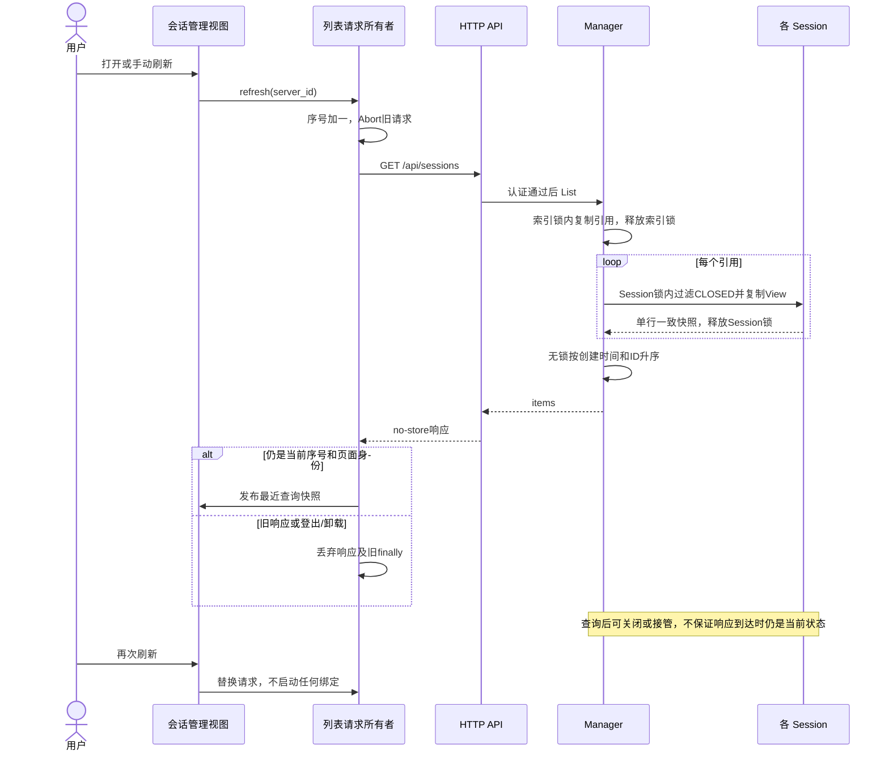

## 7. Takeover 后端流程与原子提交

### 7.1 冻结规则逐条落实

1. HTTP Prepare 只签发凭证，不撤销旧 Binding。
2. 候选 WebSocket 尚未完成 bind 和服务端验证时，旧 Binding 仍然有效。
3. 只有新连接成功完成全部校验并提交 Binding 时，才允许原子替换旧 Binding。
4. 提交前失败，旧 Binding 保持有效。
5. 提交后失败，不允许回滚或恢复旧 Binding。
6. 同一个 Session 不允许存在两个同时有效的逻辑 Binding。
7. 旧 WebSocket 可能在新 Binding 生效后仍处于物理清理过程中，但不能继续获得新的业务操作权限。
8. 旧连接收到 `taken_over` 后必须停止自动恢复。
9. 新连接的成功状态不能依赖旧连接是否及时收到通知。
10. 旧连接资源未完成清理时，不得提前归还其 WebSocket 资源名额。

“提交前保持有效”指 takeover 本身不提前撤销旧端；不阻止独立的网络故障、登出或 Session 关闭合法撤销它。

### 7.2 Prepare 与 WS 职责

HTTP protected 负责登录/Origin、mode 两值与 expected_generation 必填安全整数。Prepare 查找 Session 后依次取得登录读锁、Session 锁、必要时凭证索引锁。共同准入先检查应用、状态、期限和代次；attach 同代次占用返回 BIND_BUSY，takeover 允许 CONNECTED/DISCONNECTED。不能为了支持 takeover 放宽 attach。

凭证记录绑定本次登录、Session、mode、expected、原到期时间；清过期/容量/插入同一索引临界区。Prepare 不拿操作门、不取消 Binding、不延长离线期限、不预留最终胜利。输出只返回凭证与到期时间，客户端取消 POST 不代表服务端没签发。

WS Service 负责 Cookie/Origin 后升级名额，未绑定/关闭中同样计数。Reader 严格读取首条 bind，mode 从哈希凭证中读；Session 提交入口负责操作门、再次准入和快照；Writer 负责成功前缀与输出；Supervisor 负责绝对期限强关；连接收尾者最后归还 slot。

### 7.3 原子撤权、Connection 终止与取消的分离

冻结架构 §3.1 的事务锁序保持：**远端操作串行门 → 登录读锁 → Session.mu → OutputBuffer.mu → 凭证索引锁**，只取需要的子序列。凭证初查可在 Session 锁下短取索引锁并释放，再取 Buffer；不持凭证索引锁反向获取 Buffer。Prepare 使用登录读锁 → Session 锁 → 凭证锁；普通 Detach/Close 不等待操作门；Manager 索引锁与 Session 锁不嵌套。

第二轮修订删除原提交伪代码中的 `old.cancel()`。必须区分以下五件事：

| 时刻 | 同步边界与事实 |
|---|---|
| ① 原子逻辑撤权 | Session 提交临界区将 old.active=false、记录仅用于内部识别的 `superseded` 标记，并发布新 Binding/G+1；不取消 old context、不调用 old.end；旧 SSH 操作与普通发送准入立即失效 |
| ② 旧 Connection 确定终止原因 | 释放操作门及全部事务锁后，经旧 Connection 的统一 Terminate 入口，在旧 Connection.mu 内检查首因；尚无原因时固定 taken_over 与关闭绝对截止 |
| ③ 取消旧 Binding context | 仍持该 Connection.mu，在已固定原因之后调用 Session.Detach(old)：按对象身份撤权并取消旧 context；取消可能唤醒 Reader/执行器，但它们不能越过该 Connection.mu 覆盖原因 |
| ④ 终止槽发布与 Writer 唤醒 | 在同一 Connection 临界区固定独立终止槽的原因/截止，取消在途 Ping 和 Connection 工作 context、发布 terminated；解锁后唤醒唯一 Writer。终止消息不走普通控制队列，不在此处写网络 |
| ⑤ 物理回收 | Writer 在锁外按预算结束已准入项、至多发送一次最终 taken_over 和 Close 4001；Supervisor 到期强关，收尾者等待全部任务后归还 slot |

②是 Connection 首终止原因的确定点；④是完整终止请求对收尾任务的发布点。两者之间一直持 Connection.mu；先记录原因再 Detach，不表示在撤权之前发网络通知。takeover 的撤权已经在①完成，其他 Terminate 路径也必须在④发布前完成 Detach。`superseded` 不是第二个 Connection 终止槽，不能覆写已经确定的真实故障首因。

#### 7.3.1 提交和锁外交接伪代码

```text
Prepare(login, sessionID, mode, expected):
  校验mode/expected；从Manager取得引用并释放索引锁
  登录读锁 -> Session.mu；检查应用/登录/状态/期限/代次
  attach且已有绑定 => BIND_BUSY；takeover允许CONNECTED/DISCONNECTED
  凭证索引锁内清过期/容量检查/存哈希与mode；释放所有锁
  返回credential/expires_at；原Binding/context/期限均不变

CommitCandidate(ctx, login, token, P):
  校验token/P；有期限取得操作门
  登录读锁 -> Session.mu
  短取凭证索引锁初查并释放；检查归属/目标/mode/TTL/代次/状态
  OutputBuffer.mu内校验P并复制唯一[S,E)快照
  凭证索引锁内再次核对记录/TTL/登录到期/离线期限/候选ctx
  校验失败：释放快照、所有锁和门；不消费仍有效凭证、不改旧Binding
  代次耗尽：退出同步边界后幂等Close(counter_exhausted)，拒绝绑定
  唯一提交点（Session.mu仍持有）：
    消费本凭证，失效该Session其他凭证
    old = s.binding
    若old非空：old.active=false；old.superseded=true
    禁止old.cancel()、old.end()、获取任何Connection.mu
    generation++；创建并发布新Binding；置CONNECTED；更新接入时间/清期限
    非阻塞标记metadata dirty
  释放凭证锁、Buffer锁、Session锁、登录锁、操作门
  返回CommitResult{newBinding, displacedBinding: old}

提交结果的唯一收尾所有者（WS Reader；所有成功提交后的分支都必须执行）：
  安装必执行的锁外收尾：old非空则old.end("taken_over")
  在新Connection.mu内检查是否已有终止原因
  可用则登记newBinding、设置心跳，解锁后唤醒新Writer
  已终止则解锁后Detach(newBinding)，不发布可用连接、不回滚old
  执行old的锁外收尾，不等待通知送达、Close或旧slot释放
```

提交结果不能由候选 ctx 取消而遗失，也不能因新 Writer 启动/登记失败提前返回而跳过旧端收尾。新 Binding 尚未登记到 Connection 时就再次被接管，仍由其登记流程与§7.4准入校验拒绝失效对象；不能只凭 `c.reason==""` 认定该 Binding 可发送。

#### 7.3.2 统一终止入口与五种竞争

```text
Connection.Terminate(reason, optionalApplicationDeadline):
  Lock(c.mu)
  若c.reason已存在：仅按既有规则收紧截止（如有），Unlock；返回
  c.reason = reason                       // 首终止原因确定点
  固定min(now+close_timeout, 应用剩余期限)，保存独立终止槽数据
  若c.binding非空：
    Session.Detach(c.binding)             // c.mu -> Session.mu
      old.active=false；old.cancel()
      只有s.binding==old且s.status==CONNECTED时才清当前Binding/设离线期限
      不改old.superseded，不调用Connection回调
  取消已登记Ping context与Connection工作context
  发布terminated/截止变更信号（非阻塞、一次性），不写网络
  Unlock(c.mu)
  唤醒唯一Writer；未完成Upgrade的底层关闭沿用现有锁外路径
```

当前代码在同一个 `c.mu` 内先 Detach 再写 reason，本就能阻挡同时进入该锁的 defer；真正缺口是**提交路径在锁外通知之前自行取消 old context**。计划将顺序进一步显式化为“先固定原因、再 Detach 取消、最后发布终止”，避免将来把取消挪出受保护范围。不能通过增设 sleep、假定 Reader 调度较慢或强制覆盖 NETWORK_ERROR 修复。

| 情况 | 精确结果 |
|---|---|
| 正常提交 | 提交仅置无效/superseded，old.Done尚未由takeover关闭；锁外old.end进入Terminate，在c.mu内固定taken_over后Detach取消。新Binding早已有效，旧端收尾不影响它 |
| Reader等待Binding.Done | 当前reader只在输入槽等待分支select b.Done，普通readMessage阻塞不是等待b.Done；前者被Detach取消唤醒后退出，defer需取得c.mu，看到taken_over后无操作；后者由Writer关闭/底层强关解除，迟到defer同样无操作 |
| Reader defer与old.end同时竞争 | 正常由这次takeover取消引起的defer不能先于原因确定：取消在该原因确定后的同一c.mu内。若由另一合法路径取消而先唤醒，且该旧Binding已被标记superseded，按下述失效退出分流先提交taken_over再return；不可在测试里伪造无归属的提前cancel后仍声称遵守此顺序 |
| 真实网络故障已经先确定原因 | Terminate(NETWORK_ERROR)先持c.mu确定首因并Detach；随后old.end不得覆盖。若原端已离线，takeover按最新状态/原代次校验可提交；若已取到旧引用才发生故障，迟到收尾也只作用旧对象 |
| 旧Binding替换后迟到Detach | 只将旧对象active=false并取消其context；s.binding!=old，因此不清新Binding、不改generation/CONNECTED/新离线期限。重复Detach幂等 |

**补齐失效退出分流，避免另一条内部错误抢先：** 提交到old.end之间，旧执行器仍可能取得操作门，然后因Binding无效而返回；旧Writer也可能先发现无效；Revoke/Sweep预先捕获的旧引用还可能晚到Detach。只移除提交内cancel不足以覆盖这些情况。

- Session在自身锁内以对象身份/不可变代次验证；若拒绝原因是已标记superseded，向WS返回明确的**内部失效处置**（如`BindingSuperseded`枚举），与普通BIND_CONFLICT/输入背压错误分开。此值绝不作为新的API错误或WS error.code发出，只转换为已有 `Terminate("taken_over")`。
- Reader在`b.Done()`分支、执行器在取消或准入拒绝分支，先于return/defer调用一个短的 `finishBindingExit(b, fallback)`；它在c.mu保护首因，再按c.mu→Session.mu读取该旧对象的superseded。已确定首因即返回；superseded则固定taken_over，否则按既有合法退出原因处理。内部复用不重复取c.mu的`terminateLocked`，其取消/发布步骤与上面完全一致；取完Session锁后释放，再调用该内部过程中的Detach，禁止重入Session锁。
- Writer发现superseded时释放发送准入使用的Session锁和Connection锁，再经统一Terminate入口提交taken_over；重新竞争c.mu时如真实故障已确定首因，保留故障。
- 真正的readMessage错误、TCP失联、Ping失败和已准入Write失败仍走原实际故障入口，不因superseded标记一概改写为接管。正常结束分支先提交具体处置，随后`defer c.Terminate("NETWORK_ERROR")`只是幂等兜底，不承担从Binding取消推断网络故障的职责。

失效退出适配的最小伪代码（仅内部取消/准入拒绝调用，真实网络错误不调用它）：

```text
finishBindingExit(b, fallback):
  Lock(c.mu)
  若c.reason已确定：Unlock(c.mu)；return
  Lock(s.mu)
  superseded = (b属于该Session且b.superseded)  // 只读传入旧对象，不替换为s.binding
  Unlock(s.mu)
  reason = superseded ? "taken_over" : fallback
  terminateLocked(reason)                   // 已持c.mu，不再获取c.mu
    先固定reason/截止，再Detach(c.binding)，取消并发布终止槽
  Unlock(c.mu)；唤醒Writer

Reader输入槽等待：
  select:
    operations入队：继续读取
    b.Done：finishBindingExit(b, 原取消退出原因)；return
    c.ctx.Done：return                       // 该context只在已确定终止后取消
    输入等待超时：按既有INPUT_BACKPRESSURE终止
  defer Terminate(NETWORK_ERROR)             // 所有明确终止之后的幂等兜底

旧Execute准入拒绝/等待取消：
  完成自身门和登录/Session锁的释放
  若是内部BindingSuperseded或Binding取消：finishBindingExit(原b, 原错误码)
  若是实际SSH故障：按原Session.Close/错误路径处理，不假冒接管
```

`terminateLocked`中调用Detach前已释放上一次读取处置的s.mu，仍保留c.mu，因此既不重入Session锁，也不会让另一终止请求插入并覆盖原因。实际连接的归属通过原Binding所属Session/不可变所属WS关系保证，不允许把其他连接的Binding传给适配器。内部处置仅补齐取消/旧权限拒绝的分类，不能把业务错误表中的所有BIND_CONFLICT或INPUT_BACKPRESSURE全局改成taken_over。

最小内部接口建议：`Binding.end func(string)`仍足以把已有taken_over原因送到所属Connection，无需新增对外接口或改变回调签名；需要调整其调用时点和统一终止实现。Session需提供受锁保护的内部失效处置读取/准入返回值，WS需一个共用的`terminateLocked`及失效退出适配，避免直接访问另一包私有字段。旧Connection尚未登记Binding时，end可先固定reason但无对象可Detach；原提交Reader在返回后的登记拒绝分支必须Detach其持有的新Binding，再完成工作任务。这一交接责任由CommitResult明确，不能把end当成已完成所有资源回收。所有名称是内部伪代码建议，未修改业务源码。

### 7.4 Writer 的精确发送准入与锁顺序

#### 7.4.1 发送准入点

**选择并标记下一条普通应用消息，是发送准入点。** 必须同时持有该连接的 `Connection.mu` 与所属 `Session.mu`，完成“终止状态检查→当前Binding身份/active/代次/CONNECTED验证→选定单个不可变发送项→标记该项已准入”。不能返回一个bool、释放Session锁后再选消息。

范围包括成功前缀、历史块、实时块、普通status等控制消息；控制队列入队不是发送准入，不得因为status早已排队就绕过替换后的校验。最终taken_over/closed/error来自独立终止槽，旧Binding已经无效也允许唯一Writer按预算发送，不走普通准入检查。

```text
Writer下一步：
  Lock(c.mu)
  若已有终止原因：取一次最终终止项/截止，Unlock；走锁外finish；return
  b = c.binding
  若b为空：Unlock；可取消地等待wake/terminated；重新开始
  Lock(s.mu)                             // 顺序c.mu -> s.mu
  检查s.binding==b、b.active、s.generation==b.Generation、s.status==CONNECTED
  若无效：
    复制b的内部失效处置；Unlock(s.mu)；Unlock(c.mu)
    若superseded：调用统一Terminate(taken_over)，重新开始
    否则等待已有关闭/撤销流程发布终止，不自行发送closed或继续普通输出
    等待必须可由wake/terminated/连接ctx解除，不持锁、不自旋
  若到期Ping优先：
    在当前短同步边界登记唯一Ping及cancel；Unlock(s.mu)；Unlock(c.mu)
    锁外Ping；失败进入统一终止；不同时准入普通消息；重新开始
  从固定前缀、普通控制FIFO或输出中选择至多一项：
    前缀/控制：非阻塞选取并复制具名消息值
    回放：从该Binding不可变快照取得一个有界块及下一游标值
    实时：保持c.mu与s.mu，Buffer.Read内部获取OutputBuffer.mu
          在同一Buffer临界区检查连续性并复制一个有界块，然后释放Buffer锁
  若取块失败：释放s.mu/c.mu后经统一终止处理；不准入普通消息
  若无消息：释放s.mu/c.mu后按现有缓存唤醒/心跳/终止机制等待
  item = 单个不可变发送描述（含所属Binding及代次、kind、payload、下一游标）
  标记item为唯一已准入项                  // 线性化点，仍同时持c.mu和s.mu
  Unlock(s.mu)；Unlock(c.mu)
  锁外JSON编码（如需要）及唯一一次网络Write，使用既有写入/关闭期限
  结束后清该项/更新本Writer游标；失败经统一终止，成功返回循环重新取两把锁
```

实际可由Session提供狭窄的 `WithSendAdmission(b, selectOne)` 内部方法：调用方已持c.mu，方法持s.mu校验并执行一次有界内存选择回调后才释放。回调只能选/复制/标记一项，可按顺序调用Buffer.Read；不拿c.mu、不取操作门/登录锁/Manager锁、不执行Terminate/Detach/网络/阻塞队列等待。API不得把Session锁泄漏给任意调用者，不能设计成`IsActive()`返回后由调用方无锁选择。`inFlight`可由唯一Writer的局部项表达，是否显式存字段由实现决定，但准入与完成必须有可测试的同步点。

新端Writer发布与旧端通知之间不保证调度先后，因此普通消息检查必须覆盖新Binding也已被再次替换的情况。没有有效Binding而在等待SSH完成关闭时，不能提前发送closed；只有原Session回收流程确认SSH关闭后才提交该终止消息。已准入项可以在takeover提交后才真正调用Write，它仍是**提交前准入**的一项，不得据实际发送时间误判为提交后新准入；单Writer执行完它之前不能预取第二项。

#### 7.4.2 两种严格先后

- Writer先完成准入：持s.mu选定并标记item，释放后takeover才可取得同一s.mu并提交。允许这唯一在途项按既有write_timeout/关闭总期限完成；后续循环重新锁内校验旧Binding失败，普通消息计数不再增加。
- takeover先提交：Writer即使先拿到c.mu，只要尚未拿s.mu并完成准入，随后就看到旧Binding失效；不得出队/选择/标记任何新的普通消息，只转终止处置。两者同时竞争s.mu的结果只能是这两种，不存在检查与选择之间的可插入提交窗口。

#### 7.4.3 锁顺序与无环论证

| 路径 | 实际嵌套顺序 | 明确禁止 |
|---|---|---|
| takeover提交 | 操作门 → 登录读锁 → Session.mu → OutputBuffer.mu → 凭证索引锁 | 持任何事务锁/门调用old.end、获取Connection.mu或写网络 |
| Writer普通发送准入 | Connection.mu → Session.mu → 必要时OutputBuffer.mu | Session有效检查后提前释放锁再选项；持锁Write/Ping/Close/等待任务 |
| Terminate/失效退出适配 | Connection.mu → Session.mu（Detach或短读处置；分别取锁，不重入） | 持Session锁再获取Connection.mu；调用公开Terminate导致Connection锁重入 |
| SSH输出追加 | 仅OutputBuffer.mu；释放后非阻塞通知 | 持Buffer锁取Session/Connection锁 |
| 普通Detach/Session Close | 仅Session及其规定的子锁；回调在释放后执行 | Session.mu → Connection.mu |
| 连接登记和旧通知 | 新Connection短锁释放后，再调用旧end获取旧Connection.mu | 同时持两条Connection.mu；新连接锁跨旧端通知 |

Connection.mu是现有WS调度锁，本次把已有 `Connection.mu→Detach/Session.mu` 的方向用于发送准入；不是在架构事务链中插入新的反向锁。Writer所用Session→Buffer是架构§3.1允许的子序列，且不向前取操作门/登录锁。提交方从不等待Connection.mu，Terminate/Writer都只按Connection→Session方向等待；Buffer持有者不反向取锁，因此这些路径没有锁等待环。Supervisor仍不获取这些锁，到期直接关闭底层net.Conn。短锁竞争可能延迟调度，但不等待Reader/Writer网络或Close完成，不把新端成功绑定到旧端通知送达上。

输入在途与提交继续共用操作门；Writer普通输出准入不额外取得该门。旧已准入SSH调用先完成再允许接管，尚未准入项通过active/身份检查拒绝；context取消只是停止等待/清理手段，不再承担提交点撤权的唯一责任。

## 8. Takeover 前端完整流程

### 8.1 所有者和启动模型

用户已确认 D2=A、D3=A，并进一步确认 S6 采用方案 B。SessionManager 只展示列表、筛选、刷新并在用户点击“打开”时发出打开事件，不查询详情、不创建 Pane、不持有确认状态。HomePage 按 Session ID 查 `tabs`、`panes`、`pending`、`closing`，在首次 await 前同步预占并创建候选 Pane。候选 Pane 只有在 `onMounted` 初始化完成、`TerminalClient`/`SessionRecovery`/`SessionTakeover` 已按顺序创建并绑定到同一 Pane、且发出经过身份校验的 `ready` 事件后，主动接管流程所有权才算移交给 Pane。模板 ref 存在或 `setPane()` 被调用都不构成 ready。

候选 Pane 拥有唯一 client/tracker/recovery/takeover 和唯一 Pane 级操作门禁。SessionTakeover 拥有主动接管的详情快照、确认候选、取消和状态；SessionRecovery 只负责人工 attach 候选和两步恢复。两者不能各自持有一套互不感知的异步状态：所有人工刷新、人工恢复、诊断刷新、接管准备、详情查询、确认和连接启动都必须经过同一个 Pane 级门禁。候选详情与 SessionRecovery 的人工 attach 候选分别存储并互相失效；SessionRecovery 不拥有 takeover。

新建 Session 的 Pane 使用 `attach` 启动模式，在 ready 后按创建 DTO 首次 attach。列表打开已有 Session 的 Pane 必须使用 `candidate` 启动模式，mount 本身不调用 `connect()`；用户确认时只调用一次 S5 已有的 `connectTakeover()`。成功前缀后同一 Pane 转为正常标签；不能成功后再创建另一个 Client 把候选 WS 搬过去。失败保留该 Pane 和原因供查询/关闭，不自动创建另一个标签（D3）。

S5-C1/S5-C2 已经完成并冻结。`TerminalClient` 已提供 `connect(expected)`、`connectTakeover(expected)`、`run()`/`runTakeover()`、`completion` 和完整 `stop()` 屏障；S6 只调用这些入口，不重新实现 mode、generation、RecoveryTask、重试或 stop 语义。初始 mode 固定在该 RecoveryTask，第一次 Prepare 可为 takeover；下一次循环无论第一次是否拿到凭证，都必须改为 attach。用独立的“首次尝试已消费”标记，不能根据 retries==0 判断模式，因为稳定资格可能把 retries 重置为0。重复点击不重新 start，不延长预算。

#### 8.1.1 同页唯一登记、pending 与 closing 状态

HomePage 的登记状态必须覆盖 Pane 尚未存在、正在初始化、初始化失败、正在关闭但尚未完成 dispose 的整个窗口，不能只用 `panes` Map 或模板 ref 判断唯一性。最小结构如下：

- `tabs`：以 Session ID 为键的 `TabEntry`，保存本次打开的 `SessionView` 快照、当前 `paneKey`/`paneInstanceId` 和 `initState: 'pending' | 'ready' | 'failed'`。
- `panes`：以 `paneKey` 为键的 Pane 句柄，不按 Session ID 覆盖旧实例；`setPane(paneKey, handle)` 只登记句柄，不释放 `pending`。
- `pending`：以 Session ID 为键，保存当前 `paneKey`/`paneInstanceId` 和创建/初始化阶段；一个 Session 同时至多一个 pending。
- `closing`：以 Session ID 为键，保存当前 `paneKey`/`paneInstanceId`、真实 `dispose()` Promise 或“尚无句柄”的创建取消 Promise、清理失败标记和至多一个 `reopenRequested`。

`paneKey` 和 `paneInstanceId` 都由 HomePage 在同步预占时生成并写入 `TabEntry` 与 `pending`，创建后传给 Pane 且不可变；`paneKey` 建议由 Session ID 加页面内单调序号组成，用作 Vue 的 `:key`，`paneInstanceId` 用作事件和异步回调的实例身份。每次创建、失败重试和关闭后重开都必须同时生成新的 `paneKey`/`paneInstanceId`，不能只用 Session ID 区分。这样旧实例的 `ready`/`failed`/`closed` 回调可以按 `paneKey` 和 `paneInstanceId` 被识别并丢弃。

| 状态 | 建立时机 | 释放时机 | 打开/关闭规则 |
|---|---|---|---|
| `tabs` 项 | 用户打开一个当前页没有的 Session，在任何 await 之前同步加入 | 交互式关闭在真实 `dispose()` 完成后移除；HomePage 销毁时整页失效 | 已有项只定位，不 push 第二项；`paneKey` 标识当前实例，旧实例不能替换新项 |
| `pending` | 与 `tabs` 项同一同步步骤加入，覆盖 Pane 创建、mount、初始化和 SessionTakeover 绑定 | 正常初始化只由匹配当前 `paneKey`/`paneInstanceId` 的 `ready` 或 `failed` 事件释放；创建前失败由 HomePage 生成同结构的失败结果释放；显式关闭/页面终止作为取消路径释放，不得把取消当成 ready | `pending` 期间再次打开只定位现有候选标签，不创建第二个 Pane、Client、详情 GET 或 takeover |
| `closing` | 用户关闭候选/标签，或 HomePage 开始交互式移除该 Pane 时同步加入 | 有句柄时等待该 `paneKey` 的 `dispose()` Promise settle；尚无句柄时等待创建取消 Promise 确认无可清理实例；清理失败则保留并允许重试关闭 | `closing` 期间禁止创建同 ID 新 Pane；可记录至多一次 `reopenRequested`，closing settle 后才按新 `paneKey` 重新预占 |

具体规则：

1. 连续点击同一 Session：第一次点击同步建立 `tabs` 项、`paneKey` 和 `pending`；后续点击命中 `tabs`、`pending` 或 `closing`，只定位或记录一次待重开，不创建第二份候选状态。
2. Pane 尚未 mount：`pending` 已存在但没有 `panes` 句柄；此时不自动连接、不查详情。正常路径只有匹配的 `ready` 事件到达后才释放 `pending` 并完成所有权移交；用户关闭或页面终止按第 8/12 条的取消路径处理。
3. Pane 正在初始化：`pending` 保持到匹配的 `ready`/`failed`；`setPane()` 或模板 ref 出现不改变 `pending`。初始化中的重复打开不触发第二次初始化。
4. 用户切换管理页/终端页：只改变视图，不改变 `tabs`、`paneKey`、`pending`、`closing` 或 Pane 的接管所有权。
5. 候选 Pane 创建失败（组件尚未建立）：HomePage 捕获创建错误，保留同一 `tabs` 项，生成该 `paneKey` 的失败状态和明确原因，释放 `pending`；不自动重试，不另 push 并行 Pane。
6. 候选 Pane mount 或初始化失败：TerminalPane 先进入 `failed`，使旧实例不再可能发出 `ready`，invalidate 门禁和 SessionTakeover、abort 详情请求，并立即发出带 `paneKey`/`paneInstanceId` 和错误原因的 `failed`；异步清理随后进行，不得让 `failed` 的发布等待 `stop()`/`dispose()`。HomePage 只接受当前实例的失败，立即释放 `pending`，保留失败标签和原因；清理失败只追加“清理失败”状态，不能把已经进入 `failed` 的 Pane 重新标记为可用。
7. 初始化失败后的同标签重试：只允许用户显式点击“重试初始化”。重试不复用半初始化的 Client/Takeover，而是把旧实例进入 `closing`，等待其真实 `dispose()` settle，移除旧 `paneKey` 的标签和句柄后，生成新 `paneKey` 重新创建。旧实例迟到的 `ready`/`failed`/`closed` 因 `paneKey` 不匹配被忽略。
8. Pane 正在关闭但尚未 dispose：`closing` 保持，`panes` 句柄和旧任务仍属于旧 Pane；不得先创建新 Pane 等待旧 Pane 卸载，不得仅因 `nextTick()` 或模板 ref 变为 null 释放 `closing`。若关闭发生在 Pane 句柄存在之前，HomePage 必须取消该 `paneKey` 的 pending 创建意图，记录“尚无句柄”的创建取消 Promise；若最终确认没有实例可创建，可在创建尝试 settle 后释放 `closing`（没有 Client 可清理），但迟到的 `setPane` 若带来句柄仍必须先 dispose 再释放。即使 `closing` 已结束，旧 `paneKey` 的迟到 `setPane` 也不得登记为当前 Pane，必须立即 dispose；旧 `ready`/`failed` 不得重建可操作 Pane。
9. 关闭后立即重新打开：若旧 Pane 尚未 dispose 完成，只在该 `closing` 记录中保存一次 `reopenRequested`；`dispose()` settle 后释放 `closing`，再同步预占并生成新 `paneKey`，保证旧、新 Pane 不重叠。
10. 关闭与失败/ready 竞争：关闭意图优先。`closing` 或页面失效后到达的 `ready`/`failed` 不释放新状态、不重建标签；关闭仍只等待该 `paneKey` 的 dispose。
11. 清理失败：`dispose()` 的拒绝或清理错误必须显示为明确失败，`closing` 不伪造成功；保留旧句柄并允许用户重试关闭，只有真实 dispose settle 后才允许同一 Session 新建 Pane。
12. HomePage 卸载、登出或身份失效：设置页面失效标识，停止接受新打开并清空 `pending`、`closing` 和 `reopenRequested`；通过 Pane 暴露的 invalidate/stop/dispose 入口让每个 Pane 先失效门禁和 SessionTakeover、abort 详情，再按既有生命周期 stop/dispose。页面销毁后迟到回调不得重建 `tabs`、`pending` 或连接。交互式关闭等待 dispose；浏览器页面销毁只能尽力异步清理，不能伪称同步完成。

#### 8.1.2 Pane ready/failed 握手

TerminalPane 的初始化必须形成可观察、可校验的握手，不能把组件实例存在当作成功。设计约定如下：

- props 至少包含 `session`、`active`、`pageToken`、`paneKey`、`paneInstanceId` 和 `startMode: 'attach' | 'candidate'`。
- emits 至少包含 `ready`、`failed`、`closed`；payload 均带 `{ sessionId, paneKey, paneInstanceId }`，`failed` 另带安全错误文本，`closed` 表示该实例已完成 `dispose()`。
- HomePage 的 `setPane(paneKey, handle)` 只登记句柄。只有 `ready`/`failed` 的 `sessionId`、`paneKey`、`paneInstanceId` 与当前 `tabs`、`pending` 完全匹配，且页面/身份仍有效时，才允许改变 `pending` 和所有权状态。

初始化顺序固定为：

1. 捕获本 Pane 的 `pageToken`、`paneKey`、`paneInstanceId` 和登录身份 token；校验身份、页面和 host 可用。
2. 创建唯一 `TerminalClient`，此步不调用 `connect()`/`connectTakeover()`。
3. 创建唯一 `PaneOperationGate`，初始状态为 `idle`。
4. 创建唯一 `SessionRecovery`，注入该门禁、Pane 身份、页面 token 和身份 token。
5. 创建唯一 `SessionTakeover`，完成 `bind({ sessionId, paneKey, paneInstanceId, client, recovery, gate, identityToken, pageToken, requestClose })`；绑定必须校验传入对象就是本 Pane 的实例。
6. 安装终端工厂、尺寸/主题监听和网络监听；候选模式到此仍不创建 WebSocket、不申请凭证、不查详情。
7. 等待必要的 `nextTick()`，再次校验本实例 `paneKey`/`paneInstanceId` 未变化、页面/身份 token 有效、`closing`/`disposed` 未发生。
8. 全部通过后进入 `ready`，先记录状态再 emit `ready`。若任何一步抛错或校验失败，进入 `failed`，使后续 `ready` 永久不可能发出，先 emit 一次带安全错误原因的 `failed`，再异步清理门禁/Takeover/Client；清理的拒绝或延迟不得阻止 HomePage 释放 `pending`，也不得产生第二次 `failed` 或迟到的 `ready`。失败后的内部清理不得发出会让 HomePage 移除标签的 `closed`；`closed` 只属于用户显式关闭或“重试初始化”路径，失败标签必须保留到用户选择重试或关闭。

`ready` 表示“Pane 已具备安全接收候选接管操作的能力”，不表示已连接。`attach` 模式可在 `ready` 后按既有流程首次 attach；`candidate` 模式在用户确认前不得 attach、Prepare 或创建 WebSocket。初始化失败不得用超时、模板 ref 或普通渲染重试来猜测成功；失败标签必须保留明确原因，并由用户显式重试或关闭。

若 Vue 在 Pane 实例创建/渲染阶段抛出 Pane 自身 try/catch 无法捕获的错误，HomePage 必须使用局部 `errorCaptured` 或等价错误边界，按当前 `paneKey` 生成 failed 结果、释放 pending 并保留失败标签；不得让错误冒泡成空白页面，也不得把该实例当成 ready。

#### 8.1.3 Pane 级统一操作门禁

每个 Pane 持有一个本地 `PaneOperationGate`。它不是全局锁、事件总线或任务队列，只协调该 Pane 内 SessionRecovery 与 SessionTakeover 的操作权。门禁至少保存：当前状态、单调递增的 lease ID、当前 lease 的 kind、当前任务 ID、`paneKey`/`paneInstanceId`、页面 token 和身份 token。

| 门禁状态 | 当前所有者 | 允许进入 | 允许动作 |
|---|---|---|---|
| `idle` | 无 | Recovery 申请；Takeover 申请 | 只有满足 D2/D3 分类的操作可申请 |
| `recovery` | SessionRecovery lease | 仅由 `refresh()`/`recover()` 在首次 await 前取得 | 执行一个人工刷新或恢复；Takeover 可在分类允许时显式抢占并先 stop |
| `takeoverPreparing` | SessionTakeover lease | 由 Takeover 显式发起，或从 `recovery`/`clientTask` 抢占 | 失效旧候选、stop/drain、随后详情 GET；Recovery 全部拒绝 |
| `takeoverReview` | SessionTakeover lease | 详情成功发布后 | 刷新详情、确认、取消；Recovery 全部拒绝 |
| `takeoverConnecting` | SessionTakeover lease | 确认处理器首次 await 前 | 调用一次 `connectTakeover()`；重复确认忽略 |
| `clientTask` | TerminalClient 长期任务 | 已取得 `clientTask` lease 并启动 `connect()`/`connectTakeover()` | Recovery 由 `client.running` 和门禁双重拒绝；仅在分类为恢复中/已停止时允许显式 takeover 抢占 |
| `blockedStop` | SessionTakeover lease | stop 拒绝或屏障未完成 | 只允许重试 stop 或关闭 Pane；禁止详情 GET、Prepare、WS 和 Recovery |
| `terminating` | Pane 生命周期 | 关闭、登出、身份失效、HomePage 卸载 | 全部操作拒绝；只执行 invalidate/abort/stop/dispose |

规则：

1. `SessionRecovery.refresh()`、`SessionRecovery.recover()` 和 `stoppedState()` 触发的 `recovery.refresh(false, taskId)` 必须在首次 await 前调用 `gate.tryAcquireRecovery()`。返回 null 时不发请求、不清空快照/候选/错误、不自动重试；诊断刷新只记录“已跳过”，不把跳过当网络错误。取得 lease 后，`refresh()` 再递增 sequence/abort 旧 GET；`recover()` 先捕获 candidate 再 invalidate，旧候选不能在 lease 失效后继续启动 attach；`recover()` 调用 `connect()` 启动长期任务后转入 `clientTask`。`refresh()`/`recover()` 的所有成功、失败、取消和 finally 路径都必须在 `finally` 中按 lease 身份释放 recovery lease；只有转入 `clientTask` 的路径才把释放责任交给该长期任务。旧 lease 的 finally 只能失效自己，不能释放或覆盖新 lease。
2. `SessionTakeover.prepare()` 必须在首次 await 前调用 `gate.beginTakeover()`。若当前是 `takeoverPreparing`，加入现有准备动作；若当前是 `takeoverReview`，普通重复打开只定位，不重新请求，用户显式“刷新详情”才复用同一 lease、递增 sequence、abort 旧 GET 并重新查询；若当前是 `takeoverConnecting`，拒绝重复准备。若门禁被 Recovery 占用且 Pane 分类为恢复中/已停止，可显式抢占：先使旧 lease 失效、调用 `recovery.invalidate()`，再等待 `client.stop()`；若分类为已连接/replaying，直接拒绝并只定位。prepare 的早期拒绝、取消失败和同步异常，若本次新建了 lease，必须按 lease 身份释放；复用现有 lease 的路径不得误释放它。
3. 抢占后旧 Recovery 的成功、失败和 finally 都因 lease/sequence 不匹配被丢弃；旧任务不能重新发布候选、启动连接或清空新状态。
4. D2 的 stop 必须使用既有 `client.stop()` 完整屏障，等待长期任务、发送和 drain 完成。屏障完成前不得 GET 详情、Prepare、新建 WebSocket 或启动新的 Recovery attempt；旧任务的 WS 只按 stop 清理，不当作接管候选。
5. stop 拒绝或屏障未完成时进入 `blockedStop`，显示明确原因；不查询详情，不自动重试，不允许 Recovery 绕过。用户只能重试 stop 或关闭 Pane。
6. 详情 GET、候选快照展示、确认/取消期间保持 `takeoverPreparing`/`takeoverReview` lease；用户取消时只标记取消并 abort 详情，若 stop 尚未 settle 不得提前释放 lease，stop settle 后才释放到 `idle`；stop 失败则进入 `blockedStop`。旧 RecoveryTask 保持停止，不自动复活。之后用户显式刷新或恢复时才可重新取得 lease。
7. 确认处理器在首次 await 前消费快照并校验 lease、`paneKey`、`paneInstanceId`、页面 token、身份 token、任务 ID 和快照 sequence；通过后进入 `takeoverConnecting` 并只调用一次 `connectTakeover()`。`connectTakeover()` 同步抛错或启动前异步失败时按 lease 身份释放并显示失败；只有长期任务实际启动后才转为 `clientTask`，不能让失败路径留下永久 lease。
8. `clientTask` 只在 `client.completion` settle 且 `client.running` 为 false 时释放到 `idle`；takeover 成功后 Recovery 仍因 `client.running` 被拒绝，任务结束/停止后才重新获得显式恢复资格。不得在 S5 长期任务仍有效时启动另一个连接任务。
9. 任何 `client.connect()`/`connectTakeover()` 调用，包括 `attach` 模式 ready 后的首次 attach，都必须在首次 await 前取得 `clientTask` lease；取不到时不得启动连接。该 lease 由启动任务的所有者持有，直到 `client.completion` settle 且 `client.running=false`；同步启动失败必须在 `finally` 中立即释放。这样初始 attach、人工恢复和主动接管不会并行启动第二个连接任务。
10. 关闭、登出、身份失效或 HomePage 卸载必须先把门禁置为 `terminating`，再 invalidate SessionTakeover、abort 详情、stop/dispose。终止后任何旧 lease 的 assert 都失败。
11. 门禁必须检查当前 `tabs` 的 `paneKey` 和 Pane 实例身份；旧 Pane 的 lease 不能操作新 Pane，旧 Pane 的完成回调也不能释放新 Pane 的 `pending`/`closing`。

#### 8.1.4 登录身份代次

只判断 `identity.value !== null` 不足以证明发起操作时的登录身份仍然有效。沿用现有 auth 模块的私有 `identityEpoch`，增加只读身份代次访问，并规定：

- 每次 `acceptIdentity()` 接受新的身份对象、`clearIdentity()`、登出或身份过期都推进身份代次；同一对象重复接受不重复推进；同一管理员重新登录仍必须得到新代次。
- Pane 初始化、详情查询、确认、`connectTakeover()` 启动和所有迟到回调捕获发起时的 `{ epoch, identity }` token。
- 有效条件为：token 的 epoch 等于当前代次、token 的 identity 仍是当前对象、`logoutPending=false`、页面 token 未失效、Pane 未 terminating。
- 旧身份的迟到详情、确认、凭证、onopen、bind_success 和 finally 一律丢弃，不能在新身份下创建 WS、改代次、重建标签或启动连接。
- 不新增全局身份 Store 或跨页面身份服务；只在现有 auth 模块暴露只读代次，Pane 内保存 token。
- TerminalClient 的 `allowed()` 回调也必须由 Pane 提供页面 token、身份 token 和实例有效性检查，不能只判断 `identity.value !== null`；但 gate 仍由 Pane/Takeover 拥有，不塞进 TerminalClient 的连接状态机。

### 8.2 从列表到终端的步骤

1. 用户点 SessionManager 某行“打开/主动接管”；SessionManager 只发出打开事件并传递 Session ID 与列表快照，不查询详情、不创建 Pane、不持有确认状态。
2. HomePage 按 Session ID 查当前页 `tabs`、`panes`、`pending`、`closing`，在首次 await 前同步预占并生成 `paneKey`；绝不按服务器名称去重，也不因列表快照相同而复用不同 Session。
3. 已有在线或 `replaying` Pane 按 D2 优先定位，结束本次列表动作，不停止 Pane、不发 takeover；已有恢复/停止 Pane 走 §11 的显式流程。无 Pane 按 D3 建立唯一候选 Pane，默认不联网。
4. 所有权移交：HomePage 完成 Session ID 唯一登记并创建候选 Pane；只有匹配当前 `paneKey`/`paneInstanceId` 的 `ready` 事件到达，且 SessionTakeover 已绑定该 Pane 后，主动接管流程所有权移交完成。`setPane()` 不是移交点。SessionManager 卸载、管理页切换或重新挂载只取消列表 GET，不影响已移交的详情、确认或 takeover。
5. 主动接管准备阶段由 Pane 的 SessionTakeover 执行：先取得 Pane 门禁 lease，封闭原人工候选；若存在旧任务，显式停止并等待 `client.stop()` 的长期任务、发送、清理与 drain 屏障完成后才继续。按 D2=A，恢复中任务在用户点击“停止恢复并准备接管”时先停止，之后取消确认也不自动复活；在线或 replaying 端只定位，不悄悄暂停。
6. 用可取消详情 GET 获取完整 SessionView。检查门禁 lease、任务、Pane 实例、页面 token 和登录身份 token；展示 Session 快照目标、状态、代次、离线期限。CONNECTING/CLOSING/NOT_FOUND 禁止接管；CONNECTED/DISCONNECTED 才可确认。GET 无本地自动超时。
7. 用户单独确认“主动接管；当前操作端将停止”。确认框位于候选 Pane，不是列表刷新自动生成的授权。确认前不申请凭证、不请求 Prepare、不创建 WebSocket、不启动 SSH、不自动 attach 或 takeover；刷新详情或目标变化使旧确认候选失效，不自动确认新代次。
8. 确认处理器首次 await 前消费候选、锁住动作并进入 `takeoverConnecting`；复查门禁 lease、旧任务收尾、Pane/页面/身份 token 和动作 sequence；以详情代次启动该 Pane 唯一任务，第一次 POST `mode=takeover`。
9. 凭证 POST 使用独立 credential_timeout；迟到/取消响应不创建 WS。通过后新建候选 WS，设置 arraybuffer/handlers，onopen 前再次检查身份，发送首条 bind。
10. 服务端按 §7 依次验证、取操作门、快照与原子提交；HTTP 成功、WS OPEN 或 bind 已发送都不等于已接管。
11. 客户端校验 bind_success 代次与前缀；connection Promise 完整前缀才反馈成功，长期 completion 仍运行。成功后聚焦同一标签、同步有效尺寸；回放未处理完显示“正在回放”，不提前启用输入。
12. 标记列表需刷新；列表数据不能反向驱动终端。旧浏览器收到 taken_over/4001 立即停输入和自动恢复，有限排空，保留明确状态。初次或后续可重试失败按原预算只 attach、只使用已成功获知代次；BIND_CONFLICT 停止。结果不确定不自动采用详情新代次再 takeover，要求新一轮用户详情/确认。成功后门禁进入 `clientTask`，直到 `client.completion` settle 且 `client.running=false` 才释放。

#### 8.2.1 详情查询、确认与迟到回调隔离

SessionTakeover 持有独立的 `sequence`、`controller`、`snapshot`、`acting`、`phase`、门禁 lease 和当前 Pane/任务/身份 token。每次准备接管按以下顺序执行：

1. 首次 await 前通过门禁取得 takeover lease；若当前是 `takeoverPreparing`，加入现有准备动作；若当前是 `takeoverReview`，普通重复打开只定位，用户显式“刷新详情”才复用同一 lease 并启动新查询；若当前是 `takeoverConnecting`，拒绝重复准备。若门禁被不允许抢占的 Recovery 占用则拒绝并显示“当前终端操作进行中”，不发详情请求。
2. 新准备或显式刷新详情时，在 lease 仍有效的前提下递增 `sequence`、invalidate 旧确认候选并 abort 旧详情请求，再清理旧快照和错误；若存在旧 RecoveryTask，先执行完整 `client.stop()` 屏障。只有长期任务、发送和 drain 完成后才发详情 GET。显式刷新不能创建第二个 takeover lease，也不能让旧请求的 `finally` 清除新请求的 loading。
3. 详情 GET 完成后检查本次 `sequence`、lease、请求身份、`AbortSignal`、Pane 实例、页面 token、身份 token 和 `logoutPending`，全部有效才发布快照和确认界面。
4. `AbortController.abort()` 只表示本地取消意图，不证明底层 fetch、JSON 解析或调用方 `finally` 已结束。成功、失败和 `finally` 回调都必须检查同一 `sequence`、lease 与请求身份；旧请求迟到时不得清当前 loading、覆盖新快照、重新展示确认内容或启动 takeover。
5. 用户取消、重新查询详情、关闭 Pane、HomePage 卸载、登出或身份失效都使当前 `sequence`/lease 失效并清空确认候选；取消发生在 stop 尚未完成时只标记取消，待 stop settle 后释放，stop 失败进入 `blockedStop`；旧 RecoveryTask 保持停止，不因取消查询或关闭确认界面而恢复。
6. stop 拒绝或未完成时进入 `blockedStop`，不发布详情、不自动重试；只有重试 stop 成功或关闭 Pane 才能离开该状态。

确认动作只能使用当前有效的详情快照：

1. 首次 await 前同步消费候选、设置 `acting` 并进入 `takeoverConnecting`，后续重复点击直接忽略，不能产生第二次 Prepare。
2. 校验快照的 Session ID、详情 `binding_generation`、查询 `sequence`、lease、候选身份、Pane 实例、当前任务身份、页面 token、身份 token 和旧任务停止状态。
3. 快照已取消、失效、被新查询替换或 Pane 已进入关闭/销毁时拒绝确认，释放 lease 并清空候选，不调用 `connectTakeover()`。
4. 确认后把快照代次作为该 TerminalClient 唯一任务的不可变 `initialExpectedGeneration`；首次 Prepare 使用 `mode=takeover`，后续可重试 attempt 固定 attach，并使用 `confirmedGeneration ?? initialExpectedGeneration`；BIND_CONFLICT 按停止处理，不进入 attach 重试；不查询详情推算代次，不因 `bind_success` 丢失而 generation + 1。
5. `connectTakeover()` 同步抛错时释放 lease、显示失败且不创建 WS；启动任务后门禁进入 `clientTask`。确认结果、Prepare 响应、WebSocket 回调和 `finally` 返回时再次检查动作、lease、任务与 Pane/身份 token；旧动作不得写新状态、创建 WS、重试或复活已停止任务。

同实例复用先 drain 再读取 processedOffset；新设备、新页面、新 xterm 或排空失败重建从 0。无论已有 Pane 与否，都不得使用另一设备、列表或服务端发送游标作偏移。

### 8.3 时序图 2：没有已有 Pane 的主动接管（D3=A 已确认）

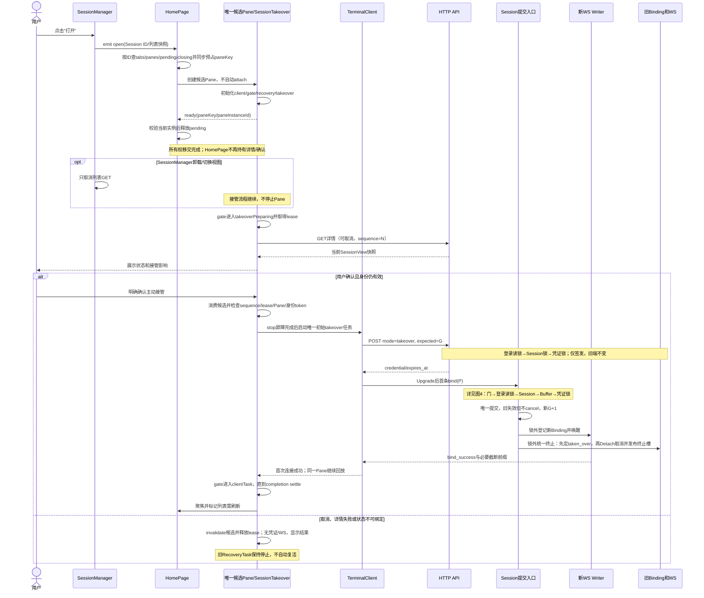

### 8.4 时序图 3：当前页已有 Pane（D2=A 已确认）

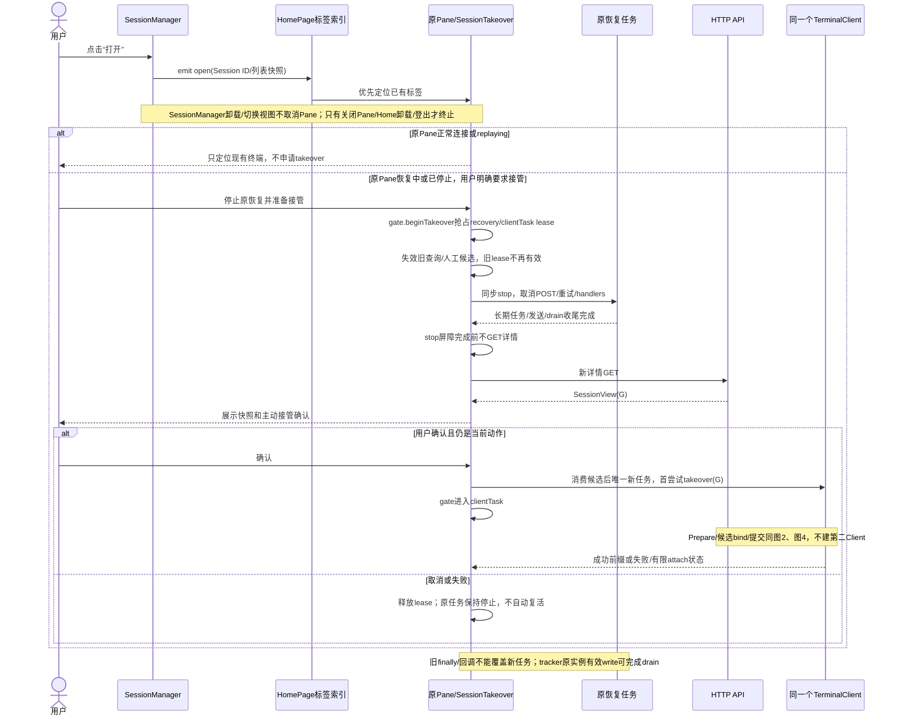

### 8.5 时序图 3A：SessionManager 卸载但 Pane 继续接管

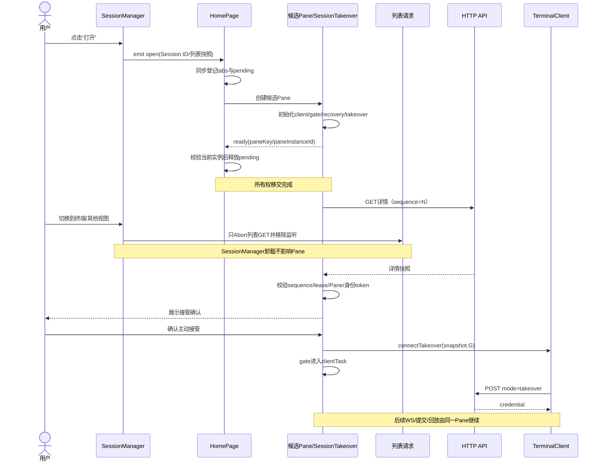

### 8.6 时序图 3B：详情查询取消与迟到回调隔离

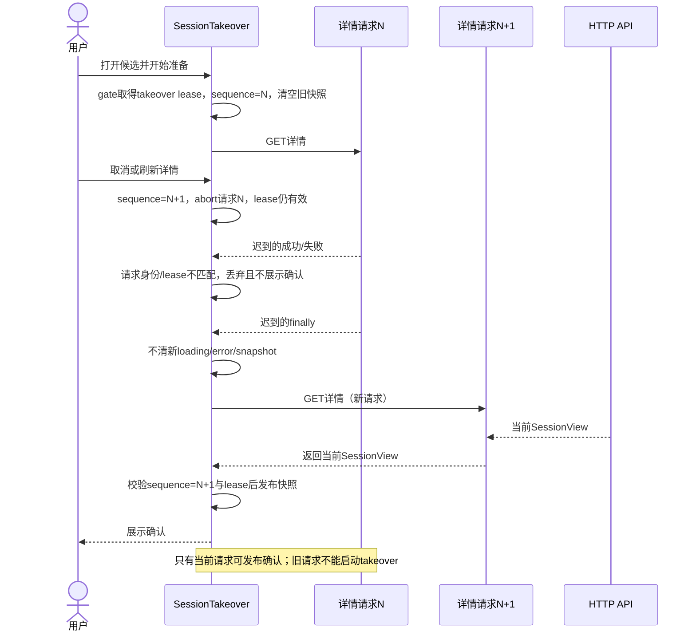

## 9. Binding 提交、终止与资源生命周期

### 9.1 时序图 4：提交、旧 Writer 准入与原因确定

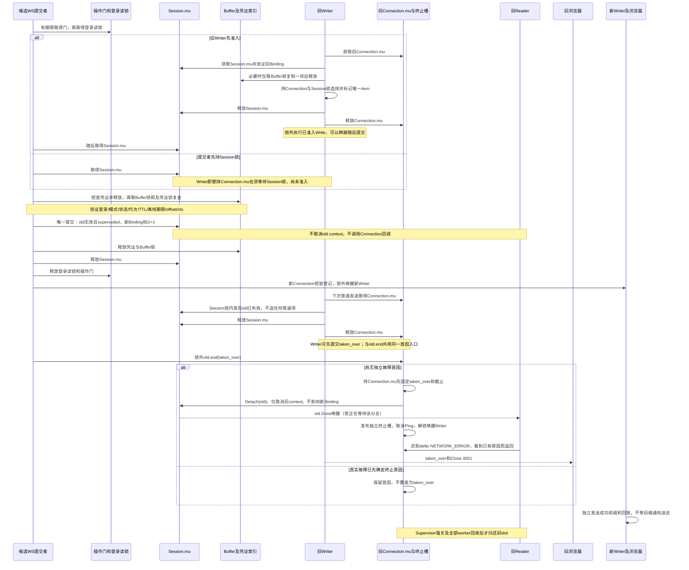

旧Reader、旧Writer与浏览器是三个独立参与者；§12.5图8补充浏览器本地停止和排空。若Writer先发现superseded，其锁外Terminate可先于old.end固定taken_over；后者幂等。真实read/write/Ping故障先固定首因则保留。提交先持Session锁的分支中，Writer不得在拿到锁后再发送普通消息。新Binding在登记前已失效时按§7.3/7.4收尾，不保证一定发成功前缀。

### 9.2 时序图 5：提交前失败，旧 Binding 保持

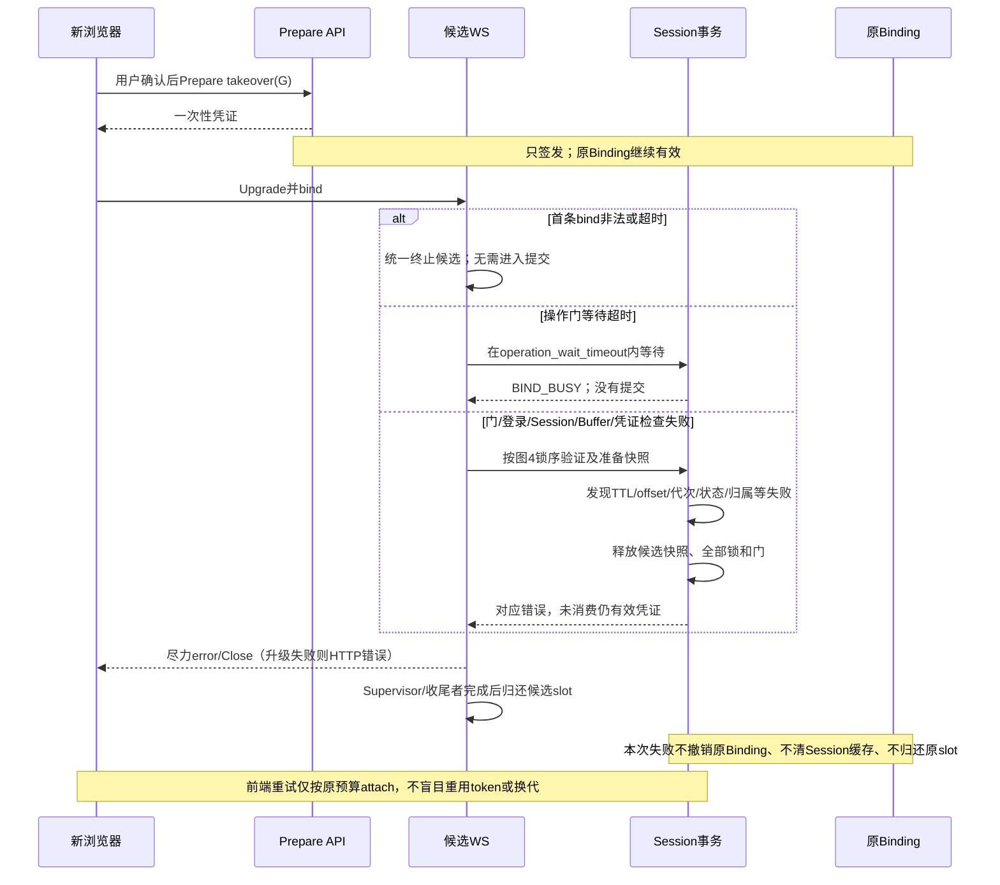

### 9.3 资源清单与提交后失败

| 资源 | 唯一释放者及边界 |
|---|---|
| 候选凭证 | Manager 提交消费/Session其他凭证失效、登录撤销、到期扫描或退出清理；前端 Abort 无远端撤销保证 |
| 候选快照 | 提交前失败即释放；成功交新 Writer；终止释放未发送数据，允许一次在途数据完成 |
| 旧 Binding | 提交点仅逻辑失效/superseded，不cancel；锁外统一终止先定原因再Detach取消，旧回调仅作用该对象，永不复活或改写新代次 |
| 新 Binding | 已提交但前缀写失败时只 Detach 新对象，若仍当前则 DISCONNECTED；不恢复旧端、不重建 SSH |
| WS/Reader/Writer/执行器/Ping/定时器 | 各连接统一终止；取消在途Ping；Supervisor不等调度锁或Close，绝对截止强关底层net.Conn |
| WS slot | Service 的连接收尾者等待 workers、Supervisor 全部完成后一次归还；Close发起、taken_over送达、Session移除均不能提前归还 |
| SSH/PTY/Buffer、服务器名额 | 仍属于 Session；takeover不释放；只由既有Close/reap在相应生命周期释放 |
| Pane/client/tracker/listeners | Pane.stop保留实例；Pane.dispose同步封闭准入并有限排空后销毁；页面卸载捕获清理异常 |

即便 bind_success 写失败，服务端提交已经发生，凭证已消费、generation已递增。若前端未收到该代次，原代次 attach 最终冲突停止；若已经收到并校验 bind_success，后续恢复可用刚获知代次。两种情形均不能通过查询偷偷换代。新成功不依赖旧通知送达；旧连接始终按自己的关闭预算收尾。

当 max_connections=1 且旧端占用时，新候选不能升级，因此无法直接在线接管；这是冻结的全局容量行为，不能提前释放旧 slot 绕过。实际接管测试至少预留一个候选 slot，并另测容量不足失败保持旧端。

## 10. 并发场景处理表

表中 G 为双方取得凭证时的同一 expected_generation。“失败码”描述可观察到的合法服务端结果，不保证首个被检测条件或通知送达。候选均由各自 WS 统一终止/收尾者释放；旧 Binding 物理清理可晚于逻辑失效。所有重试均不能重放输入。

| 编号 / 竞争双方 | 串行化和锁保护范围 | 双方先后、结果与失败方状态 | 资源、重试及逻辑/物理状态 |
|---|---|---|---|
| C01 两个 takeover | 各 Prepare 可同代次签发；提交共用操作门→登录读锁→Session→Buffer→凭证索引 | 第一个有效提交得到 G+1；另一个发现凭证已失效为 INVALID_CREDENTIAL，或代次变化为 BIND_CONFLICT。不能断言只一种错误。同 token 也最多一个成功 | 败者释放快照/候选slot，不撤销赢家。INVALID_CREDENTIAL仅明确code时允许原预算新attach，原代次遇冲突停止；不自动新takeover。旧/败者物理连接可正在关闭。不同代次、用户重新确认后的顺序接管不受“同代次仅一个”断言禁止 |
| C02 takeover 与 attach | Prepare/提交共用状态与凭证检查，提交共用门；mode来自凭证 | CONNECTED同代次attach在Prepare即BIND_BUSY；DISCONNECTED时两者均可候选，先提交者胜，后者同C01。attach先绑定后，旧代次takeover不能无条件覆盖它 | 失败者独立收尾；attach有限原代次重试；旧端/失败端不能拿赢家代次；物理关闭窗口允许 |
| C03 takeover 与用户关闭 Session | Close先拿Session锁撤销权限，不等操作门；提交仍按全锁序 | Close先：Prepare/提交NOT_READY，索引移除后NOT_FOUND，凭证已失效也可能INVALID_CREDENTIAL。提交先：新Binding先成为当前，然后Close立即撤销新端；旧端不复活。DELETE始终幂等 | Session reaper释放SSH/缓存/服务器名额，各WS独立收尾；不自动重建或接管已关闭会话；关闭通知可能丢失，列表/详情确认；CLOSING与物理资源可并存 |
| C04 takeover 与 SSH退出/故障 | monitor/读取/操作超时调用同一Close；Session锁裁决，首个关闭原因获胜 | SSH退出先同C03拒绝；提交先可短暂CONNECTED，随即ssh_exit/ssh_error关闭；不能把网络通知成功当SSH仍健康 | Session reaper负责SSH；新旧WS分别释放；NOT_READY/FOUND停止并诊断；不可回滚或自动创建新SSH；物理关闭可滞后 |
| C05 takeover 与离线自动关闭 | Sweep在Session锁内复查DISCONNECTED、无Binding、期限；提交重新检查当前期限 | 截止前提交先清期限，旧扫描不能关闭；到期后即便Sweep尚未运行也NOT_READY；Sweep先进入CLOSING则拒绝。不能通过过期前签发延长期限 | 到期由Session reaper释放；候选自行收尾；不得自动重试延长保留；列表可短暂显示过时剩余时间，提交才权威 |
| C06 takeover 与管理员登出 | 同一次登录的写锁撤销，与提交/Prepare登录读锁互斥；写锁释放后扫描凭证/Binding/所有WS | 撤销/冻结先则AUTH_REQUIRED或因凭证清除而失败；提交先则新绑定被撤销扫描找到并Detach。旧端与新端不同登录时，只撤销被登出的登录；旧端登出不能拆掉另一次登录的新Binding | 只关闭该登录浏览器通道，不直接Close SSH。已签发凭证失效；不自动恢复退出任务。不同登录的新端可能继续CONNECTED；同登录新端转离线，物理连接待回收 |
| C07 Upgrade成功但首bind失败 | Service登记slot；Reader首bind期限/格式/大小校验；进入事务后仍有完整复查 | 非法首消息/超时/非法偏移/过期/归属错给对应INVALID_MESSAGE/BIND_TIMEOUT/INVALID_OFFSET/INVALID_CREDENTIAL/PERMISSION_DENIED等；全部提交前失败不替换旧端 | 候选快照如已产生则释放；Supervisor/收尾者回收slot。协议明确可重试错误才原预算attach，其他停止；旧逻辑Binding保持，候选物理清理 |
| C08 新候选校验前旧输入在途 | 旧Execute与提交用同一操作门；准入持登录读锁/Session锁，网络在这些短锁外执行但保留门 | 旧输入先准入：唯一SSH调用结束后候选才可提交；门等待超时BIND_BUSY且旧端保持；SSH操作超时关闭Session。候选先提交：旧排队输入/resize再准入失败，以内部superseded处置进入taken_over，不误先发BIND_CONFLICT | 不撤回已准入效果、不补发未执行输入；执行器清理待执行槽，WS回收仍等执行器；短时物理共存但无双逻辑操作权 |
| C09 旧Reader阻塞（含半帧头） | 提交不等待Reader；旧端逻辑失效在Session锁；终止短锁/绝对期限Supervisor独立 | 新端可成功；提交不cancel旧context，Terminate先定原因再取消，Done退出不误抢NETWORK_ERROR。taken_over可能发出但不能依赖其读取/Close回应；期限到raw.Close解除阻塞 | 旧reader/writer/executor/supervisor退出后归还slot；SSH持续读取；被接管端不自动抢回，物理旧端可滞留至预算 |
| C10 旧Writer阻塞/Close握手阻塞 | 提交不持网络锁、不等旧写；短发送准入与失效同步；Supervisor独立 | 按§7.4双锁临界区已准入的一次旧Write可结束；提交先完成则普通输出/status零新准入；终止通知可能写失败，不能回滚新端；CloseNow不能抢断已开始Close | 取消Ping、共用close_timeout并在到期raw.Close；收尾后归还slot，不能用“通知未发出”保留权限；新端恢复按自身预算 |
| C11 旧端正在输出排空 | 服务端单Writer快照/实时调度；客户端单tracker/epoch；终止不进入SSH输出锁等待浏览器 | 提交撤销旧业务准入，旧Writer至多完成在途消息后终止；旧浏览器收到taken_over/4001保留有限已接受队列排空。若原本已停恢复/排空，新意图须等待stop完成 | 服务端释放旧快照余量，不清Session Buffer；客户端write_drain_timeout到则按tracker规则重建或dispose，不联网；新端不等旧排空；物理/画面收尾可滞后 |
| C12 提交成功但bind_success写失败 | Session提交已完成，Writer网络写在锁外；新端Terminate仅按新Binding身份Detach | 新端若仍当前转DISCONNECTED，generation保持G+1；若又被下一次合法接管则旧新端Detach不能影响更后Binding；原端不复活 | 凭证已消费；新WS资源正常收尾；未收到新代次的客户端用G attach冲突停止，收到G+1的可有限attach；通知和逻辑状态暂不同 |
| C13 旧Detach、WS Close、输出/执行器清理迟到 | Session锁检查对象身份/active/不可变代次；客户端task/socket/epoch隔离 | 旧Detach只失效旧对象，不清新Binding/期限；旧WS Close是浏览器通道关闭，不是Session.Close。旧输出回调不更新新实例；旧执行器不能用当前Binding替换自身身份 | 只释放所属资源一次；不触发新恢复/通知覆盖。显式DELETE与真实SSH故障Close仍合法，不能把它们当“旧回调”忽略；物理旧连接可正在回收 |
| C14 多浏览器/设备同时操作 | 后端登录归属、Session门/状态锁/凭证索引为权威；各页面仅本地去重 | 列表/详情可看同一G；同代次仅一提交，其他按C01。任一登录可明确关闭同一Session；独立登录登出只影响自身Binding | 失败端不自动查询换代抢回；可刷新后再次用户确认。跨浏览器不依赖消息总线/本地存储锁，允许物理连接暂存；共享Cookie的浏览器页面受同一次登录撤销 |

补充应用退出：沿用停止接入标志与绝对 shutdown_timeout；Prepare/提交遇 SERVER_SHUTTING_DOWN 不发布，已提交资源统一关闭；未绑定 WS 也登记回收，前端仍只按原预算有限 attach。执行器已准入的 SSH 调用、元数据最终写和 WS 监督任务各自按既有边界完成，不能因第五阶段增加第二套关闭期限。

## 11. 跨标签、跨浏览器和跨设备协调

### 11.1 所有权不变量

- 一个 HomePage 生命周期内，同一 Session ID 至多一个 Pane、一个 TerminalClient、一个 tracker、一个 SessionRecovery、一个 SessionTakeover、一个 PaneOperationGate、一个有效长期任务；`pending`（已预占未 ready/failed）和 `closing`（已关闭未完成 dispose）也参与去重。
- `paneKey`/`paneInstanceId` 标识本地 Pane 实例；Session ID 是稳定业务标识；Binding 由服务端提交产生，与本地组件寿命不同。列表项不是 Pane，删除列表项不能直接卸载/关闭终端。
- SessionManager 只发出打开事件；HomePage 只做 Session ID 唯一登记、候选 Pane 创建/定位和页面生命周期，不持有详情/确认候选；候选 Pane 只有在匹配当前实例的 `ready` 到达后才完成所有权移交。
- HomePage 只调用 Pane 暴露的定位、invalidate、stop/dispose 和关闭确认入口；主动接管的 prepare/confirm 由 Pane 内 SessionTakeover 接收用户操作，实际详情 GET、确认、fetch/WS/重试由 Pane 的唯一 SessionTakeover/TerminalClient 执行。
- HomePage 可以读取 Pane 暴露的粗粒度阶段（在线、replaying、恢复中、已停止、失败、关闭中）以决定定位还是提示用户停止恢复，但不能读取或缓存详情快照、确认候选或 generation 候选。
- 同一 Pane 内所有用户操作共享 `PaneOperationGate`；SessionRecovery 的三个入口和 SessionTakeover 的准备/确认都必须经过门禁，不能只靠隐藏 UI 按钮。
- Pane 初始化、详情、确认、连接启动和迟到回调都必须校验页面 token、Pane 实例和登录身份 token；`identity.value !== null` 不是充分条件。
- SessionManager 卸载、管理页切换、列表刷新或隐藏不是所有权终止；只有候选 Pane 关闭/dispose、HomePage 卸载、登出或登录身份失效才终止已移交的主动接管流程。
- 切换服务器、列表和终端时保留 Pane，通过 active/可见性控制 fit/焦点。隐藏组件不能以零尺寸覆盖 PTY，后台恢复不能抢焦点。
- 浏览器顶层网页标签/窗口属于不同 HomePage，不能靠本页 Map 检测它们。它们与另一浏览器/设备一样由后端 Binding/generation 协调；不承诺全浏览器进程只有一个视图，不新增跨窗口选主或持久化标签恢复。浏览器刷新后通过列表发现，再由用户明确打开。

### 11.2 五类场景（D2=A、D3=A，用户已确认）

| 场景 | 已确认交互与所有权 | 失败、取消及迟到结果 |
|---|---|---|
| A 当前页没有该Session的终端标签 | SessionManager只emit打开；HomePage同步预占Session ID并创建不自动连接的候选Pane；候选Pane初始化完成、绑定SessionTakeover并发出匹配ready后，Pane拥有详情/确认/取消/takeover；成功前缀后同一Pane变正常标签并聚焦；连续点击定位同一候选 | SessionManager卸载不取消Pane；不以成功回调再push第二标签；失败保留候选Pane及原因并支持同标签重试；取消前无WS；关闭候选标签真实dispose后迟到结果无效 |
| B 已有正常连接或replaying Pane | 列表“打开”只定位该标签，不创建候选Pane、不从列表直接自我接管、不停止它、不申请凭证；replaying虽未开输入门禁但已建立连接，同样只定位。若用户之后显式停止该终端，它按D进入主动流程 | 不存在同页两个Client或候选WS；取消定位不改变连接；SessionManager卸载不影响该Pane。若其他设备接管，原Pane自行收到终止/代次冲突；列表不能恢复旧任务 |
| C 已有Pane正在自动恢复 | 定位原Pane，提供明确“停止恢复并准备接管”；由Pane内SessionTakeover在首次await前封闭旧查询/候选/重复动作，调用stop；等待旧task、发送、drain完成后GET新详情，再单独确认takeover；复用同一Client/tracker | 从点击停止准备起旧任务不再自动恢复；详情失败/取消确认不复活旧任务；SessionManager卸载不影响。主动任务可按既有协议自动attach有限重试；其最终失败后原Pane停止，用户可重新详情确认takeover，或走第四阶段两步人工attach。旧finally/handler不能覆盖新任务 |
| D 已有停止/被接管/已结束Pane | 停止或taken_over保留的Pane可以显式新详情→确认接管，优先复用原实例及其processedOffset。close已证实或SESSION_NOT_FOUND的Pane仅显示结果/关闭标签，不复活 | 必须先刷新状态；列表快照不能替代。CLOSING/CONNECTING禁用；真正closed不会重用Session ID，不能因列表迟到行清除ended。disposed Pane不可复用，必须等移除完成后方可按A处理一个仍活动的Session |
| E 旧浏览器仍打开终端 | 在线则接收taken_over/4001，立即禁止输入/自动恢复并有限排空；断网/休眠导致通知丢失时，恢复网络仅原代次attach，冲突停止 | 离线/休眠期间不假设已收到通知。即使INVALID_CREDENTIAL先出现，也仅原代次有限attach，不能取最新代次抢回。页面彻底关闭则无本地任务，后端旧通道按心跳/关闭期限回收 |

B按已确认D2=A执行“定位”，不触发无提示attach或自我接管；用户之后明确停止再按既定流程准备主动接管。未采用在线直接主动重连的B方案。

方案 B 的共同所有权规则：SessionManager 卸载、管理页切换或重新挂载只取消列表 GET；候选 Pane 只有匹配当前 `paneKey`/`paneInstanceId` 的 `ready` 到达后才完成所有权移交，后续详情、确认、取消和 takeover 均由该 Pane 负责，不因列表组件生命周期变化而取消。唯一性由 HomePage 的 `tabs`、`panes`、`pending`、`closing` 共同保证；`pending` 从同步预占开始到匹配的 `ready`/`failed` 到达，`closing` 从关闭开始到真实 `dispose()` settle。

#### 11.2.1 连接阶段分类与 `replaying` 的 D2 归属

| Pane 阶段 | 判定依据 | D2 列表打开行为 | 允许的显式操作 |
|---|---|---|---|
| 未建立 Binding / 正在恢复 | 尚无合法 `bind_success`，Client 长期任务运行于 preparing/connecting/retry_wait 等阶段 | 定位原 Pane，提示“停止恢复并准备接管” | 用户显式停止恢复、完整 stop 后详情/确认 takeover；不得并行 refresh/recover |
| `replaying` | 已收到合法 `bind_success` 且首次前缀完成，`output.inputEnabled=false` | **只定位原 Pane，不启动 takeover、不创建第二 Pane** | 等待 replay 完成；用户显式停止终端后才进入停止态流程 |
| 正常连接 | 已收到合法 `bind_success`，输入门禁已开 | 只定位原 Pane | 不主动 takeover；用户显式停止后按停止态处理 |
| 已停止 / 不可恢复 | Client 无运行任务，phase 为 stopped/ended/taken_over 等 | 定位原 Pane，允许用户重新刷新详情 | 显式详情→确认 takeover，或按第四阶段两步人工 attach；真正 ended 不复活 |
| closing / terminating | Pane 正在关闭或页面失效 | 不创建、不操作，只显示关闭中 | 无 |

`replaying` 是“已经建立连接、只是输入门禁尚未打开”，不是“尚未建立 Binding 的恢复中”。列表打开不得因 replay 未完成而停止任务或发起 takeover；同一 Session 仍只有一个 Pane/Client。

### 11.3 同一目标的关闭与新动作

页面为每个 Session 的接管、人工恢复、明确关闭和标签 dispose 设置共同的同步意图边界。关闭 SSH 确认前不停止旧端；确认后关闭意图先把 Pane 门禁置为 `terminating`，优先取消正在准备/进行的接管，调用 stop 并发出 DELETE，不等待本地排空。重复 takeover 不能绕过关闭意图；重复 DELETE 可在前次结果后幂等重试。关闭标签则取消本地所有者并等待真实 dispose，不调用 DELETE。

列表更新、详情读取、onMounted、ononline、visibilitychange 均不获得用户操作身份。打开事件只创建或定位 Pane；候选 Pane 初始化并发出匹配的 `ready` 后，由 Pane 内的 SessionTakeover 持有详情和确认候选，HomePage 不接收、不转交“已确认候选”。只有 Pane 内的明确确认按钮才创建初始 takeover 任务；SessionManager 卸载或视图切换不取消该任务，也不提供全局可随意改 mode 的恢复状态。

## 12. 关闭、登出、页面退出与任务取消

### 12.1 页面切换、关闭和所有权归属（D3=A、S6 方案 B）

方案 B 以“候选 Pane 初始化完成、SessionTakeover 已绑定且匹配当前实例的 `ready` 已到达”为所有权移交点，不以用户确认或离开管理页为边界：

- SessionManager 点击“打开”只发出事件；HomePage 同步预检 `tabs/panes/pending/closing`、预占 Session ID、生成 `paneKey` 并创建候选 Pane。
- 候选 Pane 初始化完成、SessionTakeover 归属于该 Pane 并发出匹配 `ready` 后，主动接管流程所有权移交完成；此后 Pane 负责门禁、停止旧任务、详情 GET、确认/取消和 `connectTakeover()`，HomePage 只保留登记、定位和生命周期职责。
- SessionManager 卸载、管理页切换到终端/服务器、列表刷新或隐藏只取消列表 GET；不取消已移交 Pane 的详情、确认或 takeover，不停止 Pane，不复活旧 RecoveryTask。
- 所有权终止事件只有：候选 Pane 关闭/dispose、HomePage 卸载、用户登出、登录身份失效。终止时由 Pane 先把门禁置为 `terminating`，再 invalidate SessionTakeover、abort 详情 GET、阻止迟到回调，并按既有 TerminalClient 生命周期 stop/dispose；stop 完成前不得为同一 Pane 启动新任务。
- 用户取消只取消 Pane 当前确认候选；旧 RecoveryTask 保持停止，不自动恢复。关闭候选标签会取消详情/确认并 dispose，不调用 Session DELETE。

因此“takeover HTTP 已发出后关闭管理视图”不再有三种所有权分支：关闭管理视图不影响已移交 Pane，Pane 的详情/确认/takeover 继续；只有关闭对应终端标签、离开整个 HomePage、登出或身份失效才 stop/dispose。交互式关闭的 `closing` 必须等到该 `paneKey` 的 `dispose()` Promise settle；模板 ref 变 null、`nextTick()` 完成或从 `tabs` 删除都不构成完成信号。HomePage 卸载无法同步等待浏览器销毁，只能设置页面失效并尽力异步清理；新 HomePage 有独立页面 token，旧页面迟到回调不能操作新页面，跨页面连接仍由服务端 Binding/generation 仲裁。

用户关闭网页时无法保证异步 drain 或网络 Close 握手实际完成，不依赖 beforeunload 发送 DELETE；服务端靠现有断线/心跳/Supervisor 回收 Binding 与 WS，SSH 继续离线保留。已提交后即刻关闭网页只 Detach 新端，不恢复旧端；尚未提交的候选关闭不撤销其他旧 Binding。

#### 12.1.1 时序图 5A：Pane 关闭、HomePage 卸载与身份失效清理

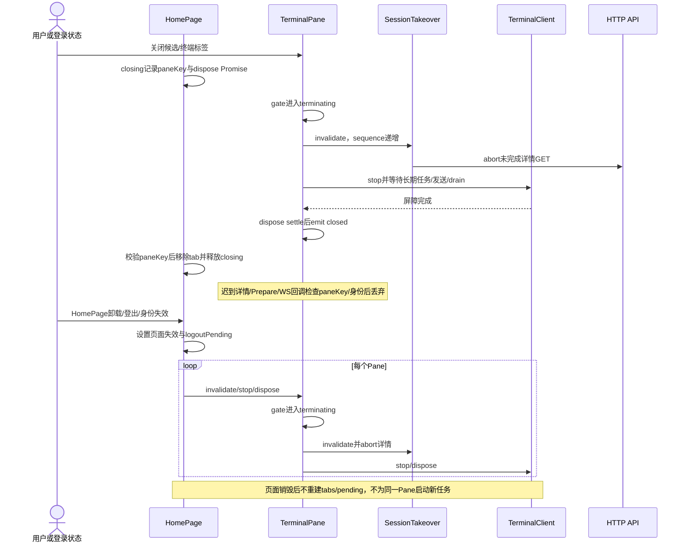

### 12.2 登出顺序和迟到响应

沿用第四阶段计划 §11/13 与实际 auth store：HomePage 首次 await 前设置 logoutPending，使页面 token 和登录身份 token 失效，先对每个 Pane 的门禁置 terminating，再取消列表/详情/确认、待挂载任务和凭证请求、停止全部 Pane。这是页面所有权终止，不是 SessionManager 卸载；SessionManager 卸载仍只取消列表 GET。logout HTTP 与本地排空并行，不等 drain 后才请求撤销。

Prepare成功但候选未提交时登出：浏览器Abort/stop防止继续发布；服务端登录写锁先使本登录无效，锁外清凭证和所属全部WS。候选如果已提交则扫描Detach它；如果来自另一独立登录的旧Binding尚有效，登出候选登录不能误撤销旧端。过期同样使用当前登录归属检查。

每个 await 返回、JSON 解析后、onopen、onmessage、重试 timer、布局 nextTick 及 finally 都检查本地动作、lease、任务、Pane 实例、页面 token 和身份 token。身份代次在 `acceptIdentity` 接受新对象、`clearIdentity`、登出和过期时推进；同一管理员重新登录也是新代次。退出后凭证或成功前缀迟到不能创建 WS、改代次、复活标签、覆盖“退出未完成”。老任务的 xterm 回调只有原 epoch 仍有效时可完成 drain，不操作新实例。

| logout结果 | 继承的处理 |
|---|---|
| 200 | 确认持久化撤销，清身份，销毁页面任务后进入登录页；不发Session DELETE |
| STORAGE_ERROR 确定回滚 | 保留Cookie/身份和logoutPending，提示退出未完成、允许重试；已停任务不自动恢复 |
| SERVER_UNAVAILABLE 提交不确定 | 服务端冻结本登录并撤销所属通道/凭证，Cookie仅供logout重试；前端保持退出意图，不假装成功 |
| 网络/响应丢失 | 结果未知，保持退出意图，幂等重试logout；不新登录覆盖Cookie |
| AUTH_REQUIRED 与退出竞争 | 保留未完成退出含义；无退出意图时才走普通过期清理 |

接管成功后旧端终止通知/Close迟到：服务端仅旧对象Detach；前端同一Pane已移除旧handler，闭包仍检查task/socket；不同浏览器的旧Pane只显示自身停止原因。不能用旧端的closed/taken_over更新新Pane为已结束。

### 12.3 时序图 6：takeover 与 Session 关闭

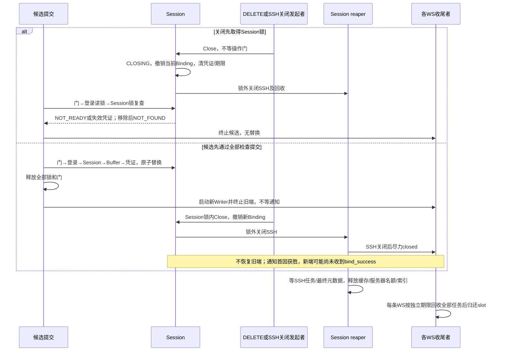

### 12.4 时序图 7：takeover 与登出

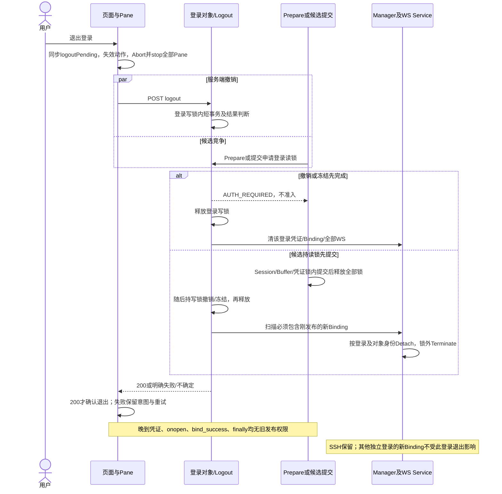

确定回滚时登录不被服务端撤销，图中“撤销或冻结”分支不发生；前端仍按第四阶段规则保持停止和未完成退出，不能自动重启。图中的并发竞争以同一个WebAuthSession为对象。

### 12.5 时序图 8：旧 WebSocket 收到 taken_over 后停止

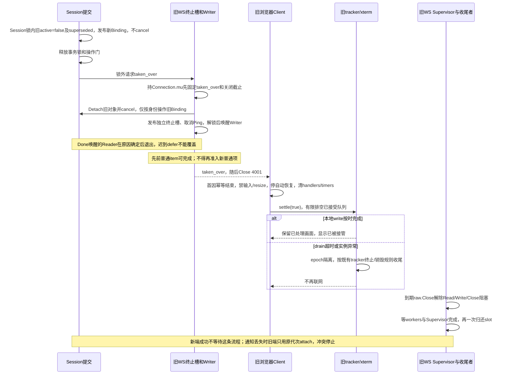

## 13. 与第四阶段兼容性清单

| 既有能力 | 第五阶段不可改变的结果与验证 |
|---|---|
| 自动恢复 | 永远attach；初始takeover后自动尝试也只attach。列表/详情/online/visibilitychange不产生takeover |
| 两步人工恢复 | 原Pane“刷新Session状态→再次点击手动恢复”保持attach；不能由列表刷新生成candidate，诊断GET也不能生成 |
| 代次 | 初始用户动作可采用明确详情候选G；自动仅bind_success更新，且必须G+1；冲突停止，不查询换代 |
| 连接结果 | 首次连接 Promise 只在完整前缀后成功；长期 completion 独立继续；停止、失败和长期完成不混写为同一状态 |
| 偏移/回放 | processedOffset只由当前实例连续write callback推进；新实例从0；同实例drain后读取；S>P时唯一截断前缀重建；每WS一次稳定快照 |
| 重试预算 | 原max/delay/stable_time、稳定资格一次消费、全部错误集合不变；不因接管/列表刷新/成功前缀重复重置 |
| taken_over/4001 | 停输入和自动恢复；裸4001显示接管关闭含义但不伪造已收到业务消息；旧端不能自动抢回 |
| OUTPUT_GAP/4002 | 仍丢未提交队列、等在途write后有限恢复；不与4001混淆，不增加invalid_bind或retryable字段 |
| INPUT_BACKPRESSURE | 停止，不重放输入；普通输入/粘贴/历史查询自动应答继续按回放门禁 |
| UI状态修复 | 当前连接提示与历史异常分离；新有效前缀清当前旧错误；旧事件不污染新任务；网络online仅展示；不因新增列表改回旧提示行为 |
| stop/dispose | stop可保留实例；dispose不可逆，销毁中不建替代实例；后续新任务必须等待旧任务和发送/drain完成 |
| 超时 | 凭证POST仅credential_timeout；详情GET无本地定时器；WS前缀等待仍bind_timeout+operation_wait_timeout+write_timeout；不修改配置和默认值 |
| 独立操作 | 关闭标签仅dispose；DELETE需确认且不等于立即CLOSED；takeover复用SSH，三种操作不混用 |

第一次takeover失败并进入有限attach后，不能因目标仍CONNECTED而反复takeover。第一次已提交但未收到成功前缀则可能很快BIND_CONFLICT；这正是停止并交由用户确认的安全边界，不“修复”为自动采用新代次。

## 14. 安全、日志和边界检查

1. 列表/详情只经当前认证查询；写API和Upgrade严格Origin；不因同一管理员放宽凭证所属独立登录、目标Session、mode或TTL校验。
2. 凭证仅HTTP响应至内存、首条bind；不进入URL、浏览器持久存储、列表、诊断、日志。候选失败不新增撤销接口，不延长TTL。响应/日志禁止密码、密文、nonce、主密钥、Cookie、登录令牌/哈希、完整Host Key与终端输入输出。
3. 全局WS容量包括旧、新、候选、升级中和关闭中；凭证容量原子检查，不淘汰仍有效凭证。无无限候选队列、无后台takeover重试服务。
4. 跨设备只使用Session ID与快照目标，不展示未经服务端定义的设备身份/IP/“我拥有此Binding”。Session名称与目标采用Vue文本插值，不把SSH输出或名称作为HTML。
5. 错误按code分类；同代次失败允许BIND_CONFLICT或INVALID_CREDENTIAL；原生浏览器Upgrade失败只能看到通用网络事件时不伪造HTTP业务码。HTTP BIND_BUSY不等于凭证已消费，DELETE响应丢失也不等于Session仍活着。
6. 新增接管日志仅记录Session ID、旧/新generation、操作种类/安全原因、失败阶段与回收是否完成，不记录凭证或终端内容。普通WS失败不是SSH关闭原因。
7. 代次/偏移安全整数溢出沿用counter_exhausted关闭；处理在退出当前同步边界后发起，不持Buffer/凭证锁反向调用Close。
8. 不改SSH Host Key、Cookie、数据库与部署安全模型。任何验收用秘密只在隔离环境注入，截图/日志脱敏。

## 15. 详细实施顺序与审查单元

本节全部是未来编码授权后的步骤。步骤可以分别审查，但在服务端提交、旧端终止与前端停止流程完整前，不把中间补丁部署给用户。特别是S2直接改变Prepare行为后，必须连同S3完成并验证，不能把尚缺taken_over发送的中间状态当可交付版本。

共同前置：重新检查当前分支/HEAD、工作区/暂存区，确认包含第四阶段与UI修复。分支按总体阶段§1.1及届时用户授权处理；本轮不fetch、不切分支。保存每一步开始时受影响文件的补丁/内容基线，暂存与未暂存分别辨认。回滚仅逐文件/逐hunk撤销本步骤未提交增量，保护前序成果和用户同文件修改；新增文件只有确认仅为本步骤所有且无后续引用才移除。禁止reset --hard、clean或整文件覆盖用户内容。难以安全分离时保留并报告。

| 步骤 | 依赖、修改文件与新增文件 | 实现职责 | 本步测试与通过标准 | 本步失败回滚 |
|---|---|---|---|---|
| S0 基线与裁决登记 | 依赖人工审查及编码授权；只读所有接入点/既有测试；本步不改业务文件；复核本计划§21已有D1–D3=A裁决、S6方案B裁决与第二轮复审结果 | 核对第四阶段基线、D1–D3和S6方案B所有权规则，确认后续新增文件职责；识别已有用户补丁 | 不把历史测试算新结果；基线命令成功或明确列出已有失败；锁序/任务所有者能对应到代码 | 无业务修改可回滚；若计划登记有误仅撤销本次登记，不改冻结文档 |
| S1 活动列表后端 | 依赖S0；修改`backend/internal/session/session.go`、`backend/internal/httpapi/sessions.go`、`backend/internal/httpapi/sessions_test.go`；新增`backend/internal/session/list_test.go` | Manager.List、具名列表响应、严格server_id query、CLOSED过滤、稳定排序、安全View；现有Get/DELETE不变 | U01–U04；HTTP认证、空数组、过滤/排序/字段；并发关闭/接管快照测试可先用已有attach验证，S3补takeover；每行一致，无DB活动查询/锁嵌套 | 撤销List及GET路由与专属测试增量，只移除本步独占list_test.go；保留原详情/DELETE |
| S2 凭证mode与原子替换事务 | 依赖S0/S1；修改`backend/internal/session/binding.go`、`backend/internal/session/session_test.go`；新增`backend/internal/session/takeover_test.go`；如内部提交结果签名变化，最小同步修改`backend/internal/websocket/connection.go`调用适配 | 存mode，共用准入，扩展同一提交点，交出被替换Binding收尾责任；锁外通知接口，不复制一套Attach；更新既有拒绝takeover的范围断言 | U05–U09、R01–R05；同代次单赢家、提交前旧有效、提交后不回滚、操作门/关闭/登录/TTL竞争；race通过。直调回调测试不代替真实WS | 按本步基线成组撤销mode、准入、提交结果及调用适配；恢复原attach-only范围断言，保留S1；本步不单独部署 |
| S3 WebSocket终止及交接 | 依赖S2；修改`backend/internal/websocket/connection.go`、`protocol.go`、`connection_test.go`、`backend/internal/httpapi/sessions_test.go`；新增`backend/internal/websocket/takeover_test.go` | taken_over具名DTO/4001、先定原因再取消、失效退出分流、Writer双锁原子准入、提交登记窗口、slot与Supervisor复用 | W01–W06、R06–R08、T1–T4；真实HTTP/WS/SSH验证新旧端消息和操作；Reader/Writer堵塞不阻挡新端、旧slot不早还；失败允许合法首因 | 先撤销本步WS/HTTP测试及实现hunk；若放弃整个接管后端，还须逆序撤销S2，不能保留缺发送链路的公开takeover能力；S1保持 |
| S4 列表前端及异步查询 | 依赖S1与D1；修改`frontend/src/api/sessions.ts`、`frontend/src/pages/HomePage.vue`；新增`frontend/src/session/list.ts`、`frontend/src/components/session/SessionManager.vue`、`frontend/tests/session-list.test.mjs`；仅在现有样式确实不足时增加最小范围 scoped CSS，优先复用 `base.css` 与 `.session-*` | 列表解析/单请求所有者/序号/Abort、服务器和本地状态筛选、独立管理视图、loading/error/empty；保持Pane挂载；接管按钮此步不开放未完成链路 | U10、F01–F03；乱序、旧finally、卸载/登出、可见刷新、失败保留快照；列表任何刷新无POST/WS；实际组件测试 | 撤销列表组件挂载/样式/API增量，移除仅本步文件；原服务器页/终端与后端列表保留，无依赖清单变化 |
| S5 Client初始takeover模式（已完成，冻结基线） | S5-C1/S5-C2 已完成并通过审查；`frontend/src/terminal/client.ts`、`frontend/tests/terminal.test.mjs`、`frontend/tests/stage-5-c2.test.mjs` 已存在，不在本轮或 S6 重新实现 | 已实现初始用户模式、后续固定attach、两种Promise、同一任务、预算、offset、stop屏障和generation规则；S6 只消费 | 作为 S6 前置回归基线；不把 S5 测试算作 S6 新结果，不要求 S6 再次修改 `client.ts` | 无 S6 回滚动作；若 S6 发现 S5 契约冲突，停止并报告，不得在 S6 内改 S5 |
| S6-C1 Pane所有权与安全纵切 | 依赖S4/S5完成、D2/D3及方案B；修改`frontend/src/components/terminal/TerminalPane.vue`、`frontend/src/terminal/recovery.ts`、`frontend/src/pages/HomePage.vue`、`frontend/src/components/session/SessionManager.vue`、`frontend/src/stores/auth.ts`、对应前端测试；新增`frontend/src/session/takeover.ts`、`frontend/tests/session-takeover.test.mjs` | SessionManager只emit打开；HomePage用tabs/panes/pending/closing与paneKey同步唯一登记；ready/failed握手；初始化失败与同标签重试；PaneOperationGate；SessionRecovery三个入口遵守门禁；D2完整stop/drain；详情/确认/取消；身份代次；Pane关闭/HomePage卸载/登出/身份失效的基础清理；closing等待真实dispose；确认前零Prepare/零WS；UI复用 | F05–F09、F12、S6-B01–B22、S6-B24–B33（含 B25 首次 UI 样式验收）、S6-B35、S6-B37；同Session一个Pane/Client；ready前不释放pending；门禁无并行详情/恢复；stop屏障前无详情；基础关闭/登出/身份失效可清理；两步人工attach原样通过 | 先撤销UI入口，再撤销Pane启动、ready/failed、门禁与所有权增量，移除本步专属控制器/测试；恢复原mounted attach，仅保留创建Session入口，S4列表仍可只读 |
| S6-C2 专项竞态与集成回归 | 依赖S6-C1；仅在测试证据表明缺陷时最小修改S6-C1文件及测试；不新增业务功能 | 重复点击/高并发、初始化失败与重试迟到、旧请求/旧finally/旧Pane迟到、多Session并行、SessionManager重挂载、stop/详情/确认/取消复杂交错、HomePage卸载与新页面竞争、浏览器集成、S4/S5回归、UI一致性复核 | F01–F04、F10–F13、S6-B18–B20的复杂交错、S6-B23、S6-B25、S6-B34、S6-B36、S6-B38、B01–B05；不能用C2补C1缺失的基本安全清理 | 撤销本步新增竞态测试或失败修复；不回退C1已完成的ready/failed、门禁、身份和dispose基础；不把C2失败当作C1可跳过 |
| S7 远端关闭、完整登出重做与列表反馈 | 依赖S6-C2；修改`frontend/src/pages/HomePage.vue`、`components/session/SessionManager.vue`、`components/terminal/TerminalPane.vue`、`session/{list,takeover}.ts`、`api/sessions.ts`及对应前端测试；必要时扩展`frontend/tests/auth.test.mjs`；无必需新增生产文件 | 远端关闭的完整交互、DELETE可取消等待与幂等重试、logoutPending完整失败/不确定重做、列表失效刷新；基本Pane清理已在C1，不在此重复实现；复用auth/router，不改认证协议 | F10–F13、S6-B23、S6-B25、B01–B05；DELETE/登出成功与失败/不确定、浏览器关闭与迟到响应；只关闭列表不误删SSH，退出后不联网 | 撤销本步退出/关闭/反馈增量；在功能恢复完整前保持新增入口禁用，不回退第四阶段既有logoutPending/stop语义；前序受依赖部分不单独发布 |
| S8 全集成、真实环境与报告 | 依赖S1–S7及环境授权；扩展上述测试；仅发现有证据缺陷时修改对应责任文件；获准后新增`doc/stage-5-implementation-report.md`，临时浏览器脚本/日志用`/tmp/codex/` | 全量Go/race/前端、真实WS/浏览器、Docker/NPM/SSH验收；记录环境/命令/失败修复/未验项；完成后停止 | §17–20所有门槛；无双有效Binding、无泄漏/旧端抢回、真实场景有证据，不能只靠单测 | 仅撤销本步独立失败修复/测试/报告增量，保留前序审查成果；集成失败不宣称完成、不部署中间补丁；外部环境回滚按事先获准部署方案 |

S0的编码基线检查仍留待获准实施；D1–D3已确认为A，S6所有权已按方案B细化，但本轮仅授权文档修订。所有“必要时修改”都以实际失败或接口适配证据为前提，不预先扩大代码范围。

## 16. 文件职责和最小改动控制

| 文件/模块 | 预期责任与明确边界 |
|---|---|
| `backend/internal/session/session.go` | List与现有生命周期快照；不建SQL列表或第二个Session索引 |
| `backend/internal/session/binding.go` | mode、唯一提交/失效与旧引用、superseded内部处置、持Session锁的狭窄发送准入接口；不发送JSON、不等WS关闭、不创建SSH |
| `backend/internal/websocket/{connection,protocol}.go` | taken_over消息、先定原因再取消的统一终止及内部退出适配、Writer双锁选项准入/提交交接；不拥有SSH生命周期、不提前减slot |
| `backend/internal/httpapi/sessions.go` | 新列表路由、具名响应/query校验；原Prepare请求形状不变 |
| `frontend/src/api/sessions.ts` | List DTO运行时校验、查询/关闭HTTP包装；不做UI所有权或绑定循环 |
| `frontend/src/session/list.ts`（建议新增） | 列表请求身份/Abort/快照状态；不拥有任何TerminalClient |
| `frontend/src/session/takeover.ts`（建议新增） | 候选Pane唯一主动接管所有者，并提供同文件的小型 `PaneOperationGate`：详情快照/确认候选/取消/sequence/Abort/lease；调用已有Client的stop/connectTakeover；绝不自建WS/重试循环，不建立全局队列 |
| `frontend/src/components/session/SessionManager.vue`（建议新增） | 列表展示、筛选、刷新、行“打开”事件；不查详情、不创建Pane、不持有确认、不取消已移交Pane；不在每行创建Client |
| `frontend/src/pages/HomePage.vue` | 同页唯一Session ID登记（tabs/panes/pending/closing/paneKey）、创建候选Pane、ready/failed匹配、定位、视图切换、页面停止/销毁；不持有详情/确认；列表行数据不能替换运行中Pane对象；交互式closing等待真实dispose |
| `frontend/src/components/terminal/TerminalPane.vue` | 唯一client/tracker/recovery/takeover/gate、显式`attach/candidate`启动、ready/failed握手、候选UI、焦点/尺寸/提示、真实dispose Promise；初始化失败后不允许迟到ready；stop/dispose先失效门禁和takeover |
| `frontend/src/terminal/client.ts` | S5 已冻结；S6 不修改，只调用`connect`/`connectTakeover`/`stop`/`completion`；保持初始mode、有限循环、Promise与socket所有权 |
| `frontend/src/terminal/recovery.ts` | 保持原两步attach候选；`refresh()`、`recover()`和诊断刷新全部先取Pane门禁lease；不拥有takeover详情/确认，不把主动takeover塞进recover默认路径；门禁拒绝时不发请求、不清状态 |
| `frontend/src/terminal/output.ts` | 预期无生产改动；只通过现有算法复用与回归验证；发现真实缺陷再说明最小修复 |
| `frontend/src/stores/auth.ts` | 只增加只读身份代次访问；在accept/clear/logout/expire时推进代次；不新建全局身份Store，不改登出成功边界 |
| router、config、migrations、go.mod、package锁文件 | 预期不改；既有能力足够。auth测试可扩展，不能借机改登出成功边界 |

新增控制器为可测试的小型页面所有者，不建立全局store、事件总线或任务队列。S6 方案 B 下，SessionManager 只发打开事件，HomePage 只做唯一登记、ready/failed匹配和 Pane 生命周期，候选 Pane 的 SessionTakeover 是主动接管唯一所有者，SessionRecovery 的所有入口都经过同一 Pane 门禁；不能同时保留“管理视图内确认”和“Pane 内确认”两套所有者。若S6实际能在现有Pane内保持职责清晰且完整测试，可裁减文件数量，但不能删掉ready/failed、门禁或真实dispose信号。生产注释继续中文，测试按真实职责命名。

### 16.1 S6 UI 复用实施约束与验收标准

S6 的 UI 必须沿用当前已经实现的页面样式。这是明确的实施约束，不是建议，也不是留给实现阶段自行选择的视觉方案。S6-C1/S6-C2 及 S7 的接管入口、候选状态、详情确认、错误提示和关闭交互必须优先复用：

- `frontend/src/components/layout/Modal.vue`：接管确认、关闭确认等弹窗沿用现有标题、关闭按钮、`dialog-header`、`icon-button` 和遮罩行为，不另写弹窗组件。
- `frontend/src/styles/base.css` 中现有设计令牌：`--page`、`--panel`、`--hover`、`--text`、`--secondary`、`--line`、`--strong`、`--on-strong`、`--red`、`--overlay`。
- 现有按钮、状态、提示和布局样式：`.primary`、`.danger`、`.notice`、`.muted`、`.error`、`.session-status`、`.session-manager`、`.terminal-tabs`、`.terminal-actions`。
- 现有按钮、状态标识、错误提示、加载/空态、表格/筛选器、标签和页面布局组件；不新增平行组件体系。

实施要求：

1. 不自行设计新的视觉风格，不引入新的颜色体系、按钮体系、弹窗体系或状态标识体系。
2. 不修改无关 CSS，不修改全局设计令牌的既有值，不把 S6 新状态做成独立主题。
3. 优先使用现有组件和 class；接管入口放在现有会话列表操作区，候选/接管状态沿用现有状态标识和提示样式。
4. 现有样式确实无法满足某个新增状态时，只允许增加最小范围的 scoped CSS，并保持与 `base.css` 的颜色、间距、边框、字号和交互一致。
5. 实施时不得因增加 takeover 流程导致管理页面、终端页面和现有弹窗的样式风格不一致。
6. 验收时必须检查实际渲染的组件/class/令牌复用，而不是只看功能是否可用；S6-B25 和 §20.2 的样式复用项必须同时通过。

## 17. 分层测试设计与实施门槛

本节是未来执行清单；本次没有运行或宣称第五阶段测试通过。已有第四阶段测试全部保留作为回归基线，历史数量不作为当前结果。

### 17.1 单元与模块测试

| ID | 实际被测对象与输入 | 必须断言 / 对应步骤 |
|---|---|---|
| U01 | Manager.List空索引、四活动态、CLOSED短窗口、SQLite残留活动行 | items空数组；CLOSED不返回；无SQLite复活；S1 |
| U02 | 同毫秒/不同创建时间、随机map插入、多server_id、合法未知ID | 创建时间/ID确定升序，过滤准确，目标快照不被服务器编辑覆盖；S1 |
| U03 | HTTP GET列表、匿名/过期登录、未知/重复/空/非法query | 信封/状态码/no-store/DTO与核心一致，无分页或状态参数；S1 |
| U04 | 列表字段/时间/剩余秒数、敏感字段探针 | 仅冻结字段，离线秒数向上取整非负，非离线null，无凭据/连接对象；S1 |
| U05 | Prepare attach/takeover × CONNECTED/DISCONNECTED/CONNECTING/CLOSING/到期 | attach占用仍忙，takeover仅两态，代次变化优先于同代次忙；HTTP Prepare不改旧active/代次/期限；S2 |
| U06 | 凭证mode、归属、目标、TTL、容量、相同token重复提交 | mode不可由bind篡改；只在提交消费，其他凭证失效；非法输入拒绝；S2 |
| U07 | P>E、快照复制后凭证过期/清除、登录到期、离线期限到达、ctx取消 | 失败释放快照，原Binding/generation保持；凭证仅在仍有效且无外部失效时可用；S2 |
| U08 | 直接提交后人工触发新端失败/旧Detach | 原Binding永不恢复；新端若当前则离线且代次不退；旧Detach不改新期限；S2 |
| U09 | generation/offset边界、元数据UPDATE失败 | 不回绕，既有counter_exhausted路径；元数据失败不恢复权限、不使列表回退；S2 |
| U10 | 实际列表控制器/DTO解析配合可控fetch | 序号+Abort+身份+finally保护，错误/空/加载独立；无POST/WS副作用；S4 |
| U11 | 实际TerminalClient/tracker配合可控fetch/WS/时钟 | 首尝试明确mode，后续一律attach；两Promise边界、原预算/稳定资格/偏移/401等不变；S5 |

### 17.2 并发与竞态测试

| ID | 受控交错 | 必须断言 |
|---|---|---|
| R01 | 多个不同凭证同G、同token并发；均在提交门前汇合 | 有条件允许提交时恰一赢家，generation只增一；失败码集合含INVALID_CREDENTIAL/BIND_CONFLICT，不能断言唯一冲突码 |
| R02 | takeover/attach在DISCONNECTED竞争；在线attach与takeover | 同代次不产生双有效Binding；attach不替换；串行新一轮不同G不误判为重复提交 |
| R03 | 旧SSH Write/resize准入后阻塞；候选等待门；旧排队项尚未准入 | 在途完成后才提交；等待超时不先撤销旧端；旧排队项零SSH效果；SSH自身超时按原关闭规则 |
| R04 | Close、SSH退出、Sweep与提交分别先后；快照准备后到期 | 两种先后均有效，CLOSING不回退/不重设期限；旧扫描不关闭新绑定；首关闭原因保持 |
| R05 | 同登录Prepare/提交与真实Logout；不同登录旧端退出/新端退出 | 撤销扫描不漏刚发布资源，不误删不同登录Binding；持久化回滚/不确定区分；SSH保留 |
| R06 | Commit返回后暂停Reader登记，触发Close、Revoke或又一次合法takeover | 即使Connection.binding尚空也收尾已提交Binding；旧引用通知责任不丢失；没有发布已失效的新操作权 |
| R07 | 按T3固定Writer已准入、提交已完成、双方同时竞争Session.mu三个交错；按T1交错Reader Done/defer、执行器失效退出与old.end | 准入时同时持Connection.mu/Session.mu，提交后零新增普通准入；只允许提交前唯一item完成；正常taken_over/4001，独立首因按T2保留；结合T4断言身份与资源 |
| R08 | 列表复制引用后关闭/移除/接管/新建；100轮接管/停止竞争 | 单行一致、无CLOSED行/重复ID/数据竞态；索引/slot/worker/定时器恢复基线，无全局锁阻塞其他Session |

Go必须运行 `go test -race ./...`；受控同步点用于固定交错，生产默认不安装。不要通过调低断言、只sleep或只断言无panic替代权限/完成信号验证。

### 17.2.1 第二轮专项 T1–T4：固定交错与实际证据

四项归入S2的内部准入/处置测试与S3的真实WS集成测试，S8统一回归，不改变S0–S8边界。建议扩展 `backend/internal/session/takeover_test.go`、`backend/internal/websocket/takeover_test.go` 及既有HTTP/WS夹具；本轮只设计测试，未新增测试源码或执行测试。

共用夹具：实际Session Manager、HTTP/1.1 Upgrade、固定coder/websocket、真实环回SSH及输入/resize调用计数。旧端A、新端B分别消费真实WS消息，记录type、普通二进制块、最终控制消息和Close code。同步hook只定位锁/任务交错，不替换真实Reader/Writer/Terminate；生产不安装。记录commit和send-admit事件序号、Binding指针/不可变代次/active、Session状态/期限、远端调用数、Connection.reason及workers/supervisor/done/slot。测试事件保存在有限测试记录中，不增加生产日志中的终端内容。

#### T1：Reader取消与takeover通知竞争

1. 建立A并完成bind/前缀消费，确认一个有效Binding及SSH输入可达。将A Reader固定到两个独立子场景：
   - **网络读取等待**：Reader已进入下一次readMessage；此处没有直接select Binding.Done。B提交后由统一终止、Writer Close及必要的raw.Close解除读取，检查随后defer的幂等结果。
   - **Binding.Done等待**：在不持Session操作门、Session锁或Connection锁的测试屏障暂缓旧执行器，填满容量1操作槽，让Reader持有下一条有界输入并已进入 `select operations / b.Done / c.ctx / timer`。不得阻塞一个已经持操作门的SSH调用后又要求takeover立即提交。
2. 发起B正常takeover，暂停在提交已完成、old.end尚未调用的位置（此子例同时在锁外屏障暂停旧Writer/执行器的失效处理，排除其他合法终止入口先行）：断言old.active=false/superseded、新Binding/G+1已发布，**old.Done尚未由本次提交关闭**，此时不能用提前cancel“制造”新的正常路径。释放该屏障后，在旧Terminate固定taken_over、尚未Detach取消且仍持c.mu的位置确认reason已确定。
3. 允许Detach取消，令Reader Done分支醒来、失效退出适配与defer尝试进入，同时old.end仍在c.mu内完成终止发布；解除全部屏障。重复捕获的迟到defer NETWORK_ERROR，必须仍为taken_over。
4. 追加合法迟到Detach子场景：提交后、old.end前，触发一个此前捕获旧Binding的Detach；Done分支通过§7.3.2内部失效退出适配请求taken_over，再执行defer。令适配与old.end同时竞争c.mu，两种获胜次序都固定相同taken_over，不能由普通NETWORK_ERROR或旧执行器BIND_CONFLICT抢先。
5. 至少100轮有界重复，穿插旧执行器恢复、Writer先发现superseded、正常old.end先到的调度；每轮清理后再下一轮。使用足够的测试配置期限和有限调度容差，不让测试屏障耗尽关闭预算再要求消息必达。

**严格断言：**无独立故障且旧客户端正常读取/响应关闭时，真实线上必须收到一次 `{"type":"taken_over","message":...}` 和Close **4001**，不存在替代它的error NETWORK_ERROR/BIND_CONFLICT，终止后无普通消息。旧未准入输入/resize远端执行次数为0；B输入执行一次、仍是当前Binding、generation不回退、状态CONNECTED/离线期限为空。旧Binding.Done最终关闭；旧worker/监督器全部完成后slot只归还一次，新slot保留；最终关闭B后资源回到基线。普通readMessage场景允许通过既有关闭机制解除，不错误断言cancel Binding本身会直接取消网络读取。

#### T2：旧连接真实网络故障先发生

1. A完成绑定后实际关闭/重置客户端TCP，使用完成信号确认服务端已经在c.mu内确定NETWORK_ERROR并按旧身份Detach；不能只凭客户端发起close推定服务端已经终止。
2. B对尚活动的同一Session发起takeover，读取实际代次并提交；SSH仍为同一个连接/Shell。额外子场景先完成B Prepare，令A真实故障确定首因后再提交B；以及B已捕获old并提交、但old.end被暂停时，真实故障先固定原因，再放行old.end。
3. 旧连接物理故障通常无法再收到最终消息，不能要求taken_over/4001必达；检查服务端原因仍为NETWORK_ERROR，不在old.end或失效适配中覆写。

**严格断言：**故障前已收消息与服务端发送记录符合顺序，不伪造故障后的通知送达；旧端无法继续输入；B真实前缀/回放/后续输入正常且远端只执行B一次。新Binding身份/代次/状态/期限不被旧故障或迟到Detach改变，旧资源最终回收、slot一次归还、SSH保留。再用“taken_over先固定、真实故障后到”的对照子例验证首因不变；此对照不保证断网后的通知送达。

#### T3：Writer发送准入与提交竞争

分别以历史二进制块、实时块、普通status控制项作为下一项；成功前缀也执行同一准入规则。终止项另测，不把普通队列入队当作发送准入。

| 固定交错 | 同步点和调度 | 必须断言 |
|---|---|---|
| Writer先准入 | Writer已在c.mu+s.mu内选定并标记item，然后释放全部锁，在实际网络Write前暂停；放行B完整提交并完成旧终止原因登记，再恢复该Write | admit序号严格先于commit；只有该一个已准入普通item可在commit后完成，payload不变；实际线上接着taken_over/4001，不能再发第二个普通项。不是要求提交后的普通字节数绝对为0 |
| takeover先提交 | 暂停旧Writer于取得s.mu之前，允许B提交；再放行Writer，包含Writer已持c.mu但还没取得s.mu的交错 | 检查到失效，不从FIFO/快照/缓存新选取或标记项，commit之后旧普通admit计数增量0；等待c.mu的old.end最终进入或Writer先提交taken_over；无死锁 |
| 同时竞争s.mu | 两个任务在尚未持s.mu的独立屏障汇合，分别控制两种获锁次序，另做多轮自由竞争；不能让持s.mu的hook等待对方提交而人为死锁 | 每轮只有“admit先于commit并允许该项”或“commit先、无普通admit”两种序列；不存在检查旧active成功、commit插入、再选item的第三种序列 |

**共同断言：**同时记录发送准入序号和真实网络消息顺序，不能仅凭Write开始/返回时间推导准入；旧终止槽不受普通控制队列满影响、最多一次终止消息、仍只有一个应用Writer。锁外在途Write可被真实堵写以验证close_timeout强关；堵写子例允许通知失败，仍检查不再准入和完整资源回收。队列中旧SSH输入/resize不再执行，新端输入计数正常；新Binding身份/G/状态/期限稳定。记录旧slot在worker和Supervisor未完成前仍占用。终止路径与Writer都按c.mu→s.mu，不接受仅“无panic”作为通过。

#### T4：新旧Binding隔离及迟到回调

1. A→B成功接管，记录B的Binding引用、generation、CONNECTED、offline_expires_at为空和SSH远端输入基线；A正常场景已收到taken_over/4001。
2. 保存A的旧引用/回调，在B持续输入输出时依次及并发释放：旧Detach、Reader Done/迟到defer、Writer已准入Write完成或失败、重复Terminate/Close收尾、取消执行器、旧resize、旧输出通知。所有动作携带A固定Binding，禁止测试回调改从Session读取B再操作。
3. 追加B也普通断开后的子场景：记录其新离线期限，继续触发A迟到Detach/Close回调，证明不会重新计时或改变generation。随后用户正常attach得到C，再重复A/B旧回调，证明对象隔离可跨多代。
4. 追加“B提交但Connection.binding尚未登记时就被C接管/关闭”的交接子场景：每个成功结果都履行被替换对象的old.end责任；B登记拒绝或Writer准入失败后Detach自身，不遗漏context取消/资源释放。

**严格断言：**迟到旧事件不改变当前Binding引用、generation、CONNECTED或已记录的离线期限；旧输入/resize远端调用数不增加，当前端测试输入恰一次；旧Writer无新的普通准入、最终消息不串到新WS。每条连接的context、worker、Supervisor、快照和slot按所属对象一次收尾，不清共享Session缓存、不杀SSH；最终显式关闭测试Session后Lease/索引归零。此处“旧Close回调”指旧WS物理关闭/清理，**不包括用户显式DELETE或真实SSH故障的Session.Close**，后两者按C03/C04仍应合法关闭当前Session。

### 17.3 WebSocket集成

| ID | 真实HTTP/1.1 Upgrade、固定库与实际Session/SSH场景 | 验收 |
|---|---|---|
| W01 | A在线，B Prepare后不连接/首bind超时/非法offset/过期/权限错 | A仍可完成新输入，generation未变；B全资源回收；未提交凭证规则可核对 |
| W02 | A在线，B成功提交，持续SSH输出；A继续输入/resize | B收到正确前缀/回放/实时；A正常路径taken_over+4001，提交后未准入操作不进SSH；只有一个原Shell |
| W03 | 提交后拦截/阻断B的bind_success发送 | 记录服务端实际G+1，不恢复A；新Binding断开后仅离线；后续恢复按已知/未知代次分支 |
| W04 | A原始TCP四类半帧头、Writer真实堵写、Close握手堵塞、在途Ping | B成功不等待A；旧底层强关按总预算；取消Ping；worker/Supervisor完成后slot才归还 |
| W05 | 上限1无候选余量；上限2有旧端和候选且旧端关闭中 | 前者拒绝升级保持A；后者新端有效而A仍占slot，第三连接被拒绝；A回收后仅归还一次 |
| W06 | 高输出/小缓存/慢新端；前缀前终止；应用退出 | 单次回放/OUTPUT_GAP保持；终止可先于成功前缀；SSH与WS故障隔离；全部登记资源按退出预算收尾 |

使用实际`session.Manager`、`websocket.Service`、固定`coder/websocket v1.8.15`和真实TCP；半帧头确认服务端已读注入字节后开始计时。mock Reader/只看浏览器close不能代替此层。重用现有testutil与WS测试夹具，不添加测试服务依赖。

### 17.4 前端逻辑、组件与浏览器测试

| ID | 场景 | 必须断言 |
|---|---|---|
| F01 | 首次进入、重复刷新、切服务器/本地状态筛选、错误/空列表 | 查询次数符合D1；先前响应/旧finally不能覆盖；本地状态筛选不加API参数 |
| F02 | 列表卸载、隐藏/重新可见、登出、Abort后响应迟到 | 列表卸载只 Abort 列表 GET、移除 visibility listener，不取消已移交 Pane 的详情/确认/takeover；登出才终止页面所有权并 stop/dispose；隐藏终端实例不销毁；迟到列表响应不能发布 |
| F03 | 列表状态过时、刚被关闭/接管、剩余0 | 详情/提交复查；不把列表CONNECTED当本设备在线，不在客户端到零DELETE |
| F04 | 首次takeover的HTTP/WS失败、成功后掉线、bind_success丢失 | 自动重试全部attach；G不被列表/详情悄悄更新；原预算耗尽后停止 |
| F05 | 无Pane重复点击，pending尚未mount，Pane初始化中，初始化失败/重试，多个行不同Session，closing后立即重开 | 每ID至多一个tabs项/pending/Pane/Client；正常初始化只有匹配ready/failed释放pending，关闭/终止作为取消路径；closing等待真实dispose；不同Session可独立；确认前零Prepare/WS |
| F06 | 在线或replaying Pane从列表打开 | 只定位，不创建第二Client、不自我接管；replaying不被当作恢复中；其他Pane与连接继续 |
| F07 | 自动恢复处于drain、POST、握手、replay、retry_wait时准备接管，或Recovery refresh/recover持有门禁 | takeover按分类抢占或拒绝；stop同步封准入；旧完成后才新详情/确认/任务；旧回调/old finally不能污染新状态 |
| F08 | 接管详情失败、用户取消、Prepare失败、提交结果未知 | 原任务不复活；可重试失败仅原预算attach；最终失败可由用户重新查询；真正ended禁止恢复 |
| F09 | taken_over业务消息、裸4001、通知丢失1006、旧端休眠醒来 | 禁输入/自动抢回；通知丢失只原代次attach遇冲突；终止原因不被迟到close覆写 |
| F10 | 接管时关闭SSH/取消关闭确认、DELETE失败/响应丢失 | 确认前不停止；确认后封接管、停任务并DELETE；成功不伪报CLOSED；失败查询/幂等重试，不自动恢复 |
| F11 | Prepare后登出、提交瞬间登出、退出失败/不确定/迟到AUTH_REQUIRED | 保留退出意图与重试，无凭证/WS/标签复活；其他登录Session权限正确 |
| F12 | SessionManager卸载/重挂载/切换视图、关闭候选Pane、整个Home卸载、登出 | 卸载/切换列表不取消已移交 Pane 的详情、确认或 takeover；重挂载后再次打开定位原Pane；关闭Pane才invalidate/abort/stop/dispose；Home卸载/登出终止全部所有权；均无隐式Session DELETE |
| F13 | 同实例processedOffset、新页面0、截断重建、隐藏Pane/焦点、历史提示 | 字节连续性/输入门禁/尺寸不变；恢复成功清当前提示、历史诊断明确；旧任务不抢焦点 |

#### 17.4.1 S6 方案 B 所有权与异步边界专项（S6-B01–S6-B38）

下表保留用户要求的 25 项方案 B 行为，并补充第二轮审查要求的 ready/failed、Pane 门禁、身份代次、replaying、dispose 和重挂载专项。S6-C1 负责完整安全纵切；S6-C2 只做复杂竞态、集成回归和浏览器验收，不补 C1 缺失的基本生命周期。每项必须使用实际 HomePage/Pane/SessionTakeover/TerminalClient 或可控 fetch/WS/TerminalPort 验证所有权和异步交错，不能只断言点击后出现某段文本。

| ID | 场景 | 必须断言 | 阶段 |
|---|---|---|---|
| S6-B01 | SessionManager 行点击打开 | SessionManager 只 emit，不 GET 详情、不创建 Pane/Client；HomePage 在同一同步调用栈内检查 `tabs/panes/pending/closing` 并建立 `tabs` 项与 `pending`，预占发生在任何 await 之前 | S6-C1 |
| S6-B02 | 同一 Session 连续点击 | 只有一个 `tabs` 项、一个 `pending`、挂载后一个 Pane/Client；第二次点击只定位现有候选，不重复创建 | S6-C1 |
| S6-B03 | Pane 创建及 mount 窗口 | `pending` 存在、`panes` 尚无句柄；并发点击不触发第二次创建或第二个 Client；`setPane` 只登记句柄，不释放 `pending`；正常初始化只有匹配的 `ready`/`failed` 才释放，关闭/终止走取消路径；创建/mount 失败保留同一 `tabs` 项、释放 `pending` 并显示错误，不自动重试、不另 push 并行 Pane；期间无详情 GET/Prepare/WS | S6-C1 |
| S6-B04 | 候选 Pane mount 与 ready | 候选模式 `onMounted` 不调用 attach/connect；Client、Recovery、Takeover 按顺序创建并绑定；只有匹配 `paneKey`/`paneInstanceId` 的 ready 才完成所有权移交；模板 ref 或 `setPane` 不得触发 ready | S6-C1 |
| S6-B05 | 详情成功、等待确认 | Prepare/POST/WebSocket/SSH 计数均为 0，无自动 attach/takeover；确认按钮是唯一启动入口 | S6-C1 |
| S6-B06 | SessionManager 在所有权移交后卸载 | 列表组件卸载只取消列表 GET、移除监听；已移交 Pane 的详情 GET、确认界面和 takeover 继续有效，Pane 不 stop、不 dispose | S6-C1 |
| S6-B07 | D2 已有在线 Pane | 列表打开只定位原标签；不停止任务、不查详情、不 Prepare、不建 WS；原 Client/task 身份不变 | S6-C1 |
| S6-B08 | D2 恢复中 Pane 准备接管 | 用户显式“停止恢复并准备接管”后，先完整等待 `client.stop()` 的长期任务、发送、清理与 drain 屏障；屏障完成前不得 GET 详情或启动新任务 | S6-C1 |
| S6-B09 | D2 用户取消 | 原 RecoveryTask 保持停止，不自动恢复/attach；无凭证、无 WS；Pane 保留取消原因 | S6-C1 |
| S6-B10 | 详情 GET 失败 | 候选 Pane 保留并显示明确错误；不 POST、不建 WS；允许用户在同一 Pane/Client 上显式重试，不创建第二 Pane | S6-C1 |
| S6-B11 | 详情 GET 被取消后迟到响应 | `abort()` 后旧成功响应不能发布快照或重新展示确认，旧失败不能覆盖当前状态，旧回调不能启动连接 | S6-C1 |
| S6-B12 | 旧请求 `finally` 迟到 | 旧 `finally` 不能清除新请求 loading、不能覆盖新错误/快照/phase；当前请求身份和状态保持不变 | S6-C1 |
| S6-B13 | 确认时快照已失效 | 重新查询、取消、关闭 Pane 或身份失效后，旧快照确认被拒绝；不调用 `connectTakeover()`，不产生 Prepare | S6-C1 |
| S6-B14 | 重复确认 | 首次 await 前消费候选并置 `acting`；快速重复确认只产生一次 Prepare/一次 `connectTakeover()`/一个候选 WS，第二次被忽略 | S6-C1 |
| S6-B15 | 用户确认后启动连接 | 只有确认后才调用 S5 既有 `connectTakeover(snapshot.binding_generation)`；首次 Prepare 为 takeover；首次连接 Promise 与长期 completion 分离；不另建 WebSocket、RecoveryTask 或重试循环 | S6-C1 |
| S6-B16 | 首次 takeover 可重试失败后的重试 | 后续 attempt 全部固定 attach；`initialExpectedGeneration` 不变；不再次 takeover；`confirmedGeneration` 初始为 null，只由合法 bind_success 更新；BIND_CONFLICT 不进入重试 | S6-C1 |
| S6-B17 | BIND_CONFLICT | 任务停止，不查询详情、不推算 generation + 1、不自动再次 takeover；Pane 保留冲突原因 | S6-C1 |
| S6-B18 | 候选 Pane 关闭（基础） | 先置门禁 `terminating`，同步 invalidate SessionTakeover、abort 详情 GET、按既有 Client 生命周期 stop/dispose；迟到响应不能改状态或建连接；`closing` 保持到真实 `dispose()` settle，不因模板 ref 消失或 nextTick 释放 | S6-C1 |
| S6-B19 | HomePage 卸载、登出、登录身份失效（基础） | 页面所有权终止：全部 Pane 先失效门禁，再 invalidate/abort/stop/dispose；迟到凭证、onopen、bind_success、finally 不能建 WS、改代次或复活标签；stop 完成前不为同一 Pane 启动新任务 | S6-C1 |
| S6-B20 | 关闭后立即重开同一 Session（基础） | `closing` 阻止新 Pane 创建；至多记录一次待重开；旧 Pane 真实 dispose 完成并释放 `closing` 后才生成新 `paneKey`；旧回调不作用于新 Pane，无重叠 | S6-C1 |
| S6-B21 | 不同 Session 并行接管 | 每个 Session 有独立 sequence/controller/Pane/task；一个 Session 的取消、关闭或 stop 不影响另一个的详情、确认或 takeover | S6-C1 |
| S6-B22 | takeover 成功但 replay 未完成 | 首次连接 Promise 可成功，但输入门禁仍保持；replay 处理完成前不发送输入，完成后才允许正常输入/resize | S6-C1 |
| S6-B23 | S4 列表刷新与 D1 | 进入、手动刷新、操作完成、重新可见的刷新行为不变；无定时轮询；列表卸载只取消列表 GET，不触发 takeover/停止 Pane | S6-C2 |
| S6-B24 | S5 方案 A 回归 | 首次 mode 只作用一次、后续 attach、generation 规则、完整 stop 屏障、4001/4002/OUTPUT_GAP 行为均不变；S6 没有新增第二套连接状态机 | S6-C1 |
| S6-B25 | UI 样式复用 | C1 首次新增确认/失败/门禁提示时即复用 `Modal.vue`、`base.css` 设计令牌和 `.session-*`/`.terminal-*` 样式；没有新颜色/按钮/弹窗/状态体系；新增状态最多使用最小 scoped CSS 且视觉一致；C2 复核集成后仍一致 | S6-C1/C2 |
| S6-B26 | 初始化/mount 失败与同标签重试 | Pane 初始化或局部 mount 错误进入 failed、旧实例不可能再 ready、释放 pending、保留失败标签和原因；用户显式重试时等待旧实例 dispose，生成新 paneKey 重建，不复用半初始化 Client；旧实例迟到 ready/failed/closed 被忽略 | S6-C1 |
| S6-B27 | 旧 Pane 迟到 ready/failed | 关闭、重试或页面失效后，旧 paneKey/paneInstanceId 的 ready/failed 不释放新 pending、不改新 initState、不重建 tab、不启动连接 | S6-C1 |
| S6-B28 | 真实 dispose 与重复关闭 | 从 tabs 删除、nextTick、模板 ref 为 null 均不释放 closing；有句柄时只有 `dispose()` Promise settle 才释放；无句柄的 pending 关闭在创建尝试确认无可清理实例后释放，迟到句柄仍先 dispose；重复关闭复用同一 Promise；dispose 拒绝显示清理失败且不伪造成功 | S6-C1 |
| S6-B29 | Recovery refresh 期间启动 takeover | Recovery.refresh 持有 recovery lease 时，takeover 按分类显式抢占：旧 GET abort、旧 lease 失效、先 stop，再详情；旧成功/失败/finally 不能发布候选或启动连接 | S6-C1 |
| S6-B30 | Recovery recover 期间启动 takeover | Recovery.recover 启动 attach 任务时，takeover 只允许在恢复中/已停止分类抢占；先完整 stop 再详情；不得并行 Prepare/WS；旧 attach 结果不能覆盖 takeover | S6-C1 |
| S6-B31 | takeover 详情期间手动/诊断刷新 | takeoverPreparing/Review 期间 `recovery.refresh()`、`recover()` 和 `refresh(false, taskId)` 全部被门禁拒绝；诊断刷新跳过时不发 GET、不清快照/候选/错误、不自动重试 | S6-C1 |
| S6-B32 | stop/drain 期间其他动作 | stop 未完成时点击刷新、手动恢复、重复接管或确认均被拒绝；不 GET 详情、不 Prepare、不建 WS；stop 拒绝进入 blockedStop，只允许重试 stop/关闭 | S6-C1 |
| S6-B33 | 身份对象替换与迟到详情 | 不先置空而直接替换身份对象时，旧身份 token 失效；旧详情成功/失败/finally 和确认不能在新身份下发布快照、建 WS 或改代次；同一管理员重新登录视为新代次 | S6-C1 |
| S6-B34 | SessionManager 重挂载后再次打开 | 卸载只取消列表 GET；重新挂载后再次打开同一 Session 仍定位原 Pane/原候选，不创建第二 Pane，不重启已停止任务 | S6-C2 |
| S6-B35 | replaying 的 D2 分类 | 已收到合法 bind_success 且正在 replay 的 Pane 属于已连接；列表打开只定位，不触发 takeover、不停止任务、不创建第二 Pane；输入门禁保持到 replay 完成 | S6-C1 |
| S6-B36 | HomePage 卸载后新页面竞争 | 旧页面 token 失效，旧 Pane 迟到 ready/failed/详情/确认不能操作新页面；新 HomePage 不共享旧 Map，允许新 Pane 由服务端 Binding/generation 仲裁，不出现同页双 Pane | S6-C2 |
| S6-B37 | 门禁操作中关闭/登出/卸载 | 任一 lease 正在 refresh/recover/detail/confirm 时触发关闭、登出或页面卸载，门禁先 terminating；旧 lease assert 失败，详情 abort、stop/dispose 执行，旧回调不能启动连接 | S6-C1 |
| S6-B38 | 多 Session 门禁隔离 | 不同 Session 各自 Pane 有独立 gate/lease/sequence/controller；一个 Session 的 stop、取消、关闭或身份失效不影响另一个的详情、确认或 takeover | S6-C2 |

F 测试先使用实际类/SFC 与可控 fetch/WS/TerminalPort 隔离异步交错；S6-B 测试同样必须检查真实 Pane/Client 实例数、请求身份、任务身份、stop 屏障和迟到回调，不以文案或按钮可见性代替。浏览器集成另列：

- **B01**：实际HomePage→会话管理→候选Pane ready→详情确认→真实WS→真实xterm，覆盖A/B/C/D；在候选详情/确认阶段卸载 SessionManager，接管仍继续；另验证replaying只定位和初始化失败重试，不使用未编译的伪组件。
- **B02**：两个独立浏览器登录上下文A/B、第三竞争者C，同一Session接管、同代次竞争；记录Session ID、服务端代次和原SSH任务连续性。
- **B03**：A离线/休眠后B接管，A回网不抢回；同Cookie顶层页退出与独立登录退出分别验证，不能混作一类。
- **B04**：重复点击/旧请求乱序、pending/mount/ready/failed窗口、初始化失败重试、确认取消、closing后立即重开、SessionManager重挂载、列表/Pane/页面退出、身份对象替换、登出失败重试；检查无重复xterm实例或Client、无Pane重叠、无旧lease启动连接、无未处理Promise。
- **B05**：中文/ANSI/交互程序、持续输出、回放门禁、resize、两步人工attach、UI提示残留修复回归；窄屏只记视口测试，真设备另列。

## 18. 失败注入、资源观察与验证命令

### 18.1 注入位置与证据要求

- 凭证：签发后等待TTL、快照之后清除/过期、错误登录/Session、容量满。复用已有提交hook，不在Session锁里等待另一个必须取得同锁的任务造成测试自死锁。
- 操作门：复用operationAdmitted同步点，让真实SSH调用阻塞；分别释放门与让候选超时。必须统计实际远端调用次数，证明旧未准入项没有副作用。
- WS：真实Listener包装记录半帧头读取；读端停收导致TCP堵写；记录一次实际write失败；在提交后成功前缀前断开；不把“客户端没看到成功”当服务端未提交。
- 登录：真实Logout短事务回滚/提交不确定，以及HTTP响应丢失；后两者不能混为同一种服务端状态。
- 前端：可控fetch在Abort后仍resolve/reject、可控旧socket handler、write callback延迟、task finally迟到、nextTick后Pane销毁；另注入 SessionManager 在候选详情/确认期间卸载、pending 尚未 mount、ready 迟到、初始化失败后同标签重试、closing dispose 未完成、Recovery refresh/recover 与 takeover 竞争、诊断刷新被门禁拒绝、身份对象替换、登出/身份失效与迟到响应竞争。测试实际 sequence/lease/请求/Pane/任务/登录身份检查，而不是只断言调用了 abort 或出现某段文本。
- 资源：每轮记录Manager活动数、服务器Lease、WS Count、worker/supervisor/done、凭证数量/TTL、终端/监听器实例数；协程/内存观察允许运行时噪声，但必须有实际完成信号证明回收。
- 重复100轮接管/半帧头/阻塞/关闭，末轮与应用Stop竞争；旧、新slot分别核对，不仅等待总Count最后归零。

正常接管通知测试排除独立故障，必须看到taken_over/4001；故障竞争测试接受合法第一终止原因，同时严格检查失效权限、有限恢复与资源回收。不能借“通知尽力”跳过正常消息实现，也不能强行要求故障时每条通知必达。

### 18.2 获准编码后的命令

全部在WSL Ubuntu、对应Linux目录执行。前端package.json已确认`test`和`build`存在，build包含typecheck；不虚构其他npm脚本。

```bash
# 工作目录 /home/x/workspaces/web-ssh/backend
# 定向测试名以S1–S7实际落地名称为准，再执行完整检查
go vet ./...
go test ./...
go test -race ./...
go build ./...

# 工作目录 /home/x/workspaces/web-ssh/frontend
npm test
npm run build

# 工作目录 /home/x/workspaces/web-ssh/backend
# 在前端最终构建后确认嵌入应用可构建
go build -o /tmp/codex/web-ssh-stage5/server ./cmd/server

# 工作目录 /home/x/workspaces/web-ssh
git diff --check
git status --short
git diff --stat
git diff --cached --name-only
```

临时输出目录先在授权环境准备；命令是未来步骤，不表示本轮已经创建或执行。必要的重复race限定新增竞争测试，全部通过且代码未再变化时不反复全量运行。浏览器脚本需启动实际应用、隔离SQLite与SSH测试环境，测试后停止临时进程/端口；不因历史`/tmp/codex/`工具曾存在就假设现在可用，不无故安装替代环境。

## 19. Docker、Nginx Proxy Manager与真实SSH验收

未来编码完成并获准部署后，由用户/ops在隔离或明确授权的真实环境执行。此处NPM指Nginx Proxy Manager；前端npm test/build不是代理验收。第四阶段用户确认可作为部署基础，但第五阶段必须按新增路径重新验证。

| 步骤 | 操作与观察 | 通过标准/记录 |
|---|---|---|
| E01 部署基线 | 使用现有Dockerfile/Compose、持久化目录、HTTPS public_origin、独立秘密；记录镜像/代码版本、Docker/代理/OpenSSH/浏览器版本 | 无迁移/新增配置需求；健康检查、登录、/me和WSS正常；Compose停止宽限大于应用预算 |
| E02 活动发现 | A创建真实Session并启动持续可观察任务，关闭本地标签；B独立登录，从列表按服务器筛选并读详情 | 同一Session ID/创建目标；列表来自当前运行事实；关闭标签不杀SSH；名称编辑不改变旧快照 |
| E03 在线接管 | A在线输入，B详情→明确确认→takeover，期间持续输出 | Prepare阶段A仍可用；提交后仅B有新输入权；正常A显示被接管且不恢复；原Shell/进程继续，不重建SSH |
| E04 离线接管与旧端回网 | A断网或后台休眠，B接管；恢复A网络/前台 | B正常；A仅原代次attach并停止，不自动抢回；新设备xterm从0恢复保留后缀，必要截断提示 |
| E05 同页协调 | B已有在线/replaying/恢复中/停止Pane时从列表选择；重复点接管；取消确认；详情/确认期间卸载 SessionManager；初始化失败重试；SessionManager重挂载 | 按已裁决D2执行，只有一个Pane/Client；replaying只定位；列表卸载不取消已移交 Pane；pending/ready/failed/closing dispose 窗口无 Pane 重叠；门禁无并行详情/恢复；无隐藏第二任务；取消后的状态可解释 |
| E06 竞争与失败 | A/B/C同G接管；接管时DELETE、远端exit、独立登录登出；受控阻断新前缀/旧通知 | 合法失败码集合、不双操作、不回滚旧端；DELETE与登出语义独立；响应丢失可显式查询 |
| E07 输出与终端 | 中文/ANSI、vim/top、stty size、大段输出与粘贴、小缓存和慢浏览器 | 回放/输入门禁、尺寸、有限恢复不变；被接管端输入不补发；不声称后缀完整恢复全屏画面 |
| E08 关闭与退出 | 新端提交后关网页、关列表、关Pane、logout、SIGTERM/Compose stop分别执行 | 关列表只取消列表 GET、不取消已移交 Pane；关Pane才invalidate/stop/dispose；logout/页面退出终止全部所有权；关闭浏览器不直接DELETE；服务端退出收尾在预算内，重启后旧Session不能恢复 |
| E09 长时与真设备 | 两设备不同网络，后台挂起/唤醒、网络切换，重复接管并观察资源 | 记录实际设备与时长；无持续抢占/资源增长；未测IME/真机等保留待验，不把桌面窄屏当真机 |

记录每项操作者、版本、时间、配置差异、步骤、实际结果、截图/脱敏日志、失败原因及重测结果。BIND_CONFLICT与INVALID_CREDENTIAL均可为同代次竞争合法结果，不能为对齐文案改服务端契约。生产环境不随意跑破坏性负载；失败注入优先隔离环境，用户真实任务不作为测试耗材。

## 20. 验收标准、阶段完成条件与交付报告

### 20.1 编码启动门槛

- [ ] 第二轮修订经人工复审；D1–D3=A已有明确用户裁决记录，不能将该裁决当作编码授权。
- [ ] S6 方案 B 第二轮定点修订经人工复审：ready/failed 所有权移交、Pane 级门禁、身份代次、SessionManager 卸载/重挂载、pending/closing/dispose、详情/确认异步隔离与测试矩阵一致，且未改变 S5 方案 A。
- [ ] 明确编码授权、当前基线及文件保护完成；若仅授权S1则只执行该子集。
- [ ] 无新的冻结设计冲突；一旦发现实质冲突标记BLOCKER并暂停受影响部分，不改冻结文档绕过。

### 20.2 第五阶段功能和验证完成门槛

- [ ] GET列表严格契约、Manager权威、排序/筛选/空集合/CLOSED/快照并发和敏感字段全部通过。
- [ ] 列表独立于标签；刷新、取消、迟到响应、卸载/登出、可见性按已裁决方案可测，无后台takeover。
- [ ] Prepare不替换，提交前失败原端保持，同G唯一成功，凭证mode/归属/TTL/容量与消费正确。
- [ ] 新旧Binding原子替换，提交不提前cancel；统一终止先确定原因再取消，Reader/执行器失效退出不抢占；T1–T4实测通过。旧操作准入即时失效，已准入SSH调用遵守操作门，提交后失败绝不恢复旧端。
- [ ] Writer在Connection.mu→Session.mu→必要时Buffer.mu边界内检查并选择/标记单项；与提交在同一Session锁上线性化；锁外Write/Close，提交后无新的旧端普通准入。
- [ ] 正常taken_over消息/4001送达；丢失通知仍因代次保护不能抢回；INPUT_BACKPRESSURE、OUTPUT_GAP规则不变。
- [ ] 提交到Connection登记窗口、旧Reader/Writer/Ping/Close阻塞和旧回调均有真实网络/竞态证据；旧slot不提前归还。
- [ ] A–E全部覆盖；同页重复点击/已有Pane/恢复中接管不创建第二Client或恢复链；失败取消不复活旧任务。
- [ ] S6 方案 B 所有权验收：SessionManager 只发打开事件；HomePage 同步预占 `tabs/panes/pending/closing` 并生成 `paneKey`；只有匹配当前实例的 ready 才完成所有权移交；SessionManager 卸载/视图切换不取消已移交流程，重挂载后再次打开定位原 Pane；同一 Session 在创建、初始化、失败重试、closing dispose 窗口不出现两个 Pane/Client。
- [ ] Pane 初始化失败可观察：failed 释放 pending、保留标签和原因；同标签重试等待旧实例 dispose 并生成新 paneKey；旧实例迟到 ready/failed 不影响新实例；模板 ref、nextTick 或 tabs 删除不能替代 ready/dispose 信号。
- [ ] Pane 级门禁验收：`SessionRecovery.refresh()`、`recover()`、`refresh(false, taskId)` 与 takeover 准备/详情/确认共用同一 lease；D2 stop/drain 完成前无详情、Prepare、WS 或 Recovery；诊断刷新被拒绝时不发 GET、不清状态；stop 拒绝进入 blockedStop；取消后旧任务不复活，显式操作才可重新恢复。
- [ ] 确认前零 Prepare/零 WebSocket；详情取消后的迟到成功、失败和 finally 不能发布快照、重新展示确认或启动连接；确认必须校验 lease、快照/Pane 实例/任务/页面 token/身份代次且防重复提交；takeover 成功后门禁保持到 completion settle。
- [ ] `replaying` 被归类为已连接：列表打开只定位，不触发 takeover、不停止任务、不创建第二 Pane；输入门禁在 replay 完成前保持。
- [ ] S6-B01–S6-B38 有实际组件/控制器/可控异步证据；C1 必须包含基础 ready/failed、门禁、身份、关闭/登出/身份失效清理和真实 dispose，C2 只验证复杂竞态与集成回归；不能以按钮点击后出现文案代替所有权、唯一性、stop 屏障和迟到回调断言。
- [ ] 关闭、登出、列表卸载、Pane关闭与网页关闭区分清楚；未完成退出始终保留意图和重试。
- [ ] 第四阶段attach、两步人工恢复、所有重试预算、偏移/截断/drain、网络UI提示修复回归通过。
- [ ] Go普通/race/vet/build、前端实际测试与构建、真实WS/浏览器测试有结果；不能将单元测试当接管全验收。
- [ ] 第19节真实Docker/NPM/SSH与跨设备验收关键路径有记录；缺环境只能交付“代码/本地验证完成，真实环境待验”，不能宣称本阶段全部完成。
- [ ] S6-C1 首次新增确认/失败/门禁提示时即复用 `Modal.vue`、`base.css` 设计令牌及 `.session-*`/`.terminal-*` 现有样式；C2 复核集成后仍无独立新视觉体系，新增 scoped CSS 仅为最小范围且与现有页面一致。
- [ ] 无新增表/持久化/config/dependency，无秘密泄漏、无未说明范围变更；用户文件保留。

### 20.3 未来实施报告结构

列出实现文件与职责、冻结条款对应、裁决落实、实际命令/环境/结果、故障注入与真实验收分别的证据、失败修复、未验事项及影响、资源基线、分支/HEAD/工作区/暂存区。报告需区分“服务端已提交”“前端收到完整前缀”“回放已处理可输入”“旧WS已物理回收”四个时刻。

不得把本计划的测试勾选为已完成，不沿用第四阶段历史测试次数作为第五阶段统计。完成后停止并等待下一步授权；提交、推送、部署及第六阶段不是本计划自动授权。

## 21. 用户裁决、第二轮修订与复审边界

### 21.1 已冻结，不再征求重新设计

活动Manager权威、GET列表形状与排序、四活动态/CLOSED排除、SessionView、凭证API、attach/takeover区分、Prepare不撤销、唯一提交、提交前保持/提交后不回滚、锁序/操作门、旧回调隔离、taken_over/4001、OUTPUT_GAP/4002、slot实际回收、偏移/一次回放与有限attach预算、两步人工恢复、logoutPending/stop/dispose及独立credential_timeout均已有权威依据。

**BLOCKER-PROTOCOL、BLOCKER-HTTP已解决，不重新引入。** S5-C1/S5-C2 已完成并冻结；当前后端 takeover mode/Binding 替换/taken_over 发送仍属阶段实施待办，不构成设计冲突。

### 21.2 已确认的用户裁决：D1=A、D2=A、D3=A

确认依据：用户在本次“第五阶段实施计划第二轮修订”要求§五第1项明确指示：“D1、D2、D3 全部采用 A 方案，正式作为第五阶段已确认的用户裁决。”以下仅据这一明确授权登记，不将其他内部接口建议或未经确认的推荐升级为用户裁决。

| ID / 状态 | 已确认A方案 | 未采用的原备选方案及实施落点 |
|---|---|---|
| D1 `用户已确认：A` | 进入、手动、操作结果、重新可见时按需刷新；序号+Abort；保留明确标注旧快照；GET仅主动/生命周期取消；无轮询/新配置；状态本地过滤四态、剩余时间先显示查询值 | 不采用原D1-B（仅进入/手动刷新）；落实§6/图1/U10/F01–F03、S4 |
| D2 `用户已确认：A` | 在线已有Pane只定位；replaying视为已连接，只定位不takeover；恢复中/停止的原Pane显式停止准备→完整stop/drain→新详情→确认，复用原Client/tracker；取消/最终失败不自动复活原任务；协议规定的有限attach重试保持 | 不采用原D2-B（在线直接主动重连），不建立第二Pane/Client；落实§8/图3/§11/F06–F08、S6-C1 |
| D3 `用户已确认：A` | 建立唯一不自动连接的候选Pane承载详情/确认；候选Pane初始化完成、绑定SessionTakeover并发出匹配ready后即拥有详情/确认/取消/takeover，不以用户确认或离开列表为移交点；成功成为正常标签，失败保留原因并支持同标签重试；SessionManager卸载/视图切换只取消列表GET，不取消已移交流程；关闭Pane、HomePage卸载、登出或身份失效才stop/dispose | 不采用原D3-B（管理视图先确认、再挂载Pane）；未启动候选取消可移除，原有Pane不因取消删除；落实§8/图2/§12.1/F05/F12/S6-B01–S6-B38、S6-C1/S6-C2 |

本表的“原D1-B、原D2-B、原D3-B”是D1–D3各自未采用的产品备选，与2026-11-18用户裁决的“S6方案B”不是同一概念；S6方案B是在D3=A内部确定候选Pane所有权和生命周期，不改变D1–D3的产品选择。当前没有D1–D3待裁决项。上述选择补齐产品交互，不修改服务端冻结契约，也不等于授权编码。具体内部函数名仍为常规实现细节，但 UI 必须遵守 §16.1 的现有组件、设计令牌和样式类复用约束；§7内部接口及并发伪代码作为本轮修订提交人工复审。

### 21.3 本次补齐的实施细节

补齐逐对象一致而非全局事务列表快照、查询序号/Abort/finally保护、标签ID预占与挂载入口、同一Client初始mode而后续attach、原恢复任务停止屏障、查询候选与人工attach候选隔离、提交后Reader登记窗口、旧Writer失效准入与锁外通知、关闭/登出/列表卸载所有权、14项竞争处理、8张主时序图及3张S6补充时序图（3A/3B/5A）、9个审查步骤及分层验收矩阵。D1–D3按本轮明确用户裁决采用A；第二轮新增五个终止时刻的分离、失效退出处置、Writer双锁发送准入与T1–T4固定交错，全部仍待实现验证。

2026-11-18 S6 方案 B 第二轮定点修订进一步明确：SessionManager 只发打开事件；HomePage 在首次 await 前同步登记 `tabs/panes/pending/closing`、生成 `paneKey` 并创建候选 Pane；候选 Pane 初始化完成、绑定 SessionTakeover 且发出匹配 ready 后才完成所有权移交；SessionManager 卸载、管理页切换或列表刷新只取消列表 GET，重挂载后再次打开定位原 Pane；PaneOperationGate 统一约束 SessionRecovery 三个入口和 SessionTakeover 准备/详情/确认；D2 stop/drain 完成前无详情、Prepare、WS 或 Recovery；身份代次替代仅非空判断；closing 等待真实 dispose；C1 包含完整安全纵切，C2 只做复杂竞态与集成回归；测试矩阵扩展为 S6-B01–S6-B38。

如后续确需修订其他文档，只提出建议并单独获得授权：可补充第四阶段报告的真实环境验收与UI修复记录，更新历史“尚未实现”措辞的状态说明；本轮未修改它们。不得以本计划覆盖冻结协议或新增未批准API。

### 21.4 本次交付结论

1. 第五阶段详细计划已覆盖任务要求，结构、实现入口、并发处理、文件职责、测试和真实验收均可审查。
2. 冻结Binding事务、锁序、API/协议字段、错误码/关闭码和第四阶段恢复/登出语义保持。修正的是原计划提前取消及发送准入未明确同步边界的问题，不以修改冻结设计绕过。
3. D1、D2、D3=A已确认；本次未发现其他必须用户裁决的设计空白或冻结文档冲突BLOCKER。内部失效处置/发送准入接口及交接窗口已给出设计，正确性仍须人工复审及未来T1–T4实测，不能宣称当前业务代码已修复。
4. S6 方案 B 第二轮修订已消除两个 BLOCKER：候选 Pane 通过匹配实例的 ready/failed 完成 pending 释放和所有权移交；SessionRecovery 与 SessionTakeover 共用 Pane 级门禁。另已修正 S5 过期基线、replaying 分类、身份代次、C1/C2 边界和 closing 真实 dispose。SessionManager 卸载或视图切换仍不取消已移交流程；确认前零 Prepare/零 WebSocket；S5 方案 A 的 mode、generation、stop、4001/4002/OUTPUT_GAP 契约未改变。该修订仅完成文档一致性，不构成编码授权。
5. 本轮完成后停止，等待人工复审与另行编码授权；不再次要求D1–D3裁决，不因其已确认自行进入编码。S0–S8总体边界和依赖顺序保持，仅细化S2/S3内部职责、接口与测试；S6-C1 未开始。
6. 后续获得编码授权后的第一项业务改动应为S1：在Manager增加只读List及GET /api/sessions，先验证空列表、四活动态/CLOSED、server_id、排序、快照并发与安全DTO，再进入takeover事务。

本次仅修订指定计划文档，完成后停止等待人工复审；不修改业务代码/冻结文档，不执行commit、push或破坏性Git操作。
