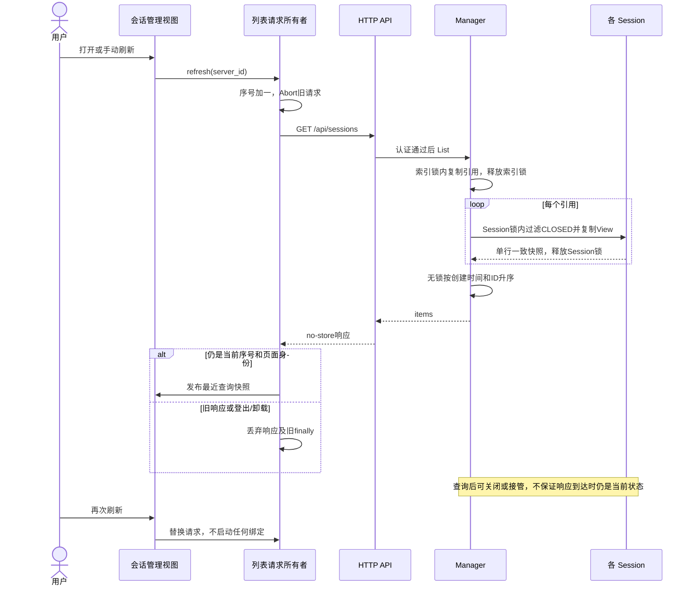
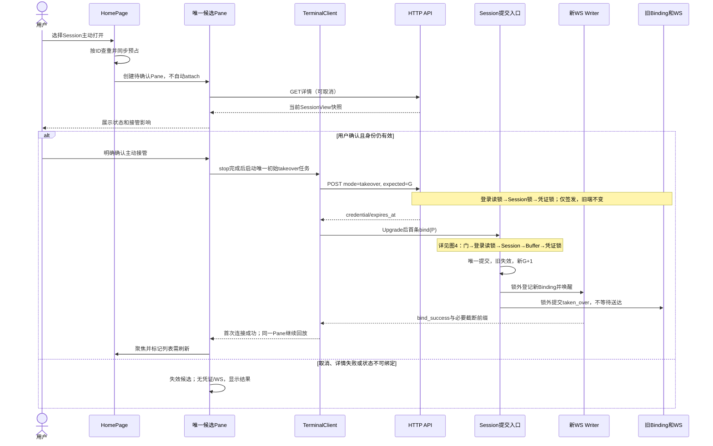
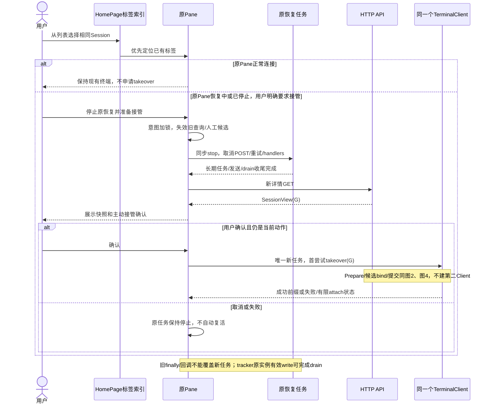
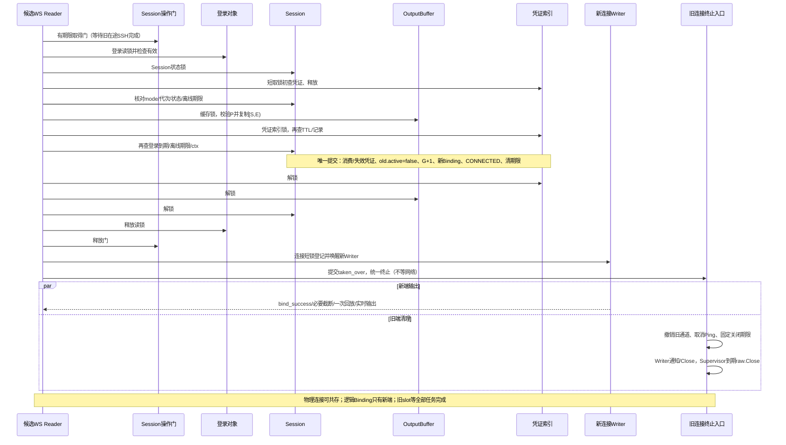
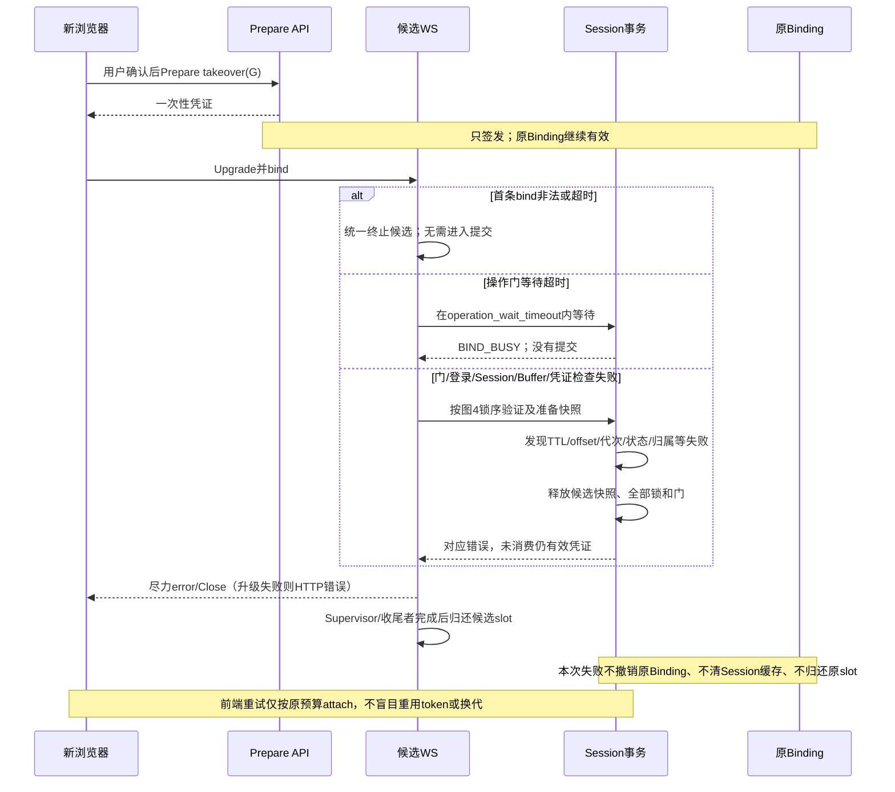
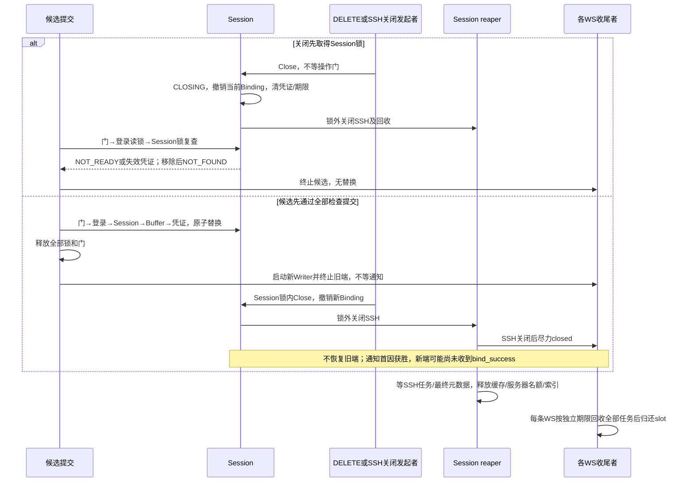
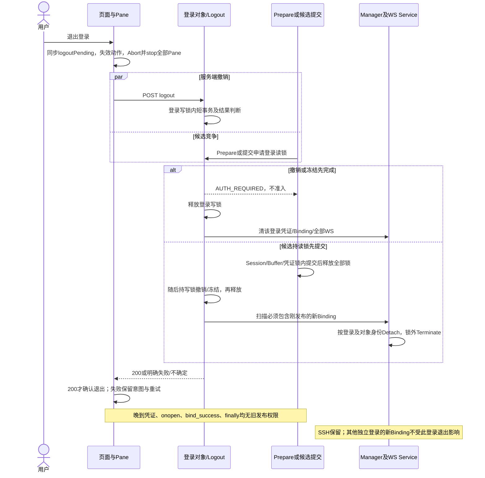
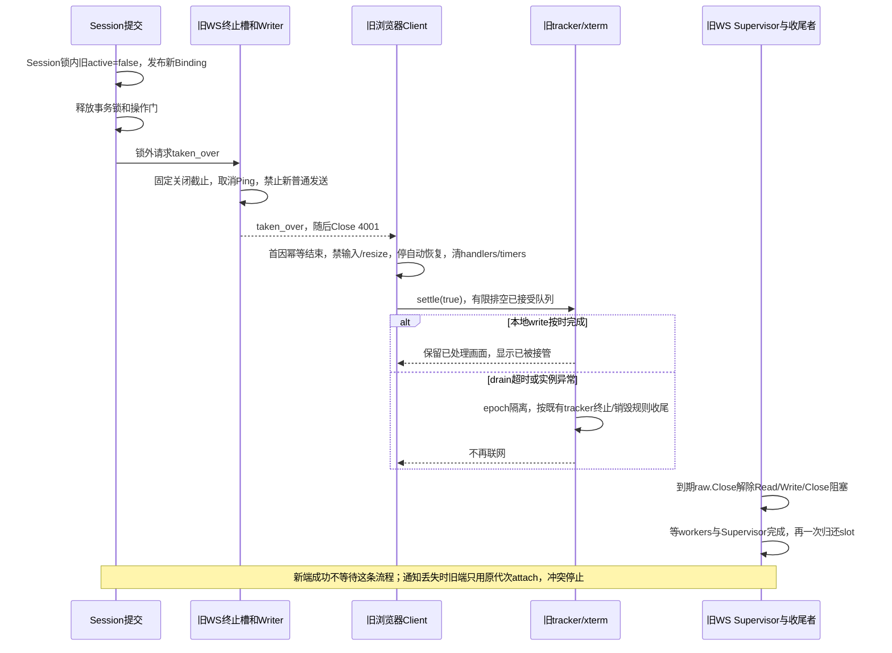

# Web SSH 第五阶段详细实施计划

- 编写日期：2026-11-16。
- 状态：完整审查稿；只完成设计和文档，未开始第五阶段编码。§21 的推荐方案仍为 `待用户裁决`，不能视为冻结规则或编码授权。
- 阶段：会话管理与跨设备接管。
- 实际检查基线：分支 `codex/第四阶段`，HEAD `8dc739d90034abb16bd60009d21e3af944654c7e`；开始时工作区与暂存区干净。
- 本轮只新增本文件。不修改业务代码、四份冻结设计、第四阶段计划和历史报告，不安装依赖，不提交、推送或执行分支整合。
- 用户本次确认：第四阶段、UI 状态提示残留修复及最新部署真实环境验证已经完成。第四阶段报告仍是当时“本地完成、生产待验”的历史记录；本计划不擅自改写它，也不将用户确认扩大为第五阶段已验收。

## 1. 阶段目标、非目标与交付边界

交付活动 Session 列表 API、独立会话管理 UI、跨终端标签/浏览器/设备发现与管理、用户明确发起的 `mode=takeover`、唯一有效 Binding 的原子替换、被接管端停止与反馈，以及与关闭、登出、SSH 退出、离线回收、旧连接阻塞的竞争处理。

第五阶段复用原 SSH Connection、Shell、PTY 和 OutputBuffer，不创建替代 SSH。普通 `attach` 用于首次绑定、第四阶段自动恢复和两步人工恢复；`takeover` 是用户确认的主动替换意图。页面刷新、可见性变化、列表刷新、网络 online、自动恢复均不得触发 takeover。

非目标：历史会话归档/重命名、分页或排序 API、服务端状态过滤参数、重启恢复、跨进程协调、屏幕快照、Redis/消息队列、轮询服务、新状态管理库、依赖升级、全套第六阶段视觉和移动端改版。关闭本地标签、关闭远端 Session、主动接管是三项独立操作。

本计划的执行性是：冻结部分给出实现与验收步骤；冻结文档未规定的产品选择给出可执行推荐分支及替代方案，待裁决后才能执行受影响步骤。文档完整不等于所有产品选项已经批准。

## 2. 完整阅读依据、术语与权威边界

本轮直接分段读完以下 Markdown 文件的全部内容，而非仅使用摘要；原型只检查会话页面、标签及相关交互代码。代码用于定位实现差距，不覆盖设计。

| 文档 | 实际读取范围与本阶段重点 |
|---|---|
| [核心需求](web-ssh-design-development-plan.md) | 全文 §1–19；重点 §5 认证、§6 Session、§7 配置、§9 会话 UI、§10 UI、§11.1/11.2/11.4–11.7 API/错误、§12 存储、§18 验收 |
| [WebSocket 协议](web-ssh-websocket-protocol.md) | 全文 §1–9，含完整 tracker/协调器参考代码；重点 §2 bind、§3 线序、§4.4/4.5、§5 期限、§6/7 输出与恢复、§8 竞争示例 |
| [架构](web-ssh-architecture-implementation-plan.md) | 全文 §1–12；重点 §3.1 锁、§4 生命周期、§5.1/5.2 凭证与提交、§6 操作门、§7.4/7.5 Writer/Supervisor、§8.1 登出、§9/10 存储/退出 |
| [总体实施阶段](web-ssh-implementation-stages.md) | 全文 §1–10；重点 §5 基础、§6 第四阶段、§7 第五阶段、§10 追踪与交付 |
| [第四阶段计划](stage-4-implementation-plan.md) | 全文 §1–21；重点 §4 所有者、§6–8 恢复、§10/11 Promise/stop/dispose、§13 登出、§15 错误/查询、§21 已解决问题 |
| [第四阶段报告](stage-4-implementation-report.md) | 全文 §1–15；实现位置、测试证据及历史环境边界 |
| [第三阶段报告](stage-3-implementation-report.md) | 全文 §1–14；Session/Binding/WS 基础、attach-only 范围及真实网络测试方法 |
| [v2 原型](web-ssh-prototype-v2.html) | 会话管理布局、状态筛选、已有标签定位、独立关闭确认；演示数组和立即切换状态不作为业务算法 |

术语：Session 是后端托管的远端会话；WebAuthSession 是一次独立登录；Binding 属于一条 WS、固定一个 generation；候选 WS 已升级但尚未提交 Binding；提交点是架构 §5.2 的唯一原子操作；Pane 是本页终端标签组件；TerminalClient 是该 Pane 的唯一连接/恢复协调器；SessionRecovery 是原 Pane 的详情及人工 attach 候选所有者。

本地查询序号、任务 ID、页面生命周期标识、terminalEpoch 均不是 binding_generation。列表/详情中的 generation 只是某次查询快照；自动任务只接受自己校验通过的 bind_success 更新代次。

**标记规则：**“冻结”表示上述文档已规定；“实施细化”表示在既有契约内落实的代码职责；“推荐，待用户裁决 Dn”表示新增产品选择。下文涉及 Dn 的流程、图和测试均是对应推荐方案的条件式执行计划，不能跳过 §21 的决定记录。未发现四份冻结文档之间新的实质冲突；两个历史 BLOCKER 不重新开启。

## 3. 当前实现、第五阶段接入点与差异

以下路径相对仓库根目录，符号定位对应上述 HEAD；后续编码先重新检查 Git 和代码，不能照搬历史行号。

| 当前文件/符号 | 已核对事实 | 第五阶段增量 |
|---|---|---|
| `backend/internal/session/session.go`：Manager、Find/Get、viewLocked、Close/Sweep/reap、StopAt | 内存索引；Get 二次排除 CLOSED；关闭/离线/元数据/名额回收已存在；无 List | 增加 List，复用 View 与逐对象锁，不读 SQLite 活动行 |
| `backend/internal/session/binding.go`：credential、Prepare、canAttach、Attach | Prepare 仅接受 attach；credential 没有 mode；canAttach 对 CONNECTED 返回 BIND_BUSY；Attach 已有操作门、两次凭证检查、快照和消费点 | 内存凭证保存 mode，准入区分 attach/takeover，扩展同一提交事务并交出旧 Binding 收尾责任 |
| 同文件：Detach、Execute、Revoke | Detach 按 Binding 指针判断；Execute 在门内校验身份；Revoke 锁外扫描，结束回调在 Session 锁外 | 复用；证明旧输入/resize/Detach 不作用新端；禁止持 Session 锁调用 `end` |
| `backend/internal/websocket/connection.go`：reader、writer、terminate、supervise、run、finish | reader 在 Attach 返回后登记 Binding；每连接单 Writer；独立绝对截止 Supervisor；收尾后归还名额；finish 只有 error/closed 分支 | 处理提交后登记前竞争、旧端通知交接；实现 taken_over 最终消息；验证被替换端发送准入与回收 |
| `backend/internal/websocket/protocol.go`：closeCode、具名 DTO | 没有 taken_over DTO/4001 映射 | 新增既有协议消息的实现，不新增协议字段 |
| `backend/internal/websocket/service.go` | Upgrade 前名额预占；包括升级中/未绑定/关闭中；Revoke/Stop 覆盖所有连接 | 复用；接管需要额外候选名额，不能“借用”旧端 slot |
| `backend/internal/httpapi/sessions.go` | 已有创建、详情、DELETE、凭证 POST、WS；无 GET 列表；请求 mode 已有 | 新列表路由/响应；保留现有 Prepare 路径与请求结构 |
| `backend/internal/auth/auth.go`、`backend/cmd/server/run.go` | 登录读锁准入，Logout 写锁判断持久化结果后释放再扫描；OnRevoke 联动 server/session/websocket | 原样复用，扩大并发测试；不新增管理员/设备权限体系 |
| `frontend/src/api/sessions.ts`、`api/management.ts` | SessionView、运行时详情校验、支持 AbortSignal 的 request；closeSession 尚未接收 signal | 增加列表解析/查询；按关闭所有权需要传递可选 signal |
| `frontend/src/terminal/client.ts` | 单长期任务，connect 首次前缀 Promise，completion 长期 Promise；所有 Prepare 写死 attach | 增加明确的主动初始模式；仅用户任务第一次允许 takeover，以后重试固定 attach |
| `frontend/src/terminal/output.ts` | tracker、偏移、drain、epoch、稳定资格及 taken_over 解析 | 原样复用；不新建第二套输出恢复机制 |
| `frontend/src/terminal/recovery.ts`：SessionRecovery | 私有详情序号/AbortController、候选、两步人工 attach；running 时拒绝刷新 | 原流程保持；与主动动作互斥、失效旧候选，不把列表结果塞入人工候选 |
| `frontend/src/components/terminal/TerminalPane.vue` | 每 Pane 一个 client/tracker/recovery；onMounted 自动 connect；只 expose stop/dispose；已有网络展示与历史诊断分离修复 | 增加受控“创建后 attach/列表待确认接管”的启动入口、主动任务接口、外部关闭协同；不能挂载时误 attach |
| `frontend/src/pages/HomePage.vue` | tabs 数组、panes Map、v-show 保留；signOut 同步封闭准入并停止 Pane | 作为页面内唯一标签索引；新增会话管理视图及操作分派，不承载恢复循环 |
| `frontend/src/stores/auth.ts`、`router/index.ts`、`pages/LoginPage.vue` | logoutPending、单 logoutTask、identityEpoch、退出失败重试 | 沿用；新增页面任务进入相同意图边界 |
| 既有 Go/前端测试 | 包含“拒绝 takeover”的阶段范围断言、恢复/race/真实 TCP 及实际 Pane 测试 | 仅替换已过时范围断言，保留 attach 安全与第四阶段全部行为断言 |

差异分类：

1. 列表、takeover mode、Binding 替换、taken_over 服务端发送缺失，是阶段划分允许的实现待办，不是冻结设计冲突。
2. 核心文档开头/第四阶段计划的“credential_timeout 尚未实现”等措辞是当时状态；当前配置、/me 与前端读取已实现。本阶段不再次增加该字段，不重开 BLOCKER-HTTP。
3. 第四阶段报告 §13 的环境待验与用户本次部署完成确认属于不同时间的证据；可建议后续获准补充报告，本文不修改历史文件。
4. 原型把 CONNECTED 显示为“当前浏览器”、直接改数组状态并按当前服务器资料取目标，这些仅是演示。正式 UI 无设备身份字段，不推断 CONNECTED 属于哪台设备；显示 Session 创建快照，等待真实提交结果。
5. 新 Binding 已在 Session 发布而 `Connection.binding` 尚未登记，是现有两层交接窗口；第五阶段必须覆盖关闭/撤销/再次接管竞争，不能只修改 Prepare 判断就宣称完成。

## 4. 数据、API、配置和依赖

### 4.1 外部接口

所有响应仍为 `{code,message,data}`，表中给出 `data`；认证、Origin、no-store、UTC 毫秒时间、严格字段及安全整数遵守核心 §11。

| 接口 | 职责和数据 | 本阶段处理 |
|---|---|---|
| `GET /api/sessions?server_id=...` | `{items:[SessionView]}`；仅可选 server_id，按创建时间、ID 升序 | 新增实现；空结果 `items:[]`，不能 null |
| `GET /api/sessions/{id}` | 当前单个 SessionView；CLOSED/移除返回 SESSION_NOT_FOUND | 复用；接管确认前读取和失败后诊断 |
| `POST /api/sessions/{id}/takeover` | `{mode:"attach"或"takeover",expected_generation:G}` → credential、expires_at | 扩展 mode；HTTP 200 只表示签发 |
| `GET /ws/sessions/{id}` | 认证/Origin/容量后 Upgrade，首条 bind 带 credential 与 requested_start_offset | 不改 URL、bind 字段；模式取服务端凭证记录 |
| `DELETE /api/sessions/{id}` | `{}` → `{}`，进入幂等关闭，CLOSING 可查询，已不存在也成功 | 复用；明确确认；响应丢失可查询/重试 |
| 创建与认证 API | 创建新 SSH、/me 配置、logout 原有契约 | 不拿创建接口充当打开已有 Session |

SessionView 完整复用：`id, server_id, name, host, port, username, status, created_at, disconnected_at, last_attached_at, offline_expires_at, remaining_seconds, binding_generation, current_cols, current_rows`。只含 CONNECTING/CONNECTED/DISCONNECTED/CLOSING；剩余秒数向上取整不小于零，仅离线非 null；目标来自创建快照。不增加 device_id、is_mine、owner、凭证或关闭历史字段。

server_id 缺省取全部，存在则按核心 ID 规则验证；空值、重复参数、未知参数拒绝 INVALID_REQUEST，复用现有服务器列表的严格 query 风格。合法但没有匹配 Session 的 ID 返回空集合，不需要查询服务器表。没有 `status`、`page`、`limit` 或 `sort` 参数。前端状态筛选只对本次列表数据做本地过滤。

### 4.2 内部结构与持久化

- credential 追加受校验的内存 mode，签发时固定，不能让 WS 或客户端再覆盖。全局哈希索引、TTL/容量/归属/失效规则不变。
- 原 Binding 仍固定所属 WS、登录、不可变 generation；替换产生新 Binding，不把旧对象转交新 WS。
- 提交结果需要保留“新 Binding、待终止旧 Binding”的明确所有权，可用内部具名结果；不成为公开 DTO。任何成功提交后的退出路径都必须处理被替换对象。
- 前端增加列表查询状态与页面内 Session 操作记录；它们是短期本地状态，不写 localStorage，不当服务端事实。
- 不改 SQLite 表、不加迁移/持久化数据、不新增配置或 client_settings、不新增依赖。现有超时、容量和内存对象足够；继续使用 Vue、本地对象、Map 和 AbortController，不安装 Pinia 或其他库。

## 5. 活动列表后端

### 5.1 权威、快照与排序

Manager.List 在管理器索引锁内复制稳定 Session 引用，马上释放索引锁；逐对象取得 Session 锁，检查 CLOSED、应用 server_id 过滤并调用 viewLocked 拷贝 DTO，随后释放。最后在无锁情况下排序和编码。不得嵌套 Manager 索引锁与 Session 锁，不遍历 SQLite，不锁住全体 Session，不等待 WS/SSH。

每行是在该 Session 状态锁内形成的一致快照，不承诺整个集合在同一瞬间的全局事务快照。索引复制之后创建的 Session 可到下次查询才出现；取行快照前已 CLOSED 的对象排除；取完行后关闭或接管的对象可暂时以旧状态/代次返回。返回的对象禁止含 CLOSED，但不能保证响应送到浏览器时每行仍活动。下一次查询、详情和提交重新核实。

排序键为创建时间的 API 毫秒精度与 ID，均升序；实现保存对应数值排序键，不能对本地化时间文字排序。同毫秒按 ID 固定顺序；不依赖 Go map 遍历顺序。列表不隐去 CONNECTING/CLOSING，也不因 remaining_seconds=0 自行删除仍 DISCONNECTED 的对象；签发/提交负责拒绝到期者。

### 5.2 路由及敏感数据

在 sessions.go 增加受保护 GET 路由、具名列表 DTO、query 校验，返回既有安全 session.View。查到记录不代表本登录拥有当前 Binding；单管理员可管理全部 Session，但绑定凭证必须属于当前独立登录。

查询取消不持有对象/网络资源；可用请求 context 在逐行处理边界停止无用工作，不改变快照契约。业务短锁不宣称可被 context 强行抢断。HTTP 响应只含 DTO，禁止序列化 Manager/Session/Binding、连接、密码、完整 Host Key、Cookie、令牌/哈希、凭证/哈希、终端内容。并发元数据写失败不影响内存列表事实。

## 6. 前端列表、刷新和请求所有权

以下刷新策略采用 **推荐 D1，待用户裁决**；取消、迟到响应隔离和快照非权威的约束必须满足。

### 6.1 页面与刷新触发

在 HomePage 内提供独立“会话管理”视图，切换视图不卸载既有终端 Pane；保留 `/` 与 `/login` 路由，不为了列表重建整个 HomePage。列表组件与终端标签集合分别维护。

| 触发 | 推荐行为 |
|---|---|
| 首次进入/再次打开会话管理 | GET 一次，带当前 server_id；首次显示 loading，成功为空显示明确空态 |
| 手动刷新、切换服务器筛选 | 取消旧 GET、序号递增、发新 GET；状态筛选只在本地计算 |
| takeover 的成功前缀、最终停止/取消或关闭操作得到结果 | 使列表标为待刷新；页面可见时合并同一轮触发为一次 GET，隐藏时下次进入加载 |
| 页面从 hidden 到 visible | 仅会话管理当前可见且登录有效时刷新一次；终端可见性不触发 takeover/重置重试 |
| 连续刷新 | 最新请求胜出；同一个同步事件批次可用一个 microtask 合并；不追加请求队列/周期轮询 |
| 离开列表视图/卸载/登出/认证失效 | 同步撤销列表发布身份并 Abort；移除 visibility listener；不把取消当网络错误 |

显示“最近查询”的状态、代次和时间。推荐保留旧行作为明确标记的历史快照，loading/error 单独显示；失败时不伪造空集合。只读列表可继续展示旧行，但所有接管都需新详情及确认；关闭由独立确认和幂等服务端裁决。状态筛选提供全部及四种活动态，不把 CONNECTING/CLOSING 合并成离线。剩余时间首版显示服务端返回值及查询时刻，不加全局倒计时或到零自动删除；后续若显示倒计时，也不能赋予准入权。

### 6.2 请求状态最小结构

建议 `SessionListController` 持有 items/loading/error/lastLoadedAt、sequence、controller、disposed，以及由宿主提供的 allowed()。每次刷新：先 ++sequence、abort 旧请求，再设置本次 controller/loading；fetch 和 JSON/DTO 校验完成后检查 sequence、signal、页面身份、当前登录及 logoutPending。catch/finally 也必须检查同一身份，旧 finally 不清新 loading。

列表解析验证 data.items 是数组，逐项复用 SessionView 校验，并检查每项 id 格式、ID 不重复；拒绝非法整体响应而非偷偷丢行。列表查询不写 TerminalClient.generation，不创建 SessionRecovery.candidate，不通过列表状态停止/启动终端。

列表 GET 推荐与详情 GET 一样只支持主动/生命周期取消，不引入新的本地定时期限（D1）。凭证 POST 独立使用 credential_timeout；bind_timeout 不用于列表或详情。

### 6.3 时序图 1：列表加载、刷新、关闭竞争



## 7. Takeover 后端流程与原子提交

### 7.1 冻结规则逐条落实

1. HTTP Prepare 只签发凭证，不撤销旧 Binding。
2. 候选 WebSocket 尚未完成 bind 和服务端验证时，旧 Binding 仍然有效。
3. 只有新连接成功完成全部校验并提交 Binding 时，才允许原子替换旧 Binding。
4. 提交前失败，旧 Binding 保持有效。
5. 提交后失败，不允许回滚或恢复旧 Binding。
6. 同一个 Session 不允许存在两个同时有效的逻辑 Binding。
7. 旧 WebSocket 可能在新 Binding 生效后仍处于物理清理过程中，但不能继续获得新的业务操作权限。
8. 旧连接收到 `taken_over` 后必须停止自动恢复。
9. 新连接的成功状态不能依赖旧连接是否及时收到通知。
10. 旧连接资源未完成清理时，不得提前归还其 WebSocket 资源名额。

“提交前保持有效”指 takeover 本身不提前撤销旧端；不阻止独立的网络故障、登出或 Session 关闭合法撤销它。

### 7.2 Prepare 与 WS 职责

HTTP protected 负责登录/Origin、mode 两值与 expected_generation 必填安全整数。Prepare 查找 Session 后依次取得登录读锁、Session 锁、必要时凭证索引锁。共同准入先检查应用、状态、期限和代次；attach 同代次占用返回 BIND_BUSY，takeover 允许 CONNECTED/DISCONNECTED。不能为了支持 takeover 放宽 attach。

凭证记录绑定本次登录、Session、mode、expected、原到期时间；清过期/容量/插入同一索引临界区。Prepare 不拿操作门、不取消 Binding、不延长离线期限、不预留最终胜利。输出只返回凭证与到期时间，客户端取消 POST 不代表服务端没签发。

WS Service 负责 Cookie/Origin 后升级名额，未绑定/关闭中同样计数。Reader 严格读取首条 bind，mode 从哈希凭证中读；Session 提交入口负责操作门、再次准入和快照；Writer 负责成功前缀与输出；Supervisor 负责绝对期限强关；连接收尾者最后归还 slot。

### 7.3 唯一锁序与提交伪代码

冻结架构 §3.1：**远端操作串行门 → 登录读锁 → Session 状态锁 → OutputBuffer 锁 → 绑定凭证索引锁**，只取需要的子序列。索引初查可在 Session 锁下短取凭证锁、释放后再拿 Buffer；不能持凭证锁反向拿 Buffer。Prepare 为登录读锁 → Session 锁 → 凭证锁。普通 Detach/Close 不等操作门。Manager 索引锁与 Session 锁不嵌套。

以下是事务职责伪代码，不是新增业务源码；涉及网络、回调、通知和等待的部分都在释放全部事务锁及操作门后执行：

```text
Prepare(login, sessionID, mode, expected):
  校验 mode 与 expected；从 Manager 取稳定 Session 引用并释放索引锁
  登录读锁 -> Session锁
  检查应用接入、登录/到期、状态、离线期限、expected
  attach 且已有绑定 => BIND_BUSY；takeover 不因占用拒绝
  生成随机凭证；凭证索引锁内清过期/检查容量/存哈希及mode
  释放锁；只返回 credential/expires_at

CommitCandidate(ctx, login, token, P):
  校验凭证编码及P安全整数
  在 operation_wait_timeout 内取得操作门；失败 => BIND_BUSY
  登录读锁 -> Session锁
  短取凭证索引锁读记录并释放；检查存在/TTL/登录归属/目标/mode
  检查状态/离线期限/expected；attach不能替换当前Binding
  若代次耗尽：退出当前锁与操作门后请求幂等Close(counter_exhausted)，拒绝
  OutputBuffer锁：P>E拒绝；复制唯一稳定[S=max(P,A),E)快照
  凭证索引锁：再次确认记录完全一致、存在、未过期
  再查登录绝对到期、离线期限、准入及候选ctx
  任何失败 => 释放快照/锁/门；不由本次失败改变旧Binding或消费仍有效凭证
  唯一提交点（仍在同一Session临界区）：
    消费本凭证并失效该Session其他凭证
    保存 old；old非空则 active=false，在同一Session锁内记录接管失效原因
    再取消旧Binding上下文以撤销尚未准入操作；这里不得调用end回调
    generation加一；新建不可变代次的新Binding
    发布新Binding；CONNECTED；更新last_attached_at；清离线期限
    非阻塞标记元数据dirty
  释放凭证锁/Buffer锁/Session锁/登录锁/操作门
  返回明确成功结果及 old 的收尾责任（不能因后续取消丢失old）

WS提交后交接（不持Session事务锁）：
  在当前Connection短调度锁中检查该候选是否已终止
  若仍可用：登记新Binding、设置心跳并唤醒新Writer
  否则：锁外Detach新Binding并按既有终止路径收尾，绝不回滚old
  无论新连接能否启动：锁外向old提交taken_over并启动其统一终止
  旧通知不等待送达；新端不等待旧Close/slot归还
```

新端 Writer 在自己的首次应用发送前按顺序发送 bind_success、必要时一次 history_truncated、稳定快照、连续实时块。bind_success 必须 G+1，输入等前缀完整且 processedOffset≥E；resize 可在成功绑定后同步。提交后至成功前缀之间发生终止可直接终止，不强制先发送成功消息。

### 7.4 现有交接窗口和旧发送准入

不能在 Session 锁里调用旧 `Binding.end`：当前回调通向 Connection.Terminate，后者又调用 Detach 获取 Session 锁，会重入/倒序。事务只撤销权限、保存旧引用；通知与关闭必须移到锁外。旧端通知采用独立终止槽，普通控制队列满也不能吞掉终止请求。重复终止第一原因获胜，不覆写已经发生的网络/关闭/登出原因。

提交点到旧终止槽提交之间，旧 Execute 必须以 Binding 身份重新检查 active；旧 Writer 的普通消息准入也需识别失效，不能只依赖稍后的通知。沿用现有 Connection 短调度锁保护“检查终止→选择一项”的结构，通过短的 Binding 有效性检查与 Session 提交同步，不能在锁外检查后无保护选新项。当前 terminate 已存在 Connection 调度锁 → Detach/Session锁的调用方向；实现不得新增反向 Session锁 → Connection锁路径，不另造全局锁序。涉及 Buffer 仍遵守 Session → Buffer 子序列。

正常接管应优先由明确的接管失效原因进入旧终止槽；若取消执行器、旧读错误与通知交错，须保证不会把接管丢成无人收尾的取消。可在 Binding 的 Session 锁保护状态中保留终止原因，失效检查返回该原因，锁外统一 Terminate；它只是既有终止原因的内部传递，不新增协议/状态。独立故障已经先获终止权时允许其原因获胜，权限与回收断言仍不可放宽。单次已经准入的旧 WS Write 可有限完成，此后不再开始普通输出；旧端本地已接收队列可排空。

输入在途与候选提交共用操作门：输入先获准则完成唯一调用后释放门；接管等待超时仅结束候选，不先撤销旧端；若 SSH 操作超时，按既有规则关闭 Session。Close 可绕过门先撤销权限并关闭底层 SSH 来解除阻塞。

## 8. Takeover 前端完整流程

### 8.1 所有者和启动模型

推荐 D2/D3（待裁决）：HomePage 保存 `Session ID → 唯一 Pane/正在准备的记录`，在首次 await 前预占目标操作；Pane 拥有唯一 client/tracker/recovery，另持主动动作的查询/确认状态，所有动作共用一个本地互斥意图，不增加恢复循环。候选详情与 SessionRecovery 的人工 attach 候选分别存储并互相失效。

新建 Session 的 Pane 仍按创建 DTO 首次 attach。列表打开已有 Session 的 Pane 必须是“未自动连接”的候选模式，mount 本身不调用 connect；用户确认时只启动一次 takeover。可以先建立不可操作的待接管标签以容纳唯一 Client，成功前缀后转为正常标签；不能成功后再创建另一个 Client 把候选 WS 搬过去。失败保留该 Pane 和原因供查询/关闭，不自动创建另一个标签（D3）。

建议在 client 保持现有 `connect(expected)`/`run(expected)` 默认 attach 外观，增加明确的用户主动入口或受类型限制的初始模式参数；具体命名不是外部契约。初始 mode 固定在该 RecoveryTask，第一次 Prepare 可为 takeover；下一次循环无论第一次是否拿到凭证，都必须改为 attach。用独立的“首次尝试已消费”标记，不能根据 retries==0 判断模式，因为稳定资格可能把 retries 重置为0。重复点击不重新 start，不延长预算。

### 8.2 从列表到终端的步骤

1. 用户点某行“打开/主动接管”；HomePage 按 Session ID 查当前页 tabs、panes 及待创建记录，预占操作，绝不按服务器名称去重。
2. 已有在线 Pane 按 D2 优先定位，结束本次列表动作，不发 takeover；已有恢复/停止 Pane 走 §11 的显式流程。无 Pane 按 D3 建立唯一待接管 Pane，默认不联网。
3. 主动接管准备阶段，封闭原人工候选；若存在旧任务，显式停止并等待 client.stop、发送与 drain 收尾后才继续。取消确认前是否停止旧任务按 D2 明示，不能悄悄暂停在线端。
4. 用可取消详情 GET 获取完整 SessionView。检查任务、Pane、页面和登录身份；展示 Session 快照目标、状态、代次、离线期限。CONNECTING/CLOSING/NOT_FOUND 禁止接管；CONNECTED/DISCONNECTED 才可确认。GET 无本地自动超时。
5. 用户单独确认“主动接管；当前操作端将停止”。确认框不是列表刷新自动生成的授权。确认前不申请凭证；刷新详情或目标变化使旧确认候选失效，不自动确认新代次。
6. 确认处理器首次 await 前消费候选、锁住动作；复查旧任务收尾与登录；以详情代次启动该 Pane 唯一任务，第一次 POST mode=takeover。
7. 凭证 POST 使用独立 credential_timeout；迟到/取消响应不创建 WS。通过后新建候选 WS，设置 arraybuffer/handlers，onopen 前再次检查身份，发送首条 bind。
8. 服务端按 §7 依次验证、取操作门、快照与原子提交；HTTP 成功、WS OPEN 或 bind 已发送都不等于已接管。
9. 客户端校验 bind_success 代次与前缀；connection Promise 完整前缀才反馈成功，长期 completion 仍运行。成功后聚焦同一标签、同步有效尺寸；回放未处理完显示“正在回放”，不提前启用输入。
10. 标记列表需刷新；列表数据不能反向驱动终端。旧浏览器收到 taken_over/4001 立即停输入和自动恢复，有限排空，保留明确状态。
11. 初次或后续可重试失败按原预算只 attach、只使用已成功获知代次；BIND_CONFLICT 停止。结果不确定不自动采用详情新代次再 takeover，要求新一轮用户详情/确认。

同实例复用先 drain 再读取 processedOffset；新设备、新页面、新 xterm 或排空失败重建从 0。无论已有 Pane 与否，都不得使用另一设备、列表或服务端发送游标作偏移。

### 8.3 时序图 2：没有已有 Pane 的主动接管（D3 推荐）



### 8.4 时序图 3：当前页已有 Pane（D2 推荐）



## 9. Binding 提交、终止与资源生命周期

### 9.1 时序图 4：新 WebSocket 提交成功



图中 W 到 N 的返回代表通过候选连接向新浏览器发送，不是第二个 Reader 或应用 Writer。更早的 Session Close/登录撤销可使新端直接进入终止，仍不得恢复旧端。

### 9.2 时序图 5：提交前失败，旧 Binding 保持



### 9.3 资源清单与提交后失败

| 资源 | 唯一释放者及边界 |
|---|---|
| 候选凭证 | Manager 提交消费/Session其他凭证失效、登录撤销、到期扫描或退出清理；前端 Abort 无远端撤销保证 |
| 候选快照 | 提交前失败即释放；成功交新 Writer；终止释放未发送数据，允许一次在途数据完成 |
| 旧 Binding | 提交点即逻辑失效；旧回调仅作用该对象，永不复活或改写新代次 |
| 新 Binding | 已提交但前缀写失败时只 Detach 新对象，若仍当前则 DISCONNECTED；不恢复旧端、不重建 SSH |
| WS/Reader/Writer/执行器/Ping/定时器 | 各连接统一终止；取消在途Ping；Supervisor不等调度锁或Close，绝对截止强关底层net.Conn |
| WS slot | Service 的连接收尾者等待 workers、Supervisor 全部完成后一次归还；Close发起、taken_over送达、Session移除均不能提前归还 |
| SSH/PTY/Buffer、服务器名额 | 仍属于 Session；takeover不释放；只由既有Close/reap在相应生命周期释放 |
| Pane/client/tracker/listeners | Pane.stop保留实例；Pane.dispose同步封闭准入并有限排空后销毁；页面卸载捕获清理异常 |

即便 bind_success 写失败，服务端提交已经发生，凭证已消费、generation已递增。若前端未收到该代次，原代次 attach 最终冲突停止；若已经收到并校验 bind_success，后续恢复可用刚获知代次。两种情形均不能通过查询偷偷换代。新成功不依赖旧通知送达；旧连接始终按自己的关闭预算收尾。

当 max_connections=1 且旧端占用时，新候选不能升级，因此无法直接在线接管；这是冻结的全局容量行为，不能提前释放旧 slot 绕过。实际接管测试至少预留一个候选 slot，并另测容量不足失败保持旧端。

## 10. 并发场景处理表

表中 G 为双方取得凭证时的同一 expected_generation。“失败码”描述可观察到的合法服务端结果，不保证首个被检测条件或通知送达。候选均由各自 WS 统一终止/收尾者释放；旧 Binding 物理清理可晚于逻辑失效。所有重试均不能重放输入。

| 编号 / 竞争双方 | 串行化和锁保护范围 | 双方先后、结果与失败方状态 | 资源、重试及逻辑/物理状态 |
|---|---|---|---|
| C01 两个 takeover | 各 Prepare 可同代次签发；提交共用操作门→登录读锁→Session→Buffer→凭证索引 | 第一个有效提交得到 G+1；另一个发现凭证已失效为 INVALID_CREDENTIAL，或代次变化为 BIND_CONFLICT。不能断言只一种错误。同 token 也最多一个成功 | 败者释放快照/候选slot，不撤销赢家。INVALID_CREDENTIAL仅明确code时允许原预算新attach，原代次遇冲突停止；不自动新takeover。旧/败者物理连接可正在关闭。不同代次、用户重新确认后的顺序接管不受“同代次仅一个”断言禁止 |
| C02 takeover 与 attach | Prepare/提交共用状态与凭证检查，提交共用门；mode来自凭证 | CONNECTED同代次attach在Prepare即BIND_BUSY；DISCONNECTED时两者均可候选，先提交者胜，后者同C01。attach先绑定后，旧代次takeover不能无条件覆盖它 | 失败者独立收尾；attach有限原代次重试；旧端/失败端不能拿赢家代次；物理关闭窗口允许 |
| C03 takeover 与用户关闭 Session | Close先拿Session锁撤销权限，不等操作门；提交仍按全锁序 | Close先：Prepare/提交NOT_READY，索引移除后NOT_FOUND，凭证已失效也可能INVALID_CREDENTIAL。提交先：新Binding先成为当前，然后Close立即撤销新端；旧端不复活。DELETE始终幂等 | Session reaper释放SSH/缓存/服务器名额，各WS独立收尾；不自动重建或接管已关闭会话；关闭通知可能丢失，列表/详情确认；CLOSING与物理资源可并存 |
| C04 takeover 与 SSH退出/故障 | monitor/读取/操作超时调用同一Close；Session锁裁决，首个关闭原因获胜 | SSH退出先同C03拒绝；提交先可短暂CONNECTED，随即ssh_exit/ssh_error关闭；不能把网络通知成功当SSH仍健康 | Session reaper负责SSH；新旧WS分别释放；NOT_READY/FOUND停止并诊断；不可回滚或自动创建新SSH；物理关闭可滞后 |
| C05 takeover 与离线自动关闭 | Sweep在Session锁内复查DISCONNECTED、无Binding、期限；提交重新检查当前期限 | 截止前提交先清期限，旧扫描不能关闭；到期后即便Sweep尚未运行也NOT_READY；Sweep先进入CLOSING则拒绝。不能通过过期前签发延长期限 | 到期由Session reaper释放；候选自行收尾；不得自动重试延长保留；列表可短暂显示过时剩余时间，提交才权威 |
| C06 takeover 与管理员登出 | 同一次登录的写锁撤销，与提交/Prepare登录读锁互斥；写锁释放后扫描凭证/Binding/所有WS | 撤销/冻结先则AUTH_REQUIRED或因凭证清除而失败；提交先则新绑定被撤销扫描找到并Detach。旧端与新端不同登录时，只撤销被登出的登录；旧端登出不能拆掉另一次登录的新Binding | 只关闭该登录浏览器通道，不直接Close SSH。已签发凭证失效；不自动恢复退出任务。不同登录的新端可能继续CONNECTED；同登录新端转离线，物理连接待回收 |
| C07 Upgrade成功但首bind失败 | Service登记slot；Reader首bind期限/格式/大小校验；进入事务后仍有完整复查 | 非法首消息/超时/非法偏移/过期/归属错给对应INVALID_MESSAGE/BIND_TIMEOUT/INVALID_OFFSET/INVALID_CREDENTIAL/PERMISSION_DENIED等；全部提交前失败不替换旧端 | 候选快照如已产生则释放；Supervisor/收尾者回收slot。协议明确可重试错误才原预算attach，其他停止；旧逻辑Binding保持，候选物理清理 |
| C08 新候选校验前旧输入在途 | 旧Execute与提交用同一操作门；准入持登录读锁/Session锁，网络在这些短锁外执行但保留门 | 旧输入先准入：唯一SSH调用结束后候选才可提交；门等待超时BIND_BUSY且旧端保持；SSH操作超时关闭Session。候选先提交：旧排队输入/resize再准入失败或取消 | 不撤回已准入效果、不补发未执行输入；执行器清理待执行槽，WS回收仍等执行器；短时物理共存但无双逻辑操作权 |
| C09 旧Reader阻塞（含半帧头） | 提交不等待Reader；旧端逻辑失效在Session锁；终止短锁/绝对期限Supervisor独立 | 新端可成功；旧Reader不妨碍提交。taken_over可能发出但不能依赖其读取/Close回应；期限到raw.Close解除阻塞 | 旧reader/writer/executor/supervisor退出后归还slot；SSH持续读取；被接管端不自动抢回，物理旧端可滞留至预算 |
| C10 旧Writer阻塞/Close握手阻塞 | 提交不持网络锁、不等旧写；短发送准入与失效同步；Supervisor独立 | 已准入的一次旧Write可结束，后续普通输出禁止；终止通知可能写失败，不能回滚新端；CloseNow不能抢断已开始Close | 取消Ping、共用close_timeout并在到期raw.Close；收尾后归还slot，不能用“通知未发出”保留权限；新端恢复按自身预算 |
| C11 旧端正在输出排空 | 服务端单Writer快照/实时调度；客户端单tracker/epoch；终止不进入SSH输出锁等待浏览器 | 提交撤销旧业务准入，旧Writer至多完成在途消息后终止；旧浏览器收到taken_over/4001保留有限已接受队列排空。若原本已停恢复/排空，新意图须等待stop完成 | 服务端释放旧快照余量，不清Session Buffer；客户端write_drain_timeout到则按tracker规则重建或dispose，不联网；新端不等旧排空；物理/画面收尾可滞后 |
| C12 提交成功但bind_success写失败 | Session提交已完成，Writer网络写在锁外；新端Terminate仅按新Binding身份Detach | 新端若仍当前转DISCONNECTED，generation保持G+1；若又被下一次合法接管则旧新端Detach不能影响更后Binding；原端不复活 | 凭证已消费；新WS资源正常收尾；未收到新代次的客户端用G attach冲突停止，收到G+1的可有限attach；通知和逻辑状态暂不同 |
| C13 旧Detach、WS Close、输出/执行器清理迟到 | Session锁检查对象身份/active/不可变代次；客户端task/socket/epoch隔离 | 旧Detach只失效旧对象，不清新Binding/期限；旧WS Close是浏览器通道关闭，不是Session.Close。旧输出回调不更新新实例；旧执行器不能用当前Binding替换自身身份 | 只释放所属资源一次；不触发新恢复/通知覆盖。显式DELETE与真实SSH故障Close仍合法，不能把它们当“旧回调”忽略；物理旧连接可正在回收 |
| C14 多浏览器/设备同时操作 | 后端登录归属、Session门/状态锁/凭证索引为权威；各页面仅本地去重 | 列表/详情可看同一G；同代次仅一提交，其他按C01。任一登录可明确关闭同一Session；独立登录登出只影响自身Binding | 失败端不自动查询换代抢回；可刷新后再次用户确认。跨浏览器不依赖消息总线/本地存储锁，允许物理连接暂存；共享Cookie的浏览器页面受同一次登录撤销 |

补充应用退出：沿用停止接入标志与绝对 shutdown_timeout；Prepare/提交遇 SERVER_SHUTTING_DOWN 不发布，已提交资源统一关闭；未绑定 WS 也登记回收，前端仍只按原预算有限 attach。执行器已准入的 SSH 调用、元数据最终写和 WS 监督任务各自按既有边界完成，不能因第五阶段增加第二套关闭期限。

## 11. 跨标签、跨浏览器和跨设备协调

### 11.1 所有权不变量

- 一个 HomePage 生命周期内，同一 Session ID 至多一个 Pane、一个 TerminalClient、一个 tracker、一个 SessionRecovery、一个有效长期任务；待挂载记录也参与去重。
- Session ID 是稳定业务标识；Pane/任务 ID 是本地所有权；Binding 由服务端提交产生，与本地组件寿命不同。列表项不是 Pane，删除列表项不能直接卸载/关闭终端。
- HomePage 只协调页面内标签和操作意图，调用 Pane 暴露的 stop/主动接管/关闭入口；实际 fetch/WS/重试由各唯一所有者执行。
- 切换服务器、列表和终端时保留 Pane，通过 active/可见性控制 fit/焦点。隐藏组件不能以零尺寸覆盖 PTY，后台恢复不能抢焦点。
- 浏览器顶层网页标签/窗口属于不同 HomePage，不能靠本页 Map 检测它们。它们与另一浏览器/设备一样由后端 Binding/generation 协调；不承诺全浏览器进程只有一个视图，不新增跨窗口选主或持久化标签恢复。浏览器刷新后通过列表发现，再由用户明确打开。

### 11.2 五类场景（D2/D3 推荐方案，待裁决）

| 场景 | 推荐交互与所有权 | 失败、取消及迟到结果 |
|---|---|---|
| A 当前页没有该Session的终端标签 | HomePage同步预占Session ID，建立一个不自动连接的候选Pane；详情→确认→唯一Client首尝试takeover；成功前缀后同一Pane变正常标签并聚焦；连续点击定位同一候选 | 不以成功回调再push第二标签；失败保留停止/有限attach中的原Pane；取消前无WS；用户可关闭候选标签，dispose后迟到结果无效 |
| B 已有正常连接Pane | 列表“打开”只定位该标签，不从列表直接自我接管，不停止它，不申请凭证。若用户之后显式停止该终端，它按D进入主动流程 | 不存在同页两个Client或候选WS；取消定位不改变连接。若在检查后端状态时其他设备接管，原Pane自行收到终止/代次冲突；列表不能恢复旧任务 |
| C 已有Pane正在自动恢复 | 定位原Pane，提供明确“停止恢复并准备接管”；首次await前封闭旧查询/候选/重复动作，调用stop；等待旧task、发送、drain完成后GET新详情，再单独确认takeover；复用同一Client/tracker | 从点击停止准备起旧任务不再自动恢复；详情失败/取消确认不复活旧任务。主动任务可按既有协议自动attach有限重试；其最终失败后原Pane停止，用户可重新详情确认takeover，或走第四阶段两步人工attach。旧finally/handler不能覆盖新任务 |
| D 已有停止/被接管/已结束Pane | 停止或taken_over保留的Pane可以显式新详情→确认接管，优先复用原实例及其processedOffset。close已证实或SESSION_NOT_FOUND的Pane仅显示结果/关闭标签，不复活 | 必须先刷新状态；列表快照不能替代。CLOSING/CONNECTING禁用；真正closed不会重用Session ID，不能因列表迟到行清除ended。disposed Pane不可复用，必须等移除完成后方可按A处理一个仍活动的Session |
| E 旧浏览器仍打开终端 | 在线则接收taken_over/4001，立即禁止输入/自动恢复并有限排空；断网/休眠导致通知丢失时，恢复网络仅原代次attach，冲突停止 | 离线/休眠期间不假设已收到通知。即使INVALID_CREDENTIAL先出现，也仅原代次有限attach，不能取最新代次抢回。页面彻底关闭则无本地任务，后端旧通道按心跳/关闭期限回收 |

B 的推荐是“定位”，不是把主动接管降级为无提示 attach。若希望在线 Pane 也能直接主动重连，须选择 §21 D2 的替代方案并重新验证其停止/确认语义。

### 11.3 同一目标的关闭与新动作

页面为每个 Session 的接管、人工恢复、明确关闭和标签dispose设置共同的同步意图边界。关闭SSH确认前不停止旧端；确认后关闭意图优先取消正在准备/进行的接管，调用stop并发出DELETE，不等待本地排空。重复takeover不能绕过关闭意图；重复DELETE可在前次结果后幂等重试。关闭标签则取消本地所有者并dispose，不调用DELETE。

列表更新、详情读取、onMounted、ononline、visibilitychange 均不获得用户操作身份。只有明确按钮确认创建初始takeover任务；可将“候选已确认并消费”的局部对象传给Pane，不提供全局可随意改mode的恢复状态。

## 12. 关闭、登出、页面退出与任务取消

### 12.1 页面关闭和所有权转移（D3 待裁决）

推荐以“用户确认启动终端任务”为边界：确认前，管理视图拥有查询/确认动作，离开管理页取消查询/确认并移除未启动候选；确认后任务归该 Pane，管理列表的隐藏/卸载仅取消列表GET，不暗中停止用户已打开的终端。UI明确显示正在接管的目标标签；用户可在Pane停止或关闭标签取消它。

因此“takeover HTTP 已发出后关闭管理页面”有三种明确情况：仅切回工作区时Pane任务继续；关闭对应终端标签时stop/dispose；离开整个HomePage或关闭浏览器网页时所有Pane同步封闭准入、取消请求/handler并dispose。不能把关闭一个列表组件等同于关闭SSH。

用户关闭网页时无法保证异步drain或网络Close握手实际完成，不依赖beforeunload发送DELETE；服务端靠现有断线/心跳/Supervisor回收Binding与WS，SSH继续离线保留。已提交后即刻关闭网页只Detach新端，不恢复旧端；尚未提交的候选关闭不撤销其他旧Binding。

### 12.2 登出顺序和迟到响应

沿用第四阶段计划 §11/13 与实际 auth store：HomePage 首次await前设置logoutPending，使页面任务身份失效，取消列表/详情/确认、待挂载任务和凭证请求、停止全部Pane。logout HTTP与本地排空并行，不等drain后才请求撤销。

Prepare成功但候选未提交时登出：浏览器Abort/stop防止继续发布；服务端登录写锁先使本登录无效，锁外清凭证和所属全部WS。候选如果已提交则扫描Detach它；如果来自另一独立登录的旧Binding尚有效，登出候选登录不能误撤销旧端。过期同样使用当前登录归属检查。

每个await返回、JSON解析后、onopen、onmessage、重试timer、布局nextTick及finally检查本地动作/任务/Pane/登录身份。退出后凭证或成功前缀迟到不能创建WS、改代次、复活标签、覆盖“退出未完成”。老任务的xterm回调只有原epoch仍有效时可完成drain，不操作新实例。

| logout结果 | 继承的处理 |
|---|---|
| 200 | 确认持久化撤销，清身份，销毁页面任务后进入登录页；不发Session DELETE |
| STORAGE_ERROR 确定回滚 | 保留Cookie/身份和logoutPending，提示退出未完成、允许重试；已停任务不自动恢复 |
| SERVER_UNAVAILABLE 提交不确定 | 服务端冻结本登录并撤销所属通道/凭证，Cookie仅供logout重试；前端保持退出意图，不假装成功 |
| 网络/响应丢失 | 结果未知，保持退出意图，幂等重试logout；不新登录覆盖Cookie |
| AUTH_REQUIRED 与退出竞争 | 保留未完成退出含义；无退出意图时才走普通过期清理 |

接管成功后旧端终止通知/Close迟到：服务端仅旧对象Detach；前端同一Pane已移除旧handler，闭包仍检查task/socket；不同浏览器的旧Pane只显示自身停止原因。不能用旧端的closed/taken_over更新新Pane为已结束。

### 12.3 时序图 6：takeover 与 Session 关闭



### 12.4 时序图 7：takeover 与登出



确定回滚时登录不被服务端撤销，图中“撤销或冻结”分支不发生；前端仍按第四阶段规则保持停止和未完成退出，不能自动重启。图中的并发竞争以同一个WebAuthSession为对象。

### 12.5 时序图 8：旧 WebSocket 收到 taken_over 后停止



## 13. 与第四阶段兼容性清单

| 既有能力 | 第五阶段不可改变的结果与验证 |
|---|---|
| 自动恢复 | 永远attach；初始takeover后自动尝试也只attach。列表/详情/online/visibilitychange不产生takeover |
| 两步人工恢复 | 原Pane“刷新Session状态→再次点击手动恢复”保持attach；不能由列表刷新生成candidate，诊断GET也不能生成 |
| 代次 | 初始用户动作可采用明确详情候选G；自动仅bind_success更新，且必须G+1；冲突停止，不查询换代 |
| 偏移/回放 | processedOffset只由当前实例连续write callback推进；新实例从0；同实例drain后读取；S>P时唯一截断前缀重建；每WS一次稳定快照 |
| 重试预算 | 原max/delay/stable_time、稳定资格一次消费、全部错误集合不变；不因接管/列表刷新/成功前缀重复重置 |
| taken_over/4001 | 停输入和自动恢复；裸4001显示接管关闭含义但不伪造已收到业务消息；旧端不能自动抢回 |
| OUTPUT_GAP/4002 | 仍丢未提交队列、等在途write后有限恢复；不与4001混淆，不增加invalid_bind或retryable字段 |
| INPUT_BACKPRESSURE | 停止，不重放输入；普通输入/粘贴/历史查询自动应答继续按回放门禁 |
| UI状态修复 | 当前连接提示与历史异常分离；新有效前缀清当前旧错误；旧事件不污染新任务；网络online仅展示；不因新增列表改回旧提示行为 |
| stop/dispose | stop可保留实例；dispose不可逆，销毁中不建替代实例；后续新任务必须等待旧任务和发送/drain完成 |
| 超时 | 凭证POST仅credential_timeout；详情GET无本地定时器；WS前缀等待仍bind_timeout+operation_wait_timeout+write_timeout；不修改配置和默认值 |
| 独立操作 | 关闭标签仅dispose；DELETE需确认且不等于立即CLOSED；takeover复用SSH，三种操作不混用 |

第一次takeover失败并进入有限attach后，不能因目标仍CONNECTED而反复takeover。第一次已提交但未收到成功前缀则可能很快BIND_CONFLICT；这正是停止并交由用户确认的安全边界，不“修复”为自动采用新代次。

## 14. 安全、日志和边界检查

1. 列表/详情只经当前认证查询；写API和Upgrade严格Origin；不因同一管理员放宽凭证所属独立登录、目标Session、mode或TTL校验。
2. 凭证仅HTTP响应至内存、首条bind；不进入URL、浏览器持久存储、列表、诊断、日志。候选失败不新增撤销接口，不延长TTL。响应/日志禁止密码、密文、nonce、主密钥、Cookie、登录令牌/哈希、完整Host Key与终端输入输出。
3. 全局WS容量包括旧、新、候选、升级中和关闭中；凭证容量原子检查，不淘汰仍有效凭证。无无限候选队列、无后台takeover重试服务。
4. 跨设备只使用Session ID与快照目标，不展示未经服务端定义的设备身份/IP/“我拥有此Binding”。Session名称与目标采用Vue文本插值，不把SSH输出或名称作为HTML。
5. 错误按code分类；同代次失败允许BIND_CONFLICT或INVALID_CREDENTIAL；原生浏览器Upgrade失败只能看到通用网络事件时不伪造HTTP业务码。HTTP BIND_BUSY不等于凭证已消费，DELETE响应丢失也不等于Session仍活着。
6. 新增接管日志仅记录Session ID、旧/新generation、操作种类/安全原因、失败阶段与回收是否完成，不记录凭证或终端内容。普通WS失败不是SSH关闭原因。
7. 代次/偏移安全整数溢出沿用counter_exhausted关闭；处理在退出当前同步边界后发起，不持Buffer/凭证锁反向调用Close。
8. 不改SSH Host Key、Cookie、数据库与部署安全模型。任何验收用秘密只在隔离环境注入，截图/日志脱敏。

## 15. 详细实施顺序与审查单元

本节全部是未来编码授权后的步骤。步骤可以分别审查，但在服务端提交、旧端终止与前端停止流程完整前，不把中间补丁部署给用户。特别是S2直接改变Prepare行为后，必须连同S3完成并验证，不能把尚缺taken_over发送的中间状态当可交付版本。

共同前置：重新检查当前分支/HEAD、工作区/暂存区，确认包含第四阶段与UI修复。分支按总体阶段§1.1及届时用户授权处理；本轮不fetch、不切分支。保存每一步开始时受影响文件的补丁/内容基线，暂存与未暂存分别辨认。回滚仅逐文件/逐hunk撤销本步骤未提交增量，保护前序成果和用户同文件修改；新增文件只有确认仅为本步骤所有且无后续引用才移除。禁止reset --hard、clean或整文件覆盖用户内容。难以安全分离时保留并报告。

| 步骤 | 依赖、修改文件与新增文件 | 实现职责 | 本步测试与通过标准 | 本步失败回滚 |
|---|---|---|---|---|
| S0 基线与裁决登记 | 依赖人工审查及编码授权；只读所有接入点/既有测试；本步不改业务文件；如获准仅在本计划§21登记裁决 | 核对第四阶段基线和D1–D3结果，确认后续新增文件职责；识别已有用户补丁 | 不把历史测试算新结果；基线命令成功或明确列出已有失败；锁序/任务所有者能对应到代码 | 无业务修改可回滚；若计划登记有误仅撤销本次登记，不改冻结文档 |
| S1 活动列表后端 | 依赖S0；修改`backend/internal/session/session.go`、`backend/internal/httpapi/sessions.go`、`backend/internal/httpapi/sessions_test.go`；新增`backend/internal/session/list_test.go` | Manager.List、具名列表响应、严格server_id query、CLOSED过滤、稳定排序、安全View；现有Get/DELETE不变 | U01–U04；HTTP认证、空数组、过滤/排序/字段；并发关闭/接管快照测试可先用已有attach验证，S3补takeover；每行一致，无DB活动查询/锁嵌套 | 撤销List及GET路由与专属测试增量，只移除本步独占list_test.go；保留原详情/DELETE |
| S2 凭证mode与原子替换事务 | 依赖S0/S1；修改`backend/internal/session/binding.go`、`backend/internal/session/session_test.go`；新增`backend/internal/session/takeover_test.go`；如内部提交结果签名变化，最小同步修改`backend/internal/websocket/connection.go`调用适配 | 存mode，共用准入，扩展同一提交点，交出被替换Binding收尾责任；锁外通知接口，不复制一套Attach；更新既有拒绝takeover的范围断言 | U05–U09、R01–R05；同代次单赢家、提交前旧有效、提交后不回滚、操作门/关闭/登录/TTL竞争；race通过。直调回调测试不代替真实WS | 按本步基线成组撤销mode、准入、提交结果及调用适配；恢复原attach-only范围断言，保留S1；本步不单独部署 |
| S3 WebSocket终止及交接 | 依赖S2；修改`backend/internal/websocket/connection.go`、`protocol.go`、`connection_test.go`、`backend/internal/httpapi/sessions_test.go`；新增`backend/internal/websocket/takeover_test.go` | taken_over具名DTO/4001、Writer失效准入、提交到Connection登记窗口、旧引用收尾、slot与Supervisor复用 | W01–W06、R06–R08；真实HTTP/WS/SSH验证新旧端消息和操作；Reader/Writer堵塞不阻挡新端、旧slot不早还；失败允许合法首因 | 先撤销本步WS/HTTP测试及实现hunk；若放弃整个接管后端，还须逆序撤销S2，不能保留缺发送链路的公开takeover能力；S1保持 |
| S4 列表前端及异步查询 | 依赖S1与D1；修改`frontend/src/api/sessions.ts`、`frontend/src/pages/HomePage.vue`、必要的`frontend/src/styles/base.css`；新增`frontend/src/session/list.ts`、`frontend/src/components/session/SessionManager.vue`、`frontend/tests/session-list.test.mjs` | 列表解析/单请求所有者/序号/Abort、服务器和本地状态筛选、独立管理视图、loading/error/empty；保持Pane挂载；接管按钮此步不开放未完成链路 | U10、F01–F03；乱序、旧finally、卸载/登出、可见刷新、失败保留快照；列表任何刷新无POST/WS；实际组件测试 | 撤销列表组件挂载/样式/API增量，移除仅本步文件；原服务器页/终端与后端列表保留，无依赖清单变化 |
| S5 Client初始takeover模式 | 依赖S3，推荐在S4后审查；修改`frontend/src/terminal/client.ts`、`frontend/tests/terminal.test.mjs`；无必需新增生产文件 | 初始用户模式、后续固定attach；保持两种Promise/同一任务/预算/offset；明确连接结果和停止原因 | U11、F04；首POST是takeover、所有重试是attach、未知提交不换代；既有attach/4001/4002/稳定预算/drain测试全部通过 | 撤销mode增量及新增测试，保留原connect/run默认attach；不删除旧恢复实现，不引入输出算法变更 |
| S6 Pane与同页标签协调 | 依赖S4/S5、D2/D3；修改`frontend/src/components/terminal/TerminalPane.vue`、`frontend/src/terminal/recovery.ts`、`frontend/src/pages/HomePage.vue`、`frontend/src/components/session/SessionManager.vue`、`frontend/tests/terminal-pane.test.mjs`；新增`frontend/src/session/takeover.ts`、`frontend/tests/session-takeover.test.mjs` | HomePage唯一ID登记/候选Pane；新的小型主动动作所有者只管详情/确认/取消并调用既有Client；mount模式显式；A–E场景、复用实例、停止旧链、失败保留状态 | F05–F09；重复点击/挂载窗口/在线定位/恢复中接管/失败取消/晚回调；同Session一个Pane/Client，旧任务完成前无新任务；两步人工attach原样通过 | 先撤销UI入口，再撤销Pane启动与所有权增量，移除本步专属控制器/测试；恢复原mounted attach，仅保留创建Session入口，S4列表仍可只读 |
| S7 关闭/登出/视图退出与列表反馈 | 依赖S6；修改`frontend/src/pages/HomePage.vue`、`components/session/SessionManager.vue`、`components/terminal/TerminalPane.vue`、`session/{list,takeover}.ts`、`api/sessions.ts`及对应前端测试；必要时扩展`frontend/tests/auth.test.mjs`；无必需新增生产文件 | 同目标关闭与接管互斥、DELETE可取消等待、隐藏列表/关闭Pane区分、logoutPending同步封闭新任务、列表失效刷新；复用auth/router，不改认证协议 | F10–F13、B01–B05；DELETE/登出成功与失败/不确定、任务转移、浏览器关闭与迟到响应；只关闭列表不误删SSH，退出后不联网 | 撤销本步退出/关闭/反馈增量；在功能恢复完整前保持新增入口禁用，不回退第四阶段既有logoutPending/stop语义；前序受依赖部分不单独发布 |
| S8 全集成、真实环境与报告 | 依赖S1–S7及环境授权；扩展上述测试；仅发现有证据缺陷时修改对应责任文件；获准后新增`doc/stage-5-implementation-report.md`，临时浏览器脚本/日志用`/tmp/codex/` | 全量Go/race/前端、真实WS/浏览器、Docker/NPM/SSH验收；记录环境/命令/失败修复/未验项；完成后停止 | §17–20所有门槛；无双有效Binding、无泄漏/旧端抢回、真实场景有证据，不能只靠单测 | 仅撤销本步独立失败修复/测试/报告增量，保留前序审查成果；集成失败不宣称完成、不部署中间补丁；外部环境回滚按事先获准部署方案 |

S0的基线检查无需在本次文档任务运行。若只授权无争议子集，可先S1；D1–D3未裁决时不自行进入相关前端步骤。所有“必要时修改”都以实际失败或接口适配证据为前提，不预先扩大代码范围。

## 16. 文件职责和最小改动控制

| 文件/模块 | 预期责任与明确边界 |
|---|---|
| `backend/internal/session/session.go` | List与现有生命周期快照；不建SQL列表或第二个Session索引 |
| `backend/internal/session/binding.go` | mode、唯一准入/提交/失效与旧引用；不发送JSON、不等WS关闭、不创建SSH |
| `backend/internal/websocket/{connection,protocol}.go` | 既有taken_over消息落实、Writer/提交交接；不拥有SSH生命周期、不提前减slot |
| `backend/internal/httpapi/sessions.go` | 新列表路由、具名响应/query校验；原Prepare请求形状不变 |
| `frontend/src/api/sessions.ts` | List DTO运行时校验、查询/关闭HTTP包装；不做UI所有权或绑定循环 |
| `frontend/src/session/list.ts`（建议新增） | 列表请求身份/Abort/快照状态；不拥有任何TerminalClient |
| `frontend/src/session/takeover.ts`（建议新增） | 单Pane主动动作的详情/候选/确认身份和取消；依赖已有Client，绝不自建WS/重试循环 |
| `frontend/src/components/session/SessionManager.vue`（建议新增） | 列表展示、筛选、刷新、独立关闭/打开意图；把动作交给页面/目标Pane，不在每行创建Client |
| `frontend/src/pages/HomePage.vue` | 同页唯一ID登记、视图切换、Pane引用、页面停止/销毁；列表行数据不能替换运行中Pane对象 |
| `frontend/src/components/terminal/TerminalPane.vue` | 唯一client/tracker/recovery、主动动作控制器、mount入口、焦点/尺寸/提示；只本地扩展职责 |
| `frontend/src/terminal/client.ts` | 明确初始mode、原有限循环、Promise与socket所有权；自动分支固定attach |
| `frontend/src/terminal/recovery.ts` | 保持原两步attach候选，只补主动意图互斥/失效协作；不把主动takeover塞进recover默认路径 |
| `frontend/src/terminal/output.ts` | 预期无生产改动；只通过现有算法复用与回归验证；发现真实缺陷再说明最小修复 |
| auth/router、config、migrations、go.mod、package锁文件 | 预期不改；既有能力足够。auth测试可扩展，不能借机改登出成功边界 |

新增控制器为可测试的小型页面所有者，不建立全局store、事件总线或任务队列。若S6实际能在现有Pane内保持职责清晰且完整测试，可裁减文件数量；不能同时保留两套所有者。生产注释继续中文，测试按真实职责命名。

## 17. 分层测试设计与实施门槛

本节是未来执行清单；本次没有运行或宣称第五阶段测试通过。已有第四阶段测试全部保留作为回归基线，历史数量不作为当前结果。

### 17.1 单元与模块测试

| ID | 实际被测对象与输入 | 必须断言 / 对应步骤 |
|---|---|---|
| U01 | Manager.List空索引、四活动态、CLOSED短窗口、SQLite残留活动行 | items空数组；CLOSED不返回；无SQLite复活；S1 |
| U02 | 同毫秒/不同创建时间、随机map插入、多server_id、合法未知ID | 创建时间/ID确定升序，过滤准确，目标快照不被服务器编辑覆盖；S1 |
| U03 | HTTP GET列表、匿名/过期登录、未知/重复/空/非法query | 信封/状态码/no-store/DTO与核心一致，无分页或状态参数；S1 |
| U04 | 列表字段/时间/剩余秒数、敏感字段探针 | 仅冻结字段，离线秒数向上取整非负，非离线null，无凭据/连接对象；S1 |
| U05 | Prepare attach/takeover × CONNECTED/DISCONNECTED/CONNECTING/CLOSING/到期 | attach占用仍忙，takeover仅两态，代次变化优先于同代次忙；HTTP Prepare不改旧active/代次/期限；S2 |
| U06 | 凭证mode、归属、目标、TTL、容量、相同token重复提交 | mode不可由bind篡改；只在提交消费，其他凭证失效；非法输入拒绝；S2 |
| U07 | P>E、快照复制后凭证过期/清除、登录到期、离线期限到达、ctx取消 | 失败释放快照，原Binding/generation保持；凭证仅在仍有效且无外部失效时可用；S2 |
| U08 | 直接提交后人工触发新端失败/旧Detach | 原Binding永不恢复；新端若当前则离线且代次不退；旧Detach不改新期限；S2 |
| U09 | generation/offset边界、元数据UPDATE失败 | 不回绕，既有counter_exhausted路径；元数据失败不恢复权限、不使列表回退；S2 |
| U10 | 实际列表控制器/DTO解析配合可控fetch | 序号+Abort+身份+finally保护，错误/空/加载独立；无POST/WS副作用；S4 |
| U11 | 实际TerminalClient/tracker配合可控fetch/WS/时钟 | 首尝试明确mode，后续一律attach；两Promise边界、原预算/稳定资格/偏移/401等不变；S5 |

### 17.2 并发与竞态测试

| ID | 受控交错 | 必须断言 |
|---|---|---|
| R01 | 多个不同凭证同G、同token并发；均在提交门前汇合 | 有条件允许提交时恰一赢家，generation只增一；失败码集合含INVALID_CREDENTIAL/BIND_CONFLICT，不能断言唯一冲突码 |
| R02 | takeover/attach在DISCONNECTED竞争；在线attach与takeover | 同代次不产生双有效Binding；attach不替换；串行新一轮不同G不误判为重复提交 |
| R03 | 旧SSH Write/resize准入后阻塞；候选等待门；旧排队项尚未准入 | 在途完成后才提交；等待超时不先撤销旧端；旧排队项零SSH效果；SSH自身超时按原关闭规则 |
| R04 | Close、SSH退出、Sweep与提交分别先后；快照准备后到期 | 两种先后均有效，CLOSING不回退/不重设期限；旧扫描不关闭新绑定；首关闭原因保持 |
| R05 | 同登录Prepare/提交与真实Logout；不同登录旧端退出/新端退出 | 撤销扫描不漏刚发布资源，不误删不同登录Binding；持久化回滚/不确定区分；SSH保留 |
| R06 | Commit返回后暂停Reader登记，触发Close、Revoke或又一次合法takeover | 即使Connection.binding尚空也收尾已提交Binding；旧引用通知责任不丢失；没有发布已失效的新操作权 |
| R07 | Writer刚准备下一块/正在Ping，提交替换；旧Reader/执行器同时终止 | 失效后不再准入普通数据，允许既有在途项；正常路径taken_over/4001，独立首因不被覆盖；无锁内网络、死锁 |
| R08 | 列表复制引用后关闭/移除/接管/新建；100轮接管/停止竞争 | 单行一致、无CLOSED行/重复ID/数据竞态；索引/slot/worker/定时器恢复基线，无全局锁阻塞其他Session |

Go必须运行 `go test -race ./...`；受控同步点用于固定交错，生产默认不安装。不要通过调低断言、只sleep或只断言无panic替代权限/完成信号验证。

### 17.3 WebSocket集成

| ID | 真实HTTP/1.1 Upgrade、固定库与实际Session/SSH场景 | 验收 |
|---|---|---|
| W01 | A在线，B Prepare后不连接/首bind超时/非法offset/过期/权限错 | A仍可完成新输入，generation未变；B全资源回收；未提交凭证规则可核对 |
| W02 | A在线，B成功提交，持续SSH输出；A继续输入/resize | B收到正确前缀/回放/实时；A正常路径taken_over+4001，提交后未准入操作不进SSH；只有一个原Shell |
| W03 | 提交后拦截/阻断B的bind_success发送 | 记录服务端实际G+1，不恢复A；新Binding断开后仅离线；后续恢复按已知/未知代次分支 |
| W04 | A原始TCP四类半帧头、Writer真实堵写、Close握手堵塞、在途Ping | B成功不等待A；旧底层强关按总预算；取消Ping；worker/Supervisor完成后slot才归还 |
| W05 | 上限1无候选余量；上限2有旧端和候选且旧端关闭中 | 前者拒绝升级保持A；后者新端有效而A仍占slot，第三连接被拒绝；A回收后仅归还一次 |
| W06 | 高输出/小缓存/慢新端；前缀前终止；应用退出 | 单次回放/OUTPUT_GAP保持；终止可先于成功前缀；SSH与WS故障隔离；全部登记资源按退出预算收尾 |

使用实际`session.Manager`、`websocket.Service`、固定`coder/websocket v1.8.15`和真实TCP；半帧头确认服务端已读注入字节后开始计时。mock Reader/只看浏览器close不能代替此层。重用现有testutil与WS测试夹具，不添加测试服务依赖。

### 17.4 前端逻辑、组件与浏览器测试

| ID | 场景 | 必须断言 |
|---|---|---|
| F01 | 首次进入、重复刷新、切服务器/本地状态筛选、错误/空列表 | 查询次数符合D1；先前响应/旧finally不能覆盖；本地状态筛选不加API参数 |
| F02 | 列表卸载、隐藏/重新可见、登出、Abort后响应迟到 | 请求可取消，监听清理；无新任务/凭证；隐藏终端实例不销毁 |
| F03 | 列表状态过时、刚被关闭/接管、剩余0 | 详情/提交复查；不把列表CONNECTED当本设备在线，不在客户端到零DELETE |
| F04 | 首次takeover的HTTP/WS失败、成功后掉线、bind_success丢失 | 自动重试全部attach；G不被列表/详情悄悄更新；原预算耗尽后停止 |
| F05 | 无Pane重复点击，挂载尚未完成，多个行不同Session | 每ID一个待建记录/Pane/Client；不同Session可独立；确认前零Prepare/WS |
| F06 | 在线Pane从列表打开 | 只定位，不创建第二Client、不自我接管；其他Pane与连接继续 |
| F07 | 自动恢复处于drain、POST、握手、replay、retry_wait时准备接管 | stop同步封准入；旧完成后才新详情/确认/任务；旧回调/old finally不能污染新状态 |
| F08 | 接管详情失败、用户取消、Prepare失败、提交结果未知 | 原任务不复活；可重试失败仅原预算attach；最终失败可由用户重新查询；真正ended禁止恢复 |
| F09 | taken_over业务消息、裸4001、通知丢失1006、旧端休眠醒来 | 禁输入/自动抢回；通知丢失只原代次attach遇冲突；终止原因不被迟到close覆写 |
| F10 | 接管时关闭SSH/取消关闭确认、DELETE失败/响应丢失 | 确认前不停止；确认后封接管、停任务并DELETE；成功不伪报CLOSED；失败查询/幂等重试，不自动恢复 |
| F11 | Prepare后登出、提交瞬间登出、退出失败/不确定/迟到AUTH_REQUIRED | 保留退出意图与重试，无凭证/WS/标签复活；其他登录Session权限正确 |
| F12 | 确认前离开列表、确认后关闭列表、关闭Pane、整个Home卸载 | 分别取消未确认动作/继续Pane任务/dispose本地/停止全部；均无隐式Session DELETE |
| F13 | 同实例processedOffset、新页面0、截断重建、隐藏Pane/焦点、历史提示 | 字节连续性/输入门禁/尺寸不变；恢复成功清当前提示、历史诊断明确；旧任务不抢焦点 |

F测试先使用实际类/SFC与可控fetch/WS/TerminalPort隔离异步交错。浏览器集成另列：

- **B01**：实际HomePage→会话管理→详情确认→真实WS→真实xterm，覆盖A/B/C/D，不使用未编译的伪组件。
- **B02**：两个独立浏览器登录上下文A/B、第三竞争者C，同一Session接管、同代次竞争；记录Session ID、服务端代次和原SSH任务连续性。
- **B03**：A离线/休眠后B接管，A回网不抢回；同Cookie顶层页退出与独立登录退出分别验证，不能混作一类。
- **B04**：重复点击/旧请求乱序、确认取消、列表/Pane/页面退出、登出失败重试；检查无重复xterm实例或Client、无未处理Promise。
- **B05**：中文/ANSI/交互程序、持续输出、回放门禁、resize、两步人工attach、UI提示残留修复回归；窄屏只记视口测试，真设备另列。

## 18. 失败注入、资源观察与验证命令

### 18.1 注入位置与证据要求

- 凭证：签发后等待TTL、快照之后清除/过期、错误登录/Session、容量满。复用已有提交hook，不在Session锁里等待另一个必须取得同锁的任务造成测试自死锁。
- 操作门：复用operationAdmitted同步点，让真实SSH调用阻塞；分别释放门与让候选超时。必须统计实际远端调用次数，证明旧未准入项没有副作用。
- WS：真实Listener包装记录半帧头读取；读端停收导致TCP堵写；记录一次实际write失败；在提交后成功前缀前断开；不把“客户端没看到成功”当服务端未提交。
- 登录：真实Logout短事务回滚/提交不确定，以及HTTP响应丢失；后两者不能混为同一种服务端状态。
- 前端：可控fetch在Abort后仍resolve/reject、可控旧socket handler、write callback延迟、task finally迟到、nextTick后Pane销毁。测试实际身份检查，而不是只断言调用了abort。
- 资源：每轮记录Manager活动数、服务器Lease、WS Count、worker/supervisor/done、凭证数量/TTL、终端/监听器实例数；协程/内存观察允许运行时噪声，但必须有实际完成信号证明回收。
- 重复100轮接管/半帧头/阻塞/关闭，末轮与应用Stop竞争；旧、新slot分别核对，不仅等待总Count最后归零。

正常接管通知测试排除独立故障，必须看到taken_over/4001；故障竞争测试接受合法第一终止原因，同时严格检查失效权限、有限恢复与资源回收。不能借“通知尽力”跳过正常消息实现，也不能强行要求故障时每条通知必达。

### 18.2 获准编码后的命令

全部在WSL Ubuntu、对应Linux目录执行。前端package.json已确认`test`和`build`存在，build包含typecheck；不虚构其他npm脚本。

```bash
# 工作目录 /home/x/workspaces/web-ssh/backend
# 定向测试名以S1–S7实际落地名称为准，再执行完整检查
go vet ./...
go test ./...
go test -race ./...
go build ./...

# 工作目录 /home/x/workspaces/web-ssh/frontend
npm test
npm run build

# 工作目录 /home/x/workspaces/web-ssh/backend
# 在前端最终构建后确认嵌入应用可构建
go build -o /tmp/codex/web-ssh-stage5/server ./cmd/server

# 工作目录 /home/x/workspaces/web-ssh
git diff --check
git status --short
git diff --stat
git diff --cached --name-only
```

临时输出目录先在授权环境准备；命令是未来步骤，不表示本轮已经创建或执行。必要的重复race限定新增竞争测试，全部通过且代码未再变化时不反复全量运行。浏览器脚本需启动实际应用、隔离SQLite与SSH测试环境，测试后停止临时进程/端口；不因历史`/tmp/codex/`工具曾存在就假设现在可用，不无故安装替代环境。

## 19. Docker、Nginx Proxy Manager与真实SSH验收

未来编码完成并获准部署后，由用户/ops在隔离或明确授权的真实环境执行。此处NPM指Nginx Proxy Manager；前端npm test/build不是代理验收。第四阶段用户确认可作为部署基础，但第五阶段必须按新增路径重新验证。

| 步骤 | 操作与观察 | 通过标准/记录 |
|---|---|---|
| E01 部署基线 | 使用现有Dockerfile/Compose、持久化目录、HTTPS public_origin、独立秘密；记录镜像/代码版本、Docker/代理/OpenSSH/浏览器版本 | 无迁移/新增配置需求；健康检查、登录、/me和WSS正常；Compose停止宽限大于应用预算 |
| E02 活动发现 | A创建真实Session并启动持续可观察任务，关闭本地标签；B独立登录，从列表按服务器筛选并读详情 | 同一Session ID/创建目标；列表来自当前运行事实；关闭标签不杀SSH；名称编辑不改变旧快照 |
| E03 在线接管 | A在线输入，B详情→明确确认→takeover，期间持续输出 | Prepare阶段A仍可用；提交后仅B有新输入权；正常A显示被接管且不恢复；原Shell/进程继续，不重建SSH |
| E04 离线接管与旧端回网 | A断网或后台休眠，B接管；恢复A网络/前台 | B正常；A仅原代次attach并停止，不自动抢回；新设备xterm从0恢复保留后缀，必要截断提示 |
| E05 同页协调 | B已有在线/恢复中/停止Pane时从列表选择；重复点接管；取消确认 | 按已裁决D2执行，只有一个Pane/Client；无隐藏第二任务；取消后的状态可解释 |
| E06 竞争与失败 | A/B/C同G接管；接管时DELETE、远端exit、独立登录登出；受控阻断新前缀/旧通知 | 合法失败码集合、不双操作、不回滚旧端；DELETE与登出语义独立；响应丢失可显式查询 |
| E07 输出与终端 | 中文/ANSI、vim/top、stty size、大段输出与粘贴、小缓存和慢浏览器 | 回放/输入门禁、尺寸、有限恢复不变；被接管端输入不补发；不声称后缀完整恢复全屏画面 |
| E08 关闭与退出 | 新端提交后关网页、关列表、关Pane、logout、SIGTERM/Compose stop分别执行 | 对应范围正确；关闭浏览器不直接DELETE；服务端退出收尾在预算内，重启后旧Session不能恢复 |
| E09 长时与真设备 | 两设备不同网络，后台挂起/唤醒、网络切换，重复接管并观察资源 | 记录实际设备与时长；无持续抢占/资源增长；未测IME/真机等保留待验，不把桌面窄屏当真机 |

记录每项操作者、版本、时间、配置差异、步骤、实际结果、截图/脱敏日志、失败原因及重测结果。BIND_CONFLICT与INVALID_CREDENTIAL均可为同代次竞争合法结果，不能为对齐文案改服务端契约。生产环境不随意跑破坏性负载；失败注入优先隔离环境，用户真实任务不作为测试耗材。

## 20. 验收标准、阶段完成条件与交付报告

### 20.1 编码启动门槛

- [ ] 本计划经人工审查；D1–D3选择有明确记录，未把推荐写成冻结事实。
- [ ] 明确编码授权、当前基线及文件保护完成；若仅授权S1则只执行该子集。
- [ ] 无新的冻结设计冲突；一旦发现实质冲突标记BLOCKER并暂停受影响部分，不改冻结文档绕过。

### 20.2 第五阶段功能和验证完成门槛

- [ ] GET列表严格契约、Manager权威、排序/筛选/空集合/CLOSED/快照并发和敏感字段全部通过。
- [ ] 列表独立于标签；刷新、取消、迟到响应、卸载/登出、可见性按已裁决方案可测，无后台takeover。
- [ ] Prepare不替换，提交前失败原端保持，同G唯一成功，凭证mode/归属/TTL/容量与消费正确。
- [ ] 新旧Binding原子替换，旧操作准入即时失效；已准入SSH调用遵守操作门；提交后失败绝不恢复旧端。
- [ ] 正常taken_over消息/4001送达；丢失通知仍因代次保护不能抢回；INPUT_BACKPRESSURE、OUTPUT_GAP规则不变。
- [ ] 提交到Connection登记窗口、旧Reader/Writer/Ping/Close阻塞和旧回调均有真实网络/竞态证据；旧slot不提前归还。
- [ ] A–E全部覆盖；同页重复点击/已有Pane/恢复中接管不创建第二Client或恢复链；失败取消不复活旧任务。
- [ ] 关闭、登出、列表退出、Pane关闭与网页关闭区分清楚；未完成退出始终保留意图和重试。
- [ ] 第四阶段attach、两步人工恢复、所有重试预算、偏移/截断/drain、网络UI提示修复回归通过。
- [ ] Go普通/race/vet/build、前端实际测试与构建、真实WS/浏览器测试有结果；不能将单元测试当接管全验收。
- [ ] 第19节真实Docker/NPM/SSH与跨设备验收关键路径有记录；缺环境只能交付“代码/本地验证完成，真实环境待验”，不能宣称本阶段全部完成。
- [ ] 无新增表/持久化/config/dependency，无秘密泄漏、无未说明范围变更；用户文件保留。

### 20.3 未来实施报告结构

列出实现文件与职责、冻结条款对应、裁决落实、实际命令/环境/结果、故障注入与真实验收分别的证据、失败修复、未验事项及影响、资源基线、分支/HEAD/工作区/暂存区。报告需区分“服务端已提交”“前端收到完整前缀”“回放已处理可输入”“旧WS已物理回收”四个时刻。

不得把本计划的测试勾选为已完成，不沿用第四阶段历史测试次数作为第五阶段统计。完成后停止并等待下一步授权；提交、推送、部署及第六阶段不是本计划自动授权。

## 21. 未确定事项、设计选项和待用户裁决

### 21.1 已冻结，不再征求重新设计

活动Manager权威、GET列表形状与排序、四活动态/CLOSED排除、SessionView、凭证API、attach/takeover区分、Prepare不撤销、唯一提交、提交前保持/提交后不回滚、锁序/操作门、旧回调隔离、taken_over/4001、OUTPUT_GAP/4002、slot实际回收、偏移/一次回放与有限attach预算、两步人工恢复、logoutPending/stop/dispose及独立credential_timeout均已有权威依据。

**BLOCKER-PROTOCOL、BLOCKER-HTTP已解决，不重新引入。** 本次未发现需要修改冻结文档的新BLOCKER。当前代码未实现takeover不构成设计冲突；新增的内部mode和taken_over DTO只是落实已定义协议。

### 21.2 待用户裁决的产品选择

| ID / 状态 | 缺失规则及实际场景 | 可行方案与影响 | 推荐与受影响步骤 |
|---|---|---|---|
| D1 `待用户裁决` | 核心§9/11.4、总体阶段§7.2定义列表但未规定加载/刷新触发与失败展示；管理页后台挂起后快照过时 | A：进入、手动、操作结果、重新可见时按需刷新；序号+Abort，保留明确标注旧快照，GET只有主动/生命周期取消。B：仅进入/手动刷新，代码更少但跨设备状态更易陈旧；操作完成仍应标记旧数据，不能伪报当前状态 | 推荐A，无轮询、无新配置；本地状态过滤四态，剩余时间先显示查询值。§6图1/U10/F01–F03按A设计；S4需裁决 |
| D2 `待用户裁决` | 核心§6.2/§9、总体阶段§7.2.9只规定“已有标签优先定位”；第四阶段§8/11规定原恢复/stop，未定义主动接管如何接入在线或恢复中的Pane | A：在线只定位；恢复中/停止的原Pane经显式停止准备→详情→确认，复用原Client/tracker，取消/最终失败不自动复活旧任务。B：在线也提供显式主动重连，同样先stop再查询确认、同一Client；会主动中断当前本地连接，失败时本页不能保留原在线任务。第二Pane并行试接管违反单所有者约束，不列为可用默认方案 | 推荐A，最少意外中断并保持既有单任务语义；仍支持停止后主动takeover。§8图3/§11/F06–F08按A设计；S6需裁决。失败后的协议有限attach不可改，不属于此选项 |
| D3 `待用户裁决` | 核心§9/10、协议§7和第四阶段§4/11未规定无Pane接管的候选UI出现时机、管理视图退出后的操作归属 | A：创建唯一“不自动连接”的候选Pane承载详情/确认，确认后任务归Pane；成功变正常标签，失败保留原因；离开列表只取消未确认动作，已确认任务继续。B：管理视图内详情确认，确认后才挂载候选Pane；需额外处理挂载等待与操作记录转移，减少取消产生的临时标签。两者都不能成功后创建第二Client；关闭整个HomePage均stop/dispose | 推荐A，所有者交接最少且易测试；未启动候选取消时移除，原有Pane绝不因取消而删除。§8图2/§12.1/F05/F12按A设计；S6/S7需裁决 |

上述选项均不改变服务端冻结契约。用户可以一次确认推荐组合，也可选替代；本轮不以沉默当确认，不提前实施。具体CSS、类名和内部函数名为常规实现细节，不是需用户裁决的产品事项。

### 21.3 本次补齐的实施细节

补齐逐对象一致而非全局事务列表快照、查询序号/Abort/finally保护、标签ID预占与挂载入口、同一Client初始mode而后续attach、原恢复任务停止屏障、查询候选与人工attach候选隔离、提交后Reader登记窗口、旧Writer失效准入与锁外通知、关闭/登出/列表卸载所有权、14项竞争处理、8张时序图、9个审查步骤及分层验收矩阵。其中D1–D3所涉及的产品行为明确为推荐，其他内容落实既有约束。

如后续确需修订其他文档，只提出建议并单独获得授权：可补充第四阶段报告的真实环境验收与UI修复记录，更新历史“尚未实现”措辞的状态说明；本轮未修改它们。不得以本计划覆盖冻结协议或新增未批准API。

### 21.4 本次交付结论

1. 第五阶段详细计划已覆盖任务要求，结构、实现入口、并发处理、文件职责、测试和真实验收均可审查。
2. 冻结Binding事务、锁序、协议、列表/API、第四阶段恢复和登出语义保持；推荐方案没有冒充已冻结规则。
3. 仍有D1–D3三项实质性前端交互/所有权选择待用户裁决；没有新发现的冻结设计冲突BLOCKER。
4. 不建议未裁决、未授权就全面编码。可先审查并确认推荐组合；若明确只授权独立后端列表子集，可先执行S0/S1，其余等待。
5. 后续获得编码授权后的第一项业务改动应为S1：在Manager增加只读List及GET /api/sessions，先验证空列表、四活动态/CLOSED、server_id、排序、快照并发与安全DTO，再进入takeover事务。

本次在文档交付后停止，等待人工审查和明确授权；没有开始第五阶段编码。
