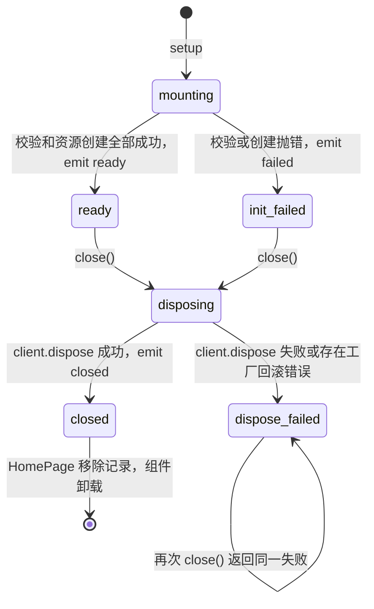
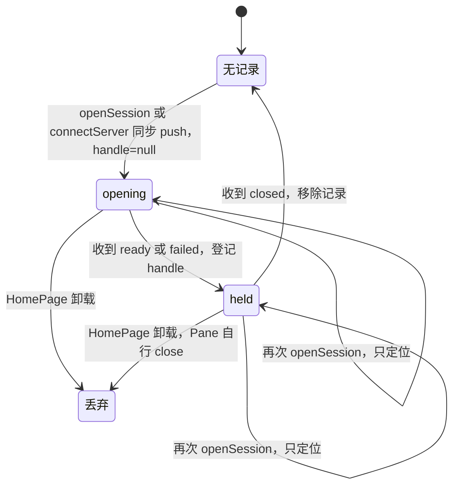
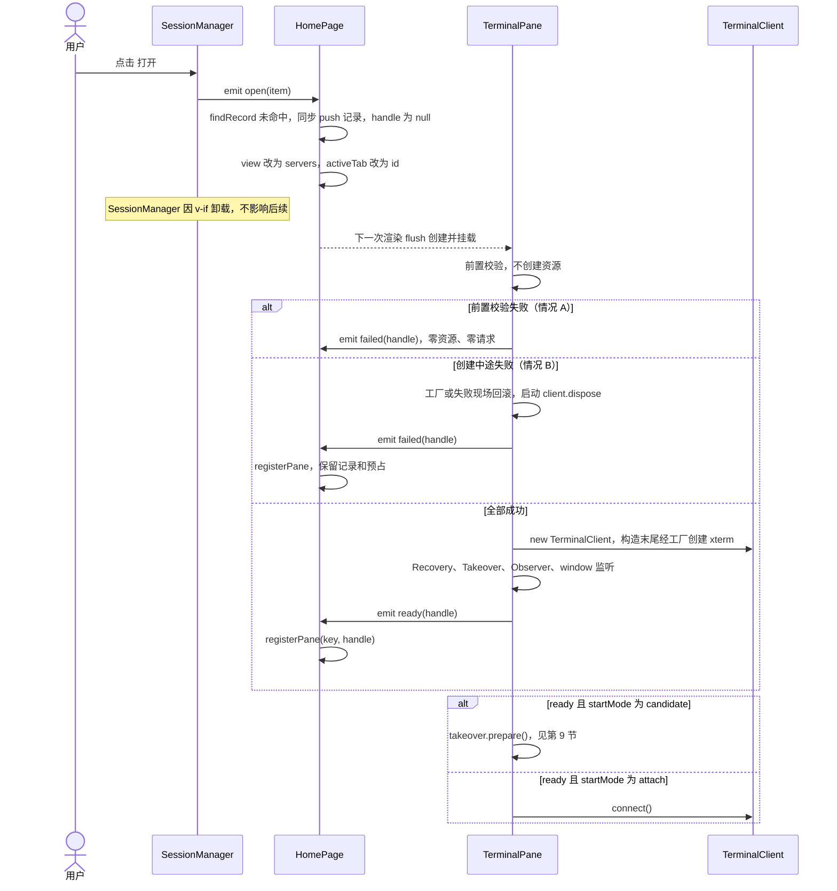
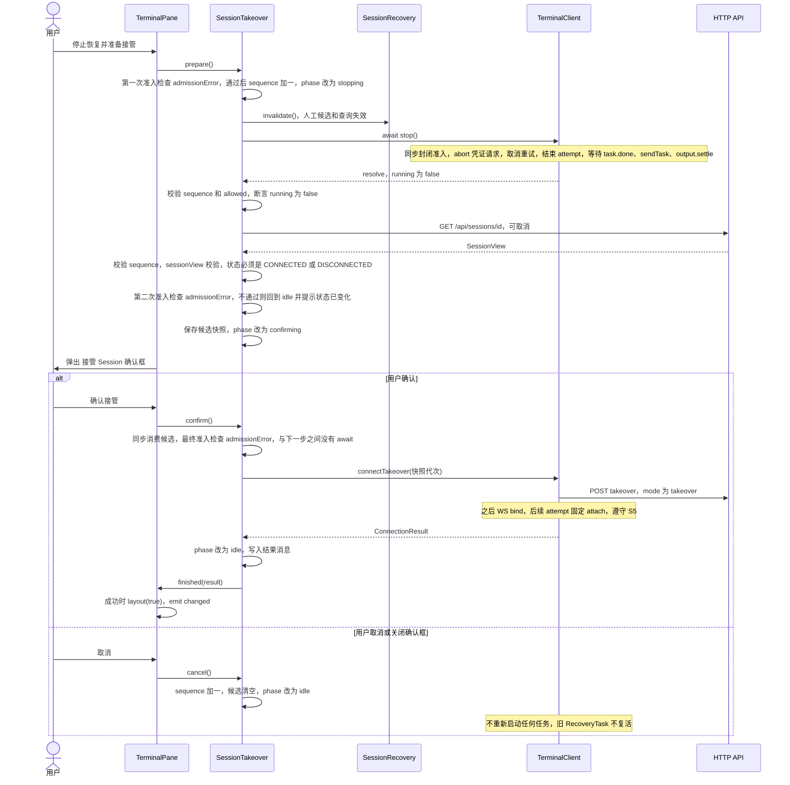
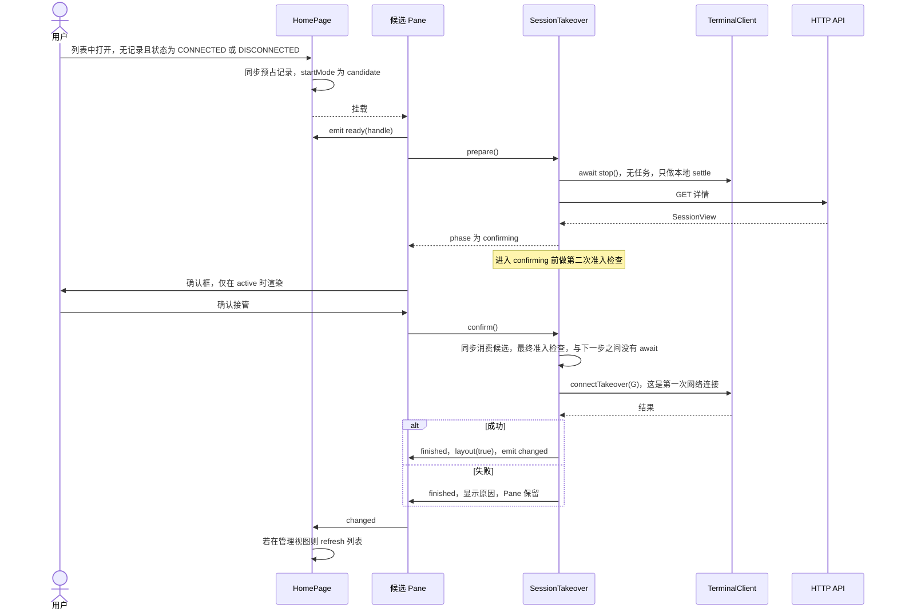
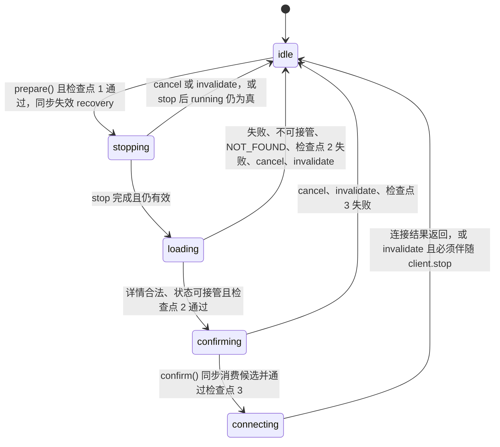
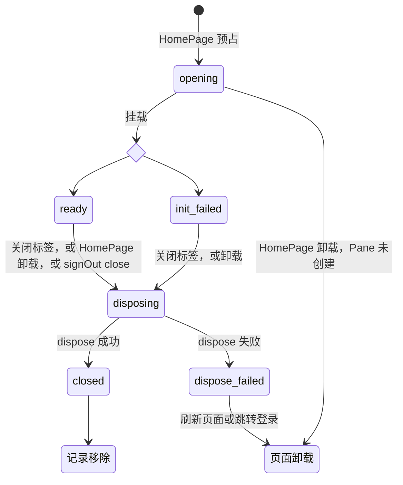

# Web SSH 第五阶段 S6 设计方案：多 Pane 与活动 Session 列表协调及主动接管

- 编写日期：2026-11-18
- 代码基线：分支 `S6`，HEAD `feb0ac5 S5-C2`，工作区干净
- 状态：第三轮定点修订稿（2026-11-18）。第二轮已处理人工审查的 BLOCKER-1/2、MAJOR-1/2/3，U1–U9 已按用户裁决登记；第三轮补充 T46-A（Terminal 构造失败）、T46-B（FitAddon 构造失败），本文档包含第三轮修订后的内容；等待最终人工审查；**未开始编码，未开始 S6-C1**
- 配套报告：`doc/stage-5-s6-design-review-report.md`
- 旧 S6 文档（`codex/第五阶段` 分支 `9e0b69b` 中的 precheck、方案 B 三轮修订报告）只作历史材料，不作为本设计的正确性依据

### 修订摘要（第二轮、第三轮）

| 审查项 | 修订位置 | 结论 |
|---|---|---|
| BLOCKER-1 构造期资源所有权 | §3.2、§3.3、§4.2、§4.3、§7.2、§7.4 | 按真实调用链证明：xterm 创建是 Client/Tracker 构造链的最后一步；构造失败只可能遗留 Pane 工厂内部的资源，由工厂局部回滚；Client 构造返回后立即归 Pane |
| BLOCKER-2 权威实施计划冲突 | `doc/stage-5-implementation-plan.md` 头部、§8.1–§8.4、§11.2、§11.3、§12.1、§12.2、§15、§16、F12、§21 | 旧规则标注“已被方案 B 替代”并保留原文 |
| MAJOR-1 三个时点准入 | §10.3、§10.4 | `prepare` 开始、GET 返回后、`connectTakeover` 紧前各检查一次；最终检查与调用之间无 await |
| MAJOR-2 初始化部分失败 | §5、§7.2、§7.4、§12 | 区分前置校验失败与创建中途失败；失败现场立即回滚，`close()` 等待同一清理结果；failed 不等于 closed |
| MAJOR-3 signOut 失败语义 | §6.5 | stop 失败与 close 失败分别统计、记录和反馈；登出成功优先 |
| U1–U9 | §19 | 全部改为“已裁决” |
| 新增测试 | §17 | S6-T46 至 S6-T50 |
| 第三轮：T46 构造阶段补充 | §7.4、§7.4.1、§15.1、§17、§18.1、§19.2 | 核对 xterm 6.0.0、addon-fit 0.11.0 源码：`new Terminal()` 抛错无可释放实例，构造期不产生外部资源（未确认边界已记录）；`new FitAddon()` 抛错时工厂释放已持有的 Terminal。新增 S6-T46-A（Terminal 构造失败）、S6-T46-B（FitAddon 构造失败）；修正 §7.4 开头的回滚表述，与回滚失败时记录清理错误的设计一致；无新阻塞项 |

---

## 1. S6 目标和非目标

### 1.1 目标

在同一浏览器的同一个 HomePage 内，协调多个终端 Pane 与活动 Session 列表，并接入用户明确确认的主动 takeover：

1. 同一 HomePage 内，同一 Session ID 最多一个 Pane（含正在创建、初始化失败、正在关闭、关闭失败的 Pane）。
2. SessionManager 每行提供“打开”入口，只触发打开事件。
3. 已有 Pane 时按 D2 定位；没有 Pane 时按 D3 创建候选 Pane。
4. Pane 内提供“准备接管 / 停止恢复并准备接管”：先完整 stop/drain，再查询详情，再弹框确认，确认后才用同一个 Client 发起 `mode=takeover`。
5. 接管成功后，同一 Pane、同一 TerminalClient、同一 TerminalOutputTracker 继续工作。
6. Pane 关闭、HomePage 卸载、登出、身份失效时，终止 Pane 拥有的动作和资源，迟到回调不能污染状态。
7. 修复现有缺陷：`closeLocal` 在清理失败时仍然 `emit('closed')`，导致 Session ID 预占被错误释放。

### 1.2 非目标

- 不修改后端，不修改 takeover 协议和 HTTP API。
- 不修改 S5 的 `client.ts`、`output.ts`，不改变其语义；不修改 `recovery.ts`、`auth.ts`、`router/index.ts`、`api/*`。
- 不重新设计 S7：关闭 SSH 的可取消 DELETE、登出失败/不确定的完整语义、列表与关闭的完整反馈都属于 S7。S6 只对 `signOut` 做适配新数据结构的最小改动。
- 不做轮询，不做跨浏览器标签页协调，不做路由化会话管理页。
- 不做视觉改版，不新增 CSS 体系。

---

## 2. 已冻结决策

| 编号 | 内容 | 在本设计中的落点 |
|---|---|---|
| D1=A | 进入管理页、手动刷新、操作完成后、页面重新可见时刷新列表，不轮询 | 前两项和“重新可见”沿用 SessionManager 现状；“操作完成后”由 Pane 的 `changed` 事件触发 HomePage 调用 `manager.refresh()`（§14） |
| D2=A | 在线 Pane 只定位；恢复中或已停止的 Pane 由用户明确发起“停止恢复并准备接管”；完整等待 stop/drain 后再查详情和确认；取消后旧任务不复活 | §8 |
| D3=A | 无 Pane 时先建候选 Pane，不自动连接；确认后 takeover；失败保留 Pane 和原因；不建第二个 Pane | §9 |
| 方案 B | HomePage 同步预占并创建候选 Pane；Pane 报告 ready 后接管所有权归 Pane；SessionManager 只展示、筛选、刷新、emit 打开；列表卸载、视图切换、刷新不取消 Pane 的动作 | §6、§7 |
| 4.5 硬约束 | 用户确认前不申请凭证、不调用 Prepare、不建 WebSocket、不连接 SSH | §9、§10.3 |
| S5 方案 A | 首个 attempt 用调用方指定的 mode，之后固定 attach；不自动查详情换代；BIND_CONFLICT 停止；`client.ts` 语义不变 | §10.3 只调用 `connectTakeover(G)`，不改 Client |

---

## 3. 现有代码和架构基线（S6 分支实际代码）

### 3.1 后端与 API

- `GET /api/sessions` 返回 `{items}`，可选 `server_id`，排除 CLOSED，按创建时间、ID 升序。
- `GET /api/sessions/{id}` 返回 SessionView，前端用 `sessionView(value, id)` 严格校验。
- `POST /api/sessions/{id}/takeover` 请求体为 `{mode, expected_generation}`，HTTP 只签发凭证。
- `canBind`：状态必须是 CONNECTED 或未过期的 DISCONNECTED，否则返回 `SESSION_NOT_READY`；`expected != generation` 返回 `BIND_CONFLICT`；attach 遇到已有 Binding 返回 `BIND_BUSY`。

### 3.2 `frontend/src/terminal/client.ts`（S5 冻结）

- `connect/run`（attach）、`connectTakeover/runTakeover`（takeover）都经过 `start()`。
- `start()` 会同步抛出：普通 `Error`（已 dispose、`allowed()` 为假、参数非法），或 `TerminalClientTaskConflictError`（`task_stopping`、`mode_mismatch`、`generation_mismatch`）。
- `running = task !== null || stopping !== null`。
- `stop()`：同步把 `task.stopped` 置真、abort 凭证请求、取消重试延迟、结束当前 attempt；随后依次等待 `task.done`、`sendTask`、`output.settle(true)`。完成后清空 `stopping`，此时 `task` 已在 loop 的 finally 中置空，所以 `stop()` resolve 后 `running === false`。
- `dispose()`：设置 `disposed=true`，组合 `stop()` 和 `output.dispose()`，结果**缓存在 `disposeTask`**；一旦失败，之后每次调用都返回同一个失败，无法重试。
- **构造顺序（BLOCKER-1 的事实依据）**：类字段初始化只有 `null`、`0`、`false` 等字面量；构造函数先做 9 个字段赋值（不会抛错），**最后一条语句**才是 `this.output = new TerminalOutputTracker(create, ...)`。构造期间不创建 WebSocket、AbortController、计时器或任务。
- 首次连接 Promise（`connection`）在 loop 中一定会 resolve，结果是 `{connected, code, message}`。

### 3.3 `frontend/src/terminal/output.ts`

- **构造顺序**：类字段初始化只有字面量、`[]`、`new Set()`；构造函数先做 5 个字段赋值，**最后一条语句**才是 `this.terminal = createTerminal()`（约第 95–102 行）。
- 因此整条构造链 `new TerminalClient → new TerminalOutputTracker → createTerminal()` 中，**创建外部资源是最后一步**：
    - `createTerminal()` 抛错：Tracker 和 Client 构造随之抛错；它们自身尚未创建任何外部资源，成为无引用的普通对象；唯一可能遗留的资源是工厂内部已经创建的 xterm、订阅，必须由工厂自己回滚（§7.4）。
    - `createTerminal()` 返回：两层构造函数都已没有后续语句，不可能再抛错；终端端口已由 Tracker 持有。
- `replaceTerminal()` 在运行期重建时也会调用同一个工厂，工厂的局部回滚规则同样适用。
- `settle()` 不会 reject，超时会重建终端。
- `dispose()` 只有在 `terminal.dispose()` 抛错时失败，结果被缓存。

### 3.4 `frontend/src/terminal/recovery.ts`（SessionRecovery）

- `allowed` 由外部注入。
- `refresh()` 要求 `allowed() && !acting && !client.running`。
- `invalidate()` 依次执行 `sequence++`、abort、清空 candidate、`acting=false`。
- `recover()` 先同步消费候选，再 stop，再 `connect(candidate.binding_generation)`（attach）。
- `ended` 是公开字段，Pane 在收到 `closed` 停止码时会写它。
- **结论**：只要把“takeover 空闲”加进注入的 `allowed`，就能实现与 takeover 互斥，无需修改 `recovery.ts`。

### 3.5 `TerminalPane.vue`

- `onMounted` 全程同步，顺序为：
    1. 注册 online/offline 监听。
    2. 构造 TerminalClient（同时创建 xterm）。
    3. 构造 SessionRecovery。
    4. 创建 ResizeObserver 和 MutationObserver。
    5. 自动执行 `connect()`（attach）。
- 初始化异常只写入 `notice`，**没有 ready/failed 报告**。
- `defineExpose({ stop, dispose })`。
- `dispose()` 把错误吞成 `notice`；`closeLocal()` 之后照样 `emit('closed')`，**清理失败也会关闭标签**，这是现有缺陷。
- `live() = !disposed && !logoutPending && identity !== null`。
- 同步 watcher 监听 `[logoutPending, identity]`，在 `!live()` 时调用 `stop()`。`/me` 刷新只替换 identity 对象，不会误停 Pane。
- `stoppedState` 有 `disposed` 和 `taskId` 守卫；收到 AUTH_REQUIRED 时调用 `notifyAuthExpired`；收到诊断码时调用 `recovery.refresh(false)`。
- `closeRemote` 让 stop 与 DELETE 并行执行。
- `closing` ref 表示“关闭 SSH 会话”确认框是否打开。

### 3.6 `HomePage.vue`

- 现有状态：
    - `tabs: SessionView[]`
    - `panes: Map<id, {stop, dispose}>`，经模板 ref 的 `setPane` 写入
    - `activeTab`（保存 session id）
    - `view: 'servers' | 'sessions'`
- TerminalPane 以 `v-for :key="tab.id"` 渲染，用 `v-show` 控制显示；SessionManager 以 `v-if="view==='sessions'"` 渲染。
- `connectServer`：`createSession` 成功后直接 push，没有去重。
- `signOut`：
    1. 设置 `logoutPending`。
    2. abort 请求，stop 所有 Pane。
    3. 调用 `logout()`。
    4. dispose 所有 Pane，清空 `tabs`。
    5. `router.replace('/login')`。

### 3.7 `SessionManager.vue`、`session/list.ts`

- 有列表、服务器筛选、本地状态筛选、可见性恢复刷新、`expose { refresh, invalidate }`。
- 表格列为 Session/服务器/状态/代次/尺寸/创建/最近绑定/断开/离线期限/剩余，**没有操作列，也没有 open 事件**。
- `authToken` 用 `Object.is` 比较；identity 对象被替换时只会重新刷新列表。

### 3.8 认证与路由

- `auth.ts`：
    - `identityEpoch` 是私有变量，`checkIdentity` 用它丢弃迟到的 `/me` 结果。
    - `logout()` 成功时执行 `clearIdentity` 并把 `logoutPending` 复位；失败时保持 `logoutPending`。
- `request()` 遇到 `AUTH_REQUIRED` 会调用 `onExpired`；网络错误抛出 `TypeError`，**不会**触发过期处理。
- 路由只有 `/` 和 `/login`。`beforeEach` 每次导航都调用 `checkIdentity`；遇到网络错误也会执行 `clearIdentity` 并跳转 `/login`。这是现有风险，S6 不新增任何导航（见 §19 U6）。

### 3.9 测试与构建

- `npm test` 即 `node --test tests/*.test.mjs`，编译真实 SFC。在临时副本中执行 `npm ci` 后，基线为 68/68 通过。
- `npm run build` 包含 `vue-tsc`。
- Pane 测试 harness 把所有 `.vue` 子组件替换成 `render(){return null}`，因此 Modal 的插槽内容目前无法断言（C1 需要调整测试 harness，§15）。
- HomePage 测试 harness 位于 `session-list.test.mjs`，其中的 TerminalPane 是计数用的替身组件。
- 新的 `.ts` 模块会被 Node 直接加载，**必须**使用可擦除的 TS 语法，相对导入带 `.ts` 后缀，与 `recovery.ts` 一致。

---

## 4. 模块职责和资源所有权

### 4.1 职责

| 模块 | 职责 | 明确不做 |
|---|---|---|
| SessionManager | 列表展示、筛选、刷新；每行“打开”按钮执行 `emit('open', item)` | 不知道 Pane 是否存在，不持有接管状态，不取消 Pane 动作 |
| HomePage | 维护 `records`；同步预占 Session ID；定位或创建 Pane；登记 Pane 句柄；在 `closed` 后才释放预占；转发 `changed` 刷新列表；登出时调用句柄 | 不参与接管流程，不查详情，不调用 Client |
| TerminalPane | 唯一拥有本 Pane 的全部长期资源和动作；初始化并报告 ready/failed；协调 recovery/takeover/close/身份 | 不修改 S5 Client 语义 |
| SessionTakeover（新增 `frontend/src/terminal/takeover.ts`） | 单个 Pane 内的主动接管动作：stop 屏障、详情查询、候选快照、确认、取消、调用 `connectTakeover` | 不建 WebSocket，不做重试，不持有 Client 生命周期 |
| SessionRecovery | 不变：两步人工 attach 和诊断查询 | — |
| TerminalClient / Tracker | 不变 | — |

### 4.2 资源所有权表

| 资源 | 创建者 | 持有者 | 创建或初始化失败时的回滚者 | 正常关闭的释放者及方式 |
|---|---|---|---|---|
| xterm Terminal、FitAddon、onData/onBinary/onResize 订阅 | Pane 的工厂 `createTerminalPort()`，由 Tracker 在构造末尾或 `replaceTerminal()` 中调用 | 工厂返回前归工厂；返回后归 TerminalOutputTracker（Pane 的 `terminal`/`fit` 只是成功提交后的引用） | 工厂自身：catch 中按逆序释放已注册订阅并 `term.dispose()`，再重新抛出原错误（§7.4） | Tracker：`client.dispose()` 经 `output.dispose()` 调用 `TerminalPort.dispose` |
| TerminalOutputTracker | `new TerminalClient` 构造末尾 | Client 字段 `output` | 无需回滚：其唯一外部资源来自工厂，工厂失败时 Tracker 尚未持有任何资源 | Client：`dispose()` 中调用 `output.dispose()` |
| TerminalClient | Pane `onMounted` 第二段 | 构造返回后**立即**赋给 Pane 字段 `client` | 构造抛错：无需回滚（见 §3.2、§3.3）；构造返回后的后续步骤失败：Pane 在失败现场立即启动 `client.dispose()` | `Pane.close()`：等待 `client.dispose()`（与失败现场启动的是同一个缓存 Promise） |
| WebSocket、凭证请求、重试计时器、sendTask | Client 任务 | Client | Client（任务内 finally） | `client.stop()`/`dispose()` |
| SessionRecovery 及其 AbortController | Pane / Recovery | Pane `recovery` | 无长期资源，无需回滚 | `invalidate()` |
| SessionTakeover 及其 AbortController | Pane / Takeover | Pane `takeover` | 无长期资源，无需回滚 | `invalidate()` |
| ResizeObserver、MutationObserver | Pane `onMounted` 第二段 | 创建后立即赋给 Pane 字段 `resize`/`theme` | Pane 失败现场：同步 `disconnect()` | `Pane.close()`：同步 `disconnect()`（幂等） |
| window online/offline 监听 | Pane `onMounted` 第二段（最后一步） | Pane | Pane 失败现场：同步 `removeEventListener`（对未注册的监听是空操作） | `Pane.close()`：同步 `removeEventListener` |
| `layout()` 中的 nextTick | Pane | — | — | 回调里校验 `live()`、实例和 taskId |
| Session ID 预占 | HomePage | `records` | 不回滚：init_failed 也保留 | 只在收到 Pane 的 `closed` 后移除 |
| 列表请求 | SessionListController | SessionManager | — | SessionManager 卸载时 `controller.dispose()` |

每个资源在任何时刻只有一个所有者，没有两个对象同时持有同一资源，也不存在“已创建但没有所有者”的时间窗口：工厂返回前归工厂，返回后归 Tracker；Client 构造返回前不存在外部资源，返回后立即归 Pane。

### 4.3 是否引入独立生命周期对象：比较与决定

| 方案 | 内容 | 复杂度 | 风险 |
|---|---|---|---|
| 甲：TerminalPane 直接管理（**采用**） | 用 `life` 枚举加单一 `close()` 入口；资源字段为空即表示未创建 | 低，只有一套状态 | 初始化全同步，没有跨 await 的半初始化窗口；`close()` 按字段是否为空清理 |
| 乙：PaneLifecycle + registerResource | 资源先登记到外部对象，由该对象统一释放 | 高 | 与 `client.dispose`/`output.dispose` 的缓存语义形成第二套生命周期；“构造完再 register 检查是否允许”是伪屏障；在同步初始化下解决的是不存在的问题 |

结论：不引入 PaneLifecycle、registerResource、PaneOperationGate、tombstone 集合或新 Store。理由：

1. Vue 的 `onMounted` 与 setup、patch 在同一同步流程内执行；本设计要求初始化**不含 await**，因此不存在“取消发生在初始化中途”的窗口，也就不需要创建屏障。
2. “创建前检查”做成真正的前置条件：可能失败的校验（身份、容器、`clientSettings`）放在创建任何资源之前（§7.2）。
3. 构造过程自身保证异常安全，而不是依赖一个外部注册表：每个资源一创建就有明确所有者；某一步失败时，由当前所有者回滚**它自己已经创建的部分**。具体为：工厂回滚 xterm 和订阅；Pane 在失败现场回滚监听器和 Observer，并立即启动 `client.dispose()`。不能把“尚未成功构造出来的 Client”留给 Pane 以后清理（§7.2、§7.4）。
4. 操作互斥依靠 JavaScript 单线程，加上“await 之前同步设置状态”和 sequence 令牌（§10）。

与“全部成功后再把完整 Client 交给 Pane”的差异：本设计在 Client **构造返回后立即**赋给 Pane 字段，而不是等 Observer、监听器全部创建成功后再赋值。原因是 `client.dispose()` 是异步的且结果被缓存，初始化失败的 Pane 必须持有 Client 句柄，才能在用户关闭时等待并判断清理结果（§12.2）。这不改变“构造失败的半成品由构造方自己回滚”的原则：Client 构造一旦返回，它就是完整对象，不是半成品。

---

## 5. Pane 状态机

### 5.1 `life`（Pane 实例生命周期，唯一一套）

```ts
type PaneLife =
  | 'mounting'       // setup 完成，尚未执行 onMounted
  | 'ready'          // 资源全部创建成功，已 emit ready
  | 'init_failed'    // 初始化失败，已 emit failed；失败现场已回滚同步资源，Client 清理可能仍在进行
  | 'disposing'      // close() 已开始，所有动作已同步失效
  | 'dispose_failed' // client.dispose() 失败或工厂回滚失败，实例保留
  | 'closed'         // 清理成功，已 emit closed
```



**ready、failed、closed 是三个不同概念，不能混用：**

| 概念 | 含义 | HomePage 的处理 |
|---|---|---|
| ready | Pane 初始化成功，资源所有权完整，接管动作所有权移交给 Pane | 登记句柄 |
| failed（`init_failed`） | Pane 初始化失败，但 **Pane 仍然存在**；可能仍有正在清理的 Client，或已回滚失败的 xterm | 登记句柄，**保留记录和 Session ID 预占** |
| closed | Pane 已经成功完成全部清理 | 移除记录，释放预占 |

failed 不意味着可以删除 Pane。即使失败现场的回滚已经完成，也必须等用户关闭、`close()` 确认清理成功后才 emit `closed`。否则可能出现“旧 xterm 仍在、却又为同一 Session 创建了新 Pane”的情况。

- `live() = life === 'ready' && !logoutPending && identity !== null`。所有动作准入、回调守卫、按钮可用性都以 `live()` 为准。
- 登出或身份失效**不是** `life` 状态，而是 `live()` 的外部条件。Pane 被 stop 但实例保留，随后由 HomePage 卸载或 signOut 调用 `close()`。
- 每个实例只会进入 `ready` 或 `init_failed` 之一，且只进入一次，因此 ready 和 failed 不会重复，也不会乱序。

### 5.2 `ready` 内部的动作状态（不是第二套生命周期）

`ready` 内部由三个已有或新增的状态组合描述：

- 连接状态：`client` 的 `phase`（idle/preparing/connecting/replaying/online/retry_wait/stopping/stopped）。
- 恢复状态：`recovery.loading/acting`。
- 接管状态：`takeover.phase`（§10.2）。

它们之间的互斥规则见 §10.1。

---

## 6. HomePage Pane 管理状态机

### 6.1 数据结构

把旧的 `tabs`、`panes`，以及旧文档中的 `pending`、`closing` 合并为一个数组：

```ts
type PaneStartMode = 'attach' | 'candidate'
interface PaneHandle {
  stop(): Promise<void>   // 失效动作并停止任务，实例保留
  close(): Promise<void>  // 不可逆；reject 表示清理失败
}
interface PaneRecord {
  key: number                 // 页内单调递增，作为 v-for :key 和事件路由键
  session: SessionView        // 打开时的快照（浅拷贝）
  startMode: PaneStartMode
  handle: PaneHandle | null   // null 表示 opening：已预占，尚未收到 ready/failed
}
const records = ref<PaneRecord[]>([])
let nextPaneKey = 0
let pageDisposed = false
```

| 旧状态 | 解决的问题 | 合并后 |
|---|---|---|
| `tabs` | 标签展示和渲染 | `records` |
| `panes` | 登出时 stop/dispose 句柄 | `record.handle`，由 ready/failed 事件写入，不再依赖模板 ref |
| `pending` | 创建到挂载之间的去重窗口 | `handle === null` |
| `closing` | 清理期间保持预占 | 记录在 `closed` 事件前一直保留；清理中、清理失败的细节属于 Pane `life`，HomePage 不需要知道 |

唯一性规则：**只要存在记录（任何状态），该 Session ID 就被占用。** 预占发生在点击处理函数中，没有任何 await，push 本身就是预占。

### 6.2 状态图



- 只有 `closed` 事件会移除记录。初始化失败和清理失败都**不**移除记录。
- 记录在 `dispose_failed` 时保留，预占不释放（§12.4，U1）。

### 6.3 `:key` 与实例身份

- `v-for` 的 key 用 `record.key`，**不用** session id。原因：如果同一次 flush 内先移除再重新打开同一个 Session，以 id 为 key 时 Vue 会复用旧组件实例（旧 Client、旧 life），以单调 key 保证一定创建新实例。
- 事件绑定使用闭包中的 `record.key`。HomePage 处理事件时按 key 查找记录，找不到则忽略。旧实例的迟到事件不会命中新记录。
- `activeTab` 继续保存 session id（同一时刻每个 id 最多一条记录）。

### 6.4 伪代码

```ts
function findRecord(sessionId: string): PaneRecord | undefined {
  return records.value.find((record) => record.session.id === sessionId)
}
function focusRecord(sessionId: string): void {
  view.value = 'servers'
  activeTab.value = sessionId
  sidebar.value = false
}
function reserveRecord(session: SessionView, startMode: PaneStartMode): void {
  // 同步预占：push 之后到 Pane ready 之间，重复打开会命中本记录
  records.value.push({ key: ++nextPaneKey, session: { ...session }, startMode, handle: null })
  focusRecord(session.id)
}

// SessionManager @open
function openSession(item: SessionView): void {
  if (pageDisposed || !identity.value || logoutPending.value) return
  if (findRecord(item.id)) {
    focusRecord(item.id) // D2：已有记录（任何状态）只定位
    return
  }
  if (item.status === 'CONNECTING') {
    notice.value = 'Session 正在建立，暂不能打开，请稍后刷新列表'
    return
  }
  if (item.status === 'CLOSING') {
    notice.value = 'Session 正在关闭，不能打开'
    return
  }
  notice.value = ''
  reserveRecord(item, 'candidate') // D3
}

// connectServer 成功分支（替换原来的 tabs.push）
if (operations.signal.aborted) return
if (findRecord(session.id)) focusRecord(session.id) // 防御性去重
else reserveRecord(session, 'attach')

// @ready 和 @failed 都登记句柄；失败原因由 Pane 自己展示
function registerPane(key: number, handle: PaneHandle): void {
  if (pageDisposed) return
  const record = records.value.find((item) => item.key === key)
  if (!record || record.handle) return
  record.handle = markRaw(handle)
}

function paneClosed(key: number): void {
  if (pageDisposed) return
  const index = records.value.findIndex((item) => item.key === key)
  if (index < 0) return
  const [record] = records.value.splice(index, 1)
  if (activeTab.value === record.session.id)
    activeTab.value = records.value.at(-1)?.session.id ?? ''
}

function paneChanged(): void {
  // D1：操作完成后刷新；不在管理视图时，下次进入会在挂载时刷新
  if (!pageDisposed && view.value === 'sessions') manager.value?.refresh()
}

onBeforeUnmount(() => {
  pageDisposed = true
  // 原有 query/operations abort 保持不变；子 Pane 卸载时各自 close()
})
```

模板：

```vue
<button v-for="record in records" :key="record.key" ...>
  {{ record.session.name }} · {{ record.session.id.slice(-4) }}
</button>
<TerminalPane
  v-for="record in records"
  :key="record.key"
  v-show="view === 'servers' && activeTab === record.session.id"
  :session="record.session"
  :start-mode="record.startMode"
  :active="view === 'servers' && activeTab === record.session.id"
  @ready="(handle) => registerPane(record.key, handle)"
  @failed="(handle) => registerPane(record.key, handle)"
  @closed="paneClosed(record.key)"
  @changed="paneChanged"
/>
<SessionManager v-if="view === 'sessions'" ref="manager" ... @open="openSession" />
```

模板 ref `manager` 只用来调用列表刷新，不承担任何 ready 语义。

### 6.5 `signOut` 的最小适配（完整语义属于 S7）

S6 只保证新增的候选接管动作能被安全失效和清理，并把 stop/close 的失败结果显式记录和反馈；不把 S7 的完整登出流程提前搬进来。

**顺序**：

1. 同步设置 `logoutPending=true`。Pane 的同步 watcher 立即调用 `Pane.stop()`，其中包含 `takeover.invalidate()`，所以候选接管动作在第一个 await 之前就已失效；新动作的准入（`live()`）同时封闭。
2. 同步对所有已登记句柄发起 `stop()`，得到 stop 屏障（与 watcher 发起的是同一个共享 Promise）。
3. **立即**调用 `logout()`，与本地排空并行。这是实施计划 §12.2 继承自第四阶段的冻结语义：准入已同步封闭，先等 drain 再请求撤销并不增加安全性，只会把服务端撤销推迟最多 `write_drain_timeout`。
4. 等待 stop 屏障完成，分别收集结果。
5. logout 成功：对所有句柄调用 `close()` 并收集结果；无论 close 是否失败都跳转登录页（U9：认证登出成功优先）。
6. logout 失败：保持现有“退出未完成，请重试”行为，停留在本页；不 close（Pane 已停止且 `logoutPending` 保持为真，不会恢复；后续处理属于 S7）。

```ts
interface PaneEntry { sessionId: string; handle: PaneHandle }
const registeredPanes = (): PaneEntry[] =>
  records.value.flatMap((record) =>
    record.handle ? [{ sessionId: record.session.id, handle: record.handle }] : [])

// 按 Session ID 汇总 allSettled 中失败的项；失败原因逐项写日志，不静默丢弃
function rejectedSessions(entries: PaneEntry[], results: PromiseSettledResult<void>[], action: string): string[] {
  const failed: string[] = []
  results.forEach((result, index) => {
    if (result.status === 'fulfilled') return
    failed.push(entries[index].sessionId)
    console.error(`退出登录时终端${action}失败`, entries[index].sessionId, result.reason)
  })
  return failed
}

async function signOut(): Promise<void> {
  if (signingOut.value) return
  signingOut.value = true
  logoutPending.value = true            // 同步：Pane watcher 调用 stop()，候选接管同步失效
  operations.abort()
  query?.abort()
  clearTimeout(debounce)
  probe.value = null
  const entries = registeredPanes()
  const stopTask = Promise.allSettled(entries.map((entry) => entry.handle.stop()))
  try {
    try {
      await logout()                    // 与本地排空并行，不等 drain
    } catch (error) {
      const stopFailed = rejectedSessions(entries, await stopTask, '停止')
      notice.value = '退出未完成，请重试。' + message(error) + stopSummary(stopFailed)
      return
    }
    const stopFailed = rejectedSessions(entries, await stopTask, '停止')
    const closeFailed = rejectedSessions(
      entries, await Promise.allSettled(entries.map((entry) => entry.handle.close())), '本地资源释放')
    await router.replace('/login')      // close 失败不阻止跳转
    // 跳转时路由守卫可能改写 authNotice（见下文），所以清理反馈在跳转完成后写入
    if (stopFailed.length > 0 || closeFailed.length > 0)
      authNotice.value = cleanupSummary(stopFailed, closeFailed)
  } finally {
    signingOut.value = false
  }
}
```

**stop 失败与 close 失败是两种不同的错误，分别统计、分别描述**：

| 失败 | 含义 | 反馈文案（示例） |
|---|---|---|
| `stop()` reject | 该 Pane 的连接任务**可能尚未完全停止**（WebSocket、凭证请求或排空可能仍在收尾） | “N 个终端未确认停止” |
| `close()` reject | 该 Pane 的**本地终端资源未能释放**（xterm 等可能残留在内存或 DOM） | “M 个终端本地资源未释放” |

- 登出成功时的完整反馈：“已退出登录；N 个终端未确认停止，M 个终端本地资源未释放，建议刷新页面”，只列出非零项；没有失败时不写反馈，保持现有行为。
- 记录方式：每个失败项 `console.error`，内容为动作、Session ID 和原始错误，不含凭证、Cookie 等敏感信息；用户反馈写入 `auth.ts` 已导出的 `authNotice`，LoginPage 已有展示位置，且只在用户提交登录时清空。不修改 `auth.ts` 和 `router/index.ts`。
- **跳转后再写 `authNotice` 的原因**（按代码推断，未运行验证）：logout 成功后 `logoutPending` 已复位、identity 为 null；`router.replace('/login')` 触发 `beforeEach` 调用 `checkIdentity()`，`/api/auth/me` 返回 AUTH_REQUIRED 时 `request()` 会调用过期处理，`expireIdentity()` 可能把 `authNotice` 改写为“登录已过期，请重新登录”。若在跳转前写入，反馈会被覆盖。这是现有 auth/router 行为，S6 不修改（U6），只在 C1 用测试确认实际顺序。
- 实际代码中 `client.stop()` 不会 reject（loop、sendTask、settle 都不 reject），但设计仍定义其失败语义，避免将来实现变化时失败被静默吞掉。
- `handle === null` 的记录：`logoutPending` 已同步置真，Pane 挂载时前置校验失败，进入 `init_failed`，不创建任何资源、不发请求；它没有登记句柄，不参与 stop/close 统计。
- close 失败的 Pane 随页面跳转卸载，无法保证其 xterm 被释放；这是登出成功优先（U9）的已知代价，用户反馈中已提示刷新页面。

---

## 7. 初始化与 ready/failed 时序

### 7.1 HomePage 视角的四个时间点

| 时间点 | HomePage 能观察到的事实 |
|---|---|
| 已创建（预占） | 记录已 push，`handle === null` |
| 组件已 mount | HomePage **不观察**；模板 ref 存在不等于 ready |
| ready | 收到 `ready(handle)`：资源全部创建成功，接管所有权移交给 Pane |
| failed | 收到 `failed(handle)`：初始化失败，Pane 仍然存在并展示原因；HomePage 登记句柄供关闭使用，**保留记录和预占** |
| closed | 收到 `closed`：Pane 清理成功，HomePage 移除记录、释放预占 |

ready **不表示已连接**。attach Pane 在 ready 之后才发起 `connect()`；候选 Pane 在 ready 之后只查询详情。

### 7.2 `onMounted` 伪代码

```ts
const props = defineProps<{ session: SessionView; active: boolean; startMode: PaneStartMode }>()
const emit = defineEmits<{ ready: [handle: PaneHandle]; failed: [handle: PaneHandle]; closed: []; changed: [] }>()
const life = ref<PaneLife>('mounting')
const takeover = shallowRef<SessionTakeover | null>(null)
let closeTask: Promise<void> | null = null
// 终端工厂回滚自身资源失败时记录的错误；非 null 表示可能有 xterm 残留，close() 必须失败
let terminalCleanupError: unknown = null
const handle: PaneHandle = { stop, close }
const live = (): boolean =>
  life.value === 'ready' && !logoutPending.value && identity.value !== null

onMounted(() => {
  if (life.value !== 'mounting') return
  // 第一段（情况 A）：只做可能失败的校验和纯计算，不创建任何资源，不发请求
  let settings: ClientSettings
  try {
    if (logoutPending.value || !identity.value || !host.value)
      throw new Error('登录状态或终端容器不可用')
    settings = clientSettings(identity.value.client_settings)
  } catch (error) {
    failInitialization(error)
    return
  }
  // 第二段（情况 B）：按顺序创建；每个资源创建后立即赋给 Pane 字段，任一步失败由失败现场回滚
  try {
    // 构造链最后一步才调用工厂创建 xterm（§3.2、§3.3）：构造抛错时只可能遗留工厂内部资源，由工厂自行回滚
    client = new TerminalClient(props.session.id, props.session.binding_generation,
      settings, createTerminalPort, /* notice、changed、stoppedState 同现状 */,
      () => live() && !closeRequested.value, confirmNetworkConnection)
    // 以下两个对象没有长期资源
    recovery.value = new SessionRecovery(props.session.id, client,
      () => live() && !remoteBusy.value && (takeover.value?.phase ?? 'idle') === 'idle',
      () => { revision.value++ })
    takeover.value = new SessionTakeover({ /* 见 §10.3 */ })
    resize = new ResizeObserver(fitTerminal)
    resize.observe(host.value)
    theme = new MutationObserver(applyTheme)
    theme.observe(document.documentElement, { attributes: true, attributeFilter: ['data-theme'] })
    networkOnline.value = navigator.onLine
    window.addEventListener('offline', networkOffline)
    window.addEventListener('online', networkRestored)
  } catch (error) {
    rollbackInitialization()
    failInitialization(error)
    return
  }
  life.value = 'ready'
  emit('ready', handle)
  if (!live()) return
  if (props.startMode === 'attach') void connect()
  else void takeover.value.prepare() // 只做 stop 屏障加 GET 详情，不连接（U2）
})

// 失败现场回滚：同步资源立即释放；Client 立即开始异步清理，结果缓存，close() 等待同一结果
function rollbackInitialization(): void {
  window.removeEventListener('offline', networkOffline) // 对未注册的监听是空操作
  window.removeEventListener('online', networkRestored)
  resize?.disconnect()
  theme?.disconnect()
  client?.dispose().catch(showCleanupFailure) // 不是空 catch：展示清理失败原因
}

function failInitialization(error: unknown): void {
  life.value = 'init_failed'
  notice.value = error instanceof Error ? error.message : '终端初始化失败'
  emit('failed', handle)
}
```

要点：

- setup 阶段不放任何可能失败的代码。
- 资源创建顺序与回滚责任：

  | 步骤 | 失败时已存在的资源 | 回滚者与时机 |
  |---|---|---|
  | `new TerminalClient`（含工厂） | 工厂内部已创建的 xterm、订阅 | 工厂 catch 中立即回滚并重新抛出（§7.4）；Client、Tracker 是无引用普通对象，无需回滚 |
  | `new SessionRecovery`、`new SessionTakeover` | Client（含 xterm） | Pane 失败现场：`client.dispose()` 立即启动 |
  | ResizeObserver 创建或 `observe` | Client；可能已有 `resize` | 同上，并同步 `resize.disconnect()` |
  | MutationObserver 创建或 `observe` | Client、`resize`；可能已有 `theme` | 同上，并同步 `theme.disconnect()` |
  | window 监听注册（最后一步） | 以上全部；可能已注册 offline | 同上，并同步移除两个监听 |

- 失败后 Pane 进入 `init_failed`，emit `failed(handle)`；HomePage 登记句柄并**保留记录和预占**。用户关闭标签时 `close()` 等待同一个 `client.dispose()` 结果，并检查 `terminalCleanupError`；只有两者都成功才 emit `closed`（§12.2）。
- ready 和 failed 在 `life` 从 `mounting` 迁出时只发一次。ready 之后的 `connect`/`prepare` 失败属于动作失败，只写入 Pane 提示，不会再发 failed。
- 初始化失败**不提供原地重试**（U5）。用户关闭标签（释放预占）后从列表或服务器重新打开，得到的是新 key、新实例。
- 候选 Pane 会创建 TerminalClient、xterm、SessionRecovery、SessionTakeover，但不启动任何任务。接管时复用这一个 Client，不会再建第二个。
- window 监听从“第一步”移到“最后一步”：监听只在 ready 之后的连接中使用，放在最后可以减少失败现场需要回滚的内容。

### 7.3 时序图



### 7.4 终端工厂 `createTerminalPort()`：局部回滚

工厂由 Tracker 在构造末尾和运行期 `replaceTerminal()` 中调用。工厂返回前，xterm 和订阅归工厂所有；返回后归 Tracker。工厂要么返回完整端口，要么抛出原始初始化错误。抛错前必须尽最大努力回滚自己创建的资源；如果回滚失败，必须记录清理错误（`terminalCleanupError`），并确保 Pane 后续关闭操作失败，不得将资源清理报告为成功，不得发送 `closed`，不得释放 Session ID 预占。

```ts
function createTerminalPort(): TerminalPort {
  const container = host.value
  if (!container) throw new Error('终端容器不可用') // 前置检查，尚未创建资源
  const term = new Terminal({ /* 同现状 */ })       // 第一个资源，所有权立即归工厂
  const subscriptions: IDisposable[] = []
  let addon: FitAddon
  try {
    addon = new FitAddon()  // loadAddon 之前不持有 DOM 或监听；加载后由 term.dispose 一并释放
    term.loadAddon(addon)
    term.open(container)
    subscriptions.push(term.onData(/* 同现状 */))
    subscriptions.push(term.onBinary(/* 同现状 */))
    subscriptions.push(term.onResize(/* 同现状 */))
  } catch (error) {
    rollbackTerminal(term, subscriptions)
    throw error // 重新抛出原错误，Tracker 和 Client 构造随之失败
  }
  // 提交：以下步骤不会同步抛错
  terminal = term
  fit = addon
  void layout()
  return {
    write: (bytes, callback) => term.write(bytes, callback),
    dispose: () => { /* 同现状：释放三个订阅、term.dispose()、清空 terminal/fit 引用 */ },
  }
}

// 逆序逐项释放；每一项单独捕获，某项失败不跳过后续项；失败记入 terminalCleanupError，不吞掉
function rollbackTerminal(term: Terminal, subscriptions: IDisposable[]): void {
  const steps = [...subscriptions.reverse().map((item) => () => item.dispose()), () => term.dispose()]
  for (const step of steps) {
    try {
      step()
    } catch (cleanupError) {
      terminalCleanupError ??= cleanupError
      console.error('终端创建失败后的回滚失败', props.session.id, cleanupError)
    }
  }
}
```

- 与现状的差异只有两点：订阅失败也纳入回滚；`terminal`/`fit` 引用改为全部成功后才写入（现状是 `open` 之后立即写入）。端口的 `write`/`dispose` 行为不变。
- 回滚失败时仍重新抛出**原错误**，回滚错误另行记录在 `terminalCleanupError`。此时可能有 xterm 残留，`close()` 会因此 reject，Pane 进入 `dispose_failed`，保留预占（U1）。
- **C1 前置不变量**：本节结论依赖“`createTerminal()` 是 `TerminalClient` 与 `TerminalOutputTracker` 构造函数的最后一步”，以及 §7.4.1 对 `@xterm/xterm` 6.0.0 构造期行为的核对。C1 开始前必须重新核对；若 S5 构造顺序或 xterm 版本改变，必须重新证明构造失败不会遗留资源，否则停止并报告（§16.2）。
- 运行期重建（`replaceTerminal`）中工厂失败时，工厂同样保证不遗留新 xterm；Tracker 随后的状态处理属于 S5 现有行为，S6 不修改。

#### 7.4.1 `new Terminal()` 与 `new FitAddon()` 两个构造阶段（第三轮补充）

依据：`frontend/package.json` 与 `package-lock.json` 锁定 `@xterm/xterm` 6.0.0、`@xterm/addon-fit` 0.11.0。项目目录没有 `node_modules`；核对使用临时副本 `/tmp/codex/s6-ui/frontend/node_modules` 中同版本包（锁文件的 version 和 integrity 与项目一致）随包发布的 `src/` 源码。

**阶段一：`new Terminal()` 抛错**

| 问题 | 结论 | 依据 |
|---|---|---|
| 调用方能否拿到可 `dispose()` 的实例 | 不能。构造表达式抛错时 `term` 没有被赋值，工厂和调用方都拿不到实例 | JavaScript 语义 |
| xterm 构造函数内部是否自行回滚已完成的部分 | **不会**。`Terminal`、`CoreBrowserTerminal`、`CoreTerminal` 的构造函数都没有 try/catch；中途抛错时，已经 `_register` 到内部 `DisposableStore` 的对象不会被 dispose | `src/browser/public/Terminal.ts` 第 32–54 行；`src/browser/CoreBrowserTerminal.ts` 第 149–181 行；`src/common/CoreTerminal.ts` 第 99–143 行 |
| 构造期间是否创建 DOM 节点 | 否。创建 `div`、`textarea` 等 DOM 节点只发生在 `open(parent)`（`CoreBrowserTerminal.ts` 第 393 行起） | 同上 |
| 构造期间是否注册全局或 DOM 事件监听、计时器、Worker、Observer | 否。构造链只创建内存对象：选项、缓冲区、日志、核心、鼠标、Unicode、字符集、OSC 链接等服务，以及 InputHandler、WriteBuffer、DecorationService、LinkProviderService、AddonManager、Emitter，并在这些内部对象之间注册事件转发。逐个检查这些构造函数，未发现 `window`/`document` 访问、`addEventListener`、`setTimeout`/`setInterval` 或 Worker；WriteBuffer 的 `setTimeout` 只在写入方法中使用 | 上述服务各自源文件的构造函数 |
| 是否登记到全局表，导致无法回收 | 否。`vs/base/common/lifecycle.ts` 中 `TRACK_DISPOSABLES = false`，`disposableTracker` 默认为 `null` | `lifecycle.ts` 第 21–22 行 |
| 非法选项是否会让构造抛错 | 一般不会。`OptionsService` 构造时对每个选项的校验错误被捕获并 `console.error`，不向外抛出 | `src/common/services/OptionsService.ts` 第 73–99 行 |

结论：`new Terminal()` 抛错时，已创建的部分对象只在内存中互相引用，没有外部引用，也没有 DOM、全局监听或计时器，会被垃圾回收。**不需要也无法由工厂或 Pane 释放**。所以 `new Terminal()` 放在 try 之前是正确的：此时工厂不持有任何资源，直接抛出原错误即可。Client、Tracker 随之构造失败（§3.2、§3.3），Pane 的 `client` 为 null，进入 `init_failed`。

未确认边界（如实记录，不当作事实）：

1. 结论来自随包发布的 TypeScript 源码。运行时实际加载的是构建产物 `lib/xterm.mjs`（压缩代码），没有逐行比对；同版本包内源码与产物同源只是合理前提，未运行验证。
2. xterm.js 没有对“构造中途抛错时不留外部资源”做文档承诺；以上只是 6.0.0 实现上的事实。升级 `@xterm/xterm` 时必须重新核对，作为 C1 前置不变量的一部分。
3. S6 的测试使用 xterm 替身，只能验证**工厂和 Pane 的**所有权逻辑，不能证明 xterm 内部行为；不能用 T46-A 的断言替代以上源码依据。

**阶段二：`new FitAddon()` 抛错**

| 问题 | 结论 |
|---|---|
| 此时 Terminal 是否已创建、是否由工厂持有 | 是。`term` 已创建并由工厂局部变量持有；按 §7.4 伪代码，`new FitAddon()` 位于 try 内 |
| 工厂是否释放 Terminal | 是。catch 调用 `rollbackTerminal(term, subscriptions)`：此时没有订阅，只执行 `term.dispose()`，然后重新抛出原错误 |
| 清理失败是否保留错误 | 是。`term.dispose()` 抛错时记入 `terminalCleanupError`，写日志，仍抛出 FitAddon 的原错误；Pane 初始化失败提示显示原错误 |
| 后续 `Pane.close()` 是否会误报成功 | 不会。此时 `client` 为 null，`close()` 中 `client?.dispose() ?? Promise.resolve()` 之后检查 `terminalCleanupError !== null` 并 reject，Pane 进入 `dispose_failed`，不 emit `closed`，HomePage 保留记录和预占（U1） |
| FitAddon 自身是否需要释放 | 不需要。0.11.0 的 `FitAddon` 没有构造函数，只有初始为 `undefined` 的 `_terminal` 字段，`dispose()` 为空操作；构造失败时没有实例 | `addon-fit/src/FitAddon.ts` 第 26–33 行 |

与当前真实代码的差异（这是 C1 要修复的现有缺陷，不是新阻塞项）：`TerminalPane.vue` 当前工厂（第 230–275 行）中 `new Terminal`、`new FitAddon`、`loadAddon`、`open` 和三个订阅**都没有 try/catch**，并在 `open` 后立即写入 `terminal`/`fit`。所以当前代码里 FitAddon 构造失败会留下一个无人引用但尚未 open 的 Terminal（按阶段一的结论，只占内存，可被回收）；`open` 或订阅失败则可能留下已插入 host 的 DOM 和监听，且无人释放。§7.4 的工厂设计已覆盖这些情况，不需要改变所有权模型。

**测试替身要求**：`terminal-pane.test.mjs` 当前把 `@xterm/addon-fit` 替换为固定的 `FitAddon` 类，无法注入构造异常。C1 需要把它改为与 `Terminal` 一样，通过 `globalThis` 提供可替换的替身，才能实现 T46-B。

---

## 8. D2：已有 Pane 的 stop/drain/takeover 完整时序

### 8.1 入口规则

- SessionManager 打开一个已有记录的 Session 时，只定位到该标签，不发起任何动作。
- Pane 工具栏中，接管按钮的显示条件为 `takeover.canPrepare`，即 takeover `phase==='idle'` 且 `admissionError() === null`（§10.3）：`life==='ready'`、身份有效、非 `logoutPending`、非 `remoteBusy`、非 `closeRequested`、未结束、未连接、Client `phase` 不在 `['online','replaying']` 之中、关闭 SSH 确认框未打开。此时 Client 可以有运行中的任务（由 prepare 先 stop），按钮文案按下两条区分。
    - 有任务在运行（preparing/connecting/retry_wait/stopping）时，按钮显示“停止恢复并准备接管”。
    - 没有任务（idle/stopped，含候选 Pane）时，按钮显示“准备接管”。
- 已连接（online、replaying，或 `connected===true`）时不显示接管按钮：本标签已经持有 Binding（D2 在线只定位）。

### 8.2 时序



### 8.3 详细语义

1. **stop 屏障**：`prepare()` 必须 `await client.stop()` 完成后才发 GET。`stop()` 返回时 `task.done`、`sendTask`、`output.settle(true)` 都已完成，满足“完整 stop/drain”。用户在 stopping 阶段再次点击时，`stop()` 返回同一个共享 Promise。
2. **代次校验**：以详情返回的 `binding_generation` 为确认代次 G，不因 G 与本地 Client 代次不同而拒绝（对方接管或掉线后代次本来就会变化）。确认框展示 G，确认时传入 `connectTakeover(G)`。stop 之后 `task === null`，因此不会触发 `generation_mismatch`。
3. **状态校验**：只有 CONNECTED、DISCONNECTED 可以确认。CONNECTING、CLOSING 显示原因并回到 idle。`SESSION_NOT_FOUND` 标记会话已结束。
4. **结果处理**：
    - 成功：同一 Pane、同一 Client、同一 Tracker 继续工作；输出偏移沿用 S5 同实例 drain 后的 processedOffset。
    - 首次 takeover attempt 可重试失败：按 S5，后续 attempt 固定 attach，代次为 `confirmedGeneration ?? G`；接管按钮因任务仍在运行显示“停止恢复并准备接管”。
    - `BIND_CONFLICT`（详情与提交之间代次又变化）：任务停止，显示原因；**不**自动查详情，**不**自动重新 takeover；用户可再次准备。
    - 迟到响应：sequence 不一致时直接丢弃。
5. **取消**：stopping、loading、confirming 阶段允许取消，取消后不调用 Client 的任何启动方法。connecting 阶段不提供“取消准备”，用户使用已有的“停止恢复”按钮（它会使 takeover 失效并停止 Client）。

### 8.4 三类并发

| 并发 | 处理 |
|---|---|
| stop 与 takeover | 由于 stop 是 prepare 的前置屏障，prepare 中不可能并发启动 takeover；confirm 的最终准入检查包含 `client.running`，若确认前 Client 又进入运行或 stopping，拒绝确认，提示重新准备 |
| stop 与关闭 | `close()` 先同步 `takeover.invalidate()`，再调用 `client.dispose()`（内部的 `stop()` 返回同一个共享 Promise）；prepare 恢复执行后 sequence 不一致，直接返回，不发 GET |
| stop 与身份失效 | 同步 watcher 调用 `Pane.stop()`，其中包含 `takeover.invalidate()`；prepare 恢复执行后返回，不发 GET；即使已在 loading，GET 也会被 abort |

---

## 9. D3：新候选 Pane 完整时序

| 问题 | 设计 |
|---|---|
| 初始状态 | 记录 `startMode='candidate'`；Pane ready 后连接状态为“未连接”，自动执行 `takeover.prepare()` |
| 是否创建 TerminalClient | 是，唯一一个；接管时复用 |
| 是否创建 xterm | 是，由 Client 构造时同步创建，内容为空 |
| 是否创建 SessionRecovery、SessionTakeover | 是 |
| 确认前能否输入 | 不能。`client.canInput` 要求存在已连接的任务，xterm 的键入会被丢弃 |
| 确认前网络动作 | 只有 `client.stop()`（无任务，只做本地 settle）和 GET 详情；不申请凭证、不 Prepare、不建 WS |
| 确认 | 同一个 Client 执行 `connectTakeover(G)` |
| 失败 | Pane 和原因保留，不新建 Pane；后续可重试错误按 S5 只 attach；不可重试错误停止 |
| 失败后再次 takeover | 只能由用户再次“准备接管”，重新 stop、查详情、确认，不会自动发生 |
| 取消 | Pane 保留，显示“未连接”和“准备接管”按钮（U4）；用户可关闭标签 |
| 候选 Pane 的人工 attach | 用户取消后，“刷新 Session 状态 → 手动恢复”这条已有的两步 attach 仍可用，属于用户显式操作（U3） |



---

## 10. 操作互斥与并发控制

### 10.1 对照表

| 当前进行中 \ 新发起 | 自动恢复（Client 任务） | 人工恢复 recover | 诊断/手动刷新 refresh | takeover.prepare | takeover.confirm | Pane.stop | close | 身份失效 |
|---|---|---|---|---|---|---|---|---|
| 自动恢复 | — | 由 recovery 先 stop 再启动 | `client.running` 时被拒绝 | 允许，抢占：stop 后继续 | 不可达（需先 prepare） | 允许 | 允许 | 允许 |
| 人工恢复 acting | — | `acting` 时拒绝 | 拒绝 | 允许，抢占：`recovery.invalidate` 后 stop | 不可达 | 允许 | 允许 | 允许 |
| refresh loading | — | 拒绝（需要候选） | 新查询取代旧查询 | 允许，抢占 | 不可达 | 允许 | 允许 | 允许 |
| takeover stopping/loading/confirming | 不会启动 | `allowed` 为假，拒绝 | `allowed` 为假，跳过 | phase 非 idle，忽略 | 仅 confirming 可用 | 允许，使 takeover 失效 | 允许 | 允许 |
| takeover connecting | 即为该任务 | 拒绝 | 跳过 | 忽略 | 忽略（候选已消费） | 允许，使 takeover 失效并 stop | 允许 | 允许 |
| closeRemote | stop 中 | `remoteBusy` 拒绝 | 拒绝 | `allowed` 为假，拒绝 | 拒绝 | 允许 | 允许 | 允许 |
| close（disposing） | dispose 中 | 拒绝 | 拒绝 | 拒绝 | 拒绝 | 返回 stop | 返回同一 closeTask | 无影响 |

规则总结：

- takeover 可以抢占 recovery，recovery 不能抢占 takeover。
- close 和身份失效可以抢占一切。
- closeRemote 通过 `stop()` 使 takeover 失效。
- “关闭 SSH 会话”按钮**不因** takeover 进行中而禁用（与实施计划 §11.3“关闭意图优先”一致）。关闭 SSH 确认框打开期间 `canBegin()` 为假：prepare 拒绝启动；GET 返回时的第二次检查失败，回到 idle，不显示接管确认框；confirm 的最终检查同样拒绝。因此两个 Modal 不会同时存在。确认关闭后 `closeRemote` 经 `stop()` 使 takeover 失效并停止任务。
- 接管确认框处于 confirming 时使用 `showModal`，用户无法点击工具栏，不会在 confirming 期间打开关闭 SSH 确认框。
- 不存在相互等待：只有 takeover 会等待 `client.stop()`，而 `stop()` 不等待任何上层动作，因此不会死锁。
- **约束**：`takeover.invalidate()` 只允许在 `Pane.stop()` 和 `Pane.close()` 内调用。这两处都会同时停止 Client，从而保证在 connecting 阶段使 takeover 失效时，Client 任务也一定会被停止。

### 10.2 SessionTakeover 状态机



### 10.3 `frontend/src/terminal/takeover.ts` 伪代码

导入要求：使用可擦除的 TS 语法，相对导入带 `.ts` 后缀（与 `recovery.ts` 一致）。

```ts
import { request, message } from '../api/management.ts'
import { ApiError } from '../api/client.ts'
import { sessionView, type SessionView } from '../api/sessions.ts'
import type { TerminalClient, ConnectionResult } from './client.ts'

export type TakeoverPhase = 'idle' | 'stopping' | 'loading' | 'confirming' | 'connecting'

export interface SessionTakeoverOptions {
  id: string
  client: Pick<TerminalClient, 'running' | 'stop' | 'connectTakeover'>
  invalidateRecovery: () => void
  allowed: () => boolean   // Pane 整体准入：life==='ready'、身份有效、非登出、!remoteBusy、!closeRequested
  canBegin: () => boolean  // Pane 当前连接与界面状态：未连接、不在 online/replaying、关闭 SSH 确认框未打开
  isEnded: () => boolean   // Session 已被确认结束（closed 停止码或 SESSION_NOT_FOUND）
  markEnded: () => void    // 同时写 Pane ended 和 recovery.ended
  changed: () => void      // revision++
  finished: (result: ConnectionResult) => void
}

// 每个 Pane 私有的主动接管动作所有者；不建 WebSocket，不重试，不持有 Client 生命周期。
export class SessionTakeover {
  phase: TakeoverPhase = 'idle'
  candidate: SessionView | null = null
  error = ''
  message = ''
  private sequence = 0
  private controller: AbortController | null = null
  private options: SessionTakeoverOptions
  constructor(options: SessionTakeoverOptions) { this.options = options }

  get canPrepare(): boolean {
    return this.phase === 'idle' && this.admissionError() === null
  }

  // 仅供确认按钮禁用使用；安全性不依赖 UI，confirm() 自己会再做最终检查
  get canConfirm(): boolean {
    return this.phase === 'confirming' && this.candidate !== null && this.startError() === null
  }

  // 用户取消：只在尚未启动连接的阶段可用
  cancel(): void {
    if (this.phase === 'idle' || this.phase === 'connecting') return
    this.invalidate()
  }

  // 只允许 Pane.stop()/close() 调用，调用方负责同时停止 Client
  invalidate(): void {
    this.sequence++
    this.controller?.abort()
    this.controller = null
    this.candidate = null
    this.phase = 'idle'
    this.options.changed()
  }

  async prepare(): Promise<void> {
    // 检查点 1：prepare 开始时；此时允许 Client 有运行中的任务（随后 stop）
    if (this.phase !== 'idle') return
    const rejected = this.admissionError()
    if (rejected !== null) {
      this.fail(rejected)
      return
    }
    const sequence = ++this.sequence
    this.options.invalidateRecovery()
    this.candidate = null
    this.error = ''
    this.message = ''
    this.phase = 'stopping'
    this.options.changed()
    try {
      await this.options.client.stop() // 完整 stop/drain 屏障
    } catch (error) {
      if (this.isCurrent(sequence)) this.fail(message(error))
      return
    }
    if (!this.isCurrent(sequence)) return
    if (this.options.client.running) {
      this.fail('原终端任务尚未停止，请稍后重新准备接管')
      return
    }
    const controller = new AbortController()
    this.controller = controller
    this.phase = 'loading'
    this.options.changed()
    try {
      const value = await request<unknown>(
        `/api/sessions/${encodeURIComponent(this.options.id)}`,
        'GET', undefined, controller.signal)
      if (!this.isCurrent(sequence)) return
      const view = sessionView(value, this.options.id)
      if (view.status !== 'CONNECTED' && view.status !== 'DISCONNECTED') {
        this.fail('Session 当前状态不能接管')
        return
      }
      // 检查点 2：GET 返回后、进入 confirming 前；不通过时不展示看似有效的确认状态
      if (this.startError() !== null) {
        this.fail('Session 或终端状态已变化，请重新准备接管')
        return
      }
      this.candidate = view
      this.phase = 'confirming'
      this.options.changed()
    } catch (error) {
      if (!this.isCurrent(sequence)) return
      if (error instanceof ApiError && error.code === 'SESSION_NOT_FOUND')
        this.options.markEnded()
      this.fail(message(error))
    } finally {
      if (this.sequence === sequence) this.controller = null
    }
  }

  async confirm(): Promise<void> {
    const candidate = this.candidate
    if (this.phase !== 'confirming' || candidate === null) return
    const sequence = ++this.sequence // 首次 await 前消费候选，重复点击无效
    this.candidate = null
    // 检查点 3：最终检查，紧贴 connectTakeover 之前，二者之间没有 await；
    // 不重新查询详情、不重新获取代次，仍使用候选快照的 binding_generation，最终冲突由 S5 与后端判定
    const rejected = this.startError()
    if (rejected !== null) {
      this.fail(`${rejected}，请重新准备接管`)
      return
    }
    this.phase = 'connecting'
    this.error = ''
    this.options.changed()
    let result: ConnectionResult
    try {
      // start() 的同步异常也在此捕获
      result = await this.options.client.connectTakeover(candidate.binding_generation)
    } catch (error) {
      if (this.sequence === sequence) this.fail(message(error))
      return
    }
    if (this.sequence !== sequence) return
    this.phase = 'idle'
    this.message = result.connected ? '已接管该 Session' : `接管未完成：${result.message}`
    this.options.changed()
    this.options.finished(result)
  }

  // 三个检查点共用的 Pane 级准入；只读取注入的判断，不复制 Pane 状态
  private admissionError(): string | null {
    if (!this.options.allowed()) return '当前终端不允许新操作'
    if (this.options.isEnded()) return 'Session 已结束'
    if (!this.options.canBegin()) return '当前终端状态不允许接管'
    return null
  }

  // stop 屏障之后使用：在 Pane 级准入之外，还要求 Client 没有运行中的任务
  private startError(): string | null {
    const rejected = this.admissionError()
    if (rejected !== null) return rejected
    return this.options.client.running ? 'Client 仍有运行中的任务' : null
  }

  // sequence 已变化说明已被失效；准入条件消失但尚未失效时就地复位，避免卡在中间阶段
  private isCurrent(sequence: number): boolean {
    if (this.sequence !== sequence) return false
    if (this.options.allowed()) return true
    this.invalidate()
    return false
  }

  private fail(text: string): void {
    this.phase = 'idle'
    this.candidate = null
    this.error = text
    this.options.changed()
  }
}
```

说明：

0. **三个准入检查点**：

   | 检查点 | 时机 | 使用 | 不通过时 |
   |---|---|---|---|
   | 1 | `prepare()` 开始，sequence 加一之前 | `admissionError()`（允许 Client 有运行中的任务，随后 stop） | 写入错误，保持 idle，不 stop、不 GET |
   | 2 | GET 返回且状态合法后、进入 confirming 前 | `startError()` | 回到 idle，提示“状态已变化，请重新准备接管”，不显示确认框 |
   | 3 | `confirm()` 同步消费候选后、调用 `connectTakeover` 紧前 | `startError()` | 回到 idle，不调用 Client 任何启动方法 |

   prepare 通过不代表 GET 返回时仍通过；GET 返回时通过也不代表用户点击确认时仍通过，所以三处都要检查。检查点 3 与 `connectTakeover` 之间没有 await，JavaScript 单线程保证检查结果在调用时仍成立。确认按钮可以用 `canConfirm` 禁用，但 `confirm()` 不依赖按钮禁用保证安全。

   四个判断各自负责不同的事实，不重复维护状态：

   | 判断 | 事实来源 | 为什么不能被其他判断替代 |
   |---|---|---|
   | `allowed()` | Pane `life`、identity、`logoutPending`、`remoteBusy`、`closeRequested` | 表示“整个 Pane 是否还接受新动作”；与 Client 的 `allowed` 注入同源 |
   | `isEnded()` | Pane `ended` | Session 已确认结束时，即使 Pane 空闲也不能接管 |
   | `canBegin()` | `connected`、Client `phase`、`closing`（关闭 SSH 确认框） | 表示“本 Pane 当前连接和界面状态是否适合开始接管”；online/replaying 时本标签已持有 Binding |
   | `!client.running` | Client `task`/`stopping` | 与 `canBegin` 不重叠：例如 retry_wait 时 `canBegin` 为真但 `running` 也为真；只在 stop 屏障之后要求为假 |

1. `isCurrent` 中由于准入消失而调用 `invalidate()` 的情形，只可能发生在 stopping 或 loading 阶段（此时没有由 takeover 启动的 Client 任务），因此不违反 §10.1 的约束。
2. connecting 阶段不调用 `isCurrent`，connection Promise 一定会 resolve（§3.2），所以 connecting 一定会退出。
3. 原本由 `stoppedState` 触发的诊断刷新在 takeover 进行中会被跳过，其结果消息已经由 `takeover.message` 展示；用户可以手动刷新状态。

### 10.4 Pane 内与 takeover 相关的改动伪代码

```ts
takeover.value = new SessionTakeover({
  id: props.session.id,
  client,
  invalidateRecovery: () => recovery.value?.invalidate(),
  allowed: () => live() && !remoteBusy.value && !closeRequested.value,
  canBegin: () => !connected.value && !['online', 'replaying'].includes(phase.value) && !closing.value,
  isEnded: () => ended.value,
  markEnded: () => {
    ended.value = true
    if (recovery.value) recovery.value.ended = true
  },
  changed: () => { revision.value++ },
  finished: (result) => {
    if (result.connected && live()) void layout(true)
    emit('changed')
  },
})

function stop(): Promise<void> {
  busy.value = false
  takeover.value?.invalidate()
  return recovery.value?.stop() ?? client?.stop() ?? Promise.resolve()
}
```

- `closeRemote()`：保持现有并行 stop+DELETE 结构（`stop()` 已包含 takeover 失效），在 finally 中 `emit('changed')`（D1）。
- `stoppedState` 守卫由 `disposed` 改为 `life.value !== 'ready'`；`fitTerminal` 同理。

---

## 11. 身份生命周期与异步回调隔离

### 11.1 四层生命周期

| 层次 | 起止 | 嵌套关系 |
|---|---|---|
| 登录周期 | 登录成功到登出、过期或服务端拒绝 | 最外层 |
| AuthView 展示数据 | `/me` 每次成功都可能替换 identity 对象 | 同一登录周期内可多次替换，**不是**周期边界 |
| HomePage 生命周期 | 挂载 `/` 到跳转 `/login` | 嵌套在一个登录周期内：每条 identity 为 null 的路径都会跳转 `/login`（`expired()`、守卫失败、登出成功） |
| Pane 实例 | `mounting` 到 `closed` | 嵌套在 HomePage 内 |

### 11.2 结论：不新增 identityEpoch，不改 auth/router

| 要求 | 依据 |
|---|---|
| `/me` 刷新不误杀 Pane | watcher 只在 `!live()` 时 stop；identity 对象替换后仍不为 null |
| AuthView 对象替换不误杀 | 同上；SessionManager 只会重新刷新列表 |
| 普通路由导航不误杀 | 只有 `/` 和 `/login` 两个路由；S6 不新增导航；守卫重定向回 `/` 时 HomePage 不重新挂载 |
| 登出或重新登录使旧 Pane 失效 | `logoutPending` 或 identity 为 null 时 watcher 同步 stop 并使 takeover 失效；随后跳转 `/login`，HomePage 卸载，Pane close；新登录只能出现在新的 HomePage 实例中 |
| 服务端明确确认失效时及时停止 | `request()` 遇到 AUTH_REQUIRED 调用 `onExpired`，identity 置 null，Pane 同步 stop；WS 停止码 AUTH_REQUIRED 由 `stoppedState` 调用 `notifyAuthExpired` |
| 网络错误不当作失效 | Pane、Takeover 中的网络错误只写提示；`request()` 只对 AUTH_REQUIRED 调用过期处理 |
| 旧登录周期的迟到响应不覆盖新周期 | 旧 Pane 已 `disposing`/`closed`，`live()` 为假；takeover 和 recovery 的 sequence 已失效；HomePage 的 `operations` 已 abort；`checkIdentity` 自带私有 epoch |

已知限制：

- 同一浏览器多个标签页共享 cookie，无法区分彼此的登录。这属于产品既有前提。
- 路由守卫把网络错误当作 `clearIdentity`，是现有风险，不在 S6 范围内修改（U6）。

---

## 12. 关闭、dispose、失败重试状态机

### 12.1 概念区分

| 概念 | 实现 |
|---|---|
| 关闭意图 | 调用 `close()`；`life` 同步改为 `disposing` |
| 禁止新操作 | `live()` 立即为假：Client 的 `allowed`、Recovery 的 `allowed`、Takeover 的 `allowed` 同步变为假 |
| 取消初始化 | 初始化是同步的，没有可取消的窗口；挂载前 `logoutPending` 由前置校验拦截（情况 A，零资源） |
| 初始化中途失败 | 情况 B：失败现场同步回滚监听器和 Observer，立即启动 `client.dispose()`；Pane 保留在 `init_failed`，由 `close()` 等待同一清理结果（§7.2） |
| stop | `Pane.stop()`：使动作失效并停止任务，实例保留 |
| dispose | `client.dispose()`：stop 加 Tracker 释放 xterm |
| 真实清理成功 | 只以 `client.dispose()` resolve **且** `terminalCleanupError === null` 为准；不以组件卸载、ref 变 null 或 nextTick 为准 |
| 失败后重试 | 不可行：`client.dispose()` 会缓存失败（S5 冻结），见 U1 |
| tombstone | 不需要：记录本身在 `closed` 之前一直存在，起到墓碑作用；旧实例由 key 和 `life` 隔离 |

### 12.2 `close()` 伪代码（统一 Promise reject 语义）

```ts
function close(): Promise<void> {
  if (closeTask) return closeTask
  life.value = 'disposing'      // live() 立即为假，所有回调、按钮、准入同步失效
  closing.value = false         // 关闭 SSH 确认框
  takeover.value?.invalidate()
  recovery.value?.invalidate()
  window.removeEventListener('offline', networkOffline)
  window.removeEventListener('online', networkRestored)
  resize?.disconnect()
  theme?.disconnect()
  // 初始化失败现场已启动 client.dispose() 时，这里拿到的是同一个缓存 Promise
  const cleanup = (client?.dispose() ?? Promise.resolve()).then(() => {
    // 工厂回滚失败意味着可能有 xterm 残留，不能视为清理成功
    if (terminalCleanupError !== null) throw terminalCleanupError
  })
  closeTask = cleanup.then(
    () => {
      life.value = 'closed'
      emit('closed')
    },
    (error: unknown) => {
      life.value = 'dispose_failed'
      throw error
    },
  )
  return closeTask
}

// 失败展示由调用方负责，错误链为：client.dispose reject → closeTask reject → 调用方展示
function showCloseFailure(error: unknown): void {
  notice.value = `终端清理失败，请刷新页面后再打开该 Session：${message(error)}`
}
// 初始化失败现场的清理失败只展示，不改变 life；用户关闭时 close() 会得到同一失败并进入 dispose_failed
function showCleanupFailure(error: unknown): void {
  notice.value = `${notice.value}；终端资源清理失败，请刷新页面：${message(error)}`
}
function closeLocal(): void { void close().catch(showCloseFailure) }
onBeforeUnmount(() => { void close().catch(showCloseFailure) })
```

- 错误传播链：`client.dispose()` reject 或存在 `terminalCleanupError`，`closeTask` reject；Pane 内的调用方用 `showCloseFailure` 展示；HomePage 的 `signOut` 用 `allSettled` 收集结果，按 §6.5 分别统计、记录和反馈，不回退流程。
- 幂等：重复调用返回同一个 `closeTask`。成功后 `closed` 只发一次；失败后不发 `closed`。
- `init_failed` 的 Pane 关闭时走同一个 `close()`：对未创建的字段是空操作，对已回滚的同步资源重复释放是幂等的。

### 12.3 状态图



### 12.4 场景表

| 场景 | 处理 |
|---|---|
| 正常关闭 | `disposing` 后 dispose 成功，进入 `closed`，emit `closed`，HomePage 移除记录 |
| 尚未创建组件时关闭 | 没有关闭入口（关闭按钮在 Pane 内）；HomePage 卸载时记录随之丢弃；signOut 时 `logoutPending` 使挂载后直接 `init_failed`，无资源 |
| 尚未 mount | 同上（创建与挂载在同一次 patch 内，不会被分隔） |
| mount 初始化中 | 初始化同步执行，不存在“初始化中”的关闭；中途抛错时由失败现场回滚（工厂回滚 xterm 和订阅，Pane 回滚监听器和 Observer 并启动 `client.dispose()`），进入 `init_failed`；预占保留，用户关闭时 `close()` 等待同一清理结果 |
| ready 后 | 正常关闭 |
| Recovery 运行中 | `recovery.invalidate()` 同步执行；`client.dispose()` 内部 stop 结束任务 |
| Takeover 请求中 | `takeover.invalidate()` 同步执行：stopping 阶段的后续不再执行，loading 阶段 abort GET，confirming 阶段候选清空，connecting 阶段的结果被丢弃且 Client 被 dispose 停止 |
| dispose 失败 | 进入 `dispose_failed`，展示原因，**记录保留，预占不释放**；再次打开该 Session 只定位到此标签 |
| dispose 重试 | 再次关闭返回同一失败（S5 `disposeTask` 缓存）；提示用户刷新页面（U1） |
| HomePage 卸载 | `pageDisposed=true`；子 Pane 的 `onBeforeUnmount` 调用 `close()`；子组件已卸载，其 emit 被 Vue 丢弃；不声称清理成功 |
| 登出 | §6.5 |
| 身份失效 | watcher 执行 `stop()`（不 close）；随后跳转 `/login`，HomePage 卸载，Pane close |

---

## 13. 关键异常和竞态处理

| 编号 | 竞态或异常 | 处理与结果 |
|---|---|---|
| R01 | 同步双击“打开” | 第二次命中记录，只定位 |
| R02 | 已打开后再次从列表打开 | 只定位（D2） |
| R03 | 打开后、Pane ready 前登出 | Pane 挂载时前置校验失败，`init_failed`，零资源、零请求 |
| R04 | 预占后、flush 前 HomePage 卸载 | Pane 从未创建，记录随页面丢弃 |
| R05 | 关闭后在同一 flush 内重新打开 | 新 key 创建新实例，旧实例不复用 |
| R06 | 旧实例迟到的 ready/closed/changed 事件 | 组件已卸载时 Vue 丢弃 emit；按 key 查不到记录时忽略 |
| R07 | prepare 的 stopping 阶段中 close、取消或身份失效 | sequence 失效；stop 完成后不发 GET；不启动任何任务 |
| R08 | loading 阶段中 close、取消或身份失效 | abort GET；迟到响应被 sequence 丢弃 |
| R09 | confirming 阶段中身份失效 | 候选清空，确认框消失（phase 变为 idle） |
| R10 | 双击“确认接管” | 第一次点击同步消费候选，第二次点击无效 |
| R11 | 确认时 Client 仍在 stopping 或又有运行中的任务 | 检查点 3 拒绝，提示重新准备 |
| R12 | connecting 阶段点“停止恢复” | `stop()` 使 takeover 失效并停止 Client；连接结果被丢弃；不自动重试 |
| R13 | connecting 阶段关闭标签 | dispose 停止任务；结果被丢弃 |
| R14 | takeover 处于 stopping/loading 时打开关闭 SSH 确认框 | 按钮不禁用（关闭意图优先）；确认框打开期间 `canBegin` 为假，GET 返回时检查点 2 失败，回到 idle，不显示接管确认框；确认关闭后 `closeRemote` 经 `stop()` 使 takeover 失效 |
| R15 | takeover 进行中触发诊断刷新或点击手动恢复 | Recovery 的 `allowed` 为假，跳过或禁用 |
| R16 | takeover 进行中 SessionManager 卸载、切换视图或刷新列表 | 无影响（方案 B） |
| R17 | 详情代次与本地代次不同 | 不拒绝，以详情代次确认 |
| R18 | 详情与提交之间代次再次变化 | 后端返回 BIND_CONFLICT，任务停止，展示原因，不自动换代 |
| R19 | 首次 takeover attempt 可重试失败 | 按 S5 后续 attempt 只 attach，代次为 `confirmedGeneration ?? G`；可能遇到 BIND_BUSY 直至预算耗尽，属于冻结行为 |
| R20 | GET 返回 SESSION_NOT_FOUND | 标记会话已结束，禁止接管和恢复 |
| R21 | GET 返回 AUTH_REQUIRED | `request()` 触发过期处理，进入 R09 的路径，最终跳转登录 |
| R22 | GET 网络错误或超时 | 只展示错误，回到 idle，不影响身份 |
| R23 | 被接管端（另一浏览器）收到 4001 或 `taken_over` | S5 行为：停止自动恢复，不抢回 |
| R24 | 同页多个不同 Session 同时接管 | 各 Pane 的 takeover 相互独立；只有 active Pane 渲染确认框 |
| R25 | confirming 阶段切换到其他标签 | Modal 使用 `showModal`，阻止页面其他交互；若以程序方式变为非 active，确认框不渲染但候选保留，重新 active 时再次渲染 |
| R26 | `dispose` 失败 | 记录保留，Session ID 不释放 |
| R27 | xterm `open`、`loadAddon` 或订阅注册抛错 | 工厂逆序释放已建订阅并 `term.dispose()`，重新抛出原错误；Client 构造失败，Pane 进入 `init_failed`，`client` 字段为 null |
| R28 | 工厂回滚本身抛错 | 错误记入 `terminalCleanupError` 并写日志；Pane 进入 `init_failed`；关闭时 `close()` reject，进入 `dispose_failed`，预占保留（U1） |
| R29 | Client 构造成功后，Observer 创建或 `observe`、监听注册抛错 | 失败现场同步回滚监听器和 Observer，立即启动 `client.dispose()`；`init_failed`；关闭时等待同一 dispose 结果，成功才 emit `closed` |
| R30 | confirming 期间 `canBegin` 变假（例如 Client 被外部推进到其他状态） | 检查点 3 拒绝，零 Prepare、零 WS |
| R31 | GET 返回前 Session 被标记结束或 Pane 准入失效 | 准入失效：`isCurrent` 就地复位；已结束或 `canBegin` 变假：检查点 2 失败，不展示确认框 |
| R32 | signOut 时某个 Pane `stop()` reject | 单独计入“未确认停止”，写日志；不阻止 logout 和跳转 |
| R33 | signOut 时 logout 成功但某个 Pane `close()` reject | 单独计入“本地资源未释放”，写日志；仍跳转登录页，跳转后写入 `authNotice` 反馈 |

---

## 14. UI 交互及现有样式复用

1. **SessionManager**：表格最后新增“操作”列，每行一个默认样式按钮“打开”，执行 `emit('open', item)`，在 `!canRefresh` 时禁用。不按状态禁用：已存在的标签需要能被定位，状态判断由 HomePage 完成。
2. **HomePage 提示**：使用已有的 `<p v-if="notice" class="notice">`（位于 `main` 内，管理视图下同样可见）。
3. **Pane 工具栏**（`.terminal-actions`，沿用默认按钮）：
    - 在连接状态文本之后插入接管按钮（文案见 §8.1）。
    - takeover 处于 stopping/loading 时显示“取消准备”。
    - “刷新 Session 状态”在 takeover 非 idle 时禁用。
    - “关闭 SSH 会话”**不因** takeover 非 idle 而禁用（关闭意图优先，§10.1）；接管确认框打开时由 `showModal` 阻止点击。
    - “关闭标签”在 `disposing`、`dispose_failed` 时禁用。
    - 当 `life !== 'ready'` 时，除“关闭标签”外全部禁用。
4. **连接状态文案**（`connectionLabel` 前置判断，按优先级）：
    - `disposing`：“正在关闭标签”
    - `dispose_failed`：“终端清理失败”
    - `init_failed`：“终端初始化失败”
    - 会话已结束：沿用现有文案
    - takeover stopping：“正在停止原恢复任务”
    - takeover loading：“正在查询 Session 状态”
    - takeover confirming：“等待确认接管”
    - takeover connecting：沿用 Client 阶段文案（“正在申请连接凭证”等）
5. **提示**：`takeover.error` 使用 `<p class="notice" role="alert">`，`takeover.message` 使用 `<p class="notice" role="status">`，与 recovery 的现有展示方式一致。
6. **确认框**：复用 `Modal.vue`。
   ```vue
   <Modal v-if="active && takeoverView.phase === 'confirming' && takeoverView.candidate"
          title="接管 Session？" @close="takeover?.cancel()">
     <div class="dialog-body">
       <p>如果其他浏览器或设备正在连接该 Session，它将被断开并停止自动恢复；本标签将成为唯一连接端。</p>
       <p>{{ c.name }}</p>
       <p class="mono">{{ c.username }}@{{ c.host }}:{{ c.port }}</p>
       <p>状态：{{ 状态中文 }} · 代次 {{ c.binding_generation }}
         <span v-if="c.remaining_seconds !== null"> · 离线保留 {{ c.remaining_seconds }} 秒（查询时）</span></p>
     </div>
     <div class="dialog-footer">
       <button @click="takeover?.cancel()">取消</button
       ><button class="primary" :disabled="!takeoverView.canConfirm" @click="takeover?.confirm()">确认接管</button>
     </div>
   </Modal>
   ```
    - 关闭确认框（×、Esc、取消）等于取消准备。
    - 接管确认框与关闭 SSH 确认框互斥（§10.1）：关闭确认框打开时检查点 2 和 3 都会失败，接管确认框不会出现；接管确认框打开时工具栏不可点击。避免两个 Modal 同时存在（`Modal.vue` 的标题 id 是固定值）。
    - “确认接管”按钮按 `canConfirm` 禁用，只是辅助；最终安全由 `confirm()` 的检查点 3 保证。
7. **CSS**：默认不修改。只有 C1 视觉检查确认操作列确实需要时，才允许在 `base.css` 增加一条操作列不换行的最小规则，并在实施报告中说明。

---

## 15. 文件修改范围

### 15.1 C1

| 文件 | 类型 | 内容 |
|---|---|---|
| `frontend/src/terminal/takeover.ts` | 新增 | SessionTakeover（§10.3） |
| `frontend/src/components/terminal/TerminalPane.vue` | 修改 | `startMode` prop；ready/failed/closed/changed 事件；`life`；两段式初始化与失败现场回滚；终端工厂局部回滚和 `terminalCleanupError`；`close()`/`stop()`；takeover 接线；UI（§14） |
| `frontend/src/pages/HomePage.vue` | 修改 | `records`、`openSession`、`registerPane`、`paneClosed`、`paneChanged`、`pageDisposed`、`connectServer` 去重、`signOut` 适配（stop/close 失败分别统计、记录和反馈，§6.5）；删除 `tabs`、`panes`、`setPane`、`removeTab` |
| `frontend/src/components/session/SessionManager.vue` | 修改 | “操作”列、`open` 事件 |
| `frontend/tests/session-takeover.test.mjs` | 新增 | SessionTakeover 单元测试 |
| `frontend/tests/terminal-pane.test.mjs` | 修改 | 新增 Pane 用例；harness 中 Modal 替身改为渲染默认插槽；`FitAddon` 替身改为可经 `globalThis` 替换（T46-B） |
| `frontend/tests/session-list.test.mjs` | 修改 | HomePage 替身 Pane 支持 ready/failed/closed/changed；新增 HomePage 与 SessionManager 用例 |
| `frontend/src/styles/base.css` | 条件修改 | 仅 §14 第 7 条的情形 |

**禁止修改**：`client.ts`、`output.ts`、`recovery.ts`、`stores/auth.ts`、`router/index.ts`、`api/*`、`Modal.vue`、后端全部文件、已有设计文档。

### 15.2 C2

- 新增或扩展测试文件（竞态矩阵）；新增 `doc/测试报告/stage-5-s6-c2-test-report.md` 及日志目录。
- 原则上不改生产代码。如发现缺陷，先报告，经同意后定点修复。

---

## 16. 阶段划分

### 16.1 为什么是一个 C1 加一个 C2

- Pane 生命周期、takeover、HomePage 唯一性、SessionManager 入口高度耦合：缺少任何一项，都会出现“能打开但不能安全关闭”或“能接管但会重复建 Pane”的不安全中间态。所以 C1 必须作为一个完整纵切交付，包含基础安全能力（唯一性、ready/failed、确认前零连接、stop 屏障、取消不复活、关闭失败保留、迟到回调隔离、身份失效、互斥）。
- C2 只增加验证深度（组合竞态、真实浏览器与后端、回归报告），不承载基本安全语义。
- 若再拆分 C1（例如先 UI 后生命周期），中间版本存在不安全状态，且同一批文件需要反复修改。

### 16.2 C1

- **输入**：本设计获批；用户授权开始 S6-C1；按仓库规则从最新 `origin/master` 或用户指定基线创建分支。
- **输出**：§15.1 的文件；全部单元测试和组件测试通过；构建通过；mock UI 截图；实施报告草稿。
- **停止条件**：
    - 需要修改禁改文件。
    - 发现设计未覆盖的语义（不得自行猜测）。
    - 基线 `npm test` 在改动前就失败。
    - 任何确认前出现 Prepare 或 WS 的路径无法消除。
    - 重新核对后发现 `createTerminal()` 已不是 `TerminalClient`/`TerminalOutputTracker` 构造链的最后一步（§7.4 前置不变量）。
      出现以上任一情况时，停止并报告。

### 16.3 C2

- **输入**：C1 已验收。
- **输出**：竞态矩阵测试、端到端验证记录、回归结果、测试报告。
- **停止条件**：端到端发现与冻结契约冲突的行为；需要修改后端或 S5 代码。

---

## 17. 测试矩阵（计划，尚未执行）

层级：U 为 `session-takeover.test.mjs`；P 为 `terminal-pane.test.mjs`；H 为 `session-list.test.mjs` 中的 HomePage/SessionManager 用例；E 为浏览器端到端。

| 编号 | 阶段 | 层级 | 场景 | 期望 |
|---|---|---|---|---|
| S6-T01 | C1 | U | prepare 时 stop 未完成 | `invalidateRecovery` 同步调用；stop resolve 前没有 GET |
| S6-T02 | C1 | U | stopping 阶段 cancel | stop 完成后不发 GET，phase 为 idle，不调用 `connectTakeover` |
| S6-T03 | C1 | U | loading 阶段 cancel 或 invalidate | signal 被 abort；迟到响应不写候选 |
| S6-T04 | C1 | U | 详情为 CONNECTING/CLOSING/非法 | 错误提示，回到 idle，不进入确认 |
| S6-T05 | C1 | U | 详情 SESSION_NOT_FOUND | 调用 `markEnded`，之后 `canPrepare` 为假 |
| S6-T06 | C1 | U | 确认 | `connectTakeover` 只调用一次，参数为详情代次；双击仍为一次 |
| S6-T07 | C1 | U | 确认时 `start` 同步抛出 `task_stopping` | 错误提示，回到 idle |
| S6-T08 | C1 | U | 连接结果失败 | 回到 idle，写入消息，`finished` 调用一次，不再次 takeover |
| S6-T09 | C1 | U | connecting 阶段 invalidate | 迟到结果被忽略，不调用 `finished` |
| S6-T10 | C1 | U | 确认时 `allowed` 为假或 `running` 为真 | 不启动 |
| S6-T11 | C1 | U | stop 后 `running` 仍为真 | 失败，回到 idle |
| S6-T12 | C1 | U | 准入在 loading 中消失但未失效 | 就地复位为 idle，不卡住 |
| S6-T13 | C1 | P | 候选 Pane 挂载 | ready 一次；只有 GET 详情；零 POST takeover、零 WS；active 时确认框可见 |
| S6-T14 | C1 | P | attach Pane 挂载 | ready 一次；现有连接用例全部保持通过 |
| S6-T15 | C1 | P | 前置校验失败（非法 client_settings、logoutPending、无 identity、无容器） | failed 一次，没有 ready，不构造 Client、不创建 xterm，零请求；close 成功并 emit closed |
| S6-T16 | C1 | P | 候选确认 | POST 请求体为 `mode:'takeover'` 加详情代次；xterm 构造次数仍为 1 |
| S6-T17 | C1 | P | 接管 BIND_CONFLICT | Pane 保留，展示原因，不再发 takeover |
| S6-T18 | C1 | P | D2：retry_wait 时点“停止恢复并准备接管” | GET 晚于 drain 完成；取消后不再出现 Prepare/WS |
| S6-T19 | C1 | P | online 或 replaying 的 Pane | 不显示接管按钮 |
| S6-T20 | C1 | P | loading 阶段关闭标签 | GET 被 abort；dispose 成功后才 emit closed |
| S6-T21 | C1 | P | dispose 失败 | 不 emit closed，进入 `dispose_failed` 并提示；再次关闭仍不 emit |
| S6-T22 | C1 | P | confirming 阶段 identity 置 null | 确认框消失，零 Prepare；`acceptIdentity` 替换对象不 stop |
| S6-T23 | C1 | P | takeover 进行中 | 手动恢复、刷新状态禁用；诊断自动刷新跳过 |
| S6-T24 | C1 | P | closeRemote 与 takeover 互斥 | takeover 非 idle 时关闭 SSH 按钮仍可用；关闭确认框打开时 prepare 被拒、GET 返回不进入 confirming；确认关闭后 takeover 失效，零 Prepare |
| S6-T25 | C1 | P | 接管结束、closeRemote 结束 | 各 emit changed 一次 |
| S6-T26 | C1 | P | 非 active 时进入 confirming | 不渲染确认框；变为 active 后渲染 |
| S6-T27 | C1 | H | 同步双击“打开” | 一条记录，Pane 挂载一次 |
| S6-T28 | C1 | H | 已有记录再次打开 | 只定位，不新建 |
| S6-T29 | C1 | H | 无记录且为 CONNECTING/CLOSING | 显示提示，不建 Pane |
| S6-T30 | C1 | H | closed 后重新打开 | 新 key 新实例；旧 key 的迟到事件被忽略 |
| S6-T31 | C1 | H | failed | 记录保留，句柄已登记 |
| S6-T32 | C1 | H | 替身 Pane 关闭失败（不发 closed） | 记录保留；再次打开只定位 |
| S6-T33 | C1 | H | 接管中切换或卸载管理视图 | Pane 实例与动作不受影响 |
| S6-T34 | C1 | H | 管理视图下收到 changed | 发起列表 GET；服务器视图下不发 |
| S6-T35 | C1 | H | signOut 正常路径 | logout 请求发出前所有句柄已发起 stop；stop 完成后才 close；全部成功时不写清理反馈，跳转登录页 |
| S6-T36 | C1 | H | SessionManager 操作列 | “打开”按钮 emit 当前行 item；`!canRefresh` 时禁用 |
| S6-T37 | C1 | H | connectServer | 仍以 attach 创建；同 id 去重 |
| S6-T38 | C2 | P | 组合矩阵：{stop、close、身份失效、closeRemote} × {stopping、loading、confirming、connecting} × Client {preparing、connecting、replaying、retry_wait、stopping} | 无复活、无确认前连接、无状态卡死 |
| S6-T39 | C2 | H | 各阶段 HomePage 卸载 | 卸载后零 fetch、零 WS，零记录变更 |
| S6-T40 | C2 | H | 多个 Pane 并发接管不同 Session | 互不影响 |
| S6-T41 | C2 | E | 真实后端，两个独立登录上下文 A、B；A 在线；B 从列表打开并确认 | A 收到 4001 并停止，不抢回；B 同一 Pane 可交互；列表刷新后代次加 1 |
| S6-T42 | C2 | E | B 的已有 Pane 处于 retry_wait 时执行 D2 | 网络面板中，drain 完成前没有新的详情和 Prepare |
| S6-T43 | C2 | E | 打开后取消 | 网络面板中零 Prepare、零 WS |
| S6-T44 | C2 | E | 视觉检查 | 浅色和深色主题下，表格、工具栏、确认框与现有风格一致 |
| S6-T45 | C2 | — | 回归 | `npm test`、`npm run build`、后端 `go test ./...` 全部通过；输出测试报告 |
| S6-T46 | C1 | P | TerminalClient 构造中途抛错：用可控的 xterm 替身分别让 `loadAddon`、`open`、`onData`/`onBinary`/`onResize` 注册抛错；另测回滚本身抛错 | 已创建的订阅和 xterm 都被释放（替身记录 dispose 次数为 1）；`client` 为 null；failed 一次；关闭后 emit closed。回滚抛错时 close reject、进入 `dispose_failed`、不 emit closed |
| S6-T46-A | C1 | P | Terminal 构造失败：`Terminal` 替身构造函数抛错 | 工厂没有可释放的实例：`FitAddon` 未构造，`loadAddon`/`open`/订阅均未调用，Pane 的 `terminal`/`fit` 保持 null，`terminalCleanupError` 为 null；`client` 为 null，ResizeObserver、MutationObserver、window 监听均未创建；failed 一次、无 ready，提示为原错误；零 fetch、零 WS；`close()` resolve 并 emit closed 一次。替身只能验证工厂和 Pane 的逻辑，xterm 内部不留外部资源以 §7.4.1 的源码依据为准，不由本测试证明 |
| S6-T46-B | C1 | P | FitAddon 构造失败：`FitAddon` 替身构造函数抛错；子场景 B2 同时令 `term.dispose()` 抛错 | B1：Terminal 替身构造一次、`dispose` 恰好一次，`loadAddon`/`open`/订阅未调用，`terminal`/`fit` 保持 null；`client` 为 null；failed 一次，提示为 FitAddon 原错误；`close()` resolve 并 emit closed 一次。B2：提示仍为原错误；回滚错误写日志并保留；`close()` reject，`life` 为 `dispose_failed`，不 emit closed；再次 `close()` 返回同一失败 |
| S6-T47 | C1 | P | ResizeObserver/MutationObserver 构造或 `observe` 抛错 | 已创建的 Observer 被 `disconnect`，window 监听被移除，Client 的 dispose 已启动且 xterm 替身被释放；`init_failed`、failed 一次；关闭时等待同一 dispose 结果；dispose 失败时不 emit closed、HomePage 记录保留 |
| S6-T48 | C1 | U/P | confirming 状态下 `canBegin()` 变假（打开关闭 SSH 确认框或 Client 状态变化），再调用 `confirm()` | `canConfirm` 为假；直接调用 `confirm()` 也不调用 `connectTakeover`；零 POST takeover、零 WS；回到 idle 并提示 |
| S6-T49 | C1 | U | GET 详情返回前：分别令 `isEnded()` 变真、`canBegin()` 变假、`allowed()` 变假 | 不进入 confirming，候选为空，确认框不渲染；之后 `confirm()` 无效 |
| S6-T50 | C1 | H | signOut 时替身 Pane 的 stop、close 分别 reject（一个或多个）；另测 logout 失败 | logout 成功：仍跳转登录页；`console.error` 按动作和 Session ID 记录；`authNotice` 在跳转后分别给出“未确认停止”和“本地资源未释放”数量。logout 失败：不 close、不跳转，notice 显示“退出未完成”及 stop 失败数 |

---

## 18. 每阶段验收标准

### 18.1 C1

1. S6-T01 至 S6-T37、S6-T46（含 T46-A、T46-B）至 S6-T50 全部通过；原有 68 个用例全部通过。
2. `npm run build`（含 `vue-tsc`）通过。
3. `git diff --name-only` 只包含 §15.1 列出的文件。
4. 代码审查确认：
    - 确认前不存在 `connect`/`connectTakeover`/`run*` 调用路径（候选 Pane）。
    - 只有 `closed` 事件移除记录。
    - `takeover.invalidate()` 只出现在 `stop()` 和 `close()` 中。
    - 初始化没有 await。
    - `createTerminal()` 仍是 Client/Tracker 构造链的最后一步；工厂失败时回滚自身资源；Pane 失败现场回滚同步资源并启动 `client.dispose()`。
    - `connectTakeover` 的唯一调用点紧跟检查点 3，中间没有 await。
    - signOut 不静默丢弃 `allSettled` 的失败结果，stop 与 close 失败分别统计。
    - 新增注释为中文。
5. mock 环境截图检查：操作列、工具栏按钮、确认框、关闭失败提示。
6. 实施报告区分已执行和未执行的验证；未经授权不 commit。

### 18.2 C2

1. S6-T38 至 S6-T45 全部通过，或失败项已有书面结论。
2. 端到端在真实后端、两个独立登录上下文中完成，并保存日志和截图。
3. 测试报告写入 `doc/测试报告/stage-5-s6-c2-test-report.md`。
4. 没有未经批准的生产代码改动。

---

## 19. 用户裁决（U1–U9 已裁决）与残留风险

### 19.1 已裁决事项

以下事项已由用户在第二轮审查中裁决，不再列为待决；经核对与真实代码没有无法兼容的事实。

| 编号 | 问题 | 用户裁决 | 本设计落点 |
|---|---|---|---|
| U1 | `client.dispose()` 失败后被缓存，无法原地重试 | 保留 Pane 记录和 Session ID 预占，不提供原地重试；提示用户刷新页面重新开始 | §12.2、§12.4、R26、R28 |
| U2 | 候选 Pane ready 后是否自动查询详情 | 自动 GET 详情并显示确认框；GET 不申请凭证、不创建 WebSocket | §7.2、§9 |
| U3 | 取消 takeover 后是否保留人工两步 attach | 保留，但不自动连接 | §9 |
| U4 | 取消 takeover 后是否保留候选 Pane | 保留，不自动关闭 | §9 |
| U5 | 初始化失败是否原地重试 | 不提供；关闭成功后重新打开创建新实例 | §7.2 |
| U6 | 路由守卫在网络错误时执行 `clearIdentity` | S6 不修改 auth/router，记录风险，留待独立处理 | §3.8、§11.2、§19.2 |
| U7 | 权威实施计划中与方案 B 冲突的旧规则 | 修订权威实施计划 | 已在 `doc/stage-5-implementation-plan.md` 标注替代（见审查报告） |
| U8 | `takeover.ts` 的位置 | 使用独立的 `frontend/src/terminal/takeover.ts` | §10.3、§15.1 |
| U9 | signOut 清理失败 | 登出成功优先，本地清理失败不阻止退出，但必须记录和反馈 | §6.5、R32、R33、S6-T50 |

### 19.2 残留风险（已知，不阻塞 S6）

| 风险 | 说明 | 处理 |
|---|---|---|
| 路由守卫把网络错误当作身份失效 | 现有行为；可能让网络抖动时跳转登录页 | U6：S6 不修改，独立处理 |
| signOut 跳转后 `authNotice` 被路由守卫改写 | 按代码推断，logout 成功后跳转时 `/me` 返回 AUTH_REQUIRED 可能写入“登录已过期” | S6 在跳转完成后再写清理反馈；C1 用测试确认实际顺序（S6-T50） |
| signOut 时 close 失败 | 页面跳转后该 Pane 被卸载，其 xterm 可能残留 | U9 的已知代价；已记录日志并提示刷新页面 |
| dispose 失败后预占不释放 | 该 Session 在本页无法再打开新 Pane | U1：提示刷新页面 |
| 构造顺序前置不变量 | BLOCKER-1 的结论依赖 S5 构造链当前顺序 | C1 开始前复核，变化即停止（§7.4、§16.2） |
| 运行期重建时工厂失败 | 工厂保证不遗留新 xterm；Tracker 之后的状态处理是 S5 现有行为 | S6 不修改 S5 |
| xterm 构造中途抛错的内部行为 | 依据 6.0.0 随包源码：构造期间不创建 DOM、全局监听或计时器，部分对象可被回收；未与构建产物逐行比对，xterm 没有文档承诺 | 不阻塞；升级 `@xterm/xterm` 时重新核对（§7.4.1） |
