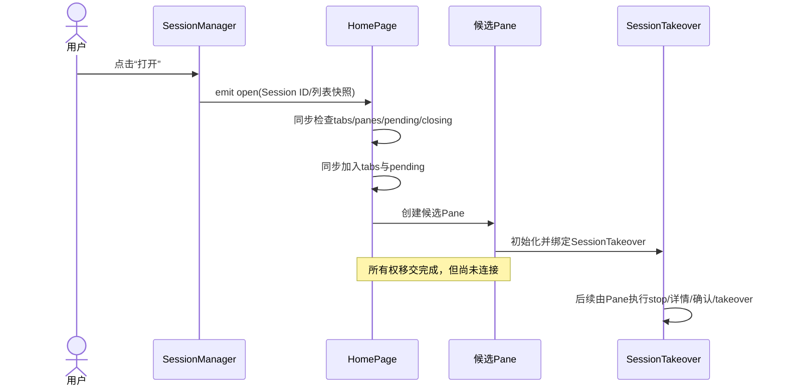
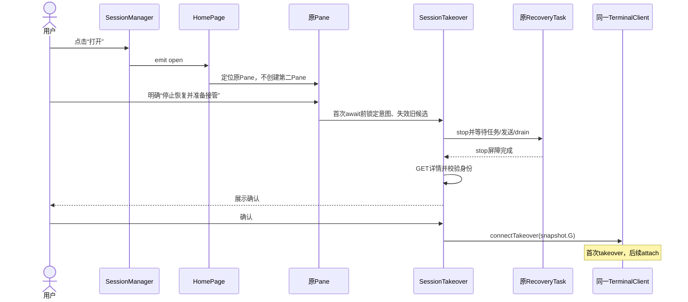
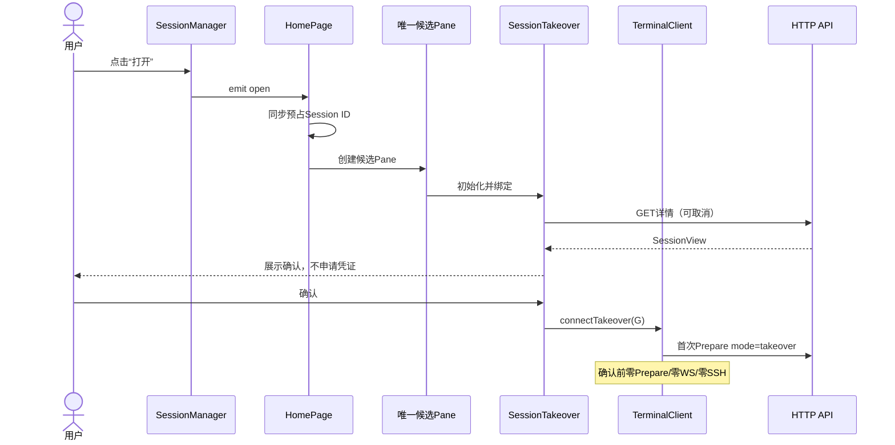
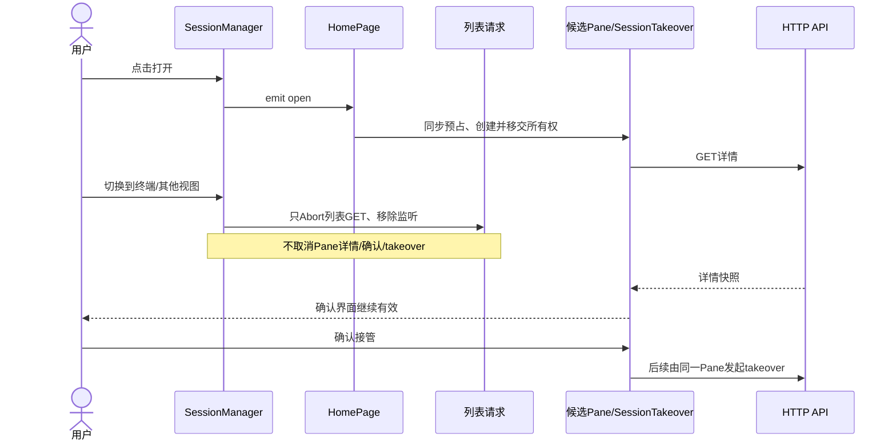
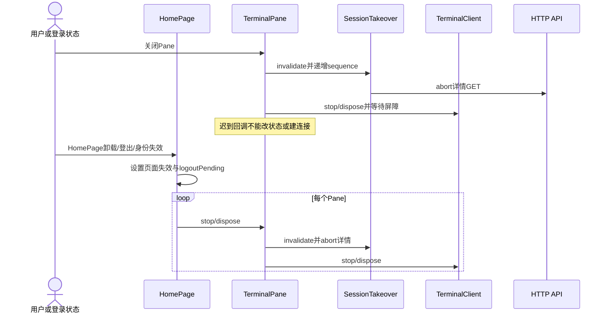
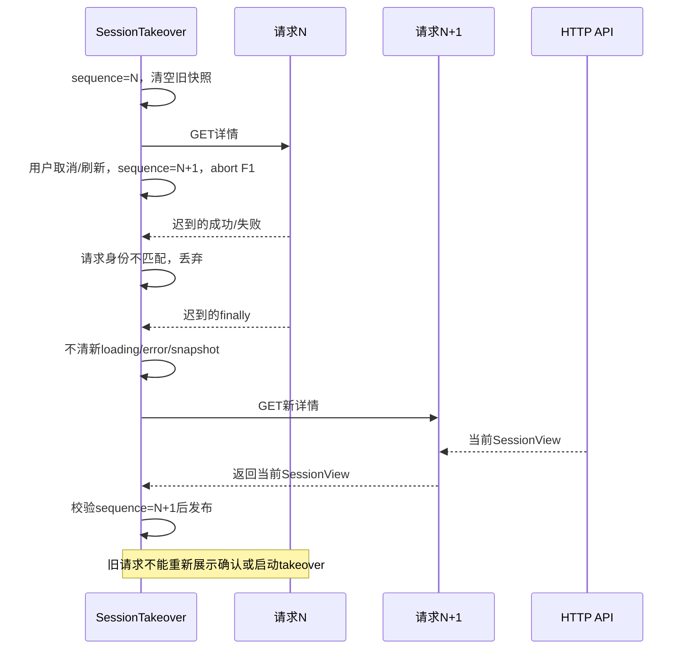

# Web SSH S6 方案 B 冻结设计文档修订报告

- 修订日期：2026-11-18
- 文档基线：分支 `codex/第五阶段`，HEAD `feb0ac5`
- 修订对象：`doc/stage-5-implementation-plan.md`
- 修订性质：仅设计文档定点修订；未进入 S6-C1 编码，未修改生产代码、测试代码、CSS、API/协议、依赖或构建配置。
- 结论：S6 方案 B 的所有权、生命周期、页面切换、详情查询、确认、取消和迟到回调规则已在第五阶段冻结实施计划中统一；全文检查未发现保留旧规则的章节。
- 对 precheck 的关闭：`stage-5-s6-precheck-report.md` G.1 的“离开管理页是否取消候选”待裁决项，已由用户明确裁决的方案 B 关闭；离开管理视图不再取消已移交 Pane。

## A. 修改文件清单

| 文件 | 状态 | 说明 |
|---|---|---|
| `doc/stage-5-implementation-plan.md` | 已修改，未暂存、未提交 | S6 方案 B 定点修订主文档 |
| `doc/stage-5-s6-plan-b-revision-report.md` | 新增，未暂存、未提交 | 本报告 |
| `doc/stage-5-s6-precheck-report.md` | 未修改 | 上一任务生成的 S6 编码前检查报告，本轮保持原样 |

本轮没有修改 `frontend/`、`backend/`、测试、`package.json`、构建配置、CSS、数据库或部署文件。

## B. 修改章节清单

| 章节 | 修改内容 | 修改原因 |
|---|---|---|
| 文件头、§1 | 增加 2026-11-18 S6 方案 B 修订状态和所有权摘要；明确本轮只改 S6 相关内容，保护未跟踪的 precheck 报告 | 固定本轮范围，避免把方案 B 误解为重新设计 D1–D3 或 S5 |
| §2 术语 | 新增 `SessionTakeover` 定义；明确 SessionManager 只发打开事件、HomePage 不持有详情/确认候选 | 建立统一术语，后续章节不再把详情/确认归给列表或 HomePage |
| §3 当前实现表 | 更新 `recovery.ts`、`TerminalPane.vue`、`HomePage.vue`，新增 `SessionManager.vue` 行 | 让代码基线与方案 B 的职责划分对应，明确当前自动 connect 与未来候选模式差异 |
| §6.1 | 拆分“离开列表/组件卸载”与“登出/认证失效”；列表卸载只取消列表 GET | 删除“离开管理页即取消接管”的旧规则来源 |
| §8.1 | 重写所有者和启动模型：SessionManager 只 emit，HomePage 同步预占并创建候选 Pane，Pane 初始化并绑定 SessionTakeover 后移交所有权 | 落实方案 B 的核心所有权移交点 |
| §8.1.1 | 新增 `tabs/panes/pending/closing` 状态表及创建、mount、初始化、失败、关闭、立即重开规则 | 覆盖 Pane 尚未存在、正在初始化、正在关闭但未卸载的全部唯一性窗口 |
| §8.2 | 重写从列表到终端的 12 步流程；确认前明确零 Prepare、零 WS、零 SSH、零自动 attach/takeover | 把“确认后才连接”写成可执行顺序，而不是仅保留原则 |
| §8.2.1 | 新增详情查询、确认与迟到回调隔离规则：sequence、Abort、请求身份、快照/Pane/任务/登录身份校验、防重复确认 | 补齐异步取消和迟到回调的所有权边界 |
| §8.3、§8.4 | 更新 D3 无 Pane、D2 已有 Pane 时序图，加入 SessionManager emit、同步预占、所有权移交和列表卸载不影响 Pane | 让关键时序图与方案 B 一致 |
| §8.5 | 新增“SessionManager 卸载但 Pane 继续接管”时序图 | 直接覆盖用户要求的页面切换场景 |
| §8.6 | 新增“详情查询取消与迟到回调隔离”时序图 | 直接覆盖旧请求成功、失败、finally 迟到场景 |
| §11.1 | 所有权不变量改为每 Session 至多一个 Pane/Client/tracker/Recovery/Takeover；`pending/closing` 参与去重；SessionManager 卸载不是终止事件 | 统一跨标签和页面生命周期规则 |
| §11.2 | A/B/C 行改为方案 B 所有权；新增共同规则段落 | 删除“候选 Pane 只展示”“管理视图拥有确认”等旧表述 |
| §11.3 | 明确打开事件只创建/定位 Pane；HomePage 不接收、不转交“已确认候选”；确认按钮在 Pane 内 | 防止确认状态回流到列表或 HomePage |
| §12.1 | 重写页面切换、关闭和所有权归属；列出唯一四类终止事件；明确取消不复活旧 RecoveryTask | 统一关闭、登出、列表卸载和 Pane 关闭的边界 |
| §12.1.1 | 新增 Pane 关闭、HomePage 卸载、身份失效清理时序图 | 覆盖 invalidate、abort、stop/dispose 和迟到回调隔离 |
| §12.2 | 明确 logout 是页面所有权终止，不是 SessionManager 卸载 | 消除登出与列表卸载的混淆 |
| §13 | 增加“连接结果”兼容行，明确首次连接 Promise 与长期 completion 分离 | 保持 S5 方案 A 的连接结果语义 |
| §15 | S6/S7 步骤改为方案 B 职责和 `S6-B01–S6-B25` 测试范围；S4 明确优先复用现有样式 | 让实施顺序、文件职责和测试矩阵同步 |
| §16 | 更新 `takeover.ts`、`SessionManager.vue`、`HomePage.vue`、`TerminalPane.vue`、`recovery.ts` 职责；明确不能保留两套确认所有者 | 固定文件级职责边界 |
| §16.1 | 新增 S6 UI 复用实施约束与验收标准，列出 `Modal.vue`、设计令牌和样式类 | 把用户要求的样式复用从建议升级为实施约束 |
| §17.4 | 修订 F02、F05、F12；新增 S6 方案 B 专项测试表 `S6-B01–S6-B25`；补充 B01/B04 浏览器测试 | 让测试验证真实所有权和异步边界，而不是只验证文案 |
| §18.1 | 增加 SessionManager 卸载、pending/mount、closing 重开、登出迟到响应等失败注入 | 保证异步测试可复现 |
| §19 | E05/E08 增加列表卸载、Pane 关闭、logout 的区分 | 真实验收不再把关闭列表当作关闭 Pane |
| §20.1 | 增加 S6 方案 B 人工复审门槛 | 文档修订完成不等于编码授权 |
| §20.2 | 增加方案 B 所有权、确认前零 Prepare/零 WS、S6-B 证据和 UI 复用验收项 | 把方案 B 纳入阶段完成门槛 |
| §21.2 | 重写 D3=A 行；把“原D1-B/D2-B/D3-B”与“S6方案B”明确区分 | 避免原产品备选 B 与本次 S6 方案 B 混淆 |
| §21.3、§21.4 | 补充方案 B 修订摘要、测试矩阵和交付结论 | 保留可审查的裁决与结论记录 |

## C. 方案 B 最终所有权模型

| 对象 | 拥有的职责 | 明确不拥有/禁止 |
|---|---|---|
| `SessionManager` | 活动 Session 列表展示、服务器筛选、本地状态筛选、手动/生命周期列表刷新、用户点击“打开”时 emit Session ID 和列表快照 | 不 GET 详情、不创建 Pane/Client、不持有确认候选、不执行 Prepare、不创建 WebSocket、不管理接管长期任务、不因自身卸载取消已移交 Pane |
| `HomePage` | 页面生命周期内的 Session ID 唯一登记；同步维护 `tabs/panes/pending/closing`；创建/定位候选 Pane；视图切换；页面停止和销毁 | 不持有详情快照或确认候选；不直接创建 TerminalClient；不绕开 Pane 管理连接；不把列表行数据替换运行中 Pane |
| `TerminalPane` | 每 Pane 唯一的 client/tracker/recovery/takeover；候选模式初始化；主动接管 UI；stop/dispose 协同；向 HomePage 暴露最小句柄/状态 | 不创建第二个 Client；不实现第二套恢复循环；不在候选 mount 时自动 attach；不在确认前申请凭证或建 WS |
| `SessionTakeover` | 候选 Pane 内主动接管唯一所有者：停止旧任务、详情 GET、快照、确认/取消、sequence/Abort、调用既有 `connectTakeover()`、错误与状态 | 不自建 WebSocket、RecoveryTask 或重试循环；不推算 generation；不在确认前 Prepare；不把人工 attach 候选混入 takeover |
| `TerminalClient` | 该 Pane 的唯一连接/恢复协调器；首次用户任务允许一次 takeover，后续 attempt 固定 attach；连接 Promise、长期 completion、stop 屏障、socket/task 身份隔离 | 不拥有 UI、列表、详情或确认状态；不因列表/详情更新 generation；不重复实现 S5 协议 |
| `SessionRecovery` | 原 Pane 的人工 attach 候选和两步恢复流程；与主动接管互斥/失效协作 | 不拥有 takeover 详情/确认；不接收列表结果作为人工候选；不在用户取消 takeover 后自动恢复原任务 |

所有权关系：

```text
SessionManager --emit open--> HomePage
HomePage --同步预占 + 创建--> TerminalPane
TerminalPane --初始化并绑定--> SessionTakeover
SessionTakeover --stop/connectTakeover--> TerminalClient
TerminalClient --唯一 RecoveryTask/socket--> 服务端 Binding/WS
TerminalPane --独立人工流程--> SessionRecovery
```

所有权移交点不是用户确认，也不是离开管理页，而是：HomePage 完成 Session ID 唯一登记并创建候选 Pane，且 TerminalPane 初始化完成、SessionTakeover 已绑定到该 Pane。移交只表示流程所有者确定，不表示自动开始连接。

## D. 生命周期和关键时序

以下时序与主文档 §8.3–§8.6、§12.1.1 一致。图中 `G` 为详情快照的 `binding_generation`，只用于首次 `connectTakeover()`；后续 attempt 固定 attach。

### D.1 从 SessionManager 点击到 Pane 所有权移交



### D.2 D2：停止恢复、详情查询、确认、takeover



### D.3 D3：候选 Pane、详情查询、确认、takeover



### D.4 SessionManager 卸载但 Pane 继续接管



### D.5 Pane 关闭、HomePage 卸载或身份失效清理



### D.6 详情请求取消和迟到回调隔离



## E. 全文冲突检查

实际使用的搜索工具为 `rg`，检查范围是 `doc/stage-5-implementation-plan.md` 全文。重点关键词包括：

`管理视图拥有`、`管理页拥有`、`离开管理页`、`离开列表`、`列表卸载`、`确认后才`、`确认后任务归`、`候选Pane只负责展示`、`只负责展示`、`SessionManager卸载`、`多个 Pane`、`两个 Pane`、`重复 Pane`、`pending`、`closing`、`AbortController`、`sequence`、`finally`、`logout`、`dispose`、`RecoveryTask`、`initialExpectedGeneration`、`confirmedGeneration`、`BIND_CONFLICT`、`connectTakeover`。

搜索命中的 `离开列表`、`离开管理页`、`SessionManager卸载` 等词，均出现在“不取消”“不以……为边界”或“不因……终止”的否定性新规则中；下表按旧规则的完整短语检查，而不是按单词出现次数判断。

| 检查项 | 结果 | 结论 |
|---|---|---|
| `管理视图拥有`、`管理页拥有` | 0 处 | 未保留“管理视图拥有详情/确认”的旧规则 |
| `离开管理页就取消`、`离开列表取消未确认动作` | 0 处 | 未保留“离开管理页/列表即取消候选”的旧规则 |
| `确认后才将主动接管任务交给Pane`、`确认后任务归Pane` | 0 处 | 所有权移交点已改为 Pane 初始化并绑定 SessionTakeover |
| `候选Pane只负责展示`、`只负责展示` | 0 处 | 候选 Pane 明确拥有详情/确认/取消/takeover |
| `SessionManager卸载会取消` | 0 处 | 仅保留“SessionManager 卸载不取消已移交 Pane”的新规则 |
| `允许同一Session出现多个Pane`、`重复创建Pane` | 0 处 | 唯一性由 `tabs/panes/pending/closing` 保护 |
| `pending`、`closing` | 已覆盖 §8.1.1、§11.2、§17.4、§20.2 | 创建、mount、closing、立即重开均有状态和测试 |
| `confirmedGeneration`、`initialExpectedGeneration` | 已覆盖 §8.2.1、§17.4 S6-B16 | S5 方案 A 代次规则保持 |
| `BIND_CONFLICT` | 已覆盖 §8.2、§13、S6-B17 | 停止，不查询详情、不推算 generation、不再次 takeover |

需要说明两处容易误读的表述：§21.2 的“原D3-B（管理视图先确认、再挂载Pane）”是对未采用产品备选的历史说明，不是现行规则；§16 的“不能同时保留管理视图内确认和 Pane 内确认两套所有者”是禁止性表述。两者都不构成旧规则残留。

对用户要求的五个问题明确回答：

1. **是否还存在“管理页拥有详情查询/确认”的旧规则？** 不存在。SessionManager 只 emit 打开事件；详情、确认和取消均在候选 Pane 的 SessionTakeover 内。
2. **是否还存在“离开管理页就取消候选”的旧规则？** 不存在。列表组件卸载只取消列表 GET；只有 Pane 关闭/dispose、HomePage 卸载、登出或身份失效才终止已移交流程。
3. **是否还存在“确认后才移交 Pane 所有权”的旧规则？** 不存在。所有权在 HomePage 完成唯一登记并创建候选 Pane、Pane 初始化并绑定 SessionTakeover 后即移交；用户确认只启动连接，不改变所有权。
4. **是否还存在 Pane 创建/关闭窗口允许重复 Pane 的规则？** 不存在。`tabs`、`panes`、`pending`、`closing` 共同去重；closing 期间至多记录一次待重开，旧 Pane 卸载后才创建新 Pane。
5. **是否存在 S5 方案 A 与 S6 主动接管冲突的规则？** 不存在。首次 takeover 最多一次，后续 attempt 固定 attach；`initialExpectedGeneration` 不可变，`confirmedGeneration` 只由合法 `bind_success` 更新；后续 attach 使用 `confirmedGeneration ?? initialExpectedGeneration`；BIND_CONFLICT 停止；stop 是完整屏障；没有第二套连接状态机。

未解决的文档冲突：无。需要保留的人工审查事项是：S6-B 测试尚未执行、实际代码尚未实现、内部函数命名和测试夹具仍需在编码阶段复核；这不属于文档规则冲突。

## F. 更新后的 S6-C1、S6-C2 测试范围

### F.1 范围划分

| 检查点 | 覆盖范围 | 主要测试 |
|---|---|---|
| S6-C1 | SessionManager 只 emit；HomePage 同步唯一登记；候选 Pane 初始化/绑定；pending/mount 窗口；D2/D3 详情与确认；确认前零 Prepare/零 WS；详情取消/迟到回调；S5 mode/generation/stop 回归 | S6-B01–S6-B17、S6-B21、S6-B22、S6-B24；F05–F09；U10/U11 相关部分 |
| S6-C2 | 候选 Pane 关闭；HomePage 卸载/登出/身份失效；closing 后立即重开；不同 Session 清理互不影响（S6-B21 在 S6-C1 验证，S6-C2 做集成回归）；S4/D1 回归；UI 样式复用；浏览器集成 | S6-B18–S6-B20、S6-B23、S6-B25；F02、F10–F13；B01–B05 |

### F.2 验收标准

- SessionManager 点击“打开”后，HomePage 必须在同一同步调用栈内完成 Session ID 预占，不能等到 await 之后才登记。
- 同一 Session 连续点击、Pane 尚未 mount、Pane 初始化中、closing 未卸载时，均不得出现第二个 Pane/Client。
- 候选 Pane 创建或 mount 失败时保留同一失败标签和原因，释放 pending，不自动重试或另建并行 Pane。
- 候选 Pane mount 不自动 attach；详情成功但用户未确认时，Prepare、WebSocket、SSH 计数均为 0。
- SessionManager 卸载后，已移交 Pane 的详情 GET、确认界面和 takeover 继续有效，Pane 不 stop、不 dispose。
- D2 在线 Pane 只定位；D2 恢复中 Pane 必须先完成 `client.stop()` 的长期任务、发送、清理和 drain 屏障，再查询详情。
- D2 用户取消后原 RecoveryTask 保持停止，不自动恢复/attach；详情失败保留候选 Pane 并允许显式重试。
- 详情 GET 取消后，迟到的成功、失败和 finally 均不能发布快照、重新展示确认、清除新 loading 或启动连接。
- 确认必须校验当前快照、Pane、任务、页面和登录身份；重复确认只产生一次 Prepare/一次 `connectTakeover()`/一个候选 WS。
- 首次 takeover 可重试失败后所有 attempt 固定 attach；BIND_CONFLICT 停止，不查询详情、不推算 generation、不再次 takeover、不进入 attach 重试。
- 候选 Pane 关闭时执行 invalidate、abort、stop/dispose；HomePage 卸载、登出、身份失效时清理全部所有权；迟到凭证/onopen/bind_success/finally 不能复活连接。
- 关闭后立即重开同一 Session 时，旧 Pane 完成卸载并释放 `closing` 后才创建新候选，旧回调不作用于新 Pane。
- 不同 Session 的接管流程独立并行，一个 Session 的取消/关闭/stop 不影响另一个。
- takeover 成功但 replay 未完成时输入门禁仍有效；replay 完成前不发送输入。
- S4 列表刷新、D1 触发和 S5 的 mode/generation/stop/4001/4002/OUTPUT_GAP 行为回归通过。
- UI 实际复用 `Modal.vue`、`base.css` 设计令牌和 `.session-*`/`.terminal-*` 样式；没有新视觉体系；新增状态最多使用最小 scoped CSS。

测试必须检查真实 Pane/Client 实例数、请求身份、任务身份、stop 屏障和迟到回调，不能只断言按钮点击后显示了某段文本。S6-B 表共 25 项，逐项见主文档 §17.4.1。

## G. 样式复用约束

S6 实施时必须复用：

- `frontend/src/components/layout/Modal.vue`：接管确认、关闭确认等弹窗沿用现有标题、关闭按钮、`dialog-header`、`icon-button` 和遮罩行为。
- `frontend/src/styles/base.css` 设计令牌：`--page`、`--panel`、`--hover`、`--text`、`--secondary`、`--line`、`--strong`、`--on-strong`、`--red`、`--overlay`。
- 现有样式类：`.primary`、`.danger`、`.notice`、`.muted`、`.error`、`.session-status`、`.session-manager`、`.terminal-tabs`、`.terminal-actions`。
- 现有按钮、状态标识、错误提示、加载/空态、表格/筛选器、标签和页面布局组件。

约束：

1. 不自行设计新的视觉风格，不引入新的颜色、按钮、弹窗或状态标识体系。
2. 不修改无关 CSS，不修改全局设计令牌的既有值，不把 S6 新状态做成独立主题。
3. 接管入口放在现有会话列表操作区；候选/接管状态沿用现有状态标识和提示样式。
4. 现有样式确实不足时，只允许增加最小范围 scoped CSS，并保持与 `base.css` 的颜色、间距、边框、字号和交互一致。
5. 不得因新增 takeover 流程导致管理页面、终端页面和现有弹窗风格不一致。
6. 验收检查实际渲染的组件/class/令牌复用，不能只看功能可用。

## H. 未修改范围确认

- 没有修改生产代码。
- 没有修改测试代码。
- 没有修改 CSS、样式文件或 UI 组件源码。
- 没有修改 API、HTTP 请求格式或 WebSocket 协议。
- 没有修改 S5 已冻结的连接和恢复协议。
- 没有修改 S5 方案 A 的 generation、mode、retry 和 stop 契约。
- 没有修改 D1、D2、D3 的用户产品裁决。
- 没有扩大或重新设计 S7、S8 的既定范围；仅同步 S7 中与 S6 所有权相关的测试引用和列表卸载说明。
- 没有修改 `package.json`、依赖、构建配置、数据库或部署配置。
- 没有修改 `doc/stage-5-s6-precheck-report.md`。
- 没有 commit、push、部署或执行破坏性 Git 操作。
- 没有开始 S6-C1 编码；文档修订完成后停止，等待人工审查。

## I. 自检记录

- `git diff --check`：通过，无空白错误。
- `git status --short`：仅 `doc/stage-5-implementation-plan.md` 修改，`doc/stage-5-s6-precheck-report.md` 保持未跟踪原状；本报告新增后为未跟踪文件。
- 全文冲突搜索：使用 `rg` 检查上述关键词；未发现保留旧规则的章节。
- 测试/构建：本轮为纯文档修订，未运行代码测试、构建或部署；不将文档检查冒充 S6 实现验证。

本轮结论：S6 方案 B 的文档规则已统一，下一步应进行人工复审；复审通过并获得明确编码授权后，才可开始 S6-C1。
