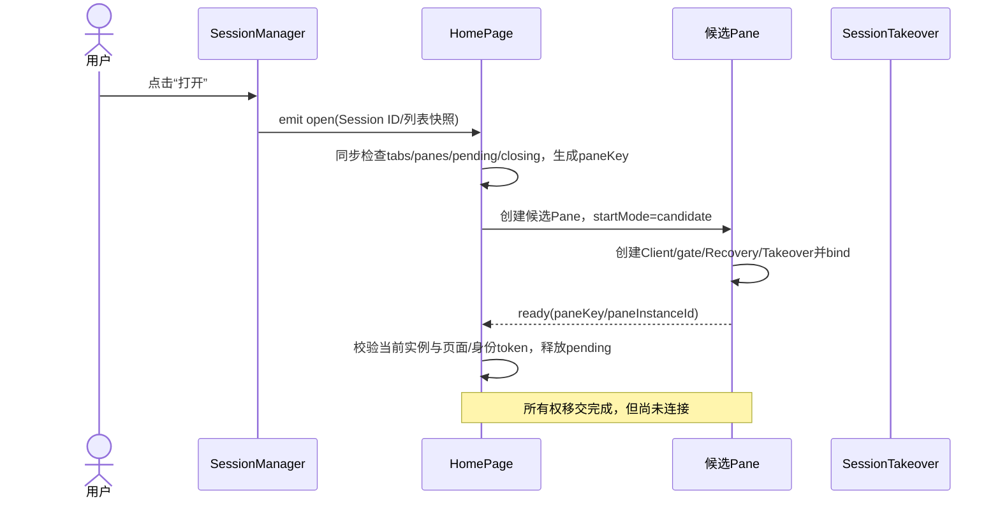
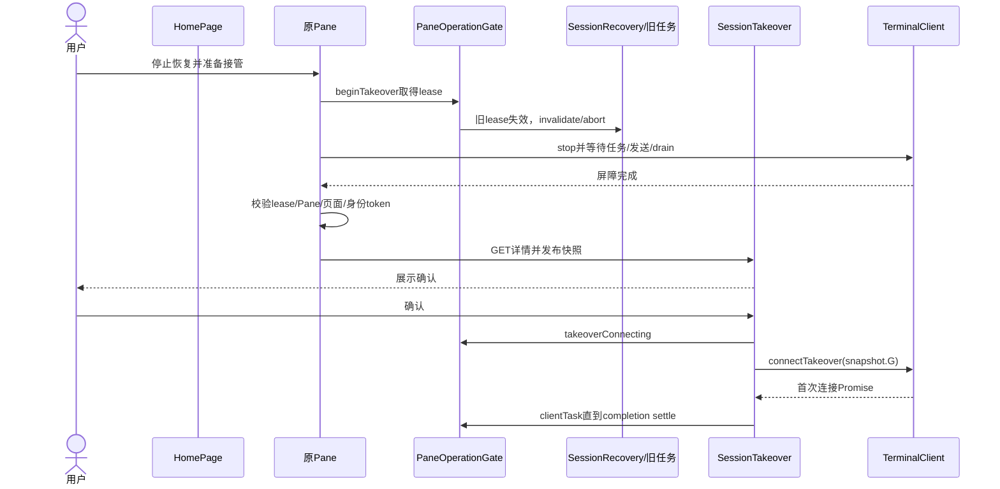
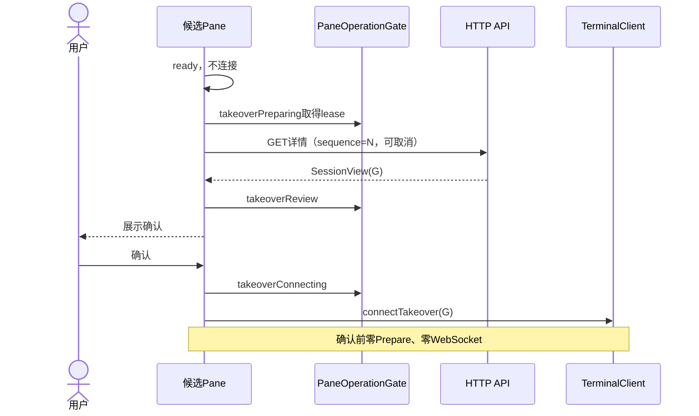
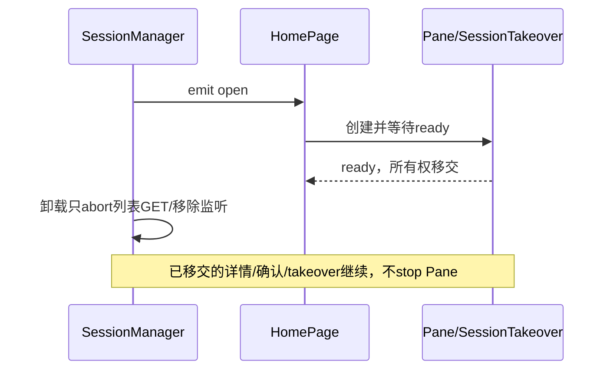
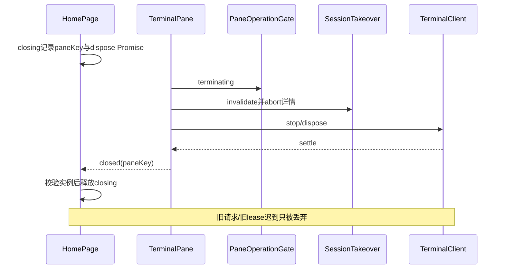

# Web SSH S6 方案 B 第二轮定点修订报告

- 修订日期：2026-11-18
- 文档基线：分支 `codex/第五阶段`，HEAD `feb0ac5`
- 修订对象：`doc/stage-5-implementation-plan.md`
- 审查依据：`doc/stage-5-s6-plan-b-second-review-report.md`
- 修订性质：仅设计文档修订；未开始 S6-C1 编码，未修改生产代码、测试代码、CSS、API/协议、配置或依赖。
- 结论：第二轮审查的两个 BLOCKER 已在冻结实施计划中关闭；S5 基线、`replaying` 分类、C1/C2 边界、身份代次、closing/dispose 和同标签重试已统一。未发现仍未解决的文档规则冲突。

## A. 修改文件清单

| 文件 | 状态 | 说明 |
|---|---|---|
| `doc/stage-5-implementation-plan.md` | 已修改，未暂存、未提交 | S6 方案 B 第二轮定点修订主文档 |
| `doc/stage-5-s6-plan-b-second-revision-report.md` | 新增，未暂存、未提交 | 本报告 |
| `doc/stage-5-s6-plan-b-second-review-report.md` | 未修改 | 第二轮只读审查报告，作为本轮依据 |
| `doc/stage-5-s6-plan-b-revision-report.md` | 未修改 | 第一轮方案 B 修订报告 |
| `doc/stage-5-s6-precheck-report.md` | 未修改 | S6 编码前检查报告 |

本轮没有修改 `frontend/`、`backend/`、测试、`package.json`、构建配置、CSS、数据库或部署文件。

## B. 修改章节清单

| 章节 | 修改内容 | 原因 |
|---|---|---|
| 文件头、§1 | 更新为第二轮修订状态；明确 S5-C1/S5-C2 已完成并冻结；更新基线为 `feb0ac5` | 删除过期基线，防止把 S5 再列为 S6 实施工作 |
| §2 术语 | 增加 `PaneOperationGate`、`paneKey`/`paneInstanceId`；明确 ready/failed 匹配和页面生命周期 | 统一后续所有权、门禁和实例身份术语 |
| §3 当前实现表 | `client.ts` 改为 S5 已完成并冻结；补充 `TerminalPane` ready/failed、`HomePage` paneKey、`SessionRecovery` 三门禁、`auth.ts` 只读身份代次 | 让代码基线与 S6 增量一致 |
| §6.1 | 明确 SessionManager 重挂载后再次打开同一 Session 仍定位原 Pane | 覆盖审查场景 14 和 MINOR 9 |
| §8.1 | 重写所有权模型：ready 才是移交点；新增 PaneOperationGate、S5 只消费、candidate/attach 模式 | 关闭 BLOCKER 1，防止 `setPane` 被误当 ready |
| §8.1.1 | 新增 `TabEntry`、HomePage 同步生成 `paneKey`/`paneInstanceId`、`panes` 按实例键、pending 正常路径仅由 ready/failed 释放、关闭/终止取消路径、closing 等待真实 dispose、失败重试和页面卸载规则 | 覆盖 Pane 创建、初始化、失败、关闭和重开窗口 |
| §8.1.2 | 新增 ready/failed 事件 payload、固定初始化顺序、成功条件、failed 先发布后清理、局部 mount 错误边界和迟到事件隔离 | 关闭 BLOCKER 1，避免失败清理阻塞 pending |
| §8.1.3 | 新增 PaneOperationGate 状态表、lease 获取/释放、Recovery 三门禁、D2 stop 屏障、stop 失败、确认、初始 attach 和 clientTask 规则 | 关闭 BLOCKER 2 |
| §8.1.4 | 新增登录身份代次和 `{epoch, identity}` token 校验；同一管理员重新登录视为新代次 | 解决身份对象替换竞态 |
| §8.2、§8.2.1 | 将 ready、门禁 lease、身份 token、stop 屏障、确认防重复、显式刷新详情和 clientTask 写入主流程 | 让文字流程与状态机一致 |
| §8.3–§8.6 | 更新 D3/D2/SessionManager 卸载/详情取消时序图，加入 ready、gate、stop 屏障和迟到回调隔离 | 图示与正文一致 |
| §11.1、§11.2、§11.3 | 增加 paneKey、ready、门禁、身份 token；新增 `replaying` 分类表；关闭/重开等待 dispose | 统一所有权和 D2 分类 |
| §12.1、§12.1.1、§12.2 | 明确交互式 closing 与页面卸载的区别；新增 terminating、真实 dispose 和身份代次清理 | 解决 closing/dispose 和 HomePage 卸载竞争 |
| §15 | S5 改为已完成冻结基线；新增 S6-C1/S6-C2；S7 改为远端关闭、完整登出重做和列表反馈 | 调整 C1/C2 责任边界，避免 C2 补 C1 基本安全 |
| §16 | 更新 takeover、HomePage、TerminalPane、recovery、client、auth 的文件职责；明确 client.ts 不修改 | 固定最小改动范围 |
| §16.1 | 样式复用范围改为 C1/C2/S7，C1 首次 UI 即验收 | 防止 C1 先形成独立视觉体系 |
| §17.4、§17.4.1 | 修订 F05–F07、F12；S6-B 扩展为 B01–B38，补充 ready/failed、门禁、身份、replaying、dispose、重挂载和跨页面竞争 | 让测试验证真实所有权和异步边界 |
| §18.1 | 增加 ready 迟到、初始化失败重试、Recovery/Takeover 竞争、诊断刷新拒绝、身份对象替换、dispose 未完成注入 | 保证关键竞态可复现 |
| §19 E05 | 增加 replaying、初始化失败重试、SessionManager 重挂载和门禁 | 真实验收同步 |
| §20.1、§20.2 | 增加 ready/failed、门禁、身份代次、replaying、真实 dispose、C1/C2 和 UI 首次验收门槛 | 把 BLOCKER 修复纳入验收 |
| §21.2–§21.4 | 更新 D2/D3 行、第二轮修订摘要和交付结论；明确 S6-C1 未开始 | 保留裁决记录和停止边界 |

## C. 方案 B 最终所有权模型

| 对象 | 拥有的职责 | 明确不拥有/禁止 |
|---|---|---|
| `SessionManager` | 活动 Session 列表展示、服务器筛选、本地状态筛选、手动/生命周期列表刷新、点击“打开”时 emit Session ID 和列表快照 | 不 GET 详情、不创建 Pane/Client、不持有确认候选、不执行 Prepare、不创建 WebSocket、不管理接管长期任务、不因自身卸载取消已移交 Pane |
| `HomePage` | 页面生命周期内的 Session ID 唯一登记；同步维护 `tabs/panes/pending/closing` 与 `paneKey`/`paneInstanceId`；创建/定位候选 Pane；匹配 ready/failed；视图切换；交互式关闭等待真实 dispose | 不持有详情快照或确认候选；不直接创建 TerminalClient；不把模板 ref 当 ready；不把列表行数据替换运行中 Pane |
| `TerminalPane` | 每 Pane 唯一的 client/tracker/recovery/takeover/gate；`candidate/attach` 初始化；ready/failed 握手；候选 UI；真实 dispose Promise；页面/身份 token | 不创建第二个 Client；不实现第二套恢复循环；候选 mount 不 attach；初始化失败后不允许迟到 ready；不在确认前 Prepare/建 WS |
| `SessionTakeover` | 候选 Pane 内主动接管唯一所有者：申请 takeover lease、stop 旧任务、详情 GET、快照、确认/取消、sequence/Abort、调用既有 `connectTakeover()`、错误与状态 | 不自建 WebSocket、RecoveryTask 或重试循环；不推算 generation；不在确认前 Prepare；不绕过 gate |
| `PaneOperationGate` | Pane 内 lease 门禁：状态、lease ID、kind、task ID、paneKey/paneInstanceId、页面/身份 token；协调 Recovery 和 Takeover | 不是全局锁、事件总线、队列或跨 Pane 协调器；不替代 TerminalClient 的任务状态机 |
| `TerminalClient` | 该 Pane 的唯一连接/恢复协调器；S5 已冻结的 mode、generation、Promise、长期任务、stop 屏障和 socket/task 身份隔离 | 不拥有 UI、列表、详情或确认状态；不因列表/详情更新 generation；S6 不重复实现 S5 协议 |
| `SessionRecovery` | 原 Pane 的人工 attach 候选和两步恢复；`refresh()`、`recover()`、诊断刷新全部先取 Pane 门禁 lease | 不拥有 takeover 详情/确认；不接收列表结果作为人工候选；门禁拒绝时不发请求、不清状态；不在用户取消 takeover 后自动恢复 |

所有权关系：

```text
SessionManager --emit open--> HomePage
HomePage --同步预占 paneKey/paneInstanceId + 创建--> TerminalPane
TerminalPane --初始化并绑定--> SessionTakeover + SessionRecovery
TerminalPane --ready(paneKey/instance)--> HomePage --校验--> 所有权移交
SessionTakeover --lease/stop/connectTakeover--> TerminalClient
SessionRecovery --lease/refresh/recover--> TerminalClient
TerminalClient --唯一 RecoveryTask/socket--> 服务端 Binding/WS
```

所有权移交点不是用户确认，也不是离开管理页，而是：HomePage 完成 Session ID 唯一登记、生成 `paneKey` 并创建候选 Pane；TerminalPane 完成初始化、绑定 SessionTakeover，并发出与当前 `paneKey`/`paneInstanceId` 匹配的 `ready`。`setPane()`、模板 ref 存在、`nextTick()` 完成都不构成移交。

## D. 生命周期、状态转换和时序

### D.1 ready/failed 状态转换

| 当前状态 | 事件 | 下一状态 | 动作 |
|---|---|---|---|
| `pending`（无句柄） | Pane 创建成功 | `pending`（有句柄） | `setPane(paneKey, handle)` 只登记，不释放 pending |
| `pending` | 初始化全部步骤完成且校验通过 | `ready` | 记录状态后 emit ready；HomePage 校验实例后释放 pending，完成所有权移交 |
| `pending` | 初始化抛错/校验失败 | `failed` | 使后续 ready 永久不可能；invalidate gate/Takeover；abort 详情；立即 emit 一次 failed；异步清理不得阻塞 pending 释放，也不得用内部 `closed` 移除失败标签 |
| `pending` | 创建失败（组件未建立） | `failed` | HomePage 生成同结构失败结果，释放 pending，保留标签和原因 |
| `failed` | 用户点击“重试初始化” | `closing` → 新 `pending` | 等待旧实例真实 dispose；移除旧 paneKey；生成新 paneKey 重建 |
| `pending`/`ready`/`failed` | 用户关闭、登出、身份失效、页面卸载 | `closing`/`terminating` | 关闭意图优先；旧 ready/failed 迟到不改变新状态 |
| `closing` | 真实 dispose Promise settle | 移除标签 | 释放 closing；若有 reopenRequested，生成新 paneKey |
| `closing` | dispose 拒绝/清理失败 | `cleanup_failed` | 不伪造成功；保留旧句柄，允许重试关闭 |

初始化顺序固定为：HomePage 同步生成并传入 `paneKey`/`paneInstanceId` → 捕获页面/身份 token 和实例 ID → 创建 TerminalClient（不连接）→ 创建 PaneOperationGate（idle）→ 创建 SessionRecovery（注入 gate/token）→ 创建 SessionTakeover 并 bind → 安装监听 → `nextTick` 后复核实例/token/未关闭 → emit ready。任何一步失败都进入 failed，先 emit failed 再异步清理，不允许之后补发 ready；内部清理不发 `closed`，失败标签由用户重试或关闭处理。

`pending` 的正常释放仍只由匹配 `ready`/`failed` 完成；显式关闭或页面终止可以作为取消路径释放 `pending`，但必须同时建立 `closing`/`terminating`，不能被当作初始化成功或所有权移交。

### D.2 PaneOperationGate 状态转换

| 状态 | 所有者 | 进入条件 | 允许动作 |
|---|---|---|---|
| `idle` | 无 | 初始、取消/失败/任务结束释放 | Recovery 申请；Takeover 申请 |
| `recovery` | SessionRecovery lease | `refresh()`/`recover()` 首次 await 前 | 一个人工刷新/恢复；Takeover 按分类抢占 |
| `takeoverPreparing` | SessionTakeover lease | 显式接管或从 recovery/clientTask 抢占 | 失效旧候选、stop/drain、随后详情 GET；Recovery 拒绝 |
| `takeoverReview` | SessionTakeover lease | 详情成功 | 刷新详情、确认、取消；Recovery 拒绝 |
| `takeoverConnecting` | SessionTakeover lease | 确认首次 await 前 | 调用一次 `connectTakeover()`；重复确认忽略 |
| `clientTask` | TerminalClient 长期任务 | 已取得 clientTask lease 并启动 connect/connectTakeover | Recovery 因 running+gate 拒绝；恢复中/已停止分类允许显式抢占 |
| `blockedStop` | SessionTakeover lease | stop 拒绝或屏障未完成 | 只允许重试 stop 或关闭 Pane |
| `terminating` | Pane 生命周期 | 关闭/登出/身份失效/页面卸载 | 只执行 invalidate/abort/stop/dispose |

释放规则：`recovery` 的 `refresh()`/`recover()` 在成功、失败、取消和 `finally` 中按 lease 身份释放，转入长期任务时交给 `clientTask`；旧 lease 的 `finally` 不能释放新 lease。`takeoverReview` 取消/失败回到 `idle`；`takeoverConnecting` 同步抛错或启动前失败回到 `idle`，启动任务后转 `clientTask`；`clientTask` 只在 `client.completion` settle 且 `client.running=false` 时回到 `idle`；`blockedStop` 不自动重试；`terminating` 不回到任何可操作状态。包括初始 attach 在内的所有 `connect()`/`connectTakeover()` 都必须先取得 `clientTask` lease。

`takeoverReview` 下的显式“刷新详情”复用原 takeover lease，递增 sequence、abort 旧 GET 并重新查询；普通重复打开只定位。旧请求的成功、失败和 finally 均按 sequence 与 lease 丢弃，不能清掉新请求 loading 或重新发布确认候选。

### D.3 SessionRecovery 所有入口的门禁

| 入口 | 门禁行为 | 被拒绝时 |
|---|---|---|
| `refresh()` 手动刷新 | 首次 await 前 `tryAcquireRecovery()`；所有出口在 `finally` 按 lease 释放 | 不发 GET、不清 snapshot/candidate/error、不自动重试 |
| `recover()` 人工恢复 | 首次 await 前取得 lease；捕获 candidate 后再 invalidate；stop 后 connect；失败/取消在 `finally` 按 lease 释放，启动长期任务则转 `clientTask` | 不发请求、不启动 attach、不改变原候选 |
| `refresh(false, taskId)` 诊断刷新 | 与手动刷新同一门禁 | 记录“已跳过”，不把跳过当网络错误，不清状态 |
| `stop()`/invalidate | 只失效自己的 lease/sequence；不重新申请 | 不启动新连接；由 Pane 关闭/登出继续清理 |

### D.4 D2 stop/drain 屏障

1. 用户显式点击“停止恢复并准备接管”；普通在线或 `replaying` Pane 不提供该入口。
2. SessionTakeover 在首次 await 前取得 takeover lease；若 Recovery 持有 lease，按分类显式抢占并使其失效。
3. 调用 `recovery.invalidate()`，递增 sequence、abort 旧详情、清空人工候选。
4. 调用既有 `client.stop()`；等待长期任务、发送任务和 output drain 完成。
5. stop 完成前不得 GET 详情、Prepare、创建 WebSocket 或启动新的 Recovery attempt。
6. stop 拒绝或未完成：进入 `blockedStop`，显示原因；不查详情、不自动重试；只允许重试 stop 或关闭 Pane。
7. stop 完成后再次校验 lease、Pane 实例、页面 token、身份 token，才 GET 详情。
8. 用户取消：释放 lease，旧任务保持停止，不自动复活；之后只能由用户显式刷新/恢复重新开始。

### D.5 closing 与同标签重试

- 交互式关闭先同步建立 `closing`，记录 `paneKey` 和 `dispose()` Promise；尚无句柄时记录创建取消 Promise，确认没有实例可清理后才释放。不得先删除 tabs 再等异步。
- `dispose()` 必须幂等；重复关闭复用同一 Promise。
- 只有该 Promise settle 后才移除 tabs/panes 并释放 closing；`nextTick`、模板 ref 为 null、从 tabs 删除都不算完成。无句柄关闭不得永久等待；迟到的 `setPane` 若带来句柄仍必须先 dispose，即使 closing 已结束也不得登记为当前 Pane。
- dispose 拒绝显示清理失败，保留旧句柄并允许重试关闭；不得在同一 Session 上创建新 Pane 与未清理旧实例重叠。
- 初始化失败后的重试不复用半初始化实例：先按 closing 流程 dispose 旧实例，再生成新 `paneKey` 重建。
- HomePage 卸载是页面销毁，不能同步等待浏览器清理；设置 pageToken 失效并尽力异步 dispose。旧页面迟到回调不能操作新页面，跨页面连接由服务端 Binding/generation 仲裁。

### D.6 登录身份代次

- auth 模块现有私有 `identityEpoch` 增加只读访问；在 `acceptIdentity` 接受新对象、`clearIdentity`、登出和过期时推进。
- Pane 初始化、详情、确认、连接启动和迟到回调捕获 `{epoch, identity}` token。
- 有效条件同时包含：epoch 相同、identity 对象相同、`logoutPending=false`、pageToken 有效、Pane 未 terminating。
- 旧身份的迟到详情/确认/凭证/onopen/bind_success/finally 一律丢弃；不能在新身份下启动连接或改代次。
- 不新增全局身份 Store 或跨页面身份服务。

### D.7 关键时序

#### 从点击打开到 ready 所有权移交



#### D2：stop、详情、确认、takeover



#### D3：候选 Pane、详情、确认、takeover



#### SessionManager 卸载但 Pane 继续



#### 关闭、登出与详情取消



## E. 全文冲突检查

### E.1 搜索关键词

使用并检查了以下关键词及其组合：

`SessionManager`、`HomePage`、`TerminalPane`、`SessionTakeover`、`SessionRecovery`、`PaneOperationGate`、`pending`、`closing`、`paneKey`、`setPane`、`ready`、`failed`、`replaying`、`详情 GET`、`确认`、`取消`、`Abort`、`sequence`、`identity`、`identityEpoch`、`登出`、`dispose`、`stop`、`RecoveryTask`、`S5`、`S6-C1`、`S6-C2`、`S7`。

### E.2 明确回答

| 检查项 | 结果 | 说明 |
|---|---|---|
| 是否还存在“管理页拥有详情查询/确认”的旧规则？ | 否 | SessionManager 只 emit；详情/确认归 Pane 内 SessionTakeover；HomePage 不持有候选 |
| 是否还存在“离开管理页就取消候选”的旧规则？ | 否 | 卸载只 abort 列表 GET；已移交 Pane 的详情/确认/takeover 继续 |
| 是否还存在“确认后才移交 Pane 所有权”的旧规则？ | 否 | 移交点是匹配 ready；确认只启动连接，不改变所有权 |
| 是否还存在 Pane 创建/关闭窗口允许重复 Pane 的规则？ | 否 | `paneKey`、pending、closing、真实 dispose 和旧事件匹配共同禁止重叠 |
| 是否存在 S5 方案 A 与 S6 主动接管冲突的规则？ | 否 | S5-C1/C2 已冻结；S6 只调用 `connectTakeover/stop/completion`，不另建状态机 |
| 是否仍把 `setPane` 当 pending 释放条件？ | 否 | 明确 setPane 只登记句柄；正常初始化只有匹配 ready/failed 释放，关闭/终止为取消路径 |
| 是否仍把 `replaying` 当恢复中？ | 否 | 新增 §11.2.1，replaying 属于已连接，只定位 |
| 是否仍把 C1 的基本清理推迟到 C2？ | 否 | B18–B20、B25、B26–B33、B35、B37 已归 C1；C2 只做复杂竞态和集成 |

未发现保留上述旧规则的章节。没有需要隐瞒的未解决文档冲突。

## F. 更新后的 S6-C1、S6-C2 测试范围

### F.1 S6-C1

C1 是完整、安全的生产业务纵切，必须完成：

- HomePage 同步唯一登记、`paneKey`、pending/closing。
- TerminalPane ready/failed 握手、初始化失败、同标签重试、真实 dispose。
- PaneOperationGate 和 SessionRecovery 三个入口的门禁。
- D2 完整 stop/drain；D3 候选详情/确认/取消。
- 确认前零 Prepare/零 WebSocket；确认后只调用 S5 `connectTakeover()`。
- 身份代次、页面 token、Pane 实例校验。
- Pane 关闭、HomePage 卸载、登出、身份失效的基础清理。
- UI 首次新增即复用现有样式。
- 基础生产测试。

对应测试：`S6-B01–B22`、`S6-B24–B33`（含 B25 首次 UI 样式验收）、`S6-B35`、`S6-B37`，以及 F05–F09、F12。

### F.2 S6-C2

C2 只负责专项竞态、集成回归和浏览器验收：

- 重复点击/高并发打开。
- 初始化失败与重试的复杂迟到竞争。
- 旧请求、旧 finally、旧 Pane 的迟到回调。
- 多 Session 并行。
- SessionManager 卸载后重新挂载。
- stop/详情/确认/取消复杂交错。
- HomePage 卸载后新页面竞争。
- 浏览器集成、S4/S5 回归、UI 一致性复核。

对应测试：`S6-B23`、`S6-B25`、`S6-B34`、`S6-B36`、`S6-B38`，B18–B20 的复杂交错，F01–F04、F10–F13、B01–B05。C2 不得用来补 C1 缺失的基本安全清理。

### F.3 测试验证边界

- 不能只断言点击后出现文本；必须检查真实 Pane/Client 实例数、gate lease、请求身份、任务身份、stop 屏障、dispose Promise 和迟到回调。
- ready 测试必须证明模板 ref 存在但 ready 未到达时 pending 不释放。
- 门禁测试必须证明 Recovery 的 `refresh()`、`recover()` 和诊断刷新在 takeover 期间实际不发请求，而不是只隐藏按钮。
- replaying 测试必须证明列表打开只定位，不触发 takeover 或第二 Pane。
- 身份测试必须覆盖身份对象直接替换而非先置空。

## G. 样式复用约束

S6-C1 首次新增确认/失败/门禁提示时即必须复用：

- `frontend/src/components/layout/Modal.vue`：`dialog-header`、`dialog-body`、`dialog-footer`、`icon-button`。
- `frontend/src/styles/base.css` 设计令牌：`--page`、`--panel`、`--hover`、`--text`、`--secondary`、`--line`、`--strong`、`--on-strong`、`--red`、`--overlay`。
- 现有样式类：`.primary`、`.danger`、`.notice`、`.muted`、`.error`、`.session-status`、`.session-manager`、`.terminal-tabs`、`.terminal-actions`。
- 现有按钮、状态标识、错误提示、加载/空态、表格/筛选器和布局组件。

禁止新颜色体系、新按钮体系、新弹窗体系、新状态标识体系或无关 CSS 重构。现有样式确实不足时，只允许最小范围 scoped CSS，并保持与 `base.css` 的颜色、间距、边框、字号和交互一致。

## H. 未修改范围确认

- 没有修改生产代码。
- 没有修改测试代码。
- 没有修改 CSS、Vue、TypeScript、Go 源码。
- 没有修改 API、HTTP 请求格式、WebSocket 协议或后端配置。
- 没有修改 S5 已冻结的 `client.ts` 契约。
- 没有修改 D1、D2、D3 的用户裁决。
- 没有修改 S7、S8 的既定范围。
- 没有执行 `git commit`、`git push`、合并、变基或部署。
- 没有开始 S6-C1 编码。

## I. 仍未解决的问题

无未解决的文档规则冲突。

仍属于未来实现验证、而非本轮文档缺口的事项：

- `SessionTakeover`、`PaneOperationGate` 和 ready/failed 事件尚未实现。
- `SessionRecovery` 的三个入口尚未接入实际门禁。
- `auth.ts` 尚未暴露只读身份代次。
- 所有 S6-B 测试尚未执行。

这些事项按 §15 的 S6-C1/S6-C2 范围在获得明确编码授权后实施，不得因本文档修订自动开始。

## J. 自检结果

- 主文档全文搜索未发现“管理页拥有详情/确认”“离开管理页取消候选”“确认后才移交所有权”“创建/关闭窗口允许重复 Pane”的旧规则。
- 主文档的状态机、时序图、测试矩阵和验收条件均使用 ready/failed、paneKey、PaneOperationGate、身份 token 和真实 dispose 语义。
- `git diff --check` 通过。
- 本轮只修改设计文档并新增本报告；工作区未暂存、未提交。
- 本轮未执行测试或构建，因为只修改设计文档；未将任何 S6 测试或构建勾选为已通过。

完成本报告后停止，等待人工复审和另行编码授权；不进入 S6-C1。
