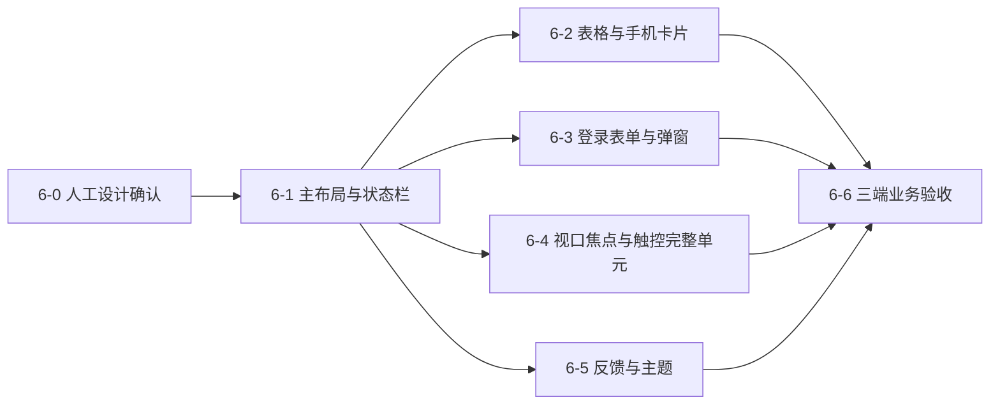

# Web SSH 第六阶段详细设计与实施计划（6-0）

- 编制日期：2026-11-19（Asia/Shanghai）。
- 产品阶段：第六阶段「全面 UI 与移动端完善」；本文 6-0～6-6 与第五阶段内部 S6、S7、S8 无编号对应关系。
- 状态：6-0 设计审查稿。六项用户裁决已经确认；本文补充的实施细化提交人工审查，不冒充已经批准或已经实现。
- 当前授权：仅编写本文。本文不授权 6-1～6-6 编码、测试修改、启动服务、部署、依赖安装或 Git 写操作；每次实施以用户明确授权范围为准。
- 核对基线：分支 `S6`，HEAD `0038266af7e190cbebe9f9f927fa61b5fb0dee67`（`S7`）；编制开始工作区干净。实施前重新核对基线，不切换分支或覆盖已有修改。
- 前置事实：用户已确认第五阶段 S7-1～S7-6 完成验收，真实环境使用测试已完成且未发现问题。本文接受这一前提，不把历史报告的未验项重新解释为用户验收失败。
- 本轮证据：只读检查文档、实际代码及测试源码；未执行测试、构建或设备操作。全文的验收表均为未来要求，不能作为通过记录。

## 1. 目标、范围与权威依据

### 1.1 阶段目标

在已完成的服务器管理、SSH 终端、有限恢复、列表、主动接管与关闭业务上，完成正式桌面和移动界面。交付重点为紧凑工作区、手机列表、表单/弹窗、系统软键盘、触控与辅助键、状态反馈及主题一致性。保留已有业务闭环，不重造连接能力。

最终桌面 Chrome、Android Chrome 真机、iOS Safari 真机均能完成登录、服务器管理、真实终端操作、恢复、接管与关闭；布局变化不产生额外 Session、Client 或连接任务；结果有分层证据和真实设备记录。

### 1.2 权威文件及解释顺序

| 依据 | 本阶段采用的内容 |
|---|---|
| [实施阶段 §8](web-ssh-implementation-stages.md#stage-6) | 第六阶段唯一原始范围：八项任务、十项必须验证要求、桌面/移动完成条件 |
| [核心需求 §8～10](web-ssh-design-development-plan.md#ui)、§5.4、§6、§11、§18 | UI、服务器/Session 行为、Host Key、DTO/接口、产品验收 |
| [v2 原型](web-ssh-prototype-v2.html) | 布局、层级、黑白灰主题和移动卡片参考；不采用演示状态及网络算法 |
| [架构 §3～8](web-ssh-architecture-implementation-plan.md#ownership) | SSH/Binding/视图所有权、Session 生命周期、输入及 resize、回收 |
| [协议 §1、§6～7](web-ssh-websocket-protocol.md#reconnect) | 原始字节、偏移、回放、输入门禁、有限串行恢复 |
| [第五阶段实施计划 §21.5～21.6](stage-5-implementation-plan.md) | 方案 B、U1～U9、S7 D1～D5、双重准入、关闭状态和登出顺序 |
| [第五阶段 S6 设计](stage-5-s6-design-plan.md) §2、§4～10、§19 | 单 Pane、候选所有权、初始化/销毁、确认及停止屏障 |
| [第五阶段 S7 冻结提案](stage-5-s7-design-decision-proposal.md) §4、§6～8、§17、§20 | CloseCoordinator、错误可信度、页面退出、已接受风险 |
| [S7-6 报告](测试报告/stage-5-s7-6-report.md) §4～6 | 历史测试层级和 R-S7-6-01；不将其结果计为本轮验证 |
| 用户本轮 6-0 任务中的六项裁决 | 作为本阶段已确认产品选择，登记在 §2；无需再次提问 |

上轮启动前只读审查报告保留在当前对话，未发现仓库内独立报告文件；本文在相同 HEAD 上重新核对关键代码，不新建第二份审查报告。仓库未发现独立同名或等价的第六阶段计划，因此新建本文。

已有第五阶段计划开头的「尚未授权 S7-1」、README 的 Stage 2 状态属于历史文字；当前进度以用户确认和实际代码为准。冻结业务约束继续有效，本次不改写历史文档。R1 按本轮明确裁决解释提示层级，不改写旧连接流程。

### 1.3 范围与非目标

范围覆盖 §4 的差距与 6-1～6-6：响应式布局、已有动作入口、组件展示、必要的前端视口/焦点/辅助键适配及直接相关验证。保留现有 Vue 3、TypeScript、xterm 6.0.0、addon-fit 0.11.0、既定 API 和锁定依赖，不新增 UI 框架。

不纳入：文件管理/SFTP、新设置后台、Session 重命名/归档、服务端重启恢复、新持久化体系、另一套 SSH 协议、新恢复/takeover 状态机、跨标签页协调、关闭意图持久化、DELETE 来源认证、原地重试失败的 dispose、新轮询及第七阶段全面稳定性/部署交付。不得把原型模拟命令输入框实现为独立输入功能。

不修改后端、API/DTO、WebSocket 协议、配置、数据库、第五阶段冻结文档、认证/路由行为或依赖版本。若确需突破，暂停受影响任务，提出独立议题与依据，不能在 UI 任务中顺带实施。

## 2. 六项已确认裁决

| ID | 用户已确认内容 | 任务落点 |
|---|---|---|
| D6-1 | 顶部保留必要操作；底部窄状态栏显示状态、目标、尺寸；恢复/接管/关闭按状态显示并使用文字；远端关闭二次确认；排列可细化但行为不变 | 6-1、6-5 |
| D6-2 | 桌面表格、手机卡片；默认名称、目标、状态、保留时间、打开/关闭；次要信息展开；数据与打开/关闭业务不变 | 6-2 |
| D6-3 | 手机切换标签只切显示，不自动唤键盘；主动点击终端才唤系统键盘；精简 Ctrl、Esc、Tab、方向辅助键，经过既有门禁；不做完整键盘 | 6-4；6-1 预留布局 |
| D6-4 / R1 | BIND_BUSY 真实失败保留；同一代次后续 attach 成功后当前显示已连接，旧失败降为历史；不改接管、状态机或绑定 | 6-5 |
| D6-5 | 服务器管理保留产品栏/侧栏入口；连接测试在编辑表单内；登录密码显示/隐藏；Host Key 独立确认弹窗 | 6-3 |
| D6-6 | 桌面 Chrome、Android Chrome 真机、iOS Safari 真机；记录型号、系统、浏览器、输入法；模拟与自动化不能代替真机 | 6-6 |

以下各节的具体布局参数、Ctrl 单次修饰、表单测试保存规则和视口方案属于本计划提出的实施细化，等待本文审查；不是新增的「用户已裁决」条目。

## 3. 当前实现盘点与差距定位

行号对应核对基线；未来以文件内同名函数/组件为定位依据。

| 编号 | 能力/状态 | 实际位置 | 本阶段剩余工作及原因 |
|---|---|---|---|
| G01 | 登录/主题入口已实现，密码显隐未实现 | `frontend/src/pages/LoginPage.vue:15,45` | 加显隐和小屏键盘可达性；不重做登录 API |
| G02 | 产品栏、默认收起侧栏和抽屉部分实现 | `frontend/src/pages/HomePage.vue:318,388,537`；`frontend/src/styles/base.css:145,355` | 顶栏文字操作较多，抽屉缺少完整背景隔离/焦点恢复；明确跨断点行为 |
| G03 | 标签和保留 Pane 已实现，展示待完善 | `HomePage.vue:80,145,151,635,652`；`base.css:418` | 增加活动项可见性、标签内关闭、标签语义；不新建第二套业务视图 |
| G04 | 顶部终端操作已实现，底部窄状态栏未实现 | `frontend/src/components/terminal/TerminalPane.vue:584`；`base.css:442` | 分离必要操作和简要状态，减少窄屏高度占用 |
| G05 | 搜索、分组筛选/折叠、CRUD 已实现 | `HomePage.vue:331,337,364,384,408,422`；`ServerForm.vue` | 保留逻辑，完善触控、长文本和小屏表单 |
| G06 | 测试连接已实现，但入口在详情而非表单 | `HomePage.vue:442,689`；`ServerForm.vue:49` | 按裁决移到编辑表单；不能测试未保存 DTO 或自动保存 |
| G07 | Host Key 独立人工确认已实现 | `HostKeyDialog.vue:15,40`；`HomePage.vue:467,738`；`api/management.ts:106` | 小屏、长指纹、过期/取消、表单与确认弹窗层级；目标变化要明确重新核对 |
| G08 | Session 查询与打开/关闭业务已实现，手机卡片未实现 | `SessionManager.vue:47,152,176,267`；`session/list.ts`；`HomePage.vue:119,184` | 11 列 nowrap 表格仅内部横向滚动；需卡片和展开，不重写 Controller |
| G09 | 页面和 xterm 基础主题已实现 | `frontend/src/main.ts:1`；`ThemeButton.vue`；`TerminalPane.vue:295,538` | 统一状态/选择色，检查 ANSI、焦点、弹窗及隐藏 Pane；不是新主题系统 |
| G10 | resize/隐藏切回已有基础，手机焦点不满足新裁决 | `TerminalPane.vue:236,303,536,561` | `layout(true)` 在标签激活等位置请求焦点；需手机显示与输入意图区分 |
| G11 | 软键盘/触控为部分实现，辅助键未实现 | `base.css:118,145,463`；`frontend/index.html:2`；`TerminalPane.vue:338` | 已有 100dvh/ResizeObserver，无专门安全区域或视口协调；需真机支持及精简键栏 |
| G12 | 普通/二进制输入、回放/偏移/截断已实现 | `TerminalPane.vue:357,363`；`terminal/client.ts:220,614`；`terminal/output.ts:159` | 复用既有发送门禁和 Tracker，补触控/IME/辅助键验证，不改原始字节语义 |
| G13 | R1 展示尚未落实 | `terminal/takeover.ts:154`；`TerminalPane.vue:204,683` | 首次连接 Promise 失败文字可在后续成功后保留为当前结果；需结构化关联任务并降级历史 |
| G14 | close 状态、登出与资源清理已实现 | `session/close.ts`；`HomePage.vue:489`；`TerminalPane.vue:251,442,579` | UI 接线与新增资源的回归；禁止重复建设协调器 |
| G15 | 自动化/浏览器历史证据已存在，三端本阶段验收未执行 | `frontend/tests/*.test.mjs`；`tests/browser/stage-5-s7-6.mjs:20,36` | 既有浏览器夹具默认 1440×1000，HTTP/WS 为替身；不证明手机键盘/真实 SSH |

### 3.1 前后端核对结果

- `backend/internal/httpapi/sessions.go:26` 使用已有列表/详情/创建/关闭/凭证/升级路径；列表仅支持 `server_id`，状态在前端筛选。不新增分页、排序或状态参数。
- `backend/internal/session/session.go:22` 与 `frontend/src/api/sessions.ts:10` 的 SessionView **没有 `updated_at`**。展开区展示创建、最近绑定、断开、离线期限、代次及尺寸；最近查询时间来自列表 Controller，标为「最近查询」，不能伪造「Session 更新时间」或借用服务器更新时间。此为对裁决中「更新时间等」的字段落实，不改变裁决或接口。
- Session 名称与目标来自创建快照。`SessionManager.serverLabel()` 可附加当前服务器名称，但卡片的主名称和目标必须来自 Session DTO；编辑服务器后旧 Session 目标不变，不把列表 CONNECTED 标成「本设备已连接」。
- `backend/internal/httpapi/management.go:204` 的测试是 `POST /api/servers/{id}/test`，请求为空对象，只测试已保存配置。`HostKey/confirm` 只提交 probe_id；前端不提交公钥或自动信任。
- `backend/internal/session/binding.go:96,190` 校验状态/代次并在 WS 提交时替换 Binding；`session.go:251,361` 的关闭异步回收。UI 不改变这些事实。

## 4. 总体设计与实施边界

### 4.1 保留的业务结构

HomePage 继续拥有唯一 records/预占与 CloseCoordinator；TerminalPane 继续拥有 Client、Recovery、Takeover 及 Pane 的视图资源，Tracker 继续拥有 xterm 端口；SessionManager 继续拥有一个列表 Controller，只发出 open/close 意图。

响应式分支仅影响展示 DOM。不得在桌面/手机分支各渲染一个 HomePage、TerminalPane 或 SessionManager 控制器；不得用断点、主题、方向、active 状态作为 Pane key。保留稳定 record.key 与 `v-show`，不以路由替换现有会话管理视图。

显示、焦点与连接准入分开：隐藏 Pane 仍可输出及按既有规则恢复；抽屉、菜单、模态框可以阻止用户焦点和辅助键，不能为此修改 `live()`/Client.allowed 并停止长期任务。

### 4.2 视图与操作规则

- 沿用 720px 作为初始窄屏布局断点，900px 仅作筛选栏过渡；不引入用户可配断点。触控/禁止自动焦点采用窄屏或粗指针/无 hover 环境的保守策略，不能只靠 UA；最终匹配在 6-4 三端核验。
- 产品栏保留品牌、服务器导航、会话管理、主题、退出；添加服务器可收纳入「更多操作」或侧栏已有入口。收纳后仍有明确文字、焦点顺序和退出重试入口，不增加独立管理页。
- 桌面侧栏与手机抽屉的显隐状态分开，首次均收起；跨断点关闭临时菜单/手机抽屉并恢复合适焦点，不自动连接。桌面展开后选择服务器保持侧栏；手机选择后收起。
- 抽屉展开隔离背景终端点击/焦点；遮罩、Escape、按钮可关闭，焦点返回打开按钮。独立模态框在上层时 Escape 只作用于最上层，不透传关闭底层或发送给 SSH。
- 顶部操作使用现有 canPrepare/canRecover/closeView 等判定；底部状态栏只展示目标、当前连接状态、当前本地 xterm 尺寸。长目标可省略但有可访问的完整内容，不挤掉状态；无终端实例时尺寸显示「—」，不从旧 DTO 猜当前尺寸。
- 点击标签关闭只能调用对应 Pane 的既有 close()，等待 closed 后释放预占；不得直接 splice records。候选、失败 Pane 也遵循该规则。
- 触控主操作命中区目标至少 44×44 CSS px；视觉可紧凑，但相邻命中区不重叠。顶部必要操作不被菜单完全隐藏；在 320/360/390/430px 宽度和横屏低高度检查可达性。
- 页面的 documentElement.scrollWidth 不大于 clientWidth（允许 1 CSS px 舍入）；允许终端内部滚动、标签横滚和桌面表格内部滚动，不能用 body 强制裁切掩盖不可达内容。

### 4.3 操作和反馈矩阵

| 真实状态/情形 | UI 入口及反馈 | 不允许的行为 |
|---|---|---|
| 本页已有 Pane | 打开只定位；切标签显示，不新增动作 | 第二 Pane/Client、自我接管 |
| 无 Pane、本地 close idle | 创建候选、stop/详情/确认；确认前仅 GET | 凭证/WS/隐式 Session 创建 |
| 准备/回放/等待恢复 | 展示真实进度；按原准入显示停止、准备接管 | 另起恢复链、将等待视为可输入 |
| 普通停止/预算耗尽 | 刷新详情后手动 attach；准备接管仍须 stop/确认 | 在线事件复活旧任务、自动换代 |
| taken_over/4001/BIND_CONFLICT | 明确失去当前操作权；提供现有用户主动入口 | 将其标为远端 ended、自动夺回 |
| close pending | 正在请求；允许取消等待 | 「已撤销远端关闭」 |
| close requested/unknown/failed | 保留关闭意图；提供原有刷新/重试关闭/关闭标签 | 被 GET 的 CONNECTED 覆盖、恢复或 takeover |
| idle + CLOSING/CONNECTING | 状态不可绑定；不给确认/凭证/WS | 把 idle 当成可接管许可或自动 ended |
| ended | 当前不可接管；保留本地关闭入口、旧行禁用 | 声称 buffer/lease/metadata 全部已回收 |
| logoutPending | 只允许退出重试/必要本地清理；保留失败反馈 | 新建、测试、保存、凭证或恢复 |

菜单是否显示不能成为安全保障；点击处理仍检查原有准入。未知/请求中关闭不折叠成「普通离线」，必要错误就近显示，不添加常驻教学文案占据终端。

## 5. 任务图、范围与推荐合并

6-2、6-3、6-4、6-5 在 6-1 的布局/接口稳定后逻辑上独立，可按共享文件顺序实施；图不要求并行开发。推荐实施顺序 6-1 → 6-2 → 6-3 → 6-4 → 6-5 → 6-6，6-5 的基础颜色可随前序任务一并落地，最终统一验收。

6-1 可与 6-5 基础样式合并；6-2 可与列表反馈视觉合并；6-3 的登录/表单/弹窗作为一个交付单元。R1 作为可单独复核的语义改动保留独立证据。6-4 的视口、尺寸、焦点、辅助键和资源清理必须完整实施/验收，不能拆成未接清理的中间发布。合并仅在用户授权覆盖这些任务时进行，不能从计划依赖推导后续授权。

## 6. 6-1：产品栏、抽屉、标签与终端状态栏

### 6.1 目标、范围与步骤

理由：G02～G04 已有业务，缺少窄状态栏及手机入口收纳。主要修改 `HomePage.vue`、`TerminalPane.vue` 的展示接线、`base.css` 和直接相关测试；必要时提取纯展示布局组件，但不抽取新的业务所有者。

1. 根据 §4.2 收口顶栏，保留主题和退出失败后的重试可达性；实现显示隐藏状态、遮罩和焦点恢复。
2. 沿用现有 server 搜索/分组/选择函数，补充抽屉背景隔离、Escape 和断点监听清理。
3. 标签增加语义、独立关闭按钮和活动项滚动进入标签容器；滚动只作用于标签容器，不滚动整个页面。键盘左右切换标签时焦点停在标签上。
4. 移动端不自动把焦点交给终端；6-1 先使布局激活只触发 fit，6-4 再完整接入触控焦点策略。桌面显式连接可保留既有焦点行为。
5. 顶部保留状态相关文字操作，底部窄栏桥接当前目标、连接状态、xterm cols/rows，不把 Terminal 实例变成普通深响应式 JSON 状态。
6. 在手机辅助键未实现前预留弹性高度；状态和操作栏可自适应但不能将终端挤出可视区。

### 6.2 验收（A1）

- A1-01：首次桌面/手机侧栏均收起；桌面开关释放/占用宽度，手机选择服务器后收起；Escape/遮罩和背景焦点行为符合 §4.2。
- A1-02：建立 A/B 两个真实终端，再反复开关侧栏、换标签及管理视图、跨断点各 10 次；record/Pane/Client/Tracker 身份不变，每 Session 最多一个 Pane，创建 Session/凭证/WS 增量为零（稳定网络、无其他动作条件下）。
- A1-03：不少于 8 个长名称标签时可横滚，激活项可见；手机切换不 focus xterm、不唤键盘；关闭非活动标签不先激活/连接它。
- A1-04：关闭标签只走原 close()，零 DELETE；dispose 失败保留记录/预占且没有原地重试；init_failed 沿用关闭后重开规则。
- A1-05：状态栏目标来自 Session 快照，尺寸来自当前 xterm；抽屉和布局变化只 fit/resize，未更新 generation、连接任务及预算。
- A1-06：320px 至桌面宽度无页面横向溢出，文字操作可达，窄屏无终端之外的大段常驻说明；焦点与语义可用。

完成后交付改动和 A1 证据，停止等待该授权范围的审查；未获授权不进入下一任务。

## 7. 6-2：Session 桌面表格与手机卡片

### 7.1 目标、范围与步骤

理由：G08 已有完整列表业务，只需信息重排。修改 `SessionManager.vue`、`base.css` 及 `session-list.test.mjs`/相关浏览器场景；不修改 API、list Controller、close Coordinator 或 Pane 流程。

1. 保留一个 SessionManager、一个 Controller 和一份 filteredItems；桌面表格与手机卡片共享格式化、emit、ended 判定。可用响应式展示分支，不能分别创建控制器或查询。
2. 桌面默认呈现名称/目标/状态/最近接入/剩余/操作；完整 ID、代次、尺寸、创建/断开/期限可在同行详情展开，不能删除原有信息。
3. 手机默认名称、目标、状态、保留时间、打开/关闭；同一 Session ID 对应展开状态，仅存组件内。展开呈现 §3.1 列出的真实字段；无独立 updated_at 时不显示伪造值。
4. 保留首次加载、首次错误、空列表、筛选为空、刷新中保留旧行、旧快照错误、最近查询、ended tombstone。remaining_seconds 显示查询值并标明查询时；不新增倒计时/轮询，0 不删除或关闭 Session。
5. 表格/卡片使用相同 open/close 入口；CONNECTING/CLOSING 打开按 HomePage 原规则反馈，关闭仍允许走原确认；非 idle 打开仍由页面创建只读关闭状态 Pane。
6. 切状态筛选和展开不新增 GET；切服务器按既有规则请求，页面重新可见的既有刷新继续保留。

### 7.2 验收（A2）

- A2-01：同一数据在桌面/手机显示相同 Session ID、名称快照、目标、状态和剩余；服务器编辑不改旧 Session 目标；CONNECTED 不显示为本设备持有。
- A2-02：默认卡片不需横扫宽表；展开可读完整 ID/代次/尺寸/时间；长 IPv6、用户名、名称和错误不撑宽页面。
- A2-03：断点往返、卡片展开收起各 10 次，Controller 实例/请求数不增加，确认中的 Pane 动作不取消；仅视图展开状态可变化。
- A2-04：加载、空、错误、旧快照、乱序响应/旧 finally 和 ended 旧行禁用全部保留。展开区不伪装最新；「最近查询」不叫 Session 更新时间。
- A2-05：卡片打开只 emit，一次用户确认对应一次原接管链；确认前零凭证/WS；取消不自动移除候选 Pane、不复活旧恢复。
- A2-06：行级关闭先确认；取消零 DELETE，重复确认复用原协调器；unknown 不显示成功；无新关闭状态机、无列表直接 DELETE。

## 8. 6-3：登录、服务器表单与确认弹窗

### 8.1 目标、范围与保存/测试契约

修改 `LoginPage.vue`、`ServerForm.vue`、`HostKeyDialog.vue`、`Modal.vue`、`HomePage.vue` 的表单测试接线及共用样式/相关测试。理由为 G01、G05～G07；不修改 auth/router、API、后端或 probe 规则。

为落实「表单内测试」且不扩展已保存 ID 接口，本计划提出以下明确流程，随本文审查：

- 新增表单没有已保存 ID：显示禁用的「测试连接」和就近提示「请先保存服务器，再编辑并测试」。不自动保存或测试。
- 编辑表单仅在所有可编辑值与载入快照一致、password 为空时允许测试；任何未保存改动均禁用并提示先保存。即使仅改备注，也不让用户误以为正在测试整份草稿。
- 保存继续沿用现有保存成功后关闭表单；用户再次编辑已保存记录后主动测试。此流程无需增加「保存并测试」或自动重开表单。
- 测试使用固定 server ID 和空请求体，结果就近显示在该表单，不通过 selected 的迟到变化切换目标；服务端结果的 host/port/username 是实际测试目标。
- 把详情中的测试入口移入编辑表单，详情保留编辑/连接等既有业务。测试不申请 Session/Channel/PTY/Shell、不创建 WS。

### 8.2 实施步骤及请求生命周期

1. 登录显隐按钮为 type=button，有显示/隐藏文字或可访问名称；不提交表单、不写密码到存储/日志；提交和离开仍清密码。保留 current-password 和真实服务端认证。
2. 窄屏表单单列，桌面双列；弹窗以可见高度限界，正文可滚，底部操作可以滚到，不以固定遮罩盖住字段。适配全局安全区域，但不新建第二套终端 viewport 管理器。
3. HomePage 继续接入既有 testServer/confirmed/HostKeyDialog 流程；ServerForm 只发测试意图并接收本次结果。需要时为表单测试增加局部请求控制与序号，不改连接 Client 或建立全局 Store。
4. 测试开始固定表单实例身份、ID 和动作类型 test；在途禁用保存、再次测试及编辑输入，取消表单仍可用。关闭表单、换编辑目标、登出或卸载时撤销本地发布身份并取消该测试的本地等待；不 abort 其他业务共用的请求，不声称服务端动作已撤销。
5. 返回 probe 时用独立 HostKeyDialog 置于表单之上，保留原表单；此时原表单不可交互。公共 Modal 使用实例唯一标题 ID，焦点停在最上层，关闭上层回到当前仍存在的表单入口；不自动 focus 背后终端。
6. Host Key 确认始终显示目标、算法、新指纹、已有时的旧指纹及有效期。目标变化后按服务端重新探测结果明确当前目标已变化/需重新核对；不发明新的 reason 字段。
7. 确认成功后仅在同一表单测试意图仍有效时刷新信任并重新测试，保留 purpose=test；从连接产生的 probe 则沿用 connect 流程。取消/过期/失败不自动确认，不误触发 createSession。
8. 取消整个表单同时关闭它拥有的测试 probe 展示并失效后续回调；已发送确认可能已写信任，取消只能停止本地等待，不能提示「已撤销信任」。再次测试以服务端事实为准。服务端配置并发变化继续由现有版本校验处理。

### 8.3 验收（A3）

- A3-01：显示/隐藏不发请求、不改变密码值；登录成功/失败清密码；服务端返回 AUTH_REQUIRED 和网络错误按原认证路径处理，不新增本地登录判定。
- A3-02：新增未保存、编辑有改动、保存/测试中、logoutPending 均不能测试；处理函数也拒绝绕过按钮；原始已保存记录测试恰好一次 POST test，零 PUT/POST servers、零 Session/WS。
- A3-03：保存后按现有行为退出表单，再编辑测试使用新保存 ID/配置；空密码不替换原密码、查询无密码回填。
- A3-04：首次信任、同目标换 key、Host/Port 变更、过期、取消、确认错误、配置并发变化分别验证；确认前零 confirm；confirm 只含 probe_id；test probe 确认后不创建 Session。
- A3-05：测试中关表单、登出、换目标，迟到成功/错误/probe 不更新新表单、不弹旧确认、不自动再测试；不更改第五阶段 signOut 同步顺序。
- A3-06：两个原生 dialog 层级、唯一标题 ID、Escape、取消及焦点返回正确；长地址/指纹/错误、软键盘和横屏低高度下，确认/取消可达且无背景误输入。

## 9. 6-4：终端可视区域、焦点与触控输入（完整单元）

### 9.1 目标与文件范围

主要修改 `TerminalPane.vue`、`HomePage.vue` 的只读布局/交互参数、`base.css`、`frontend/index.html` 和直接相关测试。只有产生实际职责时才新增一个无网络能力的 viewport 辅助模块或纯辅助键组件；不增加新的生命周期对象、Store 或连接协调器。

已有 100dvh/ResizeObserver/FitAddon 继续作为基础。必须同时解决可见尺寸、调度、焦点、系统键盘/IME、辅助键和清理，不能靠测试发现冲突后再决定所有权。

### 9.2 视口与 fit 的设计边界

1. HomePage 作为应用布局视口的唯一所有者；Login/Modal 复用 CSS 规则，不各写一个改变全局高度的监听器。Pane 只观察自己的终端容器。
2. 基础高度为 CSS 动态视口、弹性 min-height:0 和安全区域；底栏及辅助键计入可用高度。为刘海/底部手势区考虑 viewport-fit=cover 和 env(safe-area-inset-*)，以实际设备检查不双重扣减。
3. 若 CSS 动态视口在目标设备确有键盘遮挡，允许 HomePage 内的可选 viewport 适配：读取受支持的 visualViewport.height/offsetTop 等几何信息，更新布局局部 CSS 变量；无该 API 则回退到 CSS/窗口尺寸。变量不写 localStorage、不推断登录或连接状态、不强制页面 scrollTo 抢滚动。
4. 选择标准已经确定为「焦点输入和末行/操作在键盘上方可达、无双重高度扣减、保留用户滚动/缩放、无重连」。CSS 与可选几何适配的技术选择在 6-4 内以目标浏览器实测确定，并记录取舍；不把 visualViewport 宣称为唯一正确方案，不以键盘像素阈值决定业务。
5. 容器 ResizeObserver、视口/方向/工具栏变化最终合并到一个待执行 requestAnimationFrame fit；同一帧读取最新尺寸，不递归同步 resize。零宽/零高、隐藏或销毁中的 Pane 跳过，不发 0×0。
6. fit 使用现有 proposeDimensions、配置上下限和当前 term；尺寸未变时不重复发送 resize，最后一次有效变化应送达。切回隐藏 Pane 后 nextTick 再 fit，校验实例和 taskId，旧实例回调不得操作新实例。
7. 视口/可见事件只更新布局、取消临时焦点/修饰状态，绝不调用 connect/recover/prepare、修改 generation 或重置预算。真实断网仍由既有 Client 事件进入唯一恢复链。

### 9.3 焦点及系统输入

- 手机/触控路径中，标签切换、初始连接/接管成功、自动恢复、回放完成、抽屉收起和页面恢复可见均不得主动 term.focus；仅显示和 fit。必要时 blur 已隐藏的旧终端，但不 stop。
- 用户主动点击当前终端的输入区域后，由当前 xterm 输入元素正常获得焦点；不能全局 preventDefault 破坏长按选择、粘贴菜单或中文 composition，也不能只靠异步 focus 唤键盘。
- 弹窗/抽屉/菜单打开时阻止终端取得用户焦点；在 composition 中不全局拦截按键、不逐键重发、不裁剪/重编码 xterm onData。普通数据仍 TextEncoder，onBinary 仍逐字符转字节。
- 桌面可保留用户显式连接/切回后的既有焦点策略；后台 Pane、旧任务、旧 layout 回调永不抢焦点。焦点可达性与 Client 的输入权限是两件事。
- 原生复制/粘贴、长按与滚动优先由 xterm/浏览器处理；若需前端补适配，仅覆盖具体目标浏览器差异，不引入剪贴板同步服务或完整自定义选择系统。

### 9.4 精简辅助键栏的实施细化

目标设备提供带文字的 Ctrl、Esc、Tab、↑↓←→。不增加定时长按连发、宏、输入历史或完整虚拟键盘。纯 UI 组件最多 emit 键意图，不持有 client/socket。

- Ctrl 采用单次修饰：点击为选中，再点取消；下一次可映射的 ASCII A～Z/a～z 输入转换为对应控制字节（例 Ctrl+C=0x03、Ctrl+D=0x04），随后解除。已有单控制字符直接沿用，不重复转换。
- Ctrl 选中时收到多字符/中文 composition 结果或不支持的组合，不发送该组合，解除修饰并就近提示「Ctrl 仅支持单个英文字母，请取消 Ctrl 后输入」；不把中文静默变成控制序列、不缓存到恢复后补发。方向/Esc/Tab 为独立键，先解除 Ctrl，不实现 Ctrl+方向等未定义组合。
- Esc=0x1b，Tab=0x09；方向按当前 xterm 的普通/应用光标模式生成对应 CSI/SS3 序列，不能所有场景固定一套。可使用已安装 xterm 公开 input(data,true)/modes 能力经 onData 进入原发送门禁；不得调用 WebSocket.send 或更改 Client/Tracker。
- 接收 UI 意图时检查当前 Pane active、可见、无阻挡弹窗/抽屉、live 及 client.canInput；实际发送仍由现有 client.send 再检权限。回放、停止、被接管、关闭非 idle、登出及销毁时辅助键零字节、不排队。
- 点击辅助键不主动唤起已收起的软键盘；键盘已打开时避免按钮默认夺走输入焦点，但只处理键栏自身的 pointer 行为，不吞掉终端长按。外接键盘可 Tab 到按钮并用 Enter/Space 操作。
- 隐藏、失焦、弹窗/抽屉打开、停止、断线、接管、登出、销毁、终端重建均解除 Ctrl；旧 Pane 的修饰状态不能应用到新实例。

### 9.5 生命周期与验收（A4）

- A4-01：Android/iOS 真机在键盘开/关、工具栏伸缩、横竖屏下输入末行可见；可以滚动查看输出；无页面横溢或状态/键栏遮住确认入口。短横屏允许必要内部滚动，不能裁掉操作。
- A4-02：两终端切换时不自动唤键盘；点击当前终端才输入；恢复成功/重进前台/开关抽屉不抢焦点。桌面显式操作焦点正常。
- A4-03：连续 resize 合并、隐藏零尺寸跳过、切回最终 fit 正确；尺寸在配置范围，远端 stty size 对应当前终端，零新 Session/凭证/WS。
- A4-04：中文含候选选择、撤销组合、连续输入，复制多行、粘贴、长按选择/滚动和外接键盘无应用层重复发送；特殊二进制保持原字节。
- A4-05：Ctrl+C/D、Esc、Tab、四方向分别在普通 shell 和启用应用光标模式的受控程序中验证实际字节/行为；中文/多字符 Ctrl 组合按明文规则拒绝且不会延迟发送。
- A4-06：在 replaying、retry_wait、stopped、taken_over、close unknown/requested、logoutPending、inactive 和 disposed 下触发辅助键，出站输入为零；恢复后不补发。
- A4-07：视口回调等待中卸载/登出、xterm 截断重建后旧回调到达，取消 RAF/监听并校验身份；不创建替代 Client、不回调已销毁终端；既有 stop/dispose 失败语义不变。
- A4-08：目标设备至少各做 10 次键盘开关/旋转/标签往返，网络稳定时资源身份和 WS/Session 计数不变。真实后台挂起可能使系统断网，应按 §12 分类，不能强求 WS 永不变化。

## 10. 6-5：状态反馈、R1 与主题一致性

### 10.1 目标及范围

修改 `TerminalPane.vue` 展示层、SessionManager/Modal/ThemeButton 的必要样式、`main.ts`（仅有主题初始化缺陷证据时）、`base.css` 和直接相关测试。`terminal/takeover.ts` 仅在展示需要时增加只读结果元数据；禁止改变 prepare/confirm/cancel、Client 调用次数、Promise 语义或连接流程。`client.ts`、`output.ts`、`recovery.ts`、`session/close.ts` 不作本任务修改。

### 10.2 实施步骤与 R1 关联规则

1. 使用三种展示层级：当前连接/关闭事实；本次操作进度/结果；历史诊断。关闭非 idle 的提示优先于普通连接标签，不被历史成功或瞬时 GET 覆盖。
2. R1 的历史记录由真实 ConnectionResult/RecoveryState 产生，按当前 Client.taskId 关联；不从 message.includes、列表 CONNECTED 或 navigator.onLine 推测失败码/成功，不发 GET 来「确认成功」。
3. 当前首次 takeover 的真实失败 BIND_BUSY 保存 code/message 与任务关联标记，等待重试时保留其失败/等待上下文。该任务后续按冻结规则 attach，收到有效完整绑定前缀后显示「已连接」（尚在回放则同时显示「正在回放」，保持输入禁用）；此前 BIND_BUSY 转为「历史：首次接管尝试 BIND_BUSY，随后 attach 已连接」，不再是当前失败。
4. 实现可以在 Pane 的现有 finished(result)、changed/RecoveryState 回调桥接结构化展示状态。首次失败 Promise 不改成等待整个长期任务；不再 resolve 第二次。任务结束或新主动动作后不能用新成功覆写为「旧任务最终成功」。
5. 保存最近一次相关诊断及有界操作记录即可，不新增无界日志数组/全局历史 Store；旧任务/旧实例回调不更新当前记录。保留用户关闭历史提示入口。R1 不清除历史截断提示或实际关闭/登出错误。
6. 必要错误贴近对应动作；未知关闭始终显示未知、取消等待不是撤销关闭；被接管和预算耗尽保留明确的现有主动入口。历史截断继续在 SSH 字节流外，提示重建和后缀不能恢复完整历史画面。
7. CSS Variables 统一浅/深色状态色、焦点/选中、错误及辅助键选中态；保留首次 light 和 web-ssh-theme 本地选择、存储不可用回退。xterm 更新现有实例主题，不重建/重连；ANSI 字节不改写。

### 10.3 验收（A5）

- A5-01 / R1：实际动作建立 candidate 并确认，首个凭证请求返回 BIND_BUSY，下一轮 attach 使用相同 expected generation；注入合法下一代 bind_success/完整前缀。请求模式严格 [takeover, attach]；当前已连接，BIND_BUSY 可在历史查看，当前不显示「接管未完成」。输入仍等回放处理完成。
- A5-02：BIND_BUSY 后预算耗尽且未成功仍显示真实失败/停止；BIND_CONFLICT 不自动恢复；不同 taskId 的成功、迟到失败及已注销 Pane 不能使 R1 错误降级/复活。重复 online/visibility/viewport 不新增请求。
- A5-03：requested/unknown 查询到 CONNECTED 仍保持关闭意图；200 只显示请求已提交；NOT_FOUND/closed 只证明不可接管。取消等待与本地清理失败独立显示。
- A5-04：截断及恢复、历史错误和当前状态可区分，终端内没有应用插入提示字节；历史提示可关闭，不清真实状态。
- A5-05：新存储首次 light、切 dark、刷新持久化、存储拒绝，以及已有 A/B 隐藏终端主题同步均正常；每种列表/弹窗/状态可读，ANSI/选择/光标清楚；xterm/Client 身份及网络计数不变。

## 11. 测试层级、既有覆盖与未来命令

### 11.1 现有覆盖的可复用范围

| 文件/层级 | 源码中已有覆盖 | 不能替代的证据 |
|---|---|---|
| `terminal.test.mjs`、`client.test.mjs`、`stage-5-c2.test.mjs` | 实际 Client/Tracker 的偏移、回放、输入分块、停止、有限预算、takeover 首次 mode、代次与晚到回调 | 真实软键盘、浏览器渲染、真实 SSH/服务端回收 |
| `session-takeover.test.mjs` | stop 屏障、候选/确认/取消、同 Client 接管和晚到请求 | 真实多端网络与手机焦点 |
| `terminal-pane.test.mjs` | 实际 SFC，Client/协调器组合，终端/Observer/WS 替身；1006、初始化/清理、S7 关闭竞态 | 浏览器布局、原生 dialog、xterm 真实 IME/选择 |
| `session-list.test.mjs` | 实际 SessionManager/HomePage SFC，列表竞态、预占、合并刷新、行级关闭、登出；HomePage 内 Pane 为替身 | 真实 Pane 资源、响应式浏览器效果 |
| `management.test.mjs`、`auth.test.mjs` | HTTP 包装、probe 响应、认证/退出意图 | 完整 ServerForm/HostKeyDialog 的原生层叠和真机键盘 |
| `tests/browser/stage-5-s7-6.mjs` | 实际 Vue/router/xterm，HTTP/WS 可控夹具，1440×1000 桌面视口 | 真实 Go/SSH、真机、物理 WS slot 回收 |
| `backend/internal/session/{list,takeover,session}_test.go` 等 | 已有服务端列表、快照、状态、原子接管/回收测试源码 | 本轮未重跑；不能证明新 UI 无额外业务操作 |

S7-6 报告记载 309 项 Node 测试和 7 项浏览器测试通过，包含父/子测试统计；这是历史记录，不是本文的新结果。用户真实环境验收单独归为用户确认事实，不能虚构设备型号/用例和日志。

### 11.2 分层职责

- 单元：新增纯展示派生、Ctrl 映射、几何约束/调度的实际函数；既有 Client/Tracker 状态测试回归。只为有行为意义的变化补测试，不用 CSS 字符串或实现镜像凑覆盖。
- 组件：实际 HomePage/Pane/SessionManager/Form/Modal，验证 DOM 入口、emit、禁用处理、焦点意图、R1 和请求生命周期。模拟时钟/Observer 只用于确定异步顺序，不作为真机键盘证据。
- 浏览器夹具集成：真实 Vue/xterm/原生 dialog，桌面和窄屏布局、请求计数、资源身份、乱序/Abort/失败/关闭状态。R1 和存储拒绝等故障可控复现，报告明确 HTTP/WS 替身。
- 真实业务集成：当前前端 + Go + SQLite + 可控真实 SSH，记录 Session ID、credential mode/generation、WS 生命周期及远端输出；证明布局不创建 SSH 和正确恢复/接管。使用隔离验收服务器，不修改运行配置或部署服务以凑证据。
- 真机：§13 三端矩阵；系统键盘/IME、长按选择、触控、浏览器工具栏、旋转、后台、网络切换。模拟器/Chrome 设备模式/WebKit 自动化均只作辅助。

各开发任务随交付完成相关自动化与可用设备早期检查；6-6 汇总全链路。若缺设备，应在 6-4 提前暴露，不能到最终验收才默认通过。

### 11.3 后续获授权时的命令与产物

所有开发/检查在 WSL Ubuntu 对应工作目录，经 `wsl.exe -d Ubuntu --cd ... -- bash -ic ...` 执行。先核对 package.json，不下载替代运行时或升级依赖。

- `frontend/`：`npm test`、`npm run typecheck`、`npm run build`；build 内含 typecheck，避免无变化时反复执行。按本任务涉及范围先跑相关组件/行为测试，再在组合交付时全量回归。
- 浏览器：现有脚本 `node --test tests/browser/stage-5-s7-6.mjs` 不在 npm test 的 glob 内；新的第六阶段浏览器入口在实施时实际建立并记录，不能写成当前已有命令。不能覆写第五阶段历史结果/截图，新证据进入第六阶段目录。
- 根目录：只读 `git status`、`git diff --stat`、`git diff --check`；未跟踪计划要另外检查内容，因为默认 diff 不包含新文件。
- 后端本阶段不改；不强行重跑第七阶段全部 Go/race/负载验收。真实业务路径用既有接口核验；若发现后端问题，独立报告并暂停受影响项。

本次 6-0 不执行以上测试/构建。未来测试会写日志/截图，build 输出到 backend/web/dist，浏览器会启动临时进程；必须在对应实施/验收授权内执行，不能把本文当启动许可。

## 12. 资源生命周期与连接次数验收

### 12.1 所有权表

| 资源/状态 | 唯一所有者 | 新增 UI 适配的要求 |
|---|---|---|
| SSH/PTY/缓存/真实 Session 状态 | Go Session | UI 不能凭隐藏、旋转、计时、关闭页面而 DELETE |
| records/Session ID 预占 | HomePage | 仅 Pane.closed 后移除；失败预占不提前释放 |
| Client/恢复任务/凭证请求/WS/发送任务 | Pane 持有 Client，Client 管任务 | 不增加第二所有者；连接事件沿用既有串行及有限预算 |
| xterm/FitAddon/订阅 | 工厂返回前归工厂，返回后归 Tracker | 新监听遇构造失败可回滚；主题/fit 不额外 dispose/recreate |
| CloseCoordinator/DELETE/关闭查询 | HomePage | Pane 只通过 CloseHandle；销毁只退订/注销本地 stop |
| 列表 Controller/visibility 监听 | SessionManager | 桌面/手机共用一份；卸载清理，不因此取消候选 Pane |
| 应用视口/断点及抽屉监听 | HomePage，必要辅助对象只持布局数据 | 创建后登记；卸载取消监听/RAF/局部变量；无连接能力 |
| Pane fit RAF、主题/ResizeObserver、辅助键与 Ctrl 状态 | TerminalPane | 初始化失败/close 时清理；active false 取消焦点/Ctrl，不停止 Client |
| 表单测试局部意图及等待 | HomePage 的当前表单测试上下文 | 原表单退出/登出失效；只取消自身请求，迟到结果不再发布 |
| 密码与显隐、卡片展开、菜单 | 对应 UI 组件 | 不持久化密码/实例/关闭意图；卸载释放 |

### 12.2 计量口径

每场景记录基线及增量：远端 Session 创建请求、凭证请求 mode/expected_generation、浏览器 WS 构造和关闭、当前 CONNECTING/OPEN、Pane/Client/Tracker/xterm 构造/销毁、待执行 RAF/监听/Observer、远端 Shell 身份。优先使用现有测试包装和可用诊断；不新增生产诊断接口、日志终端内容或暴露凭证。

| 场景 | 可复现步骤/预期增量 |
|---|---|
| 稳定连接布局 | 预建 A/B，等待在线且无恢复；抽屉/标签/主题/方向/视口/卡片展开各 10 次：Session、凭证、WS、Client/Tracker/xterm 新建均 +0；允许必要 resize |
| 列表进出 | 进入列表可有既有初始 GET，重新可见可有一次既有刷新；候选动作和连接保持，不能将合法列表 GET 当重复连接 |
| 新建终端 | 一次明确连接动作产生一次 Session 创建；初次 attach 沿原流程。响应不确定不自动重复 create |
| 打开已有候选 | 重复打开只一个 Pane；确认前凭证/WS +0；确认后使用一个 Client，首轮 takeover，后续失败按原 attach 预算 |
| 网络断开/后台系统挂起 | SSH 身份保留；允许既有串行 attach 恢复及短暂旧 CLOSING；最多一个当前 CONNECTING/OPEN 和一个恢复任务，不要求总历史 WS 构造恒定 |
| 本地关闭标签 | DELETE +0，成功后释放本地资源/预占；远端继续。失败保留记录，不反复创建新 Client |
| 远端关闭 | 确认前 DELETE +0；确认后同 ID 竞争共用一次在途 DELETE；200=requested，非可信错误=unknown；新只读 Pane 无凭证/WS |
| 登出/卸载 | 先同步失效和停止，原顺序撤销；销毁后零新凭证/WS/输入/替代终端；迟到响应不能改新视图 |
| 表单测试 | 每次明确测试一次 test POST；可能经用户确认有 confirm 和重新 test；Session/WS +0；无自动保存 |

计数工具要说明观测层：浏览器 close() 调用不证明物理 socket/服务端名额已经释放；closed/NOT_FOUND 不证明全部资源回收。真实服务端资源证据仅来自实际可用诊断，不用 UI 推断。若无法观测某项，标未验证，不新增后端接口解决观测缺口。

### 12.3 重复与竞争验收

至少 10 轮本地开/关与布局切换，正常路径等待既有 stop/dispose 完成后，测试持有监听/RAF/观察器/本地任务回到基线；不要求所有远端 SSH 自动归零，因为关闭视图应保留 Session。主动关闭测试 Session 后再记录服务端实际回收证据；不升级为长时间负载/全面性能工程。

组合覆盖：候选详情/确认时切布局或进出列表；回放时旋转/辅助键；Ctrl 选中时断线/切标签；pending DELETE 时关 Pane/重开/登出；视口 RAF 与 close/截断重建竞争；主题变化与隐藏 Pane；表单测试/probe 与取消/登出竞争。所有检查通过实际公开操作建立状态，不直接改私有字段伪造 failed 或连接成功。

## 13. 桌面与真实设备覆盖矩阵（6-6）

### 13.1 环境与执行状态

| 环境 ID | 要求 | 型号/系统/浏览器/输入法 | 当前状态与依赖 |
|---|---|---|---|
| E-D | 桌面 Chrome，记录实际操作系统；窗口 1280/1440 及窄窗口辅助覆盖，键鼠 | 待实测填写，不把 WSL headless Chromium 自动当用户 Chrome | 本阶段未验证；需可用桌面 Chrome 与真实服务 |
| E-A | Android Chrome 真机，竖/横屏，系统键盘、触控 | 厂商型号、Android 版本、Chrome 完整版本、输入法名称/版本待填写 | 未验证；需真机、同源可达服务、测试账号/SSH 目标、Wi-Fi/移动网络 |
| E-I | iPhone Safari 真机，竖/横屏，系统键盘、触控 | iPhone 型号、iOS 版本、Safari 对应版本、输入法名称/系统版本待填写 | 未验证；需真机及同上网络/目标 |
| E-S | 自动化窄视口/触控模拟、模拟器 | 工具版本与仿真参数按实际记录 | 辅助；不抵扣 E-A/E-I 未验项 |

不在本文虚构最低系统版本或声称覆盖所有 Android/iOS。矩阵明确的是必须实际验收的浏览器类别；版本支持范围按真实记录说明。Safari 若不能独立取得版本则记录随 iOS 的版本来源；输入法无独立版本时注明随系统及系统版本，不填猜测值。

### 13.2 业务用例矩阵

所有格当前均为「未执行」，未来逐格记录通过/失败/未验证及证据；不以一端结果填充另一端。

| 用例 ID | 操作及观察结果 | E-D Chrome | E-A 真机 | E-I 真机 |
|---|---|---|---|---|
| M01 | 默认浅色、显隐密码、登录/错误、刷新服务端认证、主题保存 | 未执行 | 未执行 | 未执行 |
| M02 | 新增/编辑/搜索/分组/删除受限；表单内已保存连接测试；零多余 Session | 未执行 | 未执行 | 未执行 |
| M03 | Host Key 首次/变化/目标变化，旧新指纹、取消/过期、独立确认与重新测试 | 未执行 | 未执行 | 未执行 |
| M04 | 新建真实终端、多标签/滚动、抽屉/管理视图往返、长目标与窄状态栏 | 未执行 | 未执行 | 未执行 |
| M05 | shell 中文/ANSI/普通/二进制输入、复制/多行粘贴、输出滚动 | 未执行 | 未执行 | 未执行 |
| M06 | 标签不唤键盘、点击终端唤键盘、键盘开关/工具栏伸缩/安全区域 | 桌面焦点未执行 | 未执行 | 未执行 |
| M07 | Ctrl+C/D、Esc、Tab、方向、应用光标模式、Ctrl 错误组合与外接键盘 | 未执行 | 未执行 | 未执行 |
| M08 | 横竖屏、隐藏标签切回、stty size、视口变化零重连 | 窗口变化未执行 | 未执行 | 未执行 |
| M09 | 断网/恢复、Wi-Fi↔移动网络、前后台；SSH 原身份与有限 attach | 桌面断网未执行 | 未执行 | 未执行 |
| M10 | Chrome↔Android、Chrome↔iOS、Android↔iOS 接管；旧端禁输入/不抢回 | 配对未执行 | 配对未执行 | 配对未执行 |
| M11 | R1 真实前端+可控 BIND_BUSY 后 attach；当前与历史分离 | 未执行 | 未执行 | 未执行 |
| M12 | 截断/终端重建、回放禁止辅助输入、预算耗尽主动入口 | 未执行 | 未执行 | 未执行 |
| M13 | 本地关标签远端保留；远端关闭确认/取消、unknown/重试及列表同步 | 未执行 | 未执行 | 未执行 |
| M14 | 退出成功/失败/未知、页面退出及迟到回调、清理资源不复活 | 未执行 | 未执行 | 未执行 |
| M15 | 两主题、长列表/地址/指纹/错误、无横溢、触控目标和模态焦点 | 未执行 | 未执行 | 未执行 |

M06/M08 桌面不适用的「系统软键盘/旋转手机」子项应标不适用并说明，以桌面窗口/焦点项验收；不能把整项删除。外接键盘需要真实配件，缺配件只将该子项标未验证。M09 含短暂后台与操作系统已断通道两种结果，并分别记录；离线超过服务端保留期限不承诺 SSH 存活。

M11、M12、M13/M14 的错误/未知场景可通过隔离验收环境或浏览器夹具注入，但须写明故障是模拟、浏览器/设备是真实；正常链路、系统输入和跨设备权限必须连接真实后端/SSH。无需为制造故障修改生产协议、配置或第五阶段代码。不能稳定制造的故障列未验证，不凭桌面结果替真机。

### 13.3 6-6 执行步骤与交付

1. 确认 6-1～6-5 已获审查，记录最终 commit/工作区和构建来源；经单独授权使用现有可达验收服务，不自行部署或重启生产。
2. 记录 E-D/E-A/E-I 元信息、网络、键盘、测试服务器和登录上下文。跨设备用独立登录，避免把共享 Cookie 情形混同独立权限。
3. 按 M01～M15 操作，使用无破坏性的远端标记/PID/计数识别同一 Shell；不在截图/日志中泄漏密码、Cookie、probe、凭证或终端秘密。
4. 同步收集 §12 的稳定布局计数与真实断网计数，特别核对确认前、bind 前缀、回放可输入和旧连接收尾四个时刻。
5. 汇总失败与未验；修复若超出原范围，先报告而不在验收任务中自动修改生产。修复后仅重跑受影响场景及必要回归。
6. 交付第六阶段验收报告、设备矩阵、场景证据和明确剩余项；停止，不转入第七阶段或部署。

## 14. 第五阶段冻结边界逐项兼容性检查

下表的「必须保持」是设计要求，不表示已经通过未来回归。每项同时在对应 A/M 条件中验证。

| ID | 必须保持的冻结边界 | 本计划落实/验收 |
|---|---|---|
| F01 | 同页每 Session 一个 Pane；不同时挂载桌面/手机两套业务 Pane | §4.1；A1-02、A2-03、§12 资源身份 |
| F02 | 布局变化不重建 SSH Session/Client；标签/抽屉/展开/视口不发起连接或恢复 | A1-02/05、A2-03、A4-03/08；稳定场景增量零 |
| F03 | 候选归 Pane；列表卸载/布局/折叠不取消已移交动作 | A2-03/05；§12.3 确认/详情中切换 |
| F04 | 确认前零凭证/WS；卡片不绕过详情/确认 | A2-05、M10；仅原 emit→候选流程 |
| F05 | online/可见/旋转/视口不另建恢复链、不重置预算、无自动 takeover；代次规则不变 | §9.2、A5-01/02、M09；请求 mode/generation 计数 |
| F06 | 原始字节、write 回调偏移、回放禁输入及截断重建不变 | A4-04/06/07、A5-04、M05/M12；Tracker 不改 |
| F07 | 所有辅助键经过既有门禁，无断线输入积压/补发 | §9.4、A4-05/06；普通和应用光标模式实测 |
| F08 | 页面拥有 CloseCoordinator；UI 用 CloseHandle，不迁移 DELETE | §4.1/4.3、A2-06、A5-03；原协调器次数及顺序 |
| F09 | 详情不解除关闭意图；unknown/requested 不被 CONNECTED 覆盖 | A5-03、M13；旧快照/刷新用例 |
| F10 | idle+CLOSING 禁确认/绑定，无凭证/WS且不产生 ended | §4.3、既有 S7-C12/C29 回归、A2-05 |
| F11 | 关闭标签不是 DELETE；200=requested，非来源可信错误=unknown，failed 当前不可达 | A1-04、A2-06、A5-03；不伪造 failed 用例 |
| F12 | ended 只认详情 NOT_FOUND 或服务端 closed；不宣称全部资源已回收 | §4.3、A5-03、§12.2 分层证据 |
| F13 | 登出同步停止顺序：封准入、列表失效、records 句柄同步 stop、dispose 协调器、立即 logout 与 drain 并行；成功再 close/导航、失败停留 | A3-05、既有 S7-C14 顺序断言、M14；不改 auth/router |
| F14 | Pane 销毁只退订/注销 stop，不取消页面协调器任务；卸载迟到回调隔离 | A4-07、M13/M14、§12.3 |
| F15 | 清理失败继续保留预占；不加原地重试、持久化关闭意图、DELETE 来源认证 | A1-04；文件范围审查；已接受风险保留 |
| F16 | 服务端认证权威，不凭本地缓存放行；U6 独立登记，不改认证重试/路由 | A3-01、M01/M14、§15.1 |
| F17 | 方案 B / U2～U5：ready 后 GET、取消保留候选、两步 attach、失败关闭后再开；U9 登出成功优先 | A1-04、A2-05、M14；不自动删除候选或复活旧任务 |

所有权与状态约束没有被像素、菜单或卡片可见性替代；即使 UI 被重复点击或旧事件触发，仍要经过原业务准入。新增代码若需要改这些不变量，不能以「移动适配」名义继续。

## 15. 风险、未定技术细节与独立议题

### 15.1 不阻塞本阶段推进的已知问题

| 事项 | 处理边界与影响 |
|---|---|
| U6：`router/index.ts:23` 在 /me 网络错误也 clearIdentity 并转登录 | 网络错误不等于服务端撤销；本阶段记录原行为，网络失败提示不能伪称服务端已注销；不修改 auth/router 重试。若需改变，独立裁决/授权；不阻塞 UI 设计 |
| 刷新丢失 unknown、旧 DELETE 可在新 takeover 后生效 | 第五阶段已接受；不持久化关闭意图，不宣称前端彻底消除竞态；M13 按原边界验收 |
| DELETE/logout 无本地超时；failed 当前不可达 | 不增加 timeout/来源机制，不为覆盖而手改私有状态；记录未启用条件项 |
| 完整 vim/top 画面与截断后缀限制 | 可测基本控制/resize，但不能承诺丢历史后完整屏幕恢复；不加服务端终端模拟器 |
| 历史 README/报告状态滞后 | 不重写冻结/历史文件；可列第七阶段交付说明独立整理 |

### 15.2 需要本文审查的实施细化及技术选择

六项产品裁决无待问、无冲突。本文具体细化（表单只测试无改动的已保存记录、保存后重开；Ctrl 单次修饰及不支持组合；断点/触控策略；R1 的 taskId 关联）需要随本文人工确认后实施，不当作此前已批准。

可在相关任务内确定而不改变产品边界的细节：按钮具体排列、颜色/间距、CSS 动态视口与可选 visualViewport 几何适配、纯展示组件是否提取。其行为、所有权、回退、清理和验收已在本文固定，不把这些选择留成「测到再说」的业务空白。

未发现必须改后端/协议/第五阶段状态机才能实施的技术阻塞。真实 Android/iPhone、输入法、网络及外接键盘的可用性是验收环境依赖：不阻止 6-0 设计审查；缺少必要真机则阻止第六阶段宣称完整通过。6-4 应尽早获得目标真机反馈，不能把 desktop 缩放当最终替代。

若用户要求未保存草稿直接测试、真正 Session 更新时间、自动切标签唤键盘、自动 takeover 或更改 U6，分别涉及接口/产品或已确认边界，须先单独确认，不能修改本文既定裁决来迁就实现。

## 16. 完成标准、交付物与停止边界

### 16.1 第六阶段完成标准

- [ ] §2 六项裁决落实，G01～G15 中缺项完成、已有能力未被重新建设或削弱。
- [ ] A1～A5 与 §14 冻结边界逐项有结果；无未解释的 Session/Client/WS 增量、输入重复、旧回调复活或资源泄漏。
- [ ] 实施指南 §8.3 全部要求覆盖：主题、抽屉/标签/表单、输入/二进制/尺寸、软键盘/旋转/后台/网络、两类关闭、Host Key、停止恢复/接管、截断、资源、无横溢及事件错误。
- [ ] 相关组件、自动化和浏览器集成完成；脚本存在且可复现，原测试的冻结断言保留。测试/构建实际结果与未执行项分开。
- [ ] E-D/E-A/E-I 的 M01～M15 适用项有真实结果、版本和证据；必要真机缺失只能交付「实现/本地验证完成，真机待验」，不得宣称第六阶段全部完成。
- [ ] 真实业务与夹具/模拟结果分开，用户先前验收与本阶段新增验证分开；不凭 NOT_FOUND/closed/浏览器 close() 宣称服务端全回收。
- [ ] 无范围外 API/后端/配置/认证/协议/依赖/冻结文档改动；未解决问题及第七阶段/独立议题明确。
- [ ] 交付后停止并等待人工审查；不自动进入第七阶段、不自动提交/推送/部署。

### 16.2 后续实施交付物

获相应授权后，各任务交付文件清单/职责、裁决与 A/M 条件对应、实际命令和环境结果、失败修复与未验项、资源/连接计数和 Git 状态。建议最终报告 `doc/stage-6-implementation-report.md`，真机/浏览器新证据归 `doc/测试报告/stage-6-logs/`；只在后续获授权时建立，不覆盖第五阶段材料。

如需回退某任务，只处理该任务的实际增量并保留用户修改，不能用未授权 reset/clean 或回退第五阶段业务来修 UI；文件共用的任务应结合依赖一起审查，避免产生部分状态的发布。

### 16.3 本次 6-0 交付

本次唯一交付物为 `doc/stage-6-implementation-plan.md`。仅进行了只读检索/核对及本文编写；未修改生产代码、测试、后端、API、协议、配置或第五阶段冻结文档；未安装依赖、运行测试/构建、启动/部署服务或执行 Git 写操作。

6-0 完成后停止，等待本文人工审查与确认。不得自行开始 6-1。
