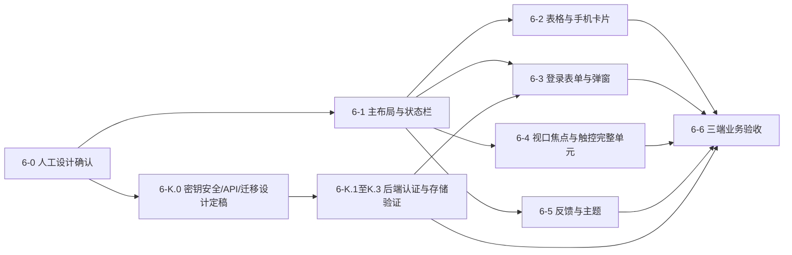

# Web SSH 第六阶段详细设计与实施计划（6-0）

- 编制日期：2026-11-19；最终一致性定向修订日期：2026-11-20（Asia/Shanghai）。
- 产品阶段：第六阶段「全面 UI 与移动端完善」；本文 6-0～6-6 及新增 6-K 与第五阶段内部 S6、S7、S8 无编号对应关系。
- 状态：6-0 定向修订审查稿。原六项产品裁决、三项实施细化及 SSH 密钥认证需求继续有效；最新裁决为私钥原始字节落盘、Passphrase 使用现有主密钥体系加密入库，文件上限 64 KB。已撤销私钥应用层加密及其轮换方案；其他技术选择仍按 §17 区分已确认、建议和待裁决，不冒充已经实现。
- 当前授权：仅只读调查并修订本文。本文不授权 6-1～6-6 或新增 6-K 的生产/测试代码、API、数据库、配置、部署实现，不授权安装依赖、启动/重启服务或 Git 写操作；每次实施以用户明确授权范围为准。
- 核对基线：原稿基于 `0038266af7e190cbebe9f9f927fa61b5fb0dee67`（`S7`）；本次补充修订开始时分支 `S6`，HEAD `7d90ec5`（`stage-6`），工作区干净，计划已经入库。该提交是现有基线，不是本次执行的提交。实施前重新核对基线，不切换分支或覆盖已有修改。
- 上轮存储方案定向修订基线为 HEAD `54bd6a1`（`stage-6`），当时开始工作区干净。本轮最终一致性修订仍基于该 HEAD，开始时已有上一轮未提交的本文修改；保留并继续修订，不覆盖或回退。两轮均未执行提交。
- 前置事实：用户已确认第五阶段 S7-1～S7-6 完成验收，真实环境使用测试已完成且未发现问题。本文接受这一前提，不把历史报告的未验项重新解释为用户验收失败。
- 调查证据沿用前轮文档、代码及测试源码核对；本轮仅全文检查计划并定点核对固定 SSH 库格式术语，未重新完整调查，未执行测试、构建或设备操作。全文验收表均为未来要求，不能作为通过记录。本任务不构成 6-0 最终批准。

## 1. 目标、范围与权威依据

### 1.1 阶段目标

在已完成的服务器管理、SSH 终端、有限恢复、列表、主动接管与关闭业务上，完成正式桌面和移动界面。交付重点为紧凑工作区、手机列表、表单/弹窗、系统软键盘、触控与辅助键、状态反馈及主题一致性。保留已有业务闭环；按用户本次明确扩展，增加与密码互斥的上传私钥认证、可选 Passphrase、安全持久化及直接相关后端验证。密钥认证是新增业务能力，单列 6-K，不以纯 UI 整理掩盖后端工作。

最终桌面 Chrome、Android Chrome 真机、iOS Safari 真机均能完成登录、服务器管理、真实终端操作、恢复、接管与关闭；布局变化不产生额外 Session、Client 或连接任务；结果有分层证据和真实设备记录。

### 1.2 权威文件及解释顺序

| 依据 | 本阶段采用的内容 |
|---|---|
| [实施阶段 §8](web-ssh-implementation-stages.md#stage-6) | 第六阶段原始范围：八项任务、十项必须验证要求、桌面/移动完成条件；本次密钥认证是用户明确追加范围 |
| [核心需求 §8～10](web-ssh-design-development-plan.md#ui)、§5.4、§6、§11、§18 | UI、服务器/Session 行为、Host Key、DTO/接口、产品验收 |
| [v2 原型](web-ssh-prototype-v2.html) | 布局、层级、黑白灰主题和移动卡片参考；不采用演示状态及网络算法 |
| [架构 §3～8](web-ssh-architecture-implementation-plan.md#ownership) | SSH/Binding/视图所有权、Session 生命周期、输入及 resize、回收 |
| [协议 §1、§6～7](web-ssh-websocket-protocol.md#reconnect) | 原始字节、偏移、回放、输入门禁、有限串行恢复 |
| [第五阶段实施计划 §21.5～21.6](stage-5-implementation-plan.md) | 方案 B、U1～U9、S7 D1～D5、双重准入、关闭状态和登出顺序 |
| [第五阶段 S6 设计](stage-5-s6-design-plan.md) §2、§4～10、§19 | 单 Pane、候选所有权、初始化/销毁、确认及停止屏障 |
| [第五阶段 S7 冻结提案](stage-5-s7-design-decision-proposal.md) §4、§6～8、§17、§20 | CloseCoordinator、错误可信度、页面退出、已接受风险 |
| [S7-6 报告](测试报告/stage-5-s7-6-report.md) §4～6 | 历史测试层级和 R-S7-6-01；不将其结果计为本轮验证 |
| 用户原 6-0 六项裁决及本次补充修订任务 | 六项产品裁决、三项实施细化、SSH 密钥认证需求登记在 §2；无需重复询问已确认事项；新增技术选择见 §17.9 |

上轮启动前只读审查报告保留在当前对话，未发现仓库内独立报告文件；原稿为新建的第六阶段计划。本次在现有计划基础上核对实际代码并补充修订，不新建第二份计划或审查报告。

已有第五阶段计划开头的「尚未授权 S7-1」、README 的 Stage 2 状态属于历史文字；当前进度以用户确认和实际代码为准。冻结业务约束继续有效，本次不改写历史文档。R1 按本轮明确裁决解释提示层级，不改写旧连接流程。

### 1.3 范围与非目标

未来实施范围覆盖 §4 的 UI 边界、6-1～6-6 及新增 6-K：响应式布局、已有动作入口、前端视口/焦点/辅助键，以及 §17 限定的 SSH 密钥认证后端、上传 API/DTO、数据库迁移、专用文件存储、安全和部署持久化要求。保留 Vue 3、TypeScript、xterm 6.0.0、addon-fit 0.11.0 与锁定依赖，不新增 UI 框架。既有 test API 形状、Host Key 确认及 Session/Binding 协议保持。

不纳入：文件管理/SFTP、新设置后台、Session 重命名/归档、服务端重启恢复、通用密钥资产管理/密钥生成/公钥下发/SSH Agent/证书认证、另一套 SSH 协议、新恢复/takeover 状态机、跨标签页协调、关闭意图持久化、DELETE 来源认证、原地重试失败的 dispose、新轮询及第七阶段全面稳定性/部署交付。不得把原型模拟命令输入框实现为独立输入功能。

本轮只修改本文，其他文件一律不动。未来仅 6-K 及其已确认契约下的 6-3 可涉及 SSH 密钥认证必需的后端/API/DTO、迁移和部署配置；其他 UI 任务不顺带改后端。WebSocket 协议、第五阶段冻结状态机、Web 登录/路由行为、依赖版本仍不在范围。原核心文档的「仅密码/不做密钥管理」需按 §17.10 单独提请补充，不能静默改写；本文也不授权修改那些文档。

## 2. 已确认的产品裁决与本次补充

| ID | 用户已确认内容 | 任务落点 |
|---|---|---|
| D6-1 | 顶部保留必要操作；底部窄状态栏显示状态、目标、尺寸；恢复/接管/关闭按状态显示并使用文字；远端关闭二次确认；排列可细化但行为不变 | 6-1、6-5 |
| D6-2 | 桌面表格、手机卡片；默认名称、目标、状态、保留时间、打开/关闭；次要信息展开；数据与打开/关闭业务不变 | 6-2 |
| D6-3 | 手机切换标签只切显示，不自动唤键盘；主动点击终端才唤系统键盘；精简 Ctrl、Esc、Tab、方向辅助键，经过既有门禁；不做完整键盘 | 6-4；6-1 预留布局 |
| D6-4 / R1 | BIND_BUSY 真实失败保留；同一代次后续 attach 成功后当前显示已连接，旧失败降为历史；不改接管、状态机或绑定 | 6-5 |
| D6-5 | 服务器管理保留产品栏/侧栏入口；连接测试在编辑表单内；登录密码显示/隐藏；Host Key 独立确认弹窗 | 6-3 |
| D6-6 | 桌面 Chrome、Android Chrome 真机、iOS Safari 真机；记录型号、系统、浏览器、输入法；模拟与自动化不能代替真机 | 6-6 |

本次用户进一步确认下列内容；这些行为不再列为待裁决问题。具体布局参数、视口技术实现及 §17 的安全/API 技术选择仍需按其性质审查。

| ID | 本次已确认内容 | 落点 |
|---|---|---|
| D6-7 | 仅测试已保存服务器；dirty 时按钮和处理函数双重拒绝；保存退出后重新编辑测试；空密码保留、不回填；不改 test API、不加临时配置测试 | §8、A3 |
| D6-8 | Ctrl 单次修饰，只转换下一个单独英文字母；中文/IME/多字符不转换且正常输入/候选/粘贴不受干扰；独立 Esc/Tab/模式正确方向；指定生命周期自动取消；全部走既有门禁 | §9.4、A4 |
| D6-9 | taskId 只识别操作和过滤迟到回调，binding_generation 判代；同一代次后续 attach 真正成功才降级旧 BIND_BUSY；Client/taskId/列表 CONNECTED 均非成功证明，新代成功不改旧代失败 | §10.2、A5 |
| D6-K | 密码与上传私钥认证明确互斥；专用目录 `/var/lib/web-ssh/ssh-keys/` 独立持久化；支持原始带 Passphrase/无口令私钥；Passphrase 加密保存、秘密不回传/记录；覆盖增换删、共享引用、重建/备份及数据库主密钥变更影响 | §17、6-K；6-3 认证表单；6-6 验收 |
| D6-KS | 最新存储裁决：私钥按上传原始字节保存，不应用层加密/解密或转换，不引入文件加密密钥/密文版本/上下文/轮换；文件上限 64 KB；格式和 Passphrase 校验成功后才落盘。Passphrase 单独以现有 APP_ENCRYPTION_KEY / APP_ENCRYPTION_KEY_FILE 加密入库，权限/租约/挂载/备份保护保留 | §17.1、§17.5～17.10；AK-04/05/09/10 |

本轮人工审查确认的约束如下；不再作为 §17.9 的待决选择：

| ID | 已确认设计 | 落点 |
|---|---|---|
| D6-KF | 首批为 OpenSSH、PEM PKCS#1 RSA、PEM SEC1 EC、固定 SSH 库实际可解析并构造 Signer 的 PEM PKCS#8 类型；不承诺 DSA、库不支持的加密 PKCS#8 或未验证格式；上传先解析，格式/口令无效明确拒绝且不保存 | §17.1/17.2、AK-02/05 |
| D6-KC | 切换成功清理旧凭据；新密钥先验证、保存、建立引用并提交，再清旧密码；切回密码先保存提交再清旧私钥引用/口令；替换密钥同样先成功提交再清旧文件，文件回收须无其他引用/在途租约；新凭据失败保留原配置及凭据 | §17.4/17.5、AK-06/07 |
| D6-KA | 私钥文件缺失/损坏不阻止整个服务启动，仅关联服务器凭据不可用；测试/新建 Session 明确错误；不生成空文件、不自动覆盖 DB 引用，管理页允许重新上传恢复；孤儿回收须有安全期限且禁止删引用/租约中的文件 | §17.5/17.7、A3-09、AK-09 |

## 3. 当前实现盘点与差距定位

行号对应核对基线；未来以文件内同名函数/组件为定位依据。

| 编号 | 能力/状态 | 实际位置 | 本阶段剩余工作及原因 |
|---|---|---|---|
| G01 | 登录/主题入口已实现，密码显隐未实现 | `frontend/src/pages/LoginPage.vue:15,45` | 加显隐和小屏键盘可达性；不重做登录 API |
| G02 | 产品栏、默认收起侧栏和抽屉部分实现 | `frontend/src/pages/HomePage.vue:318,388,537`；`frontend/src/styles/base.css:145,355` | 顶栏文字操作较多，抽屉缺少完整背景隔离/焦点恢复；明确跨断点行为 |
| G03 | 标签和保留 Pane 已实现，展示待完善 | `HomePage.vue:80,145,151,635,652`；`base.css:418` | 增加活动项可见性、标签内关闭、标签语义；不新建第二套业务视图 |
| G04 | 顶部终端操作已实现，底部窄状态栏未实现 | `frontend/src/components/terminal/TerminalPane.vue:584`；`base.css:442` | 分离必要操作和简要状态，减少窄屏高度占用 |
| G05 | 搜索、分组筛选/折叠、CRUD 已实现 | `HomePage.vue:331,337,364,384,408,422`；`ServerForm.vue` | 保留逻辑，完善触控、长文本和小屏表单 |
| G06 | 测试连接已实现，但入口在详情而非表单 | `HomePage.vue:442,689`；`ServerForm.vue:49` | 按裁决移到编辑表单；不能测试未保存 DTO 或自动保存 |
| G07 | Host Key 独立人工确认已实现 | `HostKeyDialog.vue:15,40`；`HomePage.vue:467,738`；`api/management.ts:106` | 小屏、长指纹、过期/取消、表单与确认弹窗层级；目标变化要明确重新核对 |
| G08 | Session 查询与打开/关闭业务已实现，手机卡片未实现 | `SessionManager.vue:47,152,176,267`；`session/list.ts`；`HomePage.vue:119,184` | 11 列 nowrap 表格仅内部横向滚动；需卡片和展开，不重写 Controller |
| G09 | 页面和 xterm 基础主题已实现 | `frontend/src/main.ts:1`；`ThemeButton.vue`；`TerminalPane.vue:295,538` | 统一状态/选择色，检查 ANSI、焦点、弹窗及隐藏 Pane；不是新主题系统 |
| G10 | resize/隐藏切回已有基础，手机焦点不满足新裁决 | `TerminalPane.vue:236,303,536,561` | `layout(true)` 在标签激活等位置请求焦点；需手机显示与输入意图区分 |
| G11 | 软键盘/触控为部分实现，辅助键未实现 | `base.css:118,145,463`；`frontend/index.html:2`；`TerminalPane.vue:338` | 已有 100dvh/ResizeObserver，无专门安全区域或视口协调；需真机支持及精简键栏 |
| G12 | 普通/二进制输入、回放/偏移/截断已实现 | `TerminalPane.vue:357,363`；`terminal/client.ts:220,614`；`terminal/output.ts:159` | 复用既有发送门禁和 Tracker，补触控/IME/辅助键验证，不改原始字节语义 |
| G13 | R1 展示尚未落实 | `terminal/takeover.ts:154`；`TerminalPane.vue:204,683` | 首次连接 Promise 失败文字可在后续成功后保留为当前结果；需结构化关联任务并降级历史 |
| G14 | close 状态、登出与资源清理已实现 | `session/close.ts`；`HomePage.vue:489`；`TerminalPane.vue:251,442,579` | UI 接线与新增资源的回归；禁止重复建设协调器 |
| G15 | 自动化/浏览器历史证据已存在，三端本阶段验收未执行 | `frontend/tests/*.test.mjs`；`tests/browser/stage-5-s7-6.mjs:20,36` | 既有浏览器夹具默认 1440×1000，HTTP/WS 为替身；不证明手机键盘/真实 SSH |
| G16 | 生产认证仅密码；无上传、私钥引用、Passphrase 字段及专用卷 | `server/{types,store,service,session,probe}.go`、`sshclient/test.go`、`001_initial.sql`、Dockerfile/Compose | 新增独立 6-K；6-3 接入上传与认证选择，6-6 新增 M16；实际调查与技术待定项见 §17 |

### 3.1 前后端核对结果

- `backend/internal/httpapi/sessions.go:26` 使用已有列表/详情/创建/关闭/凭证/升级路径；列表仅支持 `server_id`，状态在前端筛选。不新增分页、排序或状态参数。
- `backend/internal/session/session.go:22` 与 `frontend/src/api/sessions.ts:10` 的 SessionView **没有 `updated_at`**。展开区展示创建、最近绑定、断开、离线期限、代次及尺寸；最近查询时间来自列表 Controller，标为「最近查询」，不能伪造「Session 更新时间」或借用服务器更新时间。此为对裁决中「更新时间等」的字段落实，不改变裁决或接口。
- Session 名称与目标来自创建快照。`SessionManager.serverLabel()` 可附加当前服务器名称，但卡片的主名称和目标必须来自 Session DTO；编辑服务器后旧 Session 目标不变，不把列表 CONNECTED 标成「本设备已连接」。
- `backend/internal/httpapi/management.go:204` 的测试是 `POST /api/servers/{id}/test`，请求为空对象，只测试已保存配置。`HostKey/confirm` 只提交 probe_id；前端不提交公钥或自动信任。
- `backend/internal/session/binding.go:96,190` 校验状态/代次并在 WS 提交时替换 Binding；`session.go:251,361` 的关闭异步回收。UI 不改变这些事实。

## 4. 总体设计与实施边界

### 4.1 保留的业务结构

HomePage 继续拥有唯一 records/预占与 CloseCoordinator；TerminalPane 继续拥有 Client、Recovery、Takeover 及 Pane 的视图资源，Tracker 继续拥有 xterm 端口；SessionManager 继续拥有一个列表 Controller，只发出 open/close 意图。

响应式分支仅影响展示 DOM。不得在桌面/手机分支各渲染一个 HomePage、TerminalPane 或 SessionManager 控制器；不得用断点、主题、方向、active 状态作为 Pane key。保留稳定 record.key 与 `v-show`，不以路由替换现有会话管理视图。

显示、焦点与连接准入分开：隐藏 Pane 仍可输出及按既有规则恢复；抽屉、菜单、模态框可以阻止用户焦点和辅助键，不能为此修改 `live()`/Client.allowed 并停止长期任务。

### 4.2 视图与操作规则

- 沿用 720px 作为初始窄屏布局断点，900px 仅作筛选栏过渡；不引入用户可配断点。触控/禁止自动焦点采用窄屏或粗指针/无 hover 环境的保守策略，不能只靠 UA；最终匹配在 6-4 三端核验。
- 产品栏保留品牌、服务器导航、会话管理、主题、退出；添加服务器可收纳入「更多操作」或侧栏已有入口。收纳后仍有明确文字、焦点顺序和退出重试入口，不增加独立管理页。
- 桌面侧栏与手机抽屉的显隐状态分开，首次均收起；跨断点关闭临时菜单/手机抽屉并恢复合适焦点，不自动连接。桌面展开后选择服务器保持侧栏；手机选择后收起。
- 抽屉展开隔离背景终端点击/焦点；遮罩、Escape、按钮可关闭，焦点返回打开按钮。独立模态框在上层时 Escape 只作用于最上层，不透传关闭底层或发送给 SSH。
- 顶部操作使用现有 canPrepare/canRecover/closeView 等判定；底部状态栏只展示目标、当前连接状态、当前本地 xterm 尺寸。长目标可省略但有可访问的完整内容，不挤掉状态；无终端实例时尺寸显示「—」，不从旧 DTO 猜当前尺寸。
- 点击标签关闭只能调用对应 Pane 的既有 close()，等待 closed 后释放预占；不得直接 splice records。候选、失败 Pane 也遵循该规则。
- 触控主操作命中区目标至少 44×44 CSS px；视觉可紧凑，但相邻命中区不重叠。顶部必要操作不被菜单完全隐藏；在 320/360/390/430px 宽度和横屏低高度检查可达性。
- 页面的 documentElement.scrollWidth 不大于 clientWidth（允许 1 CSS px 舍入）；允许终端内部滚动、标签横滚和桌面表格内部滚动，不能用 body 强制裁切掩盖不可达内容。

### 4.3 操作和反馈矩阵

| 真实状态/情形 | UI 入口及反馈 | 不允许的行为 |
|---|---|---|
| 本页已有 Pane | 打开只定位；切标签显示，不新增动作 | 第二 Pane/Client、自我接管 |
| 无 Pane、本地 close idle | 创建候选、stop/详情/确认；确认前仅 GET | 凭证/WS/隐式 Session 创建 |
| 准备/回放/等待恢复 | 展示真实进度；按原准入显示停止、准备接管 | 另起恢复链、将等待视为可输入 |
| 普通停止/预算耗尽 | 刷新详情后手动 attach；准备接管仍须 stop/确认 | 在线事件复活旧任务、自动换代 |
| taken_over/4001/BIND_CONFLICT | 明确失去当前操作权；提供现有用户主动入口 | 将其标为远端 ended、自动夺回 |
| close pending | 正在请求；允许取消等待 | 「已撤销远端关闭」 |
| close requested/unknown/failed | 保留关闭意图；提供原有刷新/重试关闭/关闭标签 | 被 GET 的 CONNECTED 覆盖、恢复或 takeover |
| idle + CLOSING/CONNECTING | 状态不可绑定；不给确认/凭证/WS | 把 idle 当成可接管许可或自动 ended |
| ended | 当前不可接管；保留本地关闭入口、旧行禁用 | 声称 buffer/lease/metadata 全部已回收 |
| logoutPending | 只允许退出重试/必要本地清理；保留失败反馈 | 新建、测试、保存、凭证或恢复 |

菜单是否显示不能成为安全保障；点击处理仍检查原有准入。未知/请求中关闭不折叠成「普通离线」，必要错误就近显示，不添加常驻教学文案占据终端。

## 5. 任务图、范围与推荐合并（补充认证任务）

保留 6-1～6-6 的原编号和职责，新增独立 **6-K：SSH 密钥认证后端、API、数据与私钥存储**（§17.8），不将后端文件生命周期归入 6-3。6-K.0 的方案确认先于相关实现；6-K 后端契约及验证完成先于 6-3 认证上传部分的联调验收。6-3 的登录显隐/通用 Modal 可先做，但不能把它记为完整 6-3 已完成。

推荐顺序：6-0 审查并裁决 §17.9 → 6-K.0 设计定稿/所需权威文档补充另行授权 → 6-1（可带 6-5 基础样式）→ 6-K.1～K.3 → 6-2 → 完整 6-3 → 6-4 → 6-5 R1/统一反馈 → 6-6。6-2、6-4、6-5 可在布局稳定后独立推进，不依赖认证落盘方案；尽早安排 6-4 真机反馈。顺序调整原因是上传与保存不能先于后端一致性、秘密存储和 API 契约实施。

6-1 与 6-5 基础样式、6-2 与列表视觉可以合并；6-3 登录/表单/弹窗可作前端单元。6-K 与 6-3 可在授权同时覆盖时作为认证纵向交付，但后端调查、文件故障/安全证据与前端证据必须分别保留，不能省掉 6-K 的独立验收。R1 保留独立语义证据。6-4 视口、尺寸、焦点、辅助键与清理必须完整实施，不发布缺清理的中间态。所有合并均以明确授权为前提，依赖不是编码授权。

## 6. 6-1：产品栏、抽屉、标签与终端状态栏

### 6.1 目标、范围与步骤

理由：G02～G04 已有业务，缺少窄状态栏及手机入口收纳。主要修改 `HomePage.vue`、`TerminalPane.vue` 的展示接线、`base.css` 和直接相关测试；必要时提取纯展示布局组件，但不抽取新的业务所有者。

1. 根据 §4.2 收口顶栏，保留主题和退出失败后的重试可达性；实现显示隐藏状态、遮罩和焦点恢复。
2. 沿用现有 server 搜索/分组/选择函数，补充抽屉背景隔离、Escape 和断点监听清理。
3. 标签增加语义、独立关闭按钮和活动项滚动进入标签容器；滚动只作用于标签容器，不滚动整个页面。键盘左右切换标签时焦点停在标签上。
4. 移动端不自动把焦点交给终端；6-1 先使布局激活只触发 fit，6-4 再完整接入触控焦点策略。桌面显式连接可保留既有焦点行为。
5. 顶部保留状态相关文字操作，底部窄栏桥接当前目标、连接状态、xterm cols/rows，不把 Terminal 实例变成普通深响应式 JSON 状态。
6. 在手机辅助键未实现前预留弹性高度；状态和操作栏可自适应但不能将终端挤出可视区。

### 6.2 验收（A1）

- A1-01：首次桌面/手机侧栏均收起；桌面开关释放/占用宽度，手机选择服务器后收起；Escape/遮罩和背景焦点行为符合 §4.2。
- A1-02：建立 A/B 两个真实终端，再反复开关侧栏、换标签及管理视图、跨断点各 10 次；record/Pane/Client/Tracker 身份不变，每 Session 最多一个 Pane，创建 Session/凭证/WS 增量为零（稳定网络、无其他动作条件下）。
- A1-03：不少于 8 个长名称标签时可横滚，激活项可见；手机切换不 focus xterm、不唤键盘；关闭非活动标签不先激活/连接它。
- A1-04：关闭标签只走原 close()，零 DELETE；dispose 失败保留记录/预占且没有原地重试；init_failed 沿用关闭后重开规则。
- A1-05：状态栏目标来自 Session 快照，尺寸来自当前 xterm；抽屉和布局变化只 fit/resize，未更新 generation、连接任务及预算。
- A1-06：320px 至桌面宽度无页面横向溢出，文字操作可达，窄屏无终端之外的大段常驻说明；焦点与语义可用。

完成后交付改动和 A1 证据，停止等待该授权范围的审查；未获授权不进入下一任务。

## 7. 6-2：Session 桌面表格与手机卡片

### 7.1 目标、范围与步骤

理由：G08 已有完整列表业务，只需信息重排。修改 `SessionManager.vue`、`base.css` 及 `session-list.test.mjs`/相关浏览器场景；不修改 API、list Controller、close Coordinator 或 Pane 流程。

1. 保留一个 SessionManager、一个 Controller 和一份 filteredItems；桌面表格与手机卡片共享格式化、emit、ended 判定。可用响应式展示分支，不能分别创建控制器或查询。
2. 桌面默认呈现名称/目标/状态/最近接入/剩余/操作；完整 ID、代次、尺寸、创建/断开/期限可在同行详情展开，不能删除原有信息。
3. 手机默认名称、目标、状态、保留时间、打开/关闭；同一 Session ID 对应展开状态，仅存组件内。展开呈现 §3.1 列出的真实字段；无独立 updated_at 时不显示伪造值。
4. 保留首次加载、首次错误、空列表、筛选为空、刷新中保留旧行、旧快照错误、最近查询、ended tombstone。remaining_seconds 显示查询值并标明查询时；不新增倒计时/轮询，0 不删除或关闭 Session。
5. 表格/卡片使用相同 open/close 入口；CONNECTING/CLOSING 打开按 HomePage 原规则反馈，关闭仍允许走原确认；非 idle 打开仍由页面创建只读关闭状态 Pane。
6. 切状态筛选和展开不新增 GET；切服务器按既有规则请求，页面重新可见的既有刷新继续保留。

### 7.2 验收（A2）

- A2-01：同一数据在桌面/手机显示相同 Session ID、名称快照、目标、状态和剩余；服务器编辑不改旧 Session 目标；CONNECTED 不显示为本设备持有。
- A2-02：默认卡片不需横扫宽表；展开可读完整 ID/代次/尺寸/时间；长 IPv6、用户名、名称和错误不撑宽页面。
- A2-03：断点往返、卡片展开收起各 10 次，Controller 实例/请求数不增加，确认中的 Pane 动作不取消；仅视图展开状态可变化。
- A2-04：加载、空、错误、旧快照、乱序响应/旧 finally 和 ended 旧行禁用全部保留。展开区不伪装最新；「最近查询」不叫 Session 更新时间。
- A2-05：卡片打开只 emit，一次用户确认对应一次原接管链；确认前零凭证/WS；取消不自动移除候选 Pane、不复活旧恢复。
- A2-06：行级关闭先确认；取消零 DELETE，重复确认复用原协调器；unknown 不显示成功；无新关闭状态机、无列表直接 DELETE。

## 8. 6-3：登录、服务器表单与确认弹窗

### 8.1 目标、范围与保存/测试契约

修改 `LoginPage.vue`、`ServerForm.vue`、`HostKeyDialog.vue`、`Modal.vue`、`HomePage.vue` 的表单测试接线及共用样式/相关测试。理由为 G01、G05～G07、G16；不修改 auth/router、test/confirm API 或 probe 规则。认证方式/文件上传的前端 DTO 和请求包装按 6-K 已审查契约实现；API/后端/迁移实现归 6-K，不归纯 UI 工作。

为落实「表单内测试」且不扩展已保存 ID 接口，用户已经确认以下明确流程：

- 新增表单没有已保存 ID：显示禁用的「测试连接」和就近提示「请先保存服务器，再编辑并测试」。不自动保存或测试。
- 编辑表单仅在所有可编辑值与载入快照一致、password/Passphrase 为空、无新上传文件或认证切换/凭据动作时允许测试；任何未保存改动均禁用并提示先保存。即使仅改备注，也不让用户误以为正在测试整份草稿。
- 保存继续沿用现有保存成功后关闭表单；用户再次编辑已保存记录后主动测试。此流程无需增加「保存并测试」或自动重开表单。
- 测试使用固定 server ID 和空请求体，结果就近显示在该表单，不通过 selected 的迟到变化切换目标；服务端结果的 host/port/username 是实际测试目标。
- 把详情中的测试入口移入编辑表单，详情保留编辑/连接等既有业务。测试不申请 Session/Channel/PTY/Shell、不创建 WS。处理函数与按钮使用同一 dirty/已保存/准入校验；不能仅靠 disabled。密码和密钥均走这一已保存 ID 流程。

### 8.2 实施步骤及请求生命周期

1. 登录显隐按钮为 type=button，有显示/隐藏文字或可访问名称；不提交表单、不写密码到存储/日志；提交和离开仍清密码。保留 current-password 和真实服务端认证。
2. 窄屏表单单列，桌面双列；弹窗以可见高度限界，正文可滚，底部操作可以滚到，不以固定遮罩盖住字段。适配全局安全区域，但不新建第二套终端 viewport 管理器。
3. HomePage 继续接入既有 testServer/confirmed/HostKeyDialog 流程；ServerForm 只发测试意图并接收本次结果。需要时为表单测试增加局部请求控制与序号，不改连接 Client 或建立全局 Store。
4. 测试开始固定表单实例身份、ID 和动作类型 test；在途禁用保存、再次测试及编辑输入，取消表单仍可用。关闭表单、换编辑目标、登出或卸载时撤销本地发布身份并取消该测试的本地等待；不 abort 其他业务共用的请求，不声称服务端动作已撤销。
5. 返回 probe 时用独立 HostKeyDialog 置于表单之上，保留原表单；此时原表单不可交互。公共 Modal 使用实例唯一标题 ID，焦点停在最上层，关闭上层回到当前仍存在的表单入口；不自动 focus 背后终端。
6. Host Key 确认始终显示目标、算法、新指纹、已有时的旧指纹及有效期。目标变化后按服务端重新探测结果明确当前目标已变化/需重新核对；不发明新的 reason 字段。
7. 确认成功后仅在同一表单测试意图仍有效时刷新信任并重新测试，保留 purpose=test；从连接产生的 probe 则沿用 connect 流程。取消/过期/失败不自动确认，不误触发 createSession。
8. 取消整个表单同时关闭它拥有的测试 probe 展示并失效后续回调；已发送确认可能已写信任，取消只能停止本地等待，不能提示「已撤销信任」。再次测试以服务端事实为准。服务端配置并发变化继续由现有版本校验处理。

9. 在 6-K 契约明确后增加互斥认证选择、原生文件选择与可选 Passphrase；不要求手动粘贴，不读取或回显服务端私钥/口令。编辑仅展示安全元数据与保留/替换状态；认证切换成功清旧凭据、新凭据失败保留旧配置按 §17.4 的已确认规则；Passphrase 重新输入/单独修改的未决交互只按 K03 定稿，不猜测空输入含义。文件缺失/损坏仍允许在管理表单重新上传恢复，不能因凭据不可用禁用整个编辑入口。
10. 密码、Passphrase、所选 File 及必要内存缓冲仅归当前表单；取消/保存成功/登出/卸载清理引用和文件输入，若建立 object URL 则撤销，不写 localStorage/日志。失败可保留当前草稿供修正，但不能泄漏错误原文；取消本地等待不宣称服务端保存回滚。上传、保存及确认迟到响应受同一表单身份保护。

### 8.3 验收（A3）

- A3-01：显示/隐藏不发请求、不改变密码值；登录成功/失败清密码；服务端返回 AUTH_REQUIRED 和网络错误按原认证路径处理，不新增本地登录判定。
- A3-02：新增未保存、编辑有改动、保存/测试中、logoutPending 均不能测试；处理函数也拒绝绕过按钮；原始已保存记录测试恰好一次 POST test，零 PUT/POST servers、零 Session/WS。
- A3-03：保存后按现有行为退出表单，再编辑测试使用新保存 ID/配置；空密码不替换原密码、查询无密码回填。
- A3-04：首次信任、同目标换 key、Host/Port 变更、过期、取消、确认错误、配置并发变化分别验证；确认前零 confirm；confirm 只含 probe_id；test probe 确认后不创建 Session。
- A3-05：测试中关表单、登出、换目标，迟到成功/错误/probe 不更新新表单、不弹旧确认、不自动再测试；不更改第五阶段 signOut 同步顺序。
- A3-06：两个原生 dialog 层级、唯一标题 ID、Escape、取消及焦点返回正确；长地址/指纹/错误、软键盘和横屏低高度下，确认/取消可达且无背景误输入。
- A3-07：三端可选择私钥文件并填写可选 Passphrase；密码/密钥互斥，切换/替换/保留符合已审查契约，dirty 包含文件和秘密动作；取消及迟到响应不改新表单，不持久化秘密。
- A3-08：密码、无口令私钥、加密私钥分别完成保存→退出→重开→原 test API→人工 Host Key 确认→重测；不上传临时配置测试、不创建 Session；错误口令/格式/超限显示安全错误，后端验收见 AK。

- A3-09：私钥文件缺失/损坏时管理页和其他服务器仍可用；关联服务器测试/新建 Session 明确错误，重新上传有效文件后按保存流程恢复；不自动创建空文件或覆盖原引用，上传失败保留原配置。替换时是否重输口令及单独修改交互按 K03 最终裁决验证，不预设其中一种。

## 9. 6-4：终端可视区域、焦点与触控输入（完整单元）

### 9.1 目标与文件范围

主要修改 `TerminalPane.vue`、`HomePage.vue` 的只读布局/交互参数、`base.css`、`frontend/index.html` 和直接相关测试。只有产生实际职责时才新增一个无网络能力的 viewport 辅助模块或纯辅助键组件；不增加新的生命周期对象、Store 或连接协调器。

已有 100dvh/ResizeObserver/FitAddon 继续作为基础。必须同时解决可见尺寸、调度、焦点、系统键盘/IME、辅助键和清理，不能靠测试发现冲突后再决定所有权。

### 9.2 视口与 fit 的设计边界

1. HomePage 作为应用布局视口的唯一所有者；Login/Modal 复用 CSS 规则，不各写一个改变全局高度的监听器。Pane 只观察自己的终端容器。
2. 基础高度为 CSS 动态视口、弹性 min-height:0 和安全区域；底栏及辅助键计入可用高度。为刘海/底部手势区考虑 viewport-fit=cover 和 env(safe-area-inset-*)，以实际设备检查不双重扣减。
3. 若 CSS 动态视口在目标设备确有键盘遮挡，允许 HomePage 内的可选 viewport 适配：读取受支持的 visualViewport.height/offsetTop 等几何信息，更新布局局部 CSS 变量；无该 API 则回退到 CSS/窗口尺寸。变量不写 localStorage、不推断登录或连接状态、不强制页面 scrollTo 抢滚动。
4. 选择标准已经确定为「焦点输入和末行/操作在键盘上方可达、无双重高度扣减、保留用户滚动/缩放、无重连」。CSS 与可选几何适配的技术选择在 6-4 内以目标浏览器实测确定，并记录取舍；不把 visualViewport 宣称为唯一正确方案，不以键盘像素阈值决定业务。
5. 容器 ResizeObserver、视口/方向/工具栏变化最终合并到一个待执行 requestAnimationFrame fit；同一帧读取最新尺寸，不递归同步 resize。零宽/零高、隐藏或销毁中的 Pane 跳过，不发 0×0。
6. fit 使用现有 proposeDimensions、配置上下限和当前 term；尺寸未变时不重复发送 resize，最后一次有效变化应送达。切回隐藏 Pane 后 nextTick 再 fit，校验实例和 taskId，旧实例回调不得操作新实例。
7. 视口/可见事件只更新布局、取消临时焦点/修饰状态，绝不调用 connect/recover/prepare、修改 generation 或重置预算。真实断网仍由既有 Client 事件进入唯一恢复链。

### 9.3 焦点及系统输入

- 手机/触控路径中，标签切换、初始连接/接管成功、自动恢复、回放完成、抽屉收起和页面恢复可见均不得主动 term.focus；仅显示和 fit。必要时 blur 已隐藏的旧终端，但不 stop。
- 用户主动点击当前终端的输入区域后，由当前 xterm 输入元素正常获得焦点；不能全局 preventDefault 破坏长按选择、粘贴菜单或中文 composition，也不能只靠异步 focus 唤键盘。
- 弹窗/抽屉/菜单打开时阻止终端取得用户焦点；在 composition 中不全局拦截按键、不逐键重发、不裁剪/重编码 xterm onData。普通数据仍 TextEncoder，onBinary 仍逐字符转字节。
- 桌面可保留用户显式连接/切回后的既有焦点策略；后台 Pane、旧任务、旧 layout 回调永不抢焦点。焦点可达性与 Client 的输入权限是两件事。
- 原生复制/粘贴、长按与滚动优先由 xterm/浏览器处理；若需前端补适配，仅覆盖具体目标浏览器差异，不引入剪贴板同步服务或完整自定义选择系统。

### 9.4 精简辅助键栏的实施细化

目标设备提供带文字的 Ctrl、Esc、Tab、↑↓←→。不增加定时长按连发、宏、输入历史或完整虚拟键盘。纯 UI 组件最多 emit 键意图，不持有 client/socket。

- Ctrl 采用单次修饰：点击为选中，再点取消；仅下一次可确认来源为普通单字母输入、非粘贴、非 IME 组合/提交的 ASCII A～Z/a～z 转换为控制字节（例 Ctrl+C=0x03、Ctrl+D=0x04），发送后解除。已有单控制字符沿原路径，不重复转换。
- 中文、IME 组合/候选选择/提交、多字符、粘贴（即使只粘贴一个字母）不作 Ctrl 转换，沿 xterm 正常路径和既有门禁处理；取消修饰且不吞字、不重复发送、不阻止默认候选或粘贴行为、不要求用户重新输入。不能只凭 onData 字符串长度判断输入来源。来源无法可靠区分时保留正常输入并解除 Ctrl，不猜测转换；来源识别和 xterm 事件顺序须先用目标输入法验证。
- 独立方向/Esc/Tab 先解除 Ctrl，仅发送自身序列，不实现 Ctrl+方向等未定义组合；其他不支持输入也不合成新组合，不缓存到恢复后补发。只在已判定的单字母发送点替换一次字节，不能全局拦截 composition/beforeinput/paste 或逐键重放输入。
- Esc=0x1b，Tab=0x09；方向按当前 xterm 的普通/应用光标模式生成对应 CSI/SS3 序列，不能所有场景固定一套。可使用已安装 xterm 公开 input(data,true)/modes 能力经 onData 进入原发送门禁；不得调用 WebSocket.send 或更改 Client/Tracker。
- 接收 UI 意图时检查当前 Pane active、可见、无阻挡弹窗/抽屉、live 及 client.canInput；实际发送仍由现有 client.send 再检权限。回放、停止、被接管、关闭非 idle、登出及销毁时辅助键零字节、不排队。
- 点击辅助键不主动唤起已收起的软键盘；键盘已打开时避免按钮默认夺走输入焦点，但只处理键栏自身的 pointer 行为，不吞掉终端长按。外接键盘可 Tab 到按钮并用 Enter/Space 操作。
- 隐藏、失焦、弹窗/抽屉打开、停止、断线、接管、登出、销毁、终端重建均解除 Ctrl；旧 Pane 的修饰状态不能应用到新实例。

### 9.5 生命周期与验收（A4）

- A4-01：Android/iOS 真机在键盘开/关、工具栏伸缩、横竖屏下输入末行可见；可以滚动查看输出；无页面横溢或状态/键栏遮住确认入口。短横屏允许必要内部滚动，不能裁掉操作。
- A4-02：两终端切换时不自动唤键盘；点击当前终端才输入；恢复成功/重进前台/开关抽屉不抢焦点。桌面显式操作焦点正常。
- A4-03：连续 resize 合并、隐藏零尺寸跳过、切回最终 fit 正确；尺寸在配置范围，远端 stty size 对应当前终端，零新 Session/凭证/WS。
- A4-04：中文含候选选择、撤销组合、连续输入，复制多行、粘贴、长按选择/滚动和外接键盘无应用层重复发送；特殊二进制保持原字节。
- A4-05：Ctrl+C/D、Esc、Tab、四方向分别在普通 shell 和启用应用光标模式的受控程序中验证实际字节/行为；Ctrl 遇中文/IME/多字符及单字母/多行粘贴时正常输入保持、候选选择不受影响、Ctrl 取消且不转换/吞字/重发/延迟补发；独立方向不变成 Ctrl+方向。
- A4-06：在 replaying、retry_wait、stopped、taken_over、close unknown/requested、logoutPending、inactive 和 disposed 下触发辅助键，出站输入为零；恢复后不补发。
- A4-07：视口回调等待中卸载/登出、xterm 截断重建后旧回调到达，取消 RAF/监听并校验身份；不创建替代 Client、不回调已销毁终端；既有 stop/dispose 失败语义不变。
- A4-08：目标设备至少各做 10 次键盘开关/旋转/标签往返，网络稳定时资源身份和 WS/Session 计数不变。真实后台挂起可能使系统断网，应按 §12 分类，不能强求 WS 永不变化。

## 10. 6-5：状态反馈、R1 与主题一致性

### 10.1 目标及范围

修改 `TerminalPane.vue` 展示层、SessionManager/Modal/ThemeButton 的必要样式、`main.ts`（仅有主题初始化缺陷证据时）、`base.css` 和直接相关测试。`terminal/takeover.ts` 仅在展示需要时增加只读结果元数据；禁止改变 prepare/confirm/cancel、Client 调用次数、Promise 语义或连接流程。`client.ts`、`output.ts`、`recovery.ts`、`session/close.ts` 不作本任务修改。

### 10.2 实施步骤与 R1 关联规则

1. 使用三种展示层级：当前连接/关闭事实；本次操作进度/结果；历史诊断。关闭非 idle 的提示优先于普通连接标签，不被历史成功或瞬时 GET 覆盖。
2. R1 记录真实 ConnectionResult/RecoveryState，保存 Pane/Client 实例身份、操作 taskId、首次 takeover 的 expected binding_generation=G、失败 code/message。taskId 仅用于识别操作与过滤旧任务/旧实例迟到回调，不能代替代次判断；同 Client、同 taskId、列表 CONNECTED、navigator.onLine、message.includes 均不能证明成功，不发 GET 来推断绑定。
3. 「同一代次」指失败 takeover 与后续 attach 都针对同一 expected_generation=G 的尝试。依冻结协议，真正提交成功后的 bind_success.binding_generation 必须为 G+1，不能错误要求成功值仍为 G。只有当前 Client 校验了该 G+1 且收到有效完整绑定前缀，后续 attach 才有成功证据；尚在回放显示「已连接/正在回放」且保持输入禁用。此前针对 G 的 BIND_BUSY 才能降为历史，真实失败仍保留。后续已成功绑定新一轮代次的事件不能反向改写旧 G 的失败。
4. 可通过 Pane 的 finished(result)、RecoveryState（replaying/online）和已存在的只读 client.currentGeneration 桥接展示证据；当前 client.ts 已在校验 bind_success、完整前缀后才发布这些成功阶段。takeover.ts 若需增加候选 expected generation 等只读结果元数据，只服务展示关联，不改协议、重试/Promise/状态迁移。先固定 G；校验实例/taskId 和绑定证据，再作代次关联；不能仅判断 getter 非零或 taskId 相同。首次失败 Promise 不延长或二次 resolve；旧任务/其他代次成功不能改写为旧操作成功。
5. 保存最近一次相关诊断及有界操作记录即可，不新增无界日志数组/全局历史 Store；旧任务/旧实例回调不更新当前记录。保留用户关闭历史提示入口。R1 不清除历史截断提示或实际关闭/登出错误。
6. 必要错误贴近对应动作；未知关闭始终显示未知、取消等待不是撤销关闭；被接管和预算耗尽保留明确的现有主动入口。历史截断继续在 SSH 字节流外，提示重建和后缀不能恢复完整历史画面。
7. CSS Variables 统一浅/深色状态色、焦点/选中、错误及辅助键选中态；保留首次 light 和 web-ssh-theme 本地选择、存储不可用回退。xterm 更新现有实例主题，不重建/重连；ANSI 字节不改写。

### 10.3 验收（A5）

- A5-01 / R1：实际动作建立 candidate 并确认，首个凭证请求返回 BIND_BUSY，下一轮 attach 使用相同 expected generation；注入合法下一代 bind_success/完整前缀。请求模式严格 [takeover, attach]；当前已连接，BIND_BUSY 可在历史查看，当前不显示「接管未完成」。输入仍等回放处理完成。
- A5-02：BIND_BUSY 后预算耗尽且未成功仍显示真实失败/停止；BIND_CONFLICT 不自动恢复；同 Client/同 taskId 但 expected 代次不同、仅列表 CONNECTED、无完整前缀、不同 taskId 的成功、迟到失败及已注销 Pane 均不能错误降级/复活；新一代成功可更新当前连接事实，但旧代次 BIND_BUSY 失败记录保持原结论。重复 online/visibility/viewport 不新增请求。
- A5-03：requested/unknown 查询到 CONNECTED 仍保持关闭意图；200 只显示请求已提交；NOT_FOUND/closed 只证明不可接管。取消等待与本地清理失败独立显示。
- A5-04：截断及恢复、历史错误和当前状态可区分，终端内没有应用插入提示字节；历史提示可关闭，不清真实状态。
- A5-05：新存储首次 light、切 dark、刷新持久化、存储拒绝，以及已有 A/B 隐藏终端主题同步均正常；每种列表/弹窗/状态可读，ANSI/选择/光标清楚；xterm/Client 身份及网络计数不变。

## 11. 测试层级、既有覆盖与未来命令

### 11.1 现有覆盖的可复用范围

| 文件/层级 | 源码中已有覆盖 | 不能替代的证据 |
|---|---|---|
| `terminal.test.mjs`、`client.test.mjs`、`stage-5-c2.test.mjs` | 实际 Client/Tracker 的偏移、回放、输入分块、停止、有限预算、takeover 首次 mode、代次与晚到回调 | 真实软键盘、浏览器渲染、真实 SSH/服务端回收 |
| `session-takeover.test.mjs` | stop 屏障、候选/确认/取消、同 Client 接管和晚到请求 | 真实多端网络与手机焦点 |
| `terminal-pane.test.mjs` | 实际 SFC，Client/协调器组合，终端/Observer/WS 替身；1006、初始化/清理、S7 关闭竞态 | 浏览器布局、原生 dialog、xterm 真实 IME/选择 |
| `session-list.test.mjs` | 实际 SessionManager/HomePage SFC，列表竞态、预占、合并刷新、行级关闭、登出；HomePage 内 Pane 为替身 | 真实 Pane 资源、响应式浏览器效果 |
| `management.test.mjs`、`auth.test.mjs` | HTTP 包装、probe 响应、认证/退出意图 | 完整 ServerForm/HostKeyDialog 的原生层叠和真机键盘 |
| `tests/browser/stage-5-s7-6.mjs` | 实际 Vue/router/xterm，HTTP/WS 可控夹具，1440×1000 桌面视口 | 真实 Go/SSH、真机、物理 WS slot 回收 |
| `backend/internal/session/{list,takeover,session}_test.go` 等 | 已有服务端列表、快照、状态、原子接管/回收测试源码 | 本轮未重跑；不能证明新 UI 无额外业务操作 |

S7-6 报告记载 309 项 Node 测试和 7 项浏览器测试通过，包含父/子测试统计；这是历史记录，不是本文的新结果。用户真实环境验收单独归为用户确认事实，不能虚构设备型号/用例和日志。

### 11.2 分层职责

- 单元：新增纯展示派生、Ctrl 映射、几何约束/调度的实际函数；既有 Client/Tracker 状态测试回归。只为有行为意义的变化补测试，不用 CSS 字符串或实现镜像凑覆盖。
- 组件：实际 HomePage/Pane/SessionManager/Form/Modal，验证 DOM 入口、emit、禁用处理、焦点意图、R1 和请求生命周期。模拟时钟/Observer 只用于确定异步顺序，不作为真机键盘证据。
- 浏览器夹具集成：真实 Vue/xterm/原生 dialog，桌面和窄屏布局、请求计数、资源身份、乱序/Abort/失败/关闭状态。R1 和存储拒绝等故障可控复现，报告明确 HTTP/WS 替身。
- 真实业务集成：当前前端 + Go + SQLite + 可控真实 SSH，记录 Session ID、credential mode/generation、WS 生命周期及远端输出；证明布局不创建 SSH 和正确恢复/接管。使用隔离验收服务器，不修改运行配置或部署服务以凑证据。
- 真机：§13 三端矩阵；系统键盘/IME、长按选择、触控、浏览器工具栏、旋转、后台、网络切换。模拟器/Chrome 设备模式/WebKit 自动化均只作辅助。

各开发任务随交付完成相关自动化与可用设备早期检查；6-6 汇总全链路。若缺设备，应在 6-4 提前暴露，不能到最终验收才默认通过。

### 11.3 后续获授权时的命令与产物

所有开发/检查在 WSL Ubuntu 对应工作目录，经 `wsl.exe -d Ubuntu --cd ... -- bash -ic ...` 执行。先核对 package.json，不下载替代运行时或升级依赖。

- `frontend/`：`npm test`、`npm run typecheck`、`npm run build`；build 内含 typecheck，避免无变化时反复执行。按本任务涉及范围先跑相关组件/行为测试，再在组合交付时全量回归。
- 浏览器：现有脚本 `node --test tests/browser/stage-5-s7-6.mjs` 不在 npm test 的 glob 内；新的第六阶段浏览器入口在实施时实际建立并记录，不能写成当前已有命令。不能覆写第五阶段历史结果/截图，新证据进入第六阶段目录。
- 根目录：只读 `git status`、`git diff --stat`、`git diff --check`；若新增未跟踪文件则另核对，因为默认 diff 不包含它们。
- 6-K 获授权后在 `backend/` 运行认证/CRUD/迁移/文件故障定向集成，覆盖真实 TCP/SSH 与 SQLite，再按实际改动运行 `go test ./...`、`go test -race ./...`、`go vet ./...` 及必要编译；不下载/升级依赖来凑通过。部署卷/备份恢复在另获授权的隔离环境验收；数据库主密钥变更风险按 §17.6 登记，本阶段不要求设计或实现轮换工具，不操作现有服务。其他 UI 任务不强行重跑无关第七阶段负载验收。所有命令均为未来要求，本轮未运行。

本次 6-0 不执行以上测试/构建。未来测试会写日志/截图，build 输出到 backend/web/dist，浏览器会启动临时进程；必须在对应实施/验收授权内执行，不能把本文当启动许可。

## 12. 资源生命周期与连接次数验收

### 12.1 所有权表

| 资源/状态 | 唯一所有者 | 新增 UI 适配的要求 |
|---|---|---|
| SSH/PTY/缓存/真实 Session 状态 | Go Session | UI 不能凭隐藏、旋转、计时、关闭页面而 DELETE |
| records/Session ID 预占 | HomePage | 仅 Pane.closed 后移除；失败预占不提前释放 |
| Client/恢复任务/凭证请求/WS/发送任务 | Pane 持有 Client，Client 管任务 | 不增加第二所有者；连接事件沿用既有串行及有限预算 |
| xterm/FitAddon/订阅 | 工厂返回前归工厂，返回后归 Tracker | 新监听遇构造失败可回滚；主题/fit 不额外 dispose/recreate |
| CloseCoordinator/DELETE/关闭查询 | HomePage | Pane 只通过 CloseHandle；销毁只退订/注销本地 stop |
| 列表 Controller/visibility 监听 | SessionManager | 桌面/手机共用一份；卸载清理，不因此取消候选 Pane |
| 应用视口/断点及抽屉监听 | HomePage，必要辅助对象只持布局数据 | 创建后登记；卸载取消监听/RAF/局部变量；无连接能力 |
| Pane fit RAF、主题/ResizeObserver、辅助键与 Ctrl 状态 | TerminalPane | 初始化失败/close 时清理；active false 取消焦点/Ctrl，不停止 Client |
| 表单测试局部意图及等待 | HomePage 的当前表单测试上下文 | 原表单退出/登出失效；只取消自身请求，迟到结果不再发布 |
| 密码/Passphrase/所选文件与显隐、卡片展开、菜单 | 对应 UI 组件 | 不持久化秘密/实例/关闭意图；卸载清理引用及 object URL |
| 私钥文件/引用/待回收状态 | 6-K 服务端专用存储组件（建议，见 §17） | 数据库引用与在途短租约共同保护，不归 Pane 或长期 Session |
| 建连/测试认证快照与 Signer | 当前短期 Go 任务 | 完成/失败/取消统一释放，probe 与长期 Session 均不留秘密或文件租约 |

### 12.2 计量口径

每场景记录基线及增量：远端 Session 创建请求、凭证请求 mode/expected_generation、浏览器 WS 构造和关闭、当前 CONNECTING/OPEN、Pane/Client/Tracker/xterm 构造/销毁、待执行 RAF/监听/Observer、远端 Shell 身份。优先使用现有测试包装和可用诊断；不新增生产诊断接口、日志终端内容或暴露凭证。

| 场景 | 可复现步骤/预期增量 |
|---|---|
| 稳定连接布局 | 预建 A/B，等待在线且无恢复；抽屉/标签/主题/方向/视口/卡片展开各 10 次：Session、凭证、WS、Client/Tracker/xterm 新建均 +0；允许必要 resize |
| 列表进出 | 进入列表可有既有初始 GET，重新可见可有一次既有刷新；候选动作和连接保持，不能将合法列表 GET 当重复连接 |
| 新建终端 | 一次明确连接动作产生一次 Session 创建；初次 attach 沿原流程。响应不确定不自动重复 create |
| 打开已有候选 | 重复打开只一个 Pane；确认前凭证/WS +0；确认后使用一个 Client，首轮 takeover，后续失败按原 attach 预算 |
| 网络断开/后台系统挂起 | SSH 身份保留；允许既有串行 attach 恢复及短暂旧 CLOSING；最多一个当前 CONNECTING/OPEN 和一个恢复任务，不要求总历史 WS 构造恒定 |
| 本地关闭标签 | DELETE +0，成功后释放本地资源/预占；远端继续。失败保留记录，不反复创建新 Client |
| 远端关闭 | 确认前 DELETE +0；确认后同 ID 竞争共用一次在途 DELETE；200=requested，非可信错误=unknown；新只读 Pane 无凭证/WS |
| 登出/卸载 | 先同步失效和停止，原顺序撤销；销毁后零新凭证/WS/输入/替代终端；迟到响应不能改新视图 |
| 表单测试 | 每次明确测试一次 test POST；可能经用户确认有 confirm 和重新 test；Session/WS +0；无自动保存 |

计数工具要说明观测层：浏览器 close() 调用不证明物理 socket/服务端名额已经释放；closed/NOT_FOUND 不证明全部资源回收。真实服务端资源证据仅来自实际可用诊断，不用 UI 推断。若无法观测某项，标未验证，不新增后端接口解决观测缺口。

### 12.3 重复与竞争验收

至少 10 轮本地开/关与布局切换，正常路径等待既有 stop/dispose 完成后，测试持有监听/RAF/观察器/本地任务回到基线；不要求所有远端 SSH 自动归零，因为关闭视图应保留 Session。主动关闭测试 Session 后再记录服务端实际回收证据；不升级为长时间负载/全面性能工程。

组合覆盖：候选详情/确认时切布局或进出列表；回放时旋转/辅助键；Ctrl 选中时断线/切标签；pending DELETE 时关 Pane/重开/登出；视口 RAF 与 close/截断重建竞争；主题变化与隐藏 Pane；表单测试/probe 与取消/登出竞争。所有检查通过实际公开操作建立状态，不直接改私有字段伪造 failed 或连接成功。

## 13. 桌面与真实设备覆盖矩阵（6-6）

### 13.1 环境与执行状态

| 环境 ID | 要求 | 型号/系统/浏览器/输入法 | 当前状态与依赖 |
|---|---|---|---|
| E-D | 桌面 Chrome，记录实际操作系统；窗口 1280/1440 及窄窗口辅助覆盖，键鼠 | 待实测填写，不把 WSL headless Chromium 自动当用户 Chrome | 本阶段未验证；需可用桌面 Chrome 与真实服务 |
| E-A | Android Chrome 真机，竖/横屏，系统键盘、触控 | 厂商型号、Android 版本、Chrome 完整版本、输入法名称/版本待填写 | 未验证；需真机、同源可达服务、测试账号/SSH 目标、Wi-Fi/移动网络 |
| E-I | iPhone Safari 真机，竖/横屏，系统键盘、触控 | iPhone 型号、iOS 版本、Safari 对应版本、输入法名称/系统版本待填写 | 未验证；需真机及同上网络/目标 |
| E-S | 自动化窄视口/触控模拟、模拟器 | 工具版本与仿真参数按实际记录 | 辅助；不抵扣 E-A/E-I 未验项 |

不在本文虚构最低系统版本或声称覆盖所有 Android/iOS。矩阵明确的是必须实际验收的浏览器类别；版本支持范围按真实记录说明。Safari 若不能独立取得版本则记录随 iOS 的版本来源；输入法无独立版本时注明随系统及系统版本，不填猜测值。

### 13.2 业务用例矩阵

所有格当前均为「未执行」，未来逐格记录通过/失败/未验证及证据；不以一端结果填充另一端。

| 用例 ID | 操作及观察结果 | E-D Chrome | E-A 真机 | E-I 真机 |
|---|---|---|---|---|
| M01 | 默认浅色、显隐密码、登录/错误、刷新服务端认证、主题保存 | 未执行 | 未执行 | 未执行 |
| M02 | 新增/编辑/搜索/分组/删除受限；表单内已保存连接测试；零多余 Session | 未执行 | 未执行 | 未执行 |
| M03 | Host Key 首次/变化/目标变化，旧新指纹、取消/过期、独立确认与重新测试 | 未执行 | 未执行 | 未执行 |
| M04 | 新建真实终端、多标签/滚动、抽屉/管理视图往返、长目标与窄状态栏 | 未执行 | 未执行 | 未执行 |
| M05 | shell 中文/ANSI/普通/二进制输入、复制/多行粘贴、输出滚动 | 未执行 | 未执行 | 未执行 |
| M06 | 标签不唤键盘、点击终端唤键盘、键盘开关/工具栏伸缩/安全区域 | 桌面焦点未执行 | 未执行 | 未执行 |
| M07 | Ctrl+C/D、Esc、Tab、方向、应用光标模式、Ctrl 错误组合与外接键盘 | 未执行 | 未执行 | 未执行 |
| M08 | 横竖屏、隐藏标签切回、stty size、视口变化零重连 | 窗口变化未执行 | 未执行 | 未执行 |
| M09 | 断网/恢复、Wi-Fi↔移动网络、前后台；SSH 原身份与有限 attach | 桌面断网未执行 | 未执行 | 未执行 |
| M10 | Chrome↔Android、Chrome↔iOS、Android↔iOS 接管；旧端禁输入/不抢回 | 配对未执行 | 配对未执行 | 配对未执行 |
| M11 | R1 真实前端+可控 BIND_BUSY 后 attach；当前与历史分离 | 未执行 | 未执行 | 未执行 |
| M12 | 截断/终端重建、回放禁止辅助输入、预算耗尽主动入口 | 未执行 | 未执行 | 未执行 |
| M13 | 本地关标签远端保留；远端关闭确认/取消、unknown/重试及列表同步 | 未执行 | 未执行 | 未执行 |
| M14 | 退出成功/失败/未知、页面退出及迟到回调、清理资源不复活 | 未执行 | 未执行 | 未执行 |
| M15 | 两主题、长列表/地址/指纹/错误、无横溢、触控目标和模态焦点 | 未执行 | 未执行 | 未执行 |
| M16 | 密码兼容；上传无口令/加密私钥、替换/切换/取消；保存后重开测试及真实终端，错误不泄密 | 未执行 | 未执行 | 未执行 |

M06/M08 桌面不适用的「系统软键盘/旋转手机」子项应标不适用并说明，以桌面窗口/焦点项验收；不能把整项删除。外接键盘需要真实配件，缺配件只将该子项标未验证。M09 含短暂后台与操作系统已断通道两种结果，并分别记录；离线超过服务端保留期限不承诺 SSH 存活。

M11、M12、M13/M14 的错误/未知场景可通过隔离验收环境或浏览器夹具注入，但须写明故障是模拟、浏览器/设备是真实；正常链路、系统输入和跨设备权限必须连接真实后端/SSH。无需为制造故障修改生产协议、配置或第五阶段代码。不能稳定制造的故障列未验证，不凭桌面结果替真机。

### 13.3 6-6 执行步骤与交付

1. 确认 6-1～6-5 与 6-K 已获审查，AK 后端/持久化验证有证据，记录最终 commit/工作区和构建来源；经单独授权使用现有可达验收服务，不自行部署或重启生产。
2. 记录 E-D/E-A/E-I 元信息、网络、键盘、测试服务器和登录上下文。跨设备用独立登录，避免把共享 Cookie 情形混同独立权限。
3. 按 M01～M16 操作，使用无破坏性的远端标记/PID/计数识别同一 Shell；不在截图/日志中泄漏密码、私钥、Passphrase、主密钥、Cookie、probe、凭证或终端秘密。
4. 同步收集 §12 的稳定布局计数与真实断网计数，特别核对确认前、bind 前缀、回放可输入和旧连接收尾四个时刻。
5. 汇总失败与未验；修复若超出原范围，先报告而不在验收任务中自动修改生产。修复后仅重跑受影响场景及必要回归。
6. 交付第六阶段验收报告、设备矩阵、场景证据和明确剩余项；停止，不转入第七阶段或部署。

## 14. 第五阶段冻结边界逐项兼容性检查

下表的「必须保持」是设计要求，不表示已经通过未来回归。每项同时在对应 A/M 条件中验证。

| ID | 必须保持的冻结边界 | 本计划落实/验收 |
|---|---|---|
| F01 | 同页每 Session 一个 Pane；不同时挂载桌面/手机两套业务 Pane | §4.1；A1-02、A2-03、§12 资源身份 |
| F02 | 布局变化不重建 SSH Session/Client；标签/抽屉/展开/视口不发起连接或恢复 | A1-02/05、A2-03、A4-03/08；稳定场景增量零 |
| F03 | 候选归 Pane；列表卸载/布局/折叠不取消已移交动作 | A2-03/05；§12.3 确认/详情中切换 |
| F04 | 确认前零凭证/WS；卡片不绕过详情/确认 | A2-05、M10；仅原 emit→候选流程 |
| F05 | online/可见/旋转/视口不另建恢复链、不重置预算、无自动 takeover；代次规则不变 | §9.2、A5-01/02、M09；请求 mode/generation 计数 |
| F06 | 原始字节、write 回调偏移、回放禁输入及截断重建不变 | A4-04/06/07、A5-04、M05/M12；Tracker 不改 |
| F07 | 所有辅助键经过既有门禁，无断线输入积压/补发 | §9.4、A4-05/06；普通和应用光标模式实测 |
| F08 | 页面拥有 CloseCoordinator；UI 用 CloseHandle，不迁移 DELETE | §4.1/4.3、A2-06、A5-03；原协调器次数及顺序 |
| F09 | 详情不解除关闭意图；unknown/requested 不被 CONNECTED 覆盖 | A5-03、M13；旧快照/刷新用例 |
| F10 | idle+CLOSING 禁确认/绑定，无凭证/WS且不产生 ended | §4.3、既有 S7-C12/C29 回归、A2-05 |
| F11 | 关闭标签不是 DELETE；200=requested，非来源可信错误=unknown，failed 当前不可达 | A1-04、A2-06、A5-03；不伪造 failed 用例 |
| F12 | ended 只认详情 NOT_FOUND 或服务端 closed；不宣称全部资源已回收 | §4.3、A5-03、§12.2 分层证据 |
| F13 | 登出同步停止顺序：封准入、列表失效、records 句柄同步 stop、dispose 协调器、立即 logout 与 drain 并行；成功再 close/导航、失败停留 | A3-05、既有 S7-C14 顺序断言、M14；不改 auth/router |
| F14 | Pane 销毁只退订/注销 stop，不取消页面协调器任务；卸载迟到回调隔离 | A4-07、M13/M14、§12.3 |
| F15 | 清理失败继续保留预占；不加原地重试、持久化关闭意图、DELETE 来源认证 | A1-04；文件范围审查；已接受风险保留 |
| F16 | 服务端认证权威，不凭本地缓存放行；U6 独立登记，不改认证重试/路由 | A3-01、M01/M14、§15.1 |
| F17 | 方案 B / U2～U5：ready 后 GET、取消保留候选、两步 attach、失败关闭后再开；U9 登出成功优先 | A1-04、A2-05、M14；不自动删除候选或复活旧任务 |

所有权与状态约束没有被像素、菜单或卡片可见性替代；即使 UI 被重复点击或旧事件触发，仍要经过原业务准入。新增代码若需要改这些不变量，不能以「移动适配」名义继续。

密钥认证补充兼容要求：改变的只是创建/测试时认证材料的来源，已建立 SSH/Session 不因服务器换认证或换文件而重连/关闭；Host Key 先验信任、probe 版本失效、短期快照、名额与删除锁边界照旧。6-K 不改变 F01～F17 或第五阶段 Binding/关闭/恢复协议；详细约束见 §17.5/§17.8。

## 15. 风险、未定技术细节与独立议题

### 15.1 不阻塞本阶段推进的已知问题

| 事项 | 处理边界与影响 |
|---|---|
| U6：`router/index.ts:23` 在 /me 网络错误也 clearIdentity 并转登录 | 网络错误不等于服务端撤销；本阶段记录原行为，网络失败提示不能伪称服务端已注销；不修改 auth/router 重试。若需改变，独立裁决/授权；不阻塞 UI 设计 |
| 刷新丢失 unknown、旧 DELETE 可在新 takeover 后生效 | 第五阶段已接受；不持久化关闭意图，不宣称前端彻底消除竞态；M13 按原边界验收 |
| DELETE/logout 无本地超时；failed 当前不可达 | 不增加 timeout/来源机制，不为覆盖而手改私有状态；记录未启用条件项 |
| 完整 vim/top 画面与截断后缀限制 | 可测基本控制/resize，但不能承诺丢历史后完整屏幕恢复；不加服务端终端模拟器 |
| 历史 README/报告状态滞后 | 不重写冻结/历史文件；可列第七阶段交付说明独立整理 |

### 15.2 需要本文审查的实施细化及技术选择

原六项产品裁决及本次三项细化已经确认，不再重复询问保存后重开、Ctrl 单次或 taskId 的角色。按钮排列、间距、CSS 与可选 visualViewport 等技术细节仍在既定边界内确定；Ctrl 输入来源不能可靠区分时，必须保留正常输入并报告差异，不能以吞掉 IME/粘贴来验收。

新增密钥认证明确需要后端、API 和数据库工作，原稿「没有后端改动」结论已失效。§17.9 列出必须先确认的上传/API、口令更新、回收/备份和数据库密文技术细节；在这些选择与权威文档补充未定稿前，阻塞 6-K 实现及 6-3 认证部分，允许继续审查和独立 UI 设计。未发现需要突破第五阶段协议/状态机的必要性。

真实 Android/iPhone、输入法、网络与外接键盘是验收环境依赖；缺设备不阻止计划审查，但阻止宣称完整通过。新增还依赖隔离的真实公钥认证 SSH 目标及 UID 10001 可写的独立持久卷。部署与备份恢复演练必须另获授权；本次不要求设计或实现 Passphrase 主密钥轮换工具。

未保存草稿直接测试、真正 Session 更新时间、自动唤键盘/接管、更改 U6 仍属于另外的设计裁决；本次新增密钥认证不能带入这些范围。

## 16. 完成标准、交付物与停止边界

### 16.1 第六阶段完成标准

- [ ] §2 原裁决及 D6-7～D6-9、D6-K/KS/KF/KC/KA 落实，G01～G16 中缺项完成、已有能力未被重新建设或削弱。
- [ ] A1～A5、AK 与 §14 冻结边界逐项有结果；无未解释的 Session/Client/WS 增量、输入重复、旧回调复活或资源泄漏。
- [ ] 实施指南 §8.3 全部要求覆盖：主题、抽屉/标签/表单、输入/二进制/尺寸、软键盘/旋转/后台/网络、两类关闭、Host Key、停止恢复/接管、截断、资源、无横溢及事件错误。
- [ ] 相关组件、自动化和浏览器集成完成；脚本存在且可复现，原测试的冻结断言保留。测试/构建实际结果与未执行项分开。
- [ ] E-D/E-A/E-I 的 M01～M16 适用项有真实结果、版本和证据；必要真机缺失只能交付「实现/本地验证完成，真机待验」，不得宣称第六阶段全部完成。
- [ ] 真实业务与夹具/模拟结果分开，用户先前验收与本阶段新增验证分开；不凭 NOT_FOUND/closed/浏览器 close() 宣称服务端全回收。
- [ ] 6-K 的认证/API/迁移/目录权限、AK 故障及持久化/恢复要求完成；§17.9 已裁决，所需权威文档补充另获授权并完成；无范围外后端/协议/依赖/冻结设计改动。
- [ ] 私钥卷、数据库、Passphrase 主密钥及程序/数据结构版本的配套备份、重建与恢复有实际证据；原始私钥文件访问/备份保护合格。数据库主密钥更换影响明确，但本阶段不要求设计或实现其轮换工具，也不要求私钥文件应用层轮换；不能只 UI 完成就宣布认证功能完成。
- [ ] 交付后停止并等待人工审查；不自动进入第七阶段、不自动提交/推送/部署。

### 16.2 后续实施交付物

获相应授权后，各任务交付文件清单/职责、裁决与 A/AK/M 条件对应、实际命令和环境结果、失败修复与未验项、资源/连接计数和 Git 状态。建议最终报告 `doc/stage-6-implementation-report.md`，真机/浏览器新证据归 `doc/测试报告/stage-6-logs/`；只在后续获授权时建立，不覆盖第五阶段材料。

如需回退某任务，只处理该任务的实际增量并保留用户修改，不能用未授权 reset/clean 或回退第五阶段业务来修 UI；文件共用的任务应结合依赖一起审查，避免产生部分状态的发布。

### 16.3 本次 6-0 交付

本次唯一交付物为 `doc/stage-6-implementation-plan.md`。仅进行了只读检索/核对及本文编写和补充修订（新增 §17、同步修订 §1～§16）；未修改生产代码、测试、后端、API、协议、配置或第五阶段冻结文档；未安装依赖、运行测试/构建、启动/部署服务或执行 Git 写操作。

6-0 完成后停止，等待本文人工审查与确认。不得自行开始 6-1、6-K 或任何实现任务。

## 17. SSH 密钥认证：只读调查、最新存储裁决及独立任务

### 17.1 范围、事实与方案状态

**已确认需求与最新裁决**：密码和上传私钥两种互斥认证；通过服务器新增/编辑表单选择文件，非手动粘贴；私钥直接保存到 `/var/lib/web-ssh/ssh-keys/`，后续由用户独立挂载。上传什么字节就保存什么字节，不应用层加密/解密、不换行规范化、不裁剪空白、不重新编码或转换格式；原本带 Passphrase 的文件保留其原始加密状态，无口令文件原文保存。文件上限 **64 KB**（本计划明确按 64×1024，即 **65,536 字节**计量），格式和 Passphrase 校验成功后才持久化。

Passphrase 与私钥文件是不同存储对象：可选 Passphrase 单独使用现有 APP_ENCRYPTION_KEY / APP_ENCRYPTION_KEY_FILE 体系加密到数据库独立字段，禁止明文入库及查询/日志/异常泄漏；上述主密钥只保护数据库 Passphrase、现有密码等加密数据，不保护私钥文件。不得为私钥文件引入独立加密密钥、密文版本、加密上下文或应用层轮换。取消文件应用层加密不削弱目录/文件权限、随机文件名、非 Web 可访问性、引用/租约、Docker 持久化和备份安全。密码原行为必须兼容。

**首批格式范围（已确认）**：OpenSSH 私钥格式、PEM PKCS#1 RSA、PEM SEC1 EC，以及当前固定 `golang.org/x/crypto v0.59.0` 实际支持的 PEM PKCS#8 密钥类型（须完成私钥解析及 SSH Signer 构造，不能仅凭 PKCS#8 容器名或 x509 能解析即承诺 SSH 可用）。DSA、库不支持的加密 PKCS#8 及未经过验证的其他格式不作支持承诺。上传必须先解析验证；不支持格式或 Passphrase 不正确明确拒绝，不保存无效文件；已确认支持范围仍需真实验收，不等于已通过测试。

**本节性质**：§17.2 保留前轮调查事实，本轮仅定点核对格式术语和全文一致性；没有执行库实验、迁移、上传、SSH 测试或部署。上轮 K01（私钥是否应用层加密）已由最新裁决关闭并移出待裁决表；Passphrase 复用现有主密钥和 64 KB 文件限制也不再待问。首批格式、成功切换清理旧凭据、文件缺失/损坏隔离均已确认；剩余 K02～K06 仅按 §17.9 收窄后的事项审查，“建议/候选”不等于用户批准。原 UI 原型没有密钥上传契约，不据其模拟行为补造接口。

### 17.2 后端只读调查（实际代码位置）

| 调查项 | 已核实事实与位置 | 对新增能力的影响 |
|---|---|---|
| 实际 SSH 用户认证 | `backend/internal/sshclient/test.go` 的 Snapshot/dial：仅 PasswordEncrypted 与可信 Host Key；唯一 Auth 为 ssh.PasswordCallback；先 verifier.isTrusted 再 AES-GCM 解密；认证结束清 Auth 闭包。`terminal.go:Open` 共用 dial 后才开 Channel/PTY/Shell | 必须新增按认证方式构造 AuthMethod，不能假定 Snapshot 已有密钥；保留信任先于认证与超时/取消收尾 |
| 库和固定版本 | `backend/go.mod` 固定 `golang.org/x/crypto v0.59.0`；本机模块源码 `ssh/keys.go` 的 ParsePrivateKey/ParsePrivateKeyWithPassphrase、`ssh/client_auth.go` 的 PublicKeys/PublicKeysCallback 已读 | 已有库具备 Signer 与公钥认证入口，建议无需增加依赖；首批格式按 §17.1 已确认范围实施并真实验证，不再待裁决 |
| 格式限制 | ParseRawPrivateKey 源码接受 RSA/ECDSA/Ed25519 对应 PKCS#1/PKCS#8/EC/OpenSSH 块；带 Passphrase 路径处理加密 OpenSSH 和传统加密 PEM RSA/EC，没有 ENCRYPTED PRIVATE KEY（加密 PKCS#8）分支，DSA 明确不支持 | 首批按 §17.1 的 OpenSSH/PKCS#1 RSA/SEC1 EC/库实际支持的 PKCS#8 执行；不承诺所有 PEM、PPK、安全硬件密钥或任意算法，固定库解析/Signer 与远端协商仍须受控样本验收，不能只看扩展名 |
| 输入/查询模型 | `server/types.go` Input.Password、Record.PasswordEncrypted、View；创建要求非空密码，编辑空密码保留；View 无认证方式、私钥或 Passphrase。Record.PublicKey 是服务器 Host Key，绝不是登录私钥/用户公钥 | 新增认证字段和独立文件元数据；不得挪用 host_key/PublicKey，避免把主机信任误当用户认证 |
| 数据库 | `backend/migrations/001_initial.sql` 仅一份 SQL 迁移，servers.password_encrypted 为 BLOB NOT NULL，无 auth_type/key 引用/Passphrase；`server/store.go` 固定列、scan/save | 需要增量迁移，不能只加表单；新密钥记录如何满足密码 NOT NULL 必须设计，不能用假密码或随意空密文 |
| 新增/更新/删除 | `server/service.go` Create/Update/Delete、State.mu、version、outcome；server/store.go 短事务落库；编辑目标清信任，用户名/密码改变失效 probe；删除拒绝 occupied 或 active；无私钥文件操作 | 认证/文件引用与同一服务器锁边界、版本失效衔接；保留三态事务结果，新增文件补偿/回收不能把 Uncertain 当 RolledBack |
| 查询完整流程 | `httpapi/management.go` GET 列表/详情 → Service.List/Get → Record.view；写入 POST/PUT 返回同安全 View；DELETE 仅删除记录并清索引 | 仅允许增加安全认证类型/是否配置等展示字段；无下载/回传私钥或 Passphrase 接口 |
| 测试 API | `httpapi/management.go` POST `/api/servers/{id}/test` 解 Empty → `server/probe.go:Test` 在服务器锁内取得记录及 version，解锁后 sshclient.Test → dial，成功立即关闭/Wait；只测已保存 ID | 路径、空请求、结果/Host Key 确认形状不改；内部按保存的 auth_type 分派，覆盖密码/无口令/加密私钥，不加临时测试接口 |
| Session 创建与秘密所有权 | `server/session.go` Reserve/Creation.Open：Reserve 在同锁下预占，Creation 仅短期持 Record；Open 使用后清 record；Target 与 `sshclient.Terminal` 长期不存认证材料；`probe.go:publish` 目前专门清 PasswordEncrypted | 新增私钥缓冲/Passphrase/Signer/文件租约只能短任务持有；publish 必须同样剔除新增秘密/租约，不能只清密码后把新字段留进 probe |
| 现有加密/主密钥 | `crypto/crypto.go` 32 字节主密钥、AES-256-GCM、版本 1 + 12 字节 nonce + 密文/16 字节 tag，无 AAD/key-id；`config/secrets.go:LoadEncryptionKey` 只允许 APP_ENCRYPTION_KEY 或 APP_ENCRYPTION_KEY_FILE 其一，严格 Base64，不入 SQLite；`cmd/server/run.go` 加载后 clear 临时字节 | 用户已确认 Passphrase 使用原主密钥加密体系，未来以独立数据库字段接入；现有错误文本指向“SSH 密码”，安全错误需适配。没有自动主密钥轮换/多 key-id 能力；这些数据库密文机制不适用于原样保存的私钥文件 |
| 启动校验 | `server/service.go:New/check` 加载所有服务器并逐个解密密码，失败阻止服务启动；`cmd/server/run.go` 迁移/管理服务初始化成功后才监听 | 加密主密钥错不能覆盖旧数据，旧密码启动校验保持；已确认私钥文件缺失/损坏仅隔离关联服务器凭据，不阻止整个服务启动。数据库 Passphrase 解密失败的分类/恢复交互仍待 K04，不能与文件缺失混为同一故障 |
| 请求/日志 | `httpapi/request.go:DecodeJSON` 严格 JSON/字段检查和 MaxBytesReader；默认 max_request_body_size=65536；`frontend/src/api/management.ts:request` 固定 JSON.stringify。测试诊断 `sshclient/diagnostic.go` 白名单字段目前密码专用 | 当前没有 multipart 上传能力；需独立限额/受限解析，不直接放大全站限制；诊断适配公钥认证时保持白名单，不记录底层解析错误/请求体/私钥路径/秘密 |
| 部署/权限 | Dockerfile runtime `USER 10001:10001`，仅创建/chown /data、/app、/home/app；Compose 挂 /data 与只读 config，APP_ENCRYPTION_KEY 环境注入；未创建或挂载 ssh-keys 目录 | 应用现状不能保证有权创建指定目录；未来需镜像目录准备与部署方宿主卷 UID/GID 配套，不切换 root 绕过权限 |
| 配置与迁移机制 | `config/{types.go,config.go,defaults.yaml}` + config.example.yaml，严格拒绝未知 YAML；`database/migrate.go` 按版本文件排序，schema_migrations，所有待迁移在短事务，未知已应用版本拒绝；`migrations/embed.go` 嵌入 SQL | 建议新增后续版本迁移，不改 001；若新配置/上传限制进入 YAML，同步类型、默认、校验和示例；目录固定需求不擅自改成其他默认值 |

本轮检索生产路径未发现私钥管理/上传/主密钥轮换工具；测试中个别 PublicKeysCallback 是测试对端能力证据，不能算生产支持。未读取实际部署 .env 或输出任何运行密钥。

### 17.3 API 与数据库影响（候选契约，待 K02/K03）

**推荐 API 方向**：服务器 POST/PUT 增加受限 multipart 保存能力，普通字段用受校验元数据、私钥用单文件 part、Passphrase 为只写字段；继续兼容旧 JSON 密码请求，不改变 test/confirm/Session/Binding 接口。一次保存同时提交元数据、认证选择和文件，不预先创建可测试的临时服务器。不扩展 GET 为私钥下载，不接受客户端任意路径。

这只是候选，字段名/Content-Type 细节/错误码在 6-K.0 定稿。替代方案是受登录约束且有容量/TTL/取消回收的上传令牌再保存，会额外引入临时资产所有权；本计划推荐一次保存以减少这一层。不得把新上传 API 当成获批的临时配置测试接口。前端需专用 FormData 请求能力（不得手填 multipart boundary），保留现有同源 Cookie、AUTH_REQUIRED、错误解析、取消与迟到保护，不改其他调用语义。

API 最少需要：只写 auth_type（候选值 password/private_key）、新增/替换文件和口令动作；只读认证类型及是否已配置/安全公钥指纹等必要元数据，展示指纹若启用必须从解析的登录公钥派生、与 Host Key 清楚区分。查询响应永不含密码、Passphrase、私钥文件内容（包括其原始加密内容）、数据库秘密密文/nonce、主密钥或容器物理路径。原始文件名仅作可选展示且去路径/控制字符，不作文件定位依据。

**推荐数据库方向**：servers 增加 auth_type、可空私钥对象引用、可空加密 Passphrase；独立私钥对象元数据保存不透明随机 ID、相对存储名、引用/回收状态，必要时记录解析确认的原始文件类型；不引入私钥文件密文版本或加密元数据。数据库不保存私钥内容、客户端路径或明文 Passphrase；私钥原始字节仅存专用目录。密码记录和密钥记录按模式约束：password 模式有合法密码密文、无活动私钥；private_key 模式有合法文件引用、Passphrase 可无、无活动密码。已确认切换成功后清理旧凭据，事务/文件回收顺序见 §17.4；最终 schema 取决于 K02/K03 及数据库 Passphrase 字段的 K05 细节，私钥不加密已确定。

现有 password_encrypted NOT NULL 要在新版本迁移中显式放宽/重建并增加互斥检查，保留旧密码密文原字节、Host Key 信任、ID、索引、时间和 sessions 外键。SQLite 重建表会涉及 sessions 的 ON DELETE CASCADE，必须验证迁移不触发误删、外键完整与事务失败回滚，不能直接 DROP 原表试错。旧记录迁为 password，旧客户端省略 auth_type 时新增默认 password、编辑保留当前模式，旧密码空值保留语义延续；旧客户端编辑密钥记录不得隐式切回密码或清掉密钥。

记录与私钥对象引用在同一 SQL 事务中提交；禁止“保存服务器成功但文件不完整”。不支持把新库直接交给旧程序回退：旧 migration 代码会拒绝未知版本，应恢复匹配的程序/数据库/文件/主密钥备份组。迁移、回滚和备份恢复演练属于后续实施，不在本轮运行。

### 17.4 认证切换、旧凭据清理与 Passphrase 未决交互

**已确认的 Passphrase/存储约束**：支持带 Passphrase 和无 Passphrase 私钥，输入允许留空；带口令文件仍必须以正确口令解析成功，不能因输入允许空而跳过验证。Passphrase 使用独立数据库加密字段，继续用现有 APP_ENCRYPTION_KEY / APP_ENCRYPTION_KEY_FILE 主密钥体系，不明文入库，不进入查询响应、日志或异常。私钥原始字节直接保存，不使用该主密钥进行应用层文件加密。

| 场景 | 已确认规则 |
|---|---|
| 创建/编辑 password，未切换 | 保留现有密码认证与查询不回填；编辑密码省略/空字符串保留原密文，非空替换 |
| password→private_key | 新私钥先完成格式/Passphrase 验证、原样保存并建立有效引用；新配置成功提交后清理旧密码密文，只使用新认证方式。不能先清旧密码再尝试新文件 |
| private_key→password | 新密码成功保存并提交后，清除旧私钥引用及不再使用的数据库 Passphrase；确认无其他引用和在途租约后才删旧文件，不保留旧凭据供隐式切回 |
| 替换 private_key | 新文件验证/保存成功且新配置提交成功后，再回收旧文件；回收必须检查其他引用及在途任务租约。成功后的保存口令应与新文件认证相一致，不保留不再使用的旧口令密文 |
| 新凭据失败 | 上传、解析、Passphrase 验证或保存失败时保留原配置和原凭据，不能先删旧凭据。提交不确定仍按 §17.5 保护新旧对象并重载，不误认确定失败或成功 |

上述是成功提交的可观察顺序约束；数据库字段的互斥更新/清旧密文需与新配置的成功提交保持一致，不能出现已清旧凭据而新配置未提交的状态。物理文件与 DB 不是共同原子事务，继续遵循 §17.5。

**尚未确认，集中由 K03 裁决**：替换私钥时是否必须重新输入匹配 Passphrase、是否允许沿用已保存口令参与新文件验证；修改已保存口令必须重新上传还是可单独修改；若允许单独修改，其 API、交互、事务及失败恢复语义。本文不选择任一方案。无论采用何种口令来源，新文件只有实际验证成功才可持久化；空输入不能在契约未定时被实现者自行解释为保留或清除。未主动修改凭据时不得因查询不回填而丢失原凭据。

管理表单“移除所选文件”仅取消草稿，不代表删除已存文件；有效配置的删除/切换按已确认引用与租约规则。共享 UI/自动去重仍是 §17.5 的未获批建议，若要新增单独提请范围确认，不与 K03 的口令问题混在一起。

两种方式只选择一种 AuthMethod，不顺序试两种、不自动降级。修改认证方式/私钥对象引用或内容/Passphrase/用户名使旧 probe 失效；只改认证不清除同目标 Host Key 信任，Host/Port 改变仍清信任。所有变更只作用于未来测试/创建；已建立 Session 的 SSH 与目标快照继续沿原生命周期，不重连、不删除、不更新 Binding 代次。已开始的短任务用其一致快照与租约，不混用新旧字段。

### 17.5 私钥原始文件生命周期、权限与并发一致性

已确认的原样存储、权限保护、首批格式验证、提交成功再清旧凭据、引用/租约/安全期限及文件故障隔离必须落实；仅上传契约及具体提交/回收技术细节按 K02/K04 定稿，不能把取消应用层加密理解为可放宽安全边界。

1. 专用存储组件唯一管理 `/var/lib/web-ssh/ssh-keys/`，不进入静态资源或普通下载路由；应用生成不可预测随机文件标识，不用上传名，不接受客户端绝对路径/../，拒绝符号链接、非普通文件与不安全的父路径。目录权限建议 0700、文件 0600，运行用户 10001:10001 具有必要读写权限；其他非授权用户/进程不应有目录遍历或文件读取权限。
2. 上传先鉴权/同源保护，**单文件上限固定 64 KB（65,536 字节）**，服务端累计实际读取字节并在超限时拒绝，不能只信前端/Content-Length。multipart 总量 128 KiB 仍是待 K02 审查的建议；part 数/字段长度、请求预算、并发/磁盘配额及高成本 KDF 预算也需定稿。零字节、截断、重复文件 part、非法格式、错误口令拒绝；库的同步私钥解密不因传入 context 就自动可中断。
3. 建议上传在有界内存中保留原始文件字节，先验证格式和 Passphrase（本地解析，不连接远端），失败不写私钥文件。禁止 multipart 默认把未验证内容溢写到通用 `/tmp`、缓存或日志目录；不能为调试、杀毒中转或异常输出额外复制私钥。通过校验后才可在专用目录内建立同文件系统受保护临时对象，写入的仍是上传原始字节，绝不将解析后导出的 Signer/解密后内容重新序列化保存。
4. 临时/最终文件从创建起就采用排他安全创建、0600 和收紧的 umask，目录从创建起即为受限权限，不能先用宽松权限写入再 chmod；安全打开与路径检查需抵抗符号链接/竞态。完整写入/fsync 后原子提升为不可变最终对象并同步目录。失败、取消时关闭句柄、清理未被引用的本次临时对象并释放缓冲；Go Signer/字符串内部不保证完全可擦除，不承诺物理内存零留痕。异常退出残留按第 10 项处理。
5. 推荐“文件就绪后再提交 DB 引用”，使崩溃倾向于遗留未引用文件，而非已提交引用指向半文件；在服务器锁内校验版本/登录准入并提交记录与引用。文件 IO 不放进长 SQLite 事务，具体锁顺序和租约边界在 6-K.0 定稿；rename 与 SQLite 不是一个原子事务。
6. 确定回滚保持旧引用并安全回收本次未引用对象；明确提交才发布新记录、失效旧 probe，并将旧对象标待回收；**Uncertain** 冻结/重载，保护新旧文件直到数据库事实明确，不盲删、不盲重试。响应丢失只查询/重开确认，不提示“上传已撤销”。
7. 替换时不原地覆盖旧文件，新旧对象在短期内可能同时存在，二者均须维持同等严格权限、同一私有目录、无 Web 入口；不生成额外明文备份副本。事务解除旧引用后才评估回收，不能为缩短并存时间误删租约中的旧文件。切回密码/删除服务器同样先解除引用；删除仍先检查 occupied/active，禁止绕过现有锁边界。物理删除失败不回滚已提交记录，登记待清理和安全错误。
8. 回收至少要求“无任何服务器 DB 引用 + 无在途测试/创建短租约 + 无不确定提交/恢复保护 + 已满足安全期限”；安全期限必须存在，具体宽限和触发/执行预算待 K04。Test 取得快照后解锁且不占 Session 名额，必须同同步边界取得读取租约/稳定句柄；Creation 从 Reserve 到 Open/失败/取消的所有出口同样释放。租约不得进入长期 Session/Terminal 或 probe。
9. 建议首批无跨服务器自动去重/共享选择 UI，重复上传相同内容各有对象；但多个服务器引用同一对象时仍按实际全部引用及租约判断回收，删一保一，不能凭单次服务器删除或易失单计数决定物理删除。
10. 异常退出可能残留包含原始私钥的临时/未引用最终文件；其权限不得放宽。启动对账/受控有界清理仅作用于可证明归属且满足无引用/租约/提交保护条件的对象，保留未知文件和不确定对象，挂载缺失时禁清理。安全期限要求已确认，触发时机、具体宽限、执行频率/重试及资源预算仍待 K04。引用文件缺失/损坏不阻止整个服务启动，仅关联服务器凭据不可用，测试/新建 Session 返回明确错误；不自动生成空文件、覆盖原数据库引用、静默密码回退或标记成功，管理页允许重新上传恢复。这些故障隔离规则不再待裁决；原样保存本身不保证防篡改，读取后仍须解析并安全处理失败。

### 17.6 分离存储、Passphrase 主密钥与备份恢复

- **私钥文件（已确认）**：文件内容与上传字节完全相同，直接读取交给现有 SSH 库解析。原文件带 Passphrase 时，由 SSH 库使用口令解开原生加密；无口令文件直接解析。两者均没有 APP_ENCRYPTION_KEY 外层，也没有文件加密密钥、密文版本/上下文、应用层解密或轮换流程。解析不能改写磁盘文件，换行、末尾空白等保持原样。
- **Passphrase（已确认）**：独立数据库字段加密保存，继续使用现有 APP_ENCRYPTION_KEY / APP_ENCRYPTION_KEY_FILE 注入与 AES-256-GCM 基础，不复用密码字段；无口令允许留空，用无 Passphrase 状态表达。口令重新输入/单独修改/空输入交互仅在 K03 定稿；数据库字段表示和用途绑定归 K05，避免重复裁决。主密钥不进入 SQLite，环境变量与只读外部密钥文件仍只能设置其一，不自动生成/覆盖；它保护数据库 Passphrase、既有密码等加密数据，不保护私钥文件。
- 现有 Cipher 没有 AAD/key-id；Passphrase 数据库密文是否增加用途/记录绑定等细节仍属 K05 技术审查，必须兼容已有密码格式，不新设 Passphrase 专用主密钥，不扩大为私钥文件加密设计。对数据库字段的版本/上下文选择不能解释成私钥文件格式或转换要求。
- 后续建连/测试仅在短期任务内持有原始文件读取结果、解密出的数据库 Passphrase 和 Signer；使用现有库直接解析文件，Host Key 验证前不提供用户认证材料。Passphrase/私钥内容不得进入长期 Session/Terminal/probe、查询、日志或异常；库解析/口令错误转换为安全业务错误，不透传原始 error.Error()/内容/物理路径。上传先校验，建立连接时仍读取并校验；错误口令不替换旧配置，无口令文件不强制要求口令。
- **配套备份与恢复**：必须包含一致的 SQLite 数据库、`/var/lib/web-ssh/ssh-keys/` 全部在用对象、对应 APP_ENCRYPTION_KEY 或 APP_ENCRYPTION_KEY_FILE 主密钥，以及匹配程序/数据结构版本；数据库与私钥目录按同批清单一致备份，主密钥独立安全保存。不能只复制写入中的 .db，也不能遗漏已提交文件或过早清理备份清单正在使用的对象；需暂停写入/清理或使用能保证同一时点的快照与受控备份流程。恢复校验引用、原始文件字节完整性及已有数据库秘密可解；文件缺失/损坏按已确认规则隔离对应凭据并允许重新上传，不把全量文件完整作为整个服务启动前提；数据库密文失败的具体恢复准入仍待 K04，不生成新随机主密钥掩盖缺失。
- **备份安全**：无口令文件及其备份包含明文私钥；带 Passphrase 文件仍属于敏感私钥备份。宿主挂载目录、快照、归档、传输暂存和恢复目标均须限制授权主体，归档/临时备份文件从创建起设受限权限，禁止放入仓库、Web 根目录、公开共享或宽松 `/tmp`；备份传输使用受保护通道，保留期限/副本清单及到期清理策略在部署手册定稿。仅主密钥独立备份不能保护原文私钥，应同时保护宿主目录和备份介质。不得把原文归档误标为加密备份，也不在应用中加一层私钥加密来代替这些要求。
- **主密钥变更边界**：文件应用层加密取消后，更换 APP_ENCRYPTION_KEY 仍影响数据库中旧 Passphrase 和密码的解密；旧主密钥丢失无法由原文私钥恢复加密保存的 Passphrase。不得只换环境变量后宣称系统可用，也不能宣称整个系统不再需要考虑轮换。本次不要求设计或实现 Passphrase 主密钥轮换工具，不把工具、在线轮换 API、多 key-id 过渡或轮换演练作为 6-K/6-6 完成前提；将来若需要，另立范围和授权。主密钥变更不应改写私钥文件原始字节，既有程序也不因此自动获得轮换能力。

### 17.7 Docker、权限和配置范围

未来需修改 Dockerfile 创建并赋权 `/var/lib/web-ssh/ssh-keys/` 给 10001:10001；Compose/部署说明增加独立可写挂载，例如宿主专用目录 → 该容器路径，与现有 `/data`、只读 config 及主密钥来源分别说明。宿主 bind mount 覆盖镜像目录权限，部署方需预建并配置与容器 UID/GID 10001:10001 匹配的属主/必要权限，建议目录 0700、私钥文件 0600，同时检查父目录、ACL、宿主其他用户/容器挂载和备份账号的访问范围。不能仅凭镜像 chown 就宣称挂载安全，不由应用启动时递归 chown 用户目录，也不 chmod 777 或切 root；部署/恢复复制不能短暂把私钥放到宽松目录再搬入。

目录固定为需求指定路径，原样文件不需要任何文件加密密钥或相应环境变量；如增上传限额/清理参数，6-K.0 列字段、默认、单位和校验，同步 config/types/defaults/example，不能临时往严格 YAML 塞未知字段。若用 APP_ENCRYPTION_KEY_FILE，Compose 需可选只读 secret 文件挂载及对应环境声明，不能与现有 APP_ENCRYPTION_KEY 同时注入；秘密内容不写镜像、YAML 示例或代码仓库。无需为密钥认证改 DB/Session/WS 网络端口或登录路由。

容器无卷仍写到可丢失层的问题必须明确；应用仅凭目录存在无法证明挂载，部署检查/验收要核实。目录不可写、只读、磁盘满、文件缺失、错误主密钥均需有明确安全行为。已确认私钥文件缺失/损坏不得阻止整个 Web SSH 启动，也不能借 readiness 将全站置为不可用；仅关联服务器凭据不可用，测试/新建 Session 明确报错，不自动生成空文件或覆盖原数据库引用，管理页允许重新上传有效文件恢复。错误主密钥的旧密码启动校验保持；数据库 Passphrase 解密失败的分类及恢复交互由 K04 裁决，与文件故障隔离区分。若全为密钥认证且全部无 Passphrase，可能不存在可用于校验主密钥的数据库密文；原始私钥文件不能充当主密钥校验材料。现有配置仍要求加载规范主密钥，但无已加密数据时不能声称能识别语义上的“错钥”；有数据库密文时的技术校验机制归 K05，数据库 Passphrase 解密失败的故障分类/恢复交互归 K04，不能借此引入文件加密或主密钥轮换工具。缺失时不退回密码，不生成空文件，不把可用性降级包装成测试成功。

### 17.8 独立任务 6-K：步骤、范围、依赖与验收

| 子任务 | 目标与预期修改范围（后续授权后） | 依赖/交付边界 |
|---|---|---|
| 6-K.0 设计定稿 | 依已确认原样存储/Passphrase 主密钥/64 KB、首批格式、成功提交清旧凭据及文件故障隔离审查剩余 K02～K06；给出请求/响应、互斥/空值契约并落实已确认格式限制、SQL 升级、原始文件对象与事务状态图、锁顺序/短租约/回收、错误分类和受保护备份恢复要求；列需补充权威文档，不设计轮换工具 | 先裁决再实现；本轮仅在本文提出方案，不修改其他文档 |
| 6-K.1 数据与私钥存储 | 后续版本 SQL、server/types/store/service、Passphrase 数据库加密及必要 crypto/config 适配、专用原始文件组件、启动检查；实现先校验后原样落盘、受限权限、DB 引用、提交成功清旧凭据及增换删/崩溃恢复，文件缺失/损坏只隔离关联凭据并可重新上传恢复，不实现私钥文件加密 | 依赖 K.0；保持现有事务三态、登录准入和服务器锁，不做 Session/Binding 重构 |
| 6-K.2 认证与管理 API | sshclient/test.go/dial、server/session.go/probe.go、httpapi/management/request 与安全错误/诊断；兼容 JSON 密码和已审查上传保存 | 依赖 K.1；测试与正式创建共用认证；test/confirm/WS 协议形状不改；前端契约供 6-3 |
| 6-K.3 集成与持久化验证 | 直接相关真实 Go/SSH/SQLite/原始文件与权限故障测试；Dockerfile、Compose、config 示例的必要改动及受保护备份/恢复说明；不包含主密钥轮换工具或私钥文件加密机制 | 依赖 K.1/K.2；实际部署/重建/备份恢复演练需单独授权隔离环境；完成 AK 后才能记为认证后端交付 |

6-3 负责认证选择、文件选择、可选口令和保存/测试交互及前端请求包装；6-K 负责后端实现与数据安全。6-6 增加 M16 三端上传/测试/真实终端，不把后端故障矩阵硬塞成手机测试。原 6-1/2/4/5 的范围不增加后端认证职责。

**6-K 验收 AK（全部为未来要求，本次未执行）**：

- AK-01 密码兼容：旧库升级后原密码密文、Host Key、ID/索引/Session 元数据不丢；旧 JSON 新增/编辑、空密码保留、查询不回填、原 test 及真实终端正常；迁移失败无半迁移/误级联删除，未知版本回退明确拒绝。
- AK-02 私钥认证：按已确认范围覆盖 OpenSSH、PEM PKCS#1 RSA、PEM SEC1 EC、固定 SSH 库实际支持且能构造 Signer 的 PEM PKCS#8 类型，并对库支持的原生带口令/无口令形态分别验证。上传先解析验证，格式不支持或 Passphrase 错误明确拒绝且不保存无效文件；DSA、库不支持的加密 PKCS#8 和未验证其他格式不承诺支持。真实 SSH 认证与本地校验分别有证据，不回退密码。
- AK-03 信任/测试：两认证方式均在人工确认 Host Key 后才提供认证材料；未知/换 Host Key 时无用户认证调用；test 用已保存快照，不开 Channel/PTY/Shell/Session/WS；确认后仍 test，不误 connect；认证变化使旧 probe 失效，probe 不保留新增秘密/租约。
- AK-04 分离存储与原样：对无口令及原始带 Passphrase 私钥逐字节比较上传、落盘、读取前后与备份恢复文件（含换行/尾部空白），确保一致，无 APP_ENCRYPTION_KEY 文件包装、重编码或格式转换；数据库 Passphrase 独立字段为密文，查询/日志/异常无文件内容/口令/数据库密文/主密钥/物理路径；通过 SSH 库直接解析，解析后不改磁盘内容。
- AK-05 上传/创建权限：64 KB（65,536 字节）边界接受、超过一字节拒绝，并验证 multipart 总量/part 数/重复字段、零字节/中断、非法格式/错误 Passphrase；格式/口令失败不落盘，框架不溢写通用临时目录。临时/最终文件创建起即受保护，建议目录 0700/文件 0600，随机文件名、正确属主、无 Web/普通下载入口；路径/符号链接/无权限/只读/满盘/高成本解析受控失败，无宽松权限窗口、失控资源或失败路径额外私钥副本。
- AK-06 切换/替换与共享：密码→密钥先验证/保存/有效引用/提交，再清旧密码；密钥→密码先保存提交新密码，再清旧引用/不再使用的口令，文件须无引用/租约且满足安全期限才回收；替换同样先新文件验证保存并成功提交再清旧文件。上传/解析/口令验证/保存失败保留原配置与凭据，禁止先删再存；新旧原始文件均保持严格权限且不原地覆盖；两服务器共用对象的内部边界场景删一保一，最后引用消失且短租约释放后才删；删除失败有有界后续清理；缺失卷不扫删未知文件。共享可用存储/服务集成构造，不新增共享 UI。
- AK-07 竞态/事务：真实 SQLite 与文件故障覆盖确定回滚、不确定提交、提交后响应丢失、提升前后崩溃和对账；Test 解锁后并发替换/删除、Reserve→Open/取消与换钥竞争均得到一致旧或新快照，无混合认证/在用文件误删；租约/名额所有出口回到基线，未知提交不盲删。
- AK-08 Session 隔离：已有 SSH 在认证切换/文件替换后继续使用同一连接，未改目标快照/绑定代次；新 Session 用新方式；原 CONNECTING/活动 Session 禁删除和回收屏障保持；长期 Session/Terminal/probe 无私钥/Passphrase/Signer 或认证文件租约。
- AK-09 持久化/备份安全：UID 10001 配合真实独立卷，核对宿主属主/父目录/ACL/备份账号权限，容器重建后原样文件与两认证方式继续可用；一致 SQLite+私钥目录+Passphrase 主密钥+程序/数据结构版本备份恢复成功。无口令私钥归档按明文敏感备份受保护，传输/暂存/恢复/到期清理有证据；私钥文件缺失/损坏不阻止整个服务启动，仅关联服务器凭据不可用；测试/新建 Session 明确错误，原引用保留，不生成空文件，管理页可重新上传恢复。孤儿回收具备安全期限且不删除引用/租约中的文件，具体触发/宽限/频率/预算按 K04；其他卷权限故障和数据库口令故障按各自已定稿契约验证，不退回密码、不覆盖数据。纯密钥且无口令的数据集不伪称能靠原始文件识别错误主密钥。
- AK-10 主密钥作用边界：已有密码/Passphrase 密文在错误主密钥或损坏时安全失败、不覆盖旧数据；原始私钥文件不经应用主密钥加解密，其字节不因该主密钥改变而变化。带 Passphrase 文件使用从数据库安全解密的口令由 SSH 库解析，无口令文件不强制填写口令。记录数据库主密钥变更和恢复依赖，不要求实现/验收轮换工具，也不把私钥文件原生口令解锁误称为应用层文件解密。
- AK-11 前后端组合：A3-07/08/09、M16 与后端格式/切换/空值/文件故障隔离契约一致；查询只含批准元数据，三端选择文件可完成完整流程；不改变 F01～F17。纯 UI 部分通过不能替代 AK。

### 17.9 剩余待裁决问题与阻塞边界

最新裁决已关闭上轮 K01：私钥按原始字节保存、不做应用层加密。Passphrase 使用现有主密钥体系、64 KB 文件限制、首批格式、成功切换清理旧凭据、文件缺失/损坏仅隔离关联凭据及孤儿回收安全期限均已确定；不再询问是否共享文件加密密钥、文件密文格式/上下文或文件加密轮换。不重新编号其他问题，便于追踪。

| ID | 剩余需要裁决的选择 | 推荐及原因（尚未批准） | 未裁决的影响 |
|---|---|---|---|
| K02 | 上传请求契约、multipart 总量、上传并发及 KDF/私钥解析资源预算 | 单次 multipart 保存+兼容 JSON、总量 128 KiB 仍仅为建议；请求形状和总量/并发/解析预算尚未确认，不设为固定参数。首批格式和单文件 64 KB 已确认，见 §17.1，不再在此裁决 | 阻塞上传接口/限额定稿及 6-3 联调，不阻塞独立布局 |
| K03 | 替换私钥是否必须重输匹配 Passphrase；是否允许单独修改保存口令；相应 API/交互/事务/失败恢复语义 | 重新上传与单独修改均未获裁决，本文不预选，也不预设沿用旧口令或空输入含义；无论如何，新文件必须实际验证成功。成功切换清旧凭据已确认，见 §17.4 | 阻塞相关口令更新交互/契约，不再阻塞旧凭据应否清理的决定 |
| K04 | 孤儿回收具体触发/安全宽限/频率/重试/资源预算、备份保留策略；数据库 Passphrase 解密失败的故障分类及恢复交互 | 回收必须有安全期限且保护引用/租约已确认；文件缺失/损坏不阻塞全站启动、仅关联凭据不可用且可重传已确认，见 §17.5/17.7。仅列上述执行参数及数据库口令故障交互，均不擅自定值 | 阻塞回收/备份及数据库口令故障细节定稿，不再把文件故障隔离作为待决选择 |
| K05 | 独立数据库 Passphrase 字段的表示/用途或记录绑定、旧密码版本兼容及主密钥技术校验机制 | 复用现有 APP_ENCRYPTION_KEY / APP_ENCRYPTION_KEY_FILE 已确认；K05 只管密文技术细节，有无现存密文的校验边界要明确，不重列 K03 口令更新交互或 K04 失败分类/恢复，不设专用主密钥或轮换工具，不涉及文件加密 | 阻塞数据库秘密技术设计，不重复申请已确认的加密体系选择 |
| K06 | 新增认证和最新原样存储裁决如何补充原权威文档 | 推荐仅按 §17.10 定向补充密码专用段落、原始文件/独立 Passphrase、API/部署与阶段依赖，保留第五阶段状态机；补充动作另行授权 | 实现前需解除权威文档范围矛盾，本轮只登记建议 |

已确定的目录、原样文件、不引入文件加密机制、Passphrase 现有主密钥加密、64 KB、首批格式、成功提交清旧凭据、文件缺失/损坏隔离和安全期限、既有 test API、Ctrl 和 R1 不再二选一；本次也不要求设计或实现 Passphrase 主密钥轮换工具。结论：**可以进入本次定向修订审查；剩余 K02～K06 的相关契约仍须在 6-K/6-3 认证实现前确认，本次只消除已确认规则仍被列为待决的矛盾，不构成 6-0 最终批准或编码授权。** 不能自行开始独立 UI 或认证实现。

### 17.10 建议后续补充的权威文档（本轮不修改）

- `web-ssh-design-development-plan.md`：§4.1/4.2 的密码专用/密钥 UI 非目标、§5.3 数据库密码/Passphrase 加密与原始私钥分离存储及配套恢复、§5.4 probe 失效、§7 配置、§8.1 表单与认证选择、§11.3 保存上传/安全 DTO、§12 迁移与对象引用、部署/备份段落。登记原样字节、64 KB、已确认首批格式、先校验再落盘、提交成功清旧凭据、文件故障隔离/重传及原始私钥/备份保护；不加入文件应用层加密/轮换，也不要求 Passphrase 主密钥轮换工具，不扩成通用密钥管理。
- `web-ssh-architecture-implementation-plan.md`：短期认证快照、原始私钥对象与独立数据库 Passphrase、引用/租约、先验证后受限权限创建、服务器锁/文件/SQL 三态事务、残留/缺失文件对账及回收所有权；无文件加密所有者或解密/轮换链，Host Key 先于认证和长期 Session 无秘密的原约束保留。不得连带重开第五阶段关闭/接管设计。
- `web-ssh-implementation-stages.md` §8 与相应依赖：登记 6-K 及其前后端/API/DB/部署验证，把修订后的 M16/AK、宿主权限和受保护配套备份恢复纳入本阶段；不把 Passphrase 主密钥轮换工具设为阶段完成条件，第七阶段全面稳定性与部署交付仍保留。
- WebSocket 协议/第五阶段冻结文档没有因密钥认证必须修改的内容；如实现者提出需要修改，应先给出独立依据与用户裁决，不能视作 K06 的默认许可。

本次仅修改当前计划，不创建上述补充文档、报告、迁移、配置、脚本或代码。完成本轮修订与核对后立即停止，等待人工审查。
