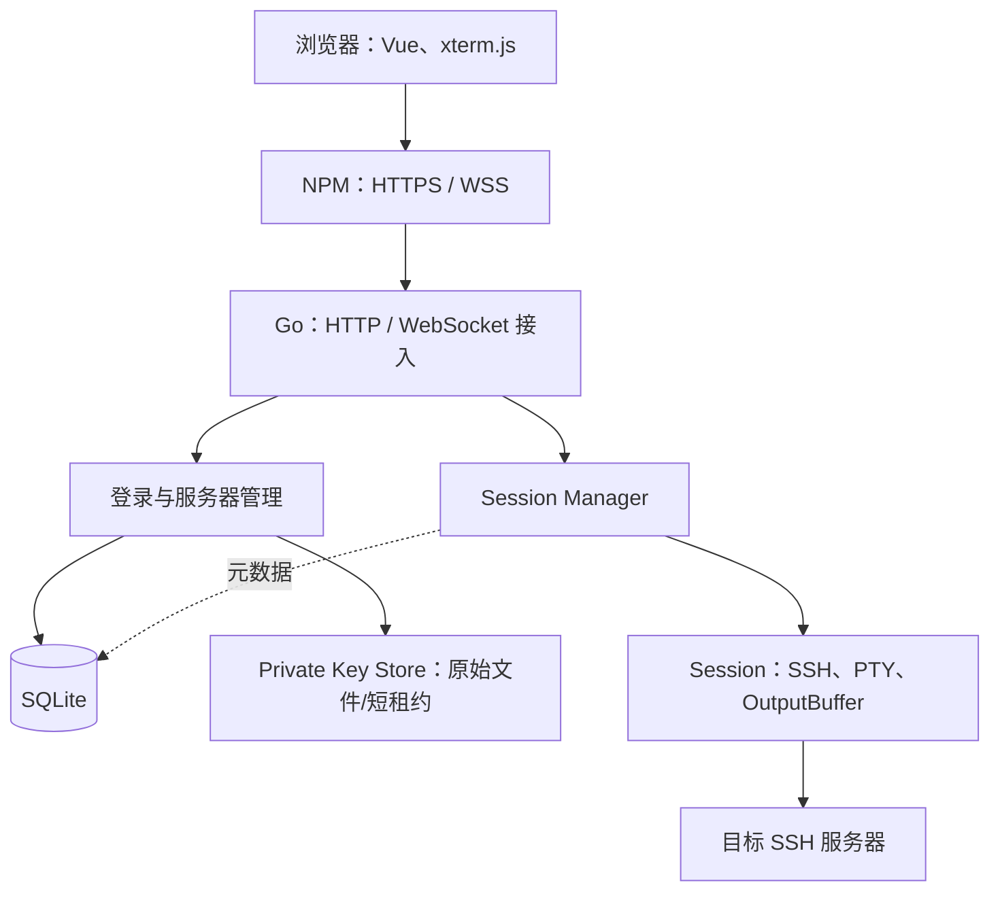

# Web SSH 架构设计与实施计划

> 6-K 实施更新（2026-11-20）：实现级同步边界、对象状态和离线命令已在 [6-K.0](stage-6-k-design-contract.md) 定稿并编码；验证与未验事项见 [交付报告](测试报告/stage-6-k-report.md)，运维见 [部署与恢复](stage-6-k-operations.md)。本更新不改变第五阶段冻结状态机或 WebSocket 协议。

- 修订日期：2026-11-20。
- 状态：四文档统一实现规范，已补充第六阶段 SSH 私钥认证、私钥文件生命周期、Passphrase 密文、回收与受控停机备份契约；本文修订不代表业务实现、运行验证或部署已完成。
- 产品、HTTP API、数据表、配置与产品验收：[核心需求](web-ssh-design-development-plan.md)。
- 消息字段、线序与客户端算法：[WebSocket 协议](web-ssh-websocket-protocol.md)。
- 实施任务、依赖和测试：[七阶段实施指南](web-ssh-implementation-stages.md)。
- UI 基准：[已确认的 v2 原型](web-ssh-prototype-v2.html)，仅供布局参考，正式前端使用 Vue 与 xterm.js。

本文是模块职责、生命周期、并发、Host Key 事务、缓存算法及资源管理的唯一权威定义。其他文档不另行定义这些算法。第一版维持个人单管理员、单进程、SQLite、Go 托管 SSH 的定位，不引入额外基础设施或重启恢复。

## 1. 系统关系



技术选型及版本基线由核心需求定义。HTTP 与 WebSocket 只负责校验、协议转换和调用业务入口，不能拥有 SSH 生命周期。SSH、浏览器通道和登录会话分别管理：浏览器失联或登录失效只撤销相应浏览器权限；SSH 自身故障才关闭 Session。

<a id="modules"></a>
## 2. 模块与目录

| 模块 | 唯一职责 |
|---|---|
| `config` | 完整 YAML 默认值、严格解析、启动校验；参数见[配置契约](web-ssh-design-development-plan.md#configuration) |
| `auth` | 单管理员密码验证、登录身份、Cookie、限流、登录撤销与到期 |
| `crypto` | APP 主密钥加载、既有密码 v1 与新 Passphrase 独立 AES-256-GCM 格式加解密 |
| `privatekey` | 专用私钥目录、原始字节安全创建/读取、对象元数据、短期文件租约、孤儿回收；不做文件应用层加密或格式转换 |
| `database` | 迁移、短事务、逐连接配置、持久化 DTO |
| `server` | CRUD、每服务器同步状态、连接快照、Host Key 信任与 probe |
| `sshclient` | TCP/SSH 握手、认证、PTY/Shell、输入、输出、健康检查 |
| `session` | 名额、活动索引、状态、绑定凭证、操作权限、输出缓存、关闭 |
| `websocket` | 单 Reader/Writer、消息校验、浏览器资源、发送和关闭 |
| `httpapi` | 路由、具名请求/响应、认证及来源校验、静态资源 |

```text
web-ssh/
├── backend/
│   ├── cmd/server/main.go
│   ├── internal/
│   │   ├── config/
│   │   ├── auth/
│   │   ├── crypto/
│   │   ├── privatekey/
│   │   ├── database/
│   │   ├── server/
│   │   ├── sshclient/
│   │   ├── session/
│   │   ├── websocket/
│   │   └── httpapi/
│   ├── migrations/
│   ├── web/
│   └── go.mod
├── frontend/src/
│   ├── api/
│   ├── components/{layout,server,session,terminal}/
│   ├── composables/
│   ├── pages/
│   ├── router/
│   ├── stores/
│   └── styles/
├── doc/
├── Dockerfile
├── docker-compose.yml
├── config.example.yaml
└── .env.example
```

只在产生实际职责时创建目录。前端服务端快照、标签、终端实例和 WebSocket 分开管理；终端实例不放进可序列化的普通 JSON 状态。主题属于浏览器本地状态，Session 存活以服务端为准。

<a id="ownership"></a>
## 3. 内存所有权和同步边界

| 对象 | 必需内容与存续范围 |
|---|---|
| `ServerState` | 服务器 ID、存在/可用标记、连接配置和信任记录、内存 `config_version`、活动名额计数、服务器锁；删除后旧引用只可读到已删除状态 |
| `WebAuthSession` | 独立登录 ID、有效标记、到期时间及短认证锁；退出一个登录不撤销其他设备登录 |
| `SessionManager` | 活动 Session 索引、停止接入标记；索引锁只用于短内存操作 |
| `Session` | ID、server_id、非敏感目标快照、状态/时间/离线期限、SSH 资源、PTY 尺寸、OutputBuffer、当前 Binding、代次、状态锁、远端操作串行门、幂等关闭和工作协程等待组 |
| `BrowserBinding` | 所属 WS、登录对象、绑定时确定且不可变的代次、active、取消信号、Writer 状态；永不转让给另一 WS |
| `BindingCredential` | 凭证哈希、所属登录、Session、模式、预期代次、到期；只存内存，完整字段语义见[绑定 API](web-ssh-design-development-plan.md#api-sessions) |
| `HostKeyProbe` | 凭证哈希、登录、服务器/目标/版本、原信任摘要、观测完整公钥/算法/指纹、确认类型、到期；只存内存，不保存认证秘密或私钥文件租约 |
| `PrivateKeyObject` | 不透明对象 ID、存储名、原始文件摘要、创建/回收候选元数据；持久化元数据不包含私钥字节 |
| `PrivateKeyLease` | Test/Creation 等短期任务对私钥对象的在途读取保护；只存在短任务生命周期，不进入 Session、Terminal、probe 或长期快照 |
| `PrivateKeySnapshot` | 固定 auth_type、私钥对象引用、Passphrase 密文及服务器版本；任务读取文件并在短期内解密/构造 Signer，认证后释放秘密引用 |
| `OutputBuffer` | 有界原始字节、LF 数量、绝对起止偏移、独立缓存锁 |
| `SessionSnapshot` | 按核心 DTO 输出运行状态、非敏感目标和时间；禁止连接对象、完整公钥、凭据及密文 |

短期建连任务固定完整认证快照。密码模式解密既有密码密文；私钥模式通过私钥对象租约读取原始文件字节、按需解密数据库 Passphrase 并构造 SSH Signer。认证结束后释放明文、Signer、认证配置和租约。Session 长期只保存非敏感目标快照及已经建立的 SSH 资源，不保存密码、Passphrase、私钥字节、Signer 或文件租约；Go 中释放引用不等于保证所有内存副本立即擦除。probe 只保存 Host Key 探测材料，不得保留任何新增认证秘密或文件租约。

### 3.1 锁规则

- 服务器编辑、删除、信任确认、创建快照与名额预占共用对应 `ServerState` 锁。服务器锁可包围必要的短 DB 事务，不能包围 SSH 网络或用户确认。
- 需要探测索引时固定顺序为 **服务器锁 →（涉及身份准入时的登录读锁）→ probe 索引锁**。索引锁只保护清理、容量、查找、插入、删除，不能包围 DB 或网络。
- 绑定及远端操作使用 **远端操作串行门 → 登录读锁 → Session 状态锁 → OutputBuffer 锁 → 绑定凭证索引锁** 的子序列；不反向取锁。无需缓存或凭证时跳过相应锁。
- 凭证签发使用登录读锁 → Session 状态锁 → 凭证索引锁。普通 detach 只需 Session 状态锁，立即撤销权限，不等待远端操作串行门。
- SSH 输出读取只取 OutputBuffer 锁，随后以非阻塞通知唤醒 Writer，不进入其他锁。Writer 不持缓存锁执行网络写入。
- 管理器索引锁不与 Session 状态锁嵌套；取出稳定对象引用后释放索引锁，再访问对象。服务器锁内可短暂发布/删除索引，索引访问方不能反向获取服务器锁。
- 关闭先在 Session 锁内撤销权限，释放锁后关闭网络和等待协程；最后独立取得服务器锁释放名额。禁止 Session 锁 → 服务器锁的嵌套。
- 登录撤销先用登录写锁设置无效，释放后扫描关联凭证和 Binding 并撤销。绑定提交和操作准入持登录读锁验证有效性/到期，保证撤销不能漏掉并发发布的新绑定。清理扫描取对象副本后再逐一处理，不倒序持锁。
- 私钥对象引用、上传提升、短期租约、GC 删除声明和 DB 提交必须建立统一同步边界。GC 声明删除与新引用/新租约准入必须原子协调；禁止“先查无引用、释放同步边界、稍后直接删除”的竞态。6-K.0 必须给出并审查完整锁序/删除声明协议；在此之前不得实现文件回收。文件 IO 不放入长 SQLite 事务，数据库事务仍遵守 RolledBack/Committed/Uncertain 三态。

日志不记录密码、密文、令牌、probe、绑定凭证或完整终端输入；使用 Session ID、操作类型和原因定位问题。

<a id="session-lifecycle"></a>
## 4. Session 生命周期

| 状态 | 事实与允许转换 |
|---|---|
| `CONNECTING` | 已预占名额，正在建立 SSH；成功到 DISCONNECTED，失败到 CLOSING |
| `DISCONNECTED` | SSH 就绪、无有效浏览器绑定，有离线截止时间；绑定成功到 CONNECTED，关闭到 CLOSING |
| `CONNECTED` | 当前有唯一有效绑定；普通断开到 DISCONNECTED，接管保持 CONNECTED，关闭到 CLOSING |
| `CLOSING` | 操作权已撤销，统一回收；只能到 CLOSED |
| `CLOSED` | SSH 已终止且不可再绑定；完成回收后移出活动索引 |

状态锁内维护状态与当前 Binding 的一致性。CONNECTED 不等于 SSH 永久健康；故障作为关闭原因处理。关闭原因集合由[核心契约](web-ssh-design-development-plan.md#close-reasons)定义。

### 4.1 创建及服务器竞争

1. 检查应用接入状态、登录和请求字段。未确认当前目标时走第 8 章临时探测，不预占正式名额。
2. 在服务器锁内检查服务器可用、信任及名额上限，原子固定连接参数/信任快照、预占名额；CONNECTING 和 CLOSING 均占名额。初始元数据 INSERT 必须成功才能发布 CONNECTING 对象；失败释放名额，不建立可用 Session。
3. 锁外在 `ssh.connect_timeout` 总预算内完成 TCP、SSH 主机校验、认证、PTY 和 Shell；PTY 的 TERM 使用核心规定的 `xterm-256color`，尺寸来自已校验的创建请求。生命周期 context 从应用派生，不继承 HTTP 或 WS；应用退出能取消建连并关闭临时底层连接。每次新取得 TCP/SSH/Channel 资源，登记时在 Session 状态锁内检查仍可创建；若 Close 已先发生，立即在锁外关闭新资源，不能把迟到资源塞回已回收对象。
4. 在 Shell 启动前安装输出接收器，所有输出从偏移 0 进入有界缓存，不能丢弃绑定前 banner/提示符。Shell 就绪后启动退出监测、Keepalive，检查应用仍接入且 Session 尚未被关闭，再发布 DISCONNECTED、设置离线期限。
5. HTTP 返回核心定义的 SessionSnapshot（首次代次为 0），浏览器另行申请 attach 凭证。响应丢失不自动重建 Session，用户可从活动列表找到；未绑定的 Session 受离线回收保护。

任一步失败由同一个回收入口关闭已分配资源、清理索引及释放名额。已信任目标在握手时突然换公钥，必须在用户认证前中止；回收预占名额和连接后，按原快照的版本/目标/原信任重新核验并发布 probe，返回确认要求，不返回可接管 Session。若配置已变化，丢弃观测结果并返回配置变化错误。

服务器编辑先完成则新建使用新快照；快照先固定则该次创建继续按旧快照建连，不混用字段。后续编辑不改变现有连接，也不触发自动重连。删除必须持服务器锁确认无活动、创建中或关闭中名额；删除先完成则后续创建/探测确认拒绝。删除事务按核心外键规则清理已结束元数据。

### 4.2 普通断开和离线计时

普通网络断开、Reader/Writer 故障、慢端、主动关闭视图、登录撤销/到期，都调用带原 Binding 引用的 Detach。Session 锁内先将该 Binding.active=false；仅当它仍为当前 Binding 且状态为 CONNECTED 时，清当前引用、更新 DISCONNECTED 和断开时间，按 `session.idle_timeout` 设置新截止时间。CLOSING/CLOSED 时只撤销传入 Binding 的权限，不改变 Session 状态或离线期限；重复/旧回调不重置新绑定或新倒计时。

权限失效不等待 SSH 操作或 WS 关闭握手。已经进入在途的远端调用按第 6 章处理；尚未准入的操作不能再执行。SSH 读取、缓存和 Keepalive 继续工作。

成功绑定清截止时间。离线回收采用应用内定时扫描；提交关闭时在 Session 锁内重新检查 DISCONNECTED、无当前 Binding、同一截止时间且已到期。到期与接管竞争由此锁确定先后，旧扫描结果不能关闭新绑定。不根据键盘输入判断离线。

### 4.3 幂等关闭与查询

- 任一关闭发起者只提交 Close(reason)，同一 Session 第一个原因获胜，重复调用复用同一完成信号。单 Session 从首次 Close 调用起复用 `server.shutdown_timeout` 作为总回收预算，应用退出时再取全局剩余期限较小者，不能为每个步骤重新计时。工作协程触发后立即返回，由独立回收任务等待，禁止等待包含自身的 WaitGroup。
- 状态锁内置 CLOSING、撤销并清空当前 Binding 引用、清离线计时、失效所有绑定凭证；另存原 Binding 引用仅供关闭通知使用，不能作为当前绑定重新发布。随后锁外取消任务，关闭 Channel、SSH Client 与底层连接，解除输入/读取/Keepalive 阻塞。
- SSH 资源已关闭后才可发送 `closed`。SSH 工作等待组与 WS 等待组分开，不能先等 Writer 退出再要求 Writer 发送关闭通知。回收任务向原 Binding 的终止槽提交 closed；若该通道已有终止原因或已失联，不保证通知送达。
- 等待受应用清理截止时间约束；SSH 工作协程退出后在状态锁内进入 CLOSED、固定 closed_at/reason，再以独立清理 context 进行最终元数据写入。完成或达到截止后释放缓存、名额、活动索引；CLOSED 到移除的短窗口不对活动查询返回。WS 通道按自己的关闭预算回收，仍占全局 WS 名额直到退出。
- 活动列表/详情只读 Manager；移出后详情返回 SESSION_NOT_FOUND，不从旧 SQLite 行伪造可接管会话。重复 DELETE 仍幂等成功。关闭通知可以丢失，前端以 HTTP 查询确认实际结果。
- 元数据失败不能恢复旧绑定、把关闭状态回滚或无限阻塞资源回收，处理见第 9 章。

### 4.4 SSH Keepalive

按 `ssh.keepalive_interval`、`ssh.keepalive_timeout`、`ssh.keepalive_max_failures` 执行。每连接至多一个在途 `ssh.Client.SendRequest("keepalive@openssh.com", true, nil)`，不向 Shell 写命令。

`err == nil` 即收到响应，包括 `ok == false` 的拒绝响应：清连续超时计数，恢复正常间隔。明确错误或 EOF 立即关闭 Session。SendRequest 无 context 取消；首次超时后仍等待同一个请求，每经过一个配置超时窗口累加一次，达到阈值关闭底层连接并回收该协程，不能再开一个探测协程继续堆积。不对共享 SSH 连接设置干扰正常输出的短读超时。

<a id="binding"></a>
## 5. 凭证与绑定事务

HTTP 契约见[核心会话 API](web-ssh-design-development-plan.md#api-sessions)，WS 字段见[协议绑定](web-ssh-websocket-protocol.md#bind)。首次绑定和接管使用同一机制。

### 5.1 签发与清理

`PrepareBinding` 在登录读锁及 Session 锁内重新校验状态、请求模式和 expected_generation。attach 要求 DISCONNECTED；takeover 可用于 DISCONNECTED/CONNECTED。CLOSING/CLOSED/CONNECTING 或已经到达离线期限均拒绝；在提交点也重新比较当前期限。代次变化优先返回 BIND_CONFLICT；代次未变但 attach 当前被占用返回 BIND_BUSY。

生成密码学安全的 32 字节随机值，编码为无填充 Base64URL，仅以哈希建立内存索引；保存登录 ID、Session ID、mode、expected_generation、expires_at。原值仅在本次响应出现，不进 URL、日志、数据库。TTL 和全局容量来自 `session.binding_credential_ttl`、`session.binding_credential_limit`。

在同一凭证索引临界区清除过期记录、检查容量、插入记录，容量满拒绝，不淘汰其他仍有效凭证。周期清理和每次签发清理并用；验证时总是重新检查到期，不能依赖扫描及时性。登录撤销、Session 关闭、应用退出使相关凭证失效。签发仅准备权限，不修改当前 Binding 或离线期限。

### 5.2 唯一提交点

1. WS 经过登录、Origin、全局连接容量及首条 bind 校验后，尝试在 `session.operation_wait_timeout` 内获取该 Session 的远端操作串行门。等待失败仅终止候选 WS，旧绑定不受影响。
2. 依第 3.1 节顺序重新验证登录有效性、凭证、Session、模式、预期代次和请求偏移。凭证必须属于当前 Cookie 对应的这次登录，不只是同一管理员。
3. 在状态/缓存同步边界准备一次不可变快照 `[S,E)`，其中 `S=max(requested_start_offset,buffer.start)`，`E=buffer.end`；请求超过 E 拒绝。仅通过前置检查的候选在此处取得快照，未通过者不复制缓存。不得等待网络。
4. 快照准备后，在同一 Session 临界区和凭证索引锁内重新检查凭证仍存在、未过期，以及登录到期与离线期限；检查失败释放候选快照，旧绑定保持。全部通过后消费凭证并失效该 Session 其他凭证、将旧 Binding.active=false、递增代次、发布新 Binding、清离线期限、置 CONNECTED。原子提交到此完成；并发请求即使各有凭证，同一预期代次只允许一个提交成功。其他凭证已经失效时可返回 INVALID_CREDENTIAL，仍能查到凭证但预期代次不匹配时返回 BIND_CONFLICT；二者均不提交，不保证竞争失败只出现后一种错误。
5. 锁外通知新 Writer 启动绑定前缀，向旧 Binding 提交 taken_over 并关闭旧通道。旧输入和回调已在提交点失效，通知不承担权限撤销职责。

提交前失败且凭证仍有效、条件未变，可以在原到期前重试；到期、登录撤销、代次变化、Session 关闭的凭证不可用。提交后即消费，即使 bind_success 未送达也不能重用或回滚原绑定。新通道失败仅解除新 Binding，SSH 保留。客户端无法确定是否提交时，按协议查询/停止恢复规则处理，不能盲目改用最新代次反复接管。

输入可用时机、重连预算及丢失接管通知时的客户端行为完全由[协议客户端规则](web-ssh-websocket-protocol.md#reconnect)定义。主动接管可替换在线操作端；自动恢复只使用 attach 和本终端上次成功代次，不自动接纳其他设备的新代次。

<a id="operation-order"></a>
## 6. 输入、尺寸和权限失效

每个 Binding 的 Reader 将输入/resize 转为明确的远端操作项，捕获 **所属 Binding 引用和其不可变代次**。resize 的消息代次还必须等于这个 Binding 的代次，不能只比较 Session 当前代次。输入不加协议头，不从 Session 查询当前 Binding 替换自己的身份。

采用每 Binding 一个顺序执行器和容量为 1 的待执行槽。槽满时 Reader 在可取消的 `session.operation_wait_timeout` 内等待空位，以正常背压承接连续粘贴，不能把第三个正常输入块立即判为失败。最多保存一个在途项、一个待执行项和 Reader 当前有界消息；不无限排队。等待超时则以 INPUT_BACKPRESSURE 终止浏览器通道，明确提示输入未全部发送，不自动重放；SSH 输出读取不受影响。旧 Binding 失效会取消等待并清空待执行槽。输入背压可能延迟 Reader 处理协议控制帧，心跳仍可终止过载通道；这不是关闭 SSH 的理由。

执行器按顺序取得 Session 远端操作串行门，在登录读锁和 Session 锁内验证对象身份、active、代次、Session 状态、登录到期；全部通过时把这一项标记为在途。此处是远端操作的准入点，锁外立即执行唯一一次 SSH Write/WindowChange，执行结束才释放串行门。不得在准入后再次把它放进异步队列；分块输入的每块分别准入。

- **普通断开**在 Session 锁内立即撤销 active，不等待串行门；所有尚未准入项必须被拒绝。准入点先于断开的一次在途调用可能在断开后返回或产生远端效果，不能撤回；不将仅“已经入队”的项冒充在途。
- **主动接管提交**必须取得同一串行门，因此先前在途调用先结束，之后原子替换；旧端仍在等待门的项重新校验时失败。等待门超时不提交切换，不先使原端失效。
- **手动/故障关闭**不等待串行门，先撤销权限再关闭底层 SSH，以解除在途阻塞。
- **SSH 操作自身超时**使用 `ssh.operation_timeout`。SSH Write/WindowChange 不能安全取消或重发已发送的部分；超时视为 SSH 故障，统一关闭 Session 并回收在途调用，不能每次超时遗留协程。此策略针对阻塞的远端操作，不将 WS 慢端当作 SSH 故障。
- 不重试终端输入，不在重连后补发未发送输入，避免重复执行命令。

这些边界同时适用于首次绑定、普通断线、登录失效、慢客户端和接管；第五阶段不重新设计输入权限机制。

<a id="output-buffer"></a>
## 7. 原始字节缓存和浏览器发送

### 7.1 OutputBuffer 算法

缓存使用固定容量环形字节数组，容量来自 `session.output_buffer_size`；保留范围是连续半开区间 `[startOffset,endOffset)`。维护 LF 数量和尾字节即可统计行数：`LF数量 + (缓存非空且末字节不是LF ? 1 : 0)`。CR 不计行，CRLF 只计 LF，视觉折行不计行。空缓存 0 行，`a\n` 为 1 行，`a\r\nb` 为 2 行，`\n\n` 为 2 行。

每次 Append 在缓存锁内执行：

1. 按原字节顺序递增绝对 endOffset；追加每字节前若数组已满，先移除最早一个字节，同时更新 startOffset 和 LF 计数。没有换行也立即受容量约束。
2. 新字节入环并更新 LF 计数。若当前行数超过 `session.history_limit`，从头移除直到并包括最早的 LF，重新计算行数，循环至合规；正数行限下没有 LF 时最多一行，不会无限寻找换行。
3. 数组容量固定，批量优化必须等价于上述规则。每个被加入/删除的字节最多处理常数次；不用保存无界行索引。锁外发出容量为 1 的“有新数据”合并通知，满则跳过通知。
4. `Snapshot(requested)` 在同一缓存锁内检查 requested≤end，复制 `[max(requested,start),end)` 并返回边界；复制结果不可变，最多一份缓存容量。
5. `ReadChunk(cursor)` 在锁内比较 cursor 与当前范围：小于 start 返回缺口，大于 end 返回内部错误，等于 end 无新数据，否则复制最多 `websocket.output_chunk_size` 字节并返回块。释放锁后才能发送网络。

偏移计算包括 UTF-8、ANSI、CR/LF 的每个原始字节；淘汰不重新编号。计数使用足够宽的整数但严格受协议安全整数上限约束，增量将超限时返回 counter_exhausted，先释放缓存锁再由读取协程触发统一关闭，不能持缓存锁反向获取 Session 锁，也不能回绕。绑定代次耗尽同样先退出已有同步边界再请求幂等关闭，不能重入状态锁。缓存不解码、不解析 ANSI、不调整回放起点、不补造结束符或提示文本。

### 7.2 SSH 读取

输出读取从 Session 生命周期派生，使用固定大小缓冲（不大于配置输出块上限），持续追加 OutputBuffer。若分别读取 stdout/stderr，两者必须持续排空，统一在 Append 锁内形成一个本服务观察到的输出总序；协议偏移对应这个总序，不承诺恢复两个 SSH 数据流原本不存在的跨流字节顺序。

读协程不直接发送 WS，不为每块输出新建协程。输出追加只可能短暂等待缓存临界区，不能等待浏览器。回放时仍追加，正常缓存淘汰不向连续在线端反复发送截断通知。

### 7.3 单次回放和缺口

提交成功的 Binding 持有唯一不可变快照 `[S,E)`，Writer 按[协议顺序](web-ssh-websocket-protocol.md#output-order)发送。快照不因后续缓存淘汰而改变；普通输出通知不能打断快照，发送完后以 E 为实时游标。被接管、关闭、登录失效、写入错误等终止事件可以中断快照并释放剩余数据。

实时发送每次只复制一个块，成功写入后推进服务端发送游标。复制后即使缓存淘汰，该块仍稳定；下一次取块重新检查连续性。游标已落后于缓存头时，提交 OUTPUT_GAP 终止事件，不再取新快照，不在当前 WS 第二次发送 history_truncated。服务端发送游标不等于浏览器已处理游标，不能把它交给客户端当恢复依据。

同实例重新绑定前必须等待已提交的 xterm 写入完成；连续起点保留实例，发生缺口则重建终端及基线，完整算法唯一位于[协议客户端](web-ssh-websocket-protocol.md#client-tracker)。重建可清除旧解析器状态，但剩余后缀本身可能从字符或控制序列中间开始；不保证无乱码、无残片或恢复完整颜色/光标/全屏画面。不引入屏幕快照或服务端终端模拟器。

### 7.4 一个 Reader、一个 Writer

HTTP 升级前必须在全局连接表原子预占 `websocket.max_connections` 名额，容量满直接返回核心 HTTP 错误而不升级；Upgrade 失败释放预占，成功后登记底层连接。名额覆盖升级中、未绑定、已绑定和关闭中的连接，Reader/Writer/执行器/关闭监督器完全回收后才归还。

- **Reader** 是唯一应用读取者，用流式 Reader 接口执行协议大小/超时校验，持续处理控制帧；输入进入第 6 章有界执行器。
- **Writer** 是唯一应用消息写入者，独占绑定前缀、快照、实时游标、控制事件和终止发送。任何 HTTP、Session、计时或 Reader 协程都不能直接 Write JSON/二进制或开始 Close 握手。
- **控制事件**使用 `websocket.control_queue_limit` 容量的 FIFO，入队是同步的短操作且不等待网络。队列满则以 SLOW_CLIENT 申请终止，不无界阻塞生产者。首次成功前缀作为 Writer 固定步骤，不与普通队列竞争。
- **输出通知**仅容量 1；通知不是数据队列。Writer 在每个完整消息边界检查终止、到期心跳和控制事件，再取下一输出块。没有通知时也必须先检查游标/缓存，再等待通知，避免丢唤醒；通知已合并不会丢字节。
- **终止槽**独立于控制队列、容量 1、仅第一个终止原因获胜。提交者先调用 Detach 撤销操作权，再通知 Writer。Writer 不再开始新二进制输出或普通控制消息；已开始的一次 Write 可在预算内结束，随后至多发送一次最终 error/taken_over/closed，再执行关闭握手。物理失联时可直接强制关闭，通知不保证送达。
- Writer 取事件、检查终止和决定下一项发送共用一个短调度锁；不能“检查未终止后再无保护排队新输出”。取得一个发送项即视为在途，网络调用在锁外完成。终止之后允许结束的仅此项。

成功绑定的前缀、中间可见的 status、终止通知的精确字段及相对顺序由协议定义。应用关闭不保证排空 SSH 所有尾部输出；不能为追求尾部完整而无限延迟关闭。SSH 关闭后浏览器已收到数据的本地排空由协议规定。

<a id="ws-read-close"></a>
### 7.5 心跳、读取和关闭预算

固定使用 `github.com/coder/websocket v1.8.15`（tag 对应提交 `9c8faadccd1b679e811a79ce506f8a10237251ad`），第一阶段将此版本写入依赖锁定文件。本节不依赖后续版本行为；更换版本须重做[阶段3专项验收](web-ssh-implementation-stages.md#ws-header-acceptance)。

该版本的实际行为与源码依据：

| 情况 | 核实结果 |
|---|---|
| 只收到部分帧头后停止发送 | [`Reader(ctx)`](https://github.com/coder/websocket/blob/v1.8.15/read.go#L369-L401) 经 readLoop 进入 [`readFrameHeader`](https://github.com/coder/websocket/blob/v1.8.15/frame.go#L52-L103)，在第二个基础字节、扩展长度或掩码的 ReadByte/io.ReadFull 上等待。没有适用的取消或关闭时，消息读取器不会返回。 |
| 此时发送服务端 Ping | [`Ping(ctx)`](https://github.com/coder/websocket/blob/v1.8.15/conn.go#L217-L261) 可以与 Reader 并发，但不读取 socket；只有同一 Reader 的 [`handleControl(opPong)`](https://github.com/coder/websocket/blob/v1.8.15/read.go#L290-L338) 才能确认 Pong。帧头未完成时不能跳过当前字节流处理后面的 Pong；正常客户端也不能把 Pong 插入一个未完成的帧内部。 |
| Ping 已写出，但等不到 Pong | `ping` 的 ctx.Done 分支只返回错误，并移除 activePings 项；**不能据此假定连接或 Reader 已关闭**。必须由应用将失败转为终止请求。 |
| Close 握手也被阻塞 | [`Close` / `CloseNow`](https://github.com/coder/websocket/blob/v1.8.15/close.go#L99-L151) 不接受 context；已开始 Close 时，并发 CloseNow 会等待关闭完成，不能用作强制中断器。应关闭 ConnContext 保存的真实底层 net.Conn。 |

沿用单 Reader、单应用 Writer 和独立关闭监督器，具体实现如下：

1. 绑定前，首条完整 bind 的 `websocket.bind_timeout` 从升级成功起覆盖 `Reader(ctx)` 返回前的等待与消息体读取；超时进入统一终止。该版本的[读取 context 取消](https://github.com/coder/websocket/blob/v1.8.15/conn.go#L187-L203) 会关闭库持有的连接，仍须完成应用侧回收。
2. 绑定后，Writer 按 `websocket.ping_interval` 维护独立于业务流量的到期时刻，首次 Ping 不晚于绑定后一个周期的调度点。空闲时定时唤醒，持续输出时在当前完整消息结束后优先处理到期 Ping，不能用业务收发重置或推迟心跳。当前一次写最多占用 `websocket.write_timeout`。
3. Writer 直接调用 `Conn.Ping(pingCtx)`，调用前以 `context.WithTimeout` 设置 `websocket.pong_timeout`，预算同时覆盖 Ping 写入和等待 Pong；单连接最多一个在途 Ping。Ping 准入及其 cancel 函数登记共用 §7.4 的短调度锁，终止后不再发起新 Ping。Reader 与它并发，不能由 Reader 自己调用 Ping 或等待 Reader 返回再启动心跳。Ping 返回任何错误，立即通过原终止入口 Detach 撤销 Binding 并提交终止槽，不能只记录错误、只取消 pingCtx 或等待下一条输入。库自动发送 Pong/协议控制帧不属于第二个应用 Writer，不另开业务 Ping 写者。
4. 首次终止请求即确定关闭绝对截止时间，同时取消已登记的在途 Ping context 并唤醒 Writer；`Ping` 的等待分支不执行 Read，不能只靠原始 socket 关闭使它立即返回。独立监督器不等待 Reader、Writer、调度锁或 Close 返回，到期直接调用保存的底层 `net.Conn.Close()`。Writer 在预算内至多尝试一次终止通知和 Close；硬关闭路径尚未开始握手时，由 Writer 调用 CloseNow 完成库侧清理，已经在 Close 内则等待底层关闭使该调用返回。正常提前完成时唤醒监督器并停止计时器。
5. 停止本连接的心跳和消息计时器，由不属于被等待工作组的连接收尾者等待 Reader、Writer（含在途 Ping/Close）及输入执行器退出，再通知并等待监督器退出，最后一次性归还全局 WS 名额。执行器已有在途 SSH 操作时仍按第 6 章的 `ssh.operation_timeout` 收尾，不能提前归还名额或让工作协程等待自身。WS 心跳失败只解除浏览器绑定，SSH Keepalive、读取和缓存独立继续运行。

Reader 取得消息读取器后的完整消息读取受 `websocket.message_read_timeout` 约束，跨分片不重置。库级读取限制与流式消息类型限制同时落实，不能无界 ReadAll。该计时不覆盖 Reader 返回前等待不完整首帧头；绑定前由 bind 总等待限制，绑定后由心跳检查限制；正常无输入不触发业务空闲超时。第一版关闭 WS 压缩，仍按完整重组消息限制大小。

该版本的消息 io.Reader 沿用传给 `Reader(ctx)` 的 context；按其 [API 说明](https://github.com/coder/websocket/blob/v1.8.15/read.go#L18-L36)，在取得读取器后启动消息计时器，到期取消同一 context 并请求终止，读完即停止该计时器。不要给绑定后的每次 Reader 调用预设 message_read_timeout，否则正常长时间无输入也会被关闭。

每次应用写受 `websocket.write_timeout` 限制；从请求终止起，未完成写、最终通知和握手共用 `websocket.close_timeout` 总预算，并取应用退出剩余时间较小者。HTTP 仅支持 HTTP/1.1 Upgrade，通过 ConnContext 保存可关闭的底层 net.Conn；该版本的 [Accept](https://github.com/coder/websocket/blob/v1.8.15/accept.go#L159-L180) 使用 Hijack 得到的连接。底层 [net.Conn.Close](https://pkg.go.dev/net#Conn) 解除阻塞的 Read/Write，随后库 Close/CloseNow 完成内部清理，应用收尾者完成任务和名额回收。

在进程正常调度下，绑定后静止半帧头至底层强关的保守预算为 `ping_interval + write_timeout + pong_timeout + close_timeout`，另计调度误差；更早的绑定、消息、登录或退出期限仍优先。此为异常回收上界，不是正常空闲时间限制。正常连接无需发送终端输入，只要能及时处理 Ping/Pong 就可持续在线；不新增帧头超时配置或第二个 Reader。

每 Session 缓存至多 B 字节；每升级连接最多一份 B 字节快照、一个输出块、有限控制项和有限输入项，全部连接数受上限；被取消 Writer 释放未发送快照引用，只保留一次在途数据。不能仅以“每 Session 缓存有界”推导整个进程有界：还须计算实际活动 Session 数，遵守每服务器名额、全局连接及登录、probe、凭证容量限制。

<a id="host-key"></a>
## 8. Host Key 与登录安全

### 8.1 登录和凭据

管理员初始化、Argon2id 参数、Cookie、来源校验、密钥注入以及限流的具体约定由[核心认证](web-ssh-design-development-plan.md#authentication)定义。AES-256-GCM 每次使用新 nonce，密钥不进入数据库；查询 DTO 从类型上排除密码、密文和完整公钥，不能依赖前端隐藏。

每次成功登录形成独立 WebAuthSession。退出登录按核心规定先确定持久化撤销结果，成功后使该身份无效；到期按绝对期限撤销。撤销失效其 probe 与绑定凭证、撤销 BrowserBinding 并关闭所属浏览器通道，不关闭 SSH，也不影响另一次登录。退出登录确定回滚不宣称成功；提交不确定则冻结该登录并撤销其通道和临时凭证，保留客户端 Cookie 只用于重试退出。登录写锁覆盖删除提交及结果判断，释放后才扫描关联对象；不确定后的失败分支不得继续授予新操作。对无键盘输入的连接也必须按已知到期时间触发撤销，不能仅靠下次输入检查。周期清理以有界索引和到期记录为对象，不为每个请求启动常驻协程。

### 8.2 信任记录和探测

服务器仅持久化当前目标的一份可信完整公钥，必须绑定 Host 和 Port；字段见[核心数据库](web-ssh-design-development-plan.md#database)。算法/指纹用于展示，不能代替完整公钥比较。不保留可自动复用的历史信任。

测试连接和 Session 创建共用如下路径，没有单独绕过校验的测试模式：

1. 在服务器锁内固定服务器 ID、Host/Port、Username、短期认证密文、config_version 和完整当前信任及其摘要。主机名规范化规则由核心字段契约决定，快照后不能只取部分新字段。
2. 锁外执行有 `ssh.connect_timeout` 总预算的握手，在 HostKeyCallback 比较实际公钥。目标与完整公钥均匹配时继续用同一快照认证：测试成功后关闭临时连接，创建则按第 4.1 节继续，均不签 probe。当前目标未信任或公钥不匹配时复制实际公钥、回调拒绝并关闭连接；不得发送 SSH 用户认证材料、申请 PTY/Shell，也不保持连接等待确认，随后才执行以下探测结果发布步骤。
3. 重新取得服务器锁及登录读锁，核对登录仍有效且未到期、服务器仍存在且可用、版本/目标/原信任未变；登录读锁保持到签发结束，防止注销扫描后再次发布。否则丢弃结果，按原因返回 AUTH_REQUIRED、SERVER_CONFIG_CHANGED 或 SERVER_UNAVAILABLE。
4. 全部一致后生成 probe_id：32 字节密码学随机数、无填充 Base64URL，哈希索引。记录第 3 章字段。首次或 Host/Port 已变且信任清空时，原信任摘要为空；同目标密钥变化时保留原摘要和原指纹用于确认。
5. 在 probe 索引锁内原子清过期、检查 `ssh.host_key_probe_limit`、插入；超限拒绝。有效期为 `ssh.host_key_probe_ttl`，访问时检查到期并周期清理。未确认公钥只存在 probe 内存；已确认完整可信公钥存在 SQLite。
6. 响应返回核心规定的确认要求，只含 probe_id、到期、目标、算法、新旧指纹，不返回完整公钥、config_version、认证材料或可接管 Session ID。用户取消不调用确认接口，记录自然到期，旧信任不变。

### 8.3 确认事务与失败路径

确认请求只接收 probe_id，额外公钥/指纹字段拒绝。服务器锁内验证登录、所属服务器/登录、到期/未消费、版本、目标、原信任摘要；通过后执行：

1. SQLite 短事务写当前目标和探测所得完整公钥、算法、指纹，提交成功。
2. 消费并删除本 probe。
3. 递增该服务器 config_version，立即失效其他全部 probe。
4. 更新内存信任快照，完成后释放服务器锁并返回成功。

内存索引锁只在步骤间短暂获取，不跨 DB 操作。确认按服务器锁 → 登录读锁 → probe索引锁的顺序检查；事务期间保持服务器锁和登录读锁但释放索引锁。登录有效性及凭证到期在确认事务准入时再次验证；准入后把probe标为本事务占用，清理仅移除非占用到期项，避免事务中被清理；确定回滚释放占用后按原期限判断是否可重试。登录撤销先发生则拒绝，已准入的短事务可以完成。并发同 probe 或同服务器不同 probe 只有第一个有效提交成功；后者不能覆盖新信任。

- **确定回滚**：不改变内存信任、版本或消费状态，凭证可在原有效期内重试，不延长 TTL。
- **提交结果不确定**：仍持服务器锁，先递增版本，失效该服务器全部 probe（也阻止旧版本在途探测重新发布），将内存快照标为不可用，再重读 SQLite。读取成功恢复确定状态，仍要求重新发起连接/探测；读取失败保持内部不可用标记并返回 SERVER_UNAVAILABLE。
- **不可用后的操作**：在服务器锁内进行一次有截止的重载；失败拒绝依赖该快照的编辑、删除、确认、测试和创建，不使用猜测状态；成功后才继续新请求，旧 probe 永不恢复。无后台无限重试队列。
- **提交成功但响应丢失**：旧 probe 不可再消费。前端重新执行测试/创建，由实际持久化信任决定是否还需确认；不能以本地缓存判断成功。
- **进程在 DB 提交后退出**：重启所有 probe 丢失，各服务器版本重新初始化；确认后的信任按 DB 读取，不能重放旧凭证。

用户确认后必须重新发起连接，用最新固定快照重新校验实际公钥，验证通过后才进行用户认证。确认与下一次连接之间再换密钥，仍阻断并重新要求确认。

### 8.4 编辑、删除和测试

- Host 或 Port 实际变化时，在同一编辑事务中清全部信任字段；提交成功后版本递增、所有 probe 失效。即使目标后来改回、或新目标公钥相同，也不能恢复旧信任。
- Username、密码或其他连接参数实际变化时，保留当前目标信任，但同样递增版本并失效全部 probe。名称/分组/备注等纯展示字段变化不改变连接版本。
- 编辑事务确定回滚不改变内存；结果不确定使用第 8.3 节相同的递增、失效、重载流程，不能仅处理确认接口的不确定提交。
- 删除成功标记 ServerState 已删除并失效 probe；同 ID 不复用，正在探测的旧引用不能发布结果。确定回滚保持原状态，不确定提交重载实际存在性后再决定，不能把已删除服务器恢复到缓存。
- 已建立或已固定快照的 Session 继续使用既有目标和 SSH 资源；不保留密码用于“跟随编辑”重新认证。
- 连接测试在信任通过后仅认证，成功或失败均关闭临时连接，不申请 Shell、PTY 或活动 Session。测试/探测不计正式 Session 名额；每次操作受连接总超时与应用退出取消约束。

<a id="private-key-storage"></a>
## 8.5 私钥认证、文件租约与回收

服务器认证快照必须明确选择 `password` 或 `private_key`，不得同时携带两种有效认证材料。私钥模式固定服务器 ID、配置版本、私钥对象 ID、Passphrase 密文和 Host Key 信任快照；Test/Creation 在读取前取得短期对象租约，租约覆盖文件打开/读取及所需解析准备，不进入长期 Session 或 probe。Host Key 校验仍先于 SSH 用户认证；认证失败使用 `SSH_AUTH_FAILED`，本地文件缺失/损坏不得误报远端认证失败。

专用组件只管理 `/var/lib/web-ssh/ssh-keys/` 内由应用创建的普通文件。原始上传字节原样写入，目录建议 0700、文件 0600，运行 UID/GID 10001:10001；使用不可预测存储名、排他创建、符号链接防护、完整写入/fsync/原子提升。不得经静态资源、下载路由、日志或异常暴露文件。私钥文件不做应用层加密/解密、重编码或转换；Passphrase 是独立数据库秘密，使用现有 APP 主密钥和新格式 AES-256-GCM 密文，AAD 绑定格式版本、固定用途和服务器 ID。

上传接收和解析/KDF 准入为两套全进程共享限制：接收并发最多 2；解析/KDF 并发最多 1，上传校验、Test、Creation 共用；满额立即拒绝，不排无界队列。解析名额只在真实同步计算结束后释放，不能因请求取消或 HTTP 超时提前释放。具体请求体/metadata/header 限额、RSA 16384 bit 预检和依赖已有 OpenSSH bcrypt 2048 rounds 上限由核心 §11.3 唯一规定。

**文件租约与回收**：Test 取得快照后会释放服务器锁执行网络操作，因此必须在固定快照和解锁边界内取得短期文件租约；Creation 从 Reserve 到 Open、失败或取消的所有出口必须释放租约。正式 Session 不持文件租约。对象只有同时满足无任何 DB 引用、无 Test/Creation 租约、无上传提升/不确定提交/恢复/备份保护、候选宽限期届满且对象路径/类型/归属检查通过，才可进入删除。未知文件保留或隔离；卷不可读/不可用时暂停 GC，不把不可读目录当空目录。文件缺失/损坏只隔离关联服务器凭据，不阻止应用整体启动；Passphrase 密文启动解密失败则按核心规则阻止启动。

GC 采用混合触发：正常操作登记候选；启动在 DB 恢复和引用对账后执行有限 reconciliation；运行期间周期扫描。宽限期配置化，默认 86,400 秒，从持久化登记候选时刻计算，重启不能重置。扫描周期固定 10 分钟；每轮最多检查 100 个候选、最多删除 20 个对象，1 秒软预算；软预算不能强制中断正在执行的文件系统调用。删除失败记录对象 ID、错误类别、次数和时间，后续轮次重试，不记录秘密。具体候选状态机、锁序、原子删除声明和备份保护在 6-K.0 定稿。

<a id="storage-runtime"></a>
## 9. SQLite 与运行事实

表、字段、索引、删除规则和 UTC 表示唯一位于[核心数据库契约](web-ssh-design-development-plan.md#database)。SSH、PTY、输出、Binding、绑定凭证、probe 和 config_version 全部在内存；DB 元数据不具有恢复 SSH 的能力。

启动顺序为配置与主密钥格式校验、打开数据库、逐连接设置与回读 PRAGMA、迁移、验证全部既有密码密文及已保存 Passphrase 密文、初始化管理员/服务器内存状态、恢复私钥对象引用并执行安全文件对账、将历史活动 Session 标记结束、开放 HTTP/WS。任一数据库 Passphrase 解密失败阻止应用启动；单个私钥文件缺失/损坏只使关联服务器凭据不可用，不阻止全站启动。私钥目录/卷不可读时暂停对账删除和 GC，密码认证及不依赖该卷的现有 SSH 不因而自动禁用；私钥认证操作明确失败。

- 默认受控单连接池，参数见核心配置；必须在每个物理连接创建/重开时生效 `foreign_keys=ON`、`busy_timeout`，在真实连接回读并验证。`journal_mode=WAL` 必须核验实际结果；不能只对池执行一次 Exec 就宣称逐连接正确。
- DB 事务只包围短持久化操作，不等网络、用户或 WS。锁等待配置不替代调用截止时间；不无限重试、不引入任务队列。
- 创建初始元数据失败不得发布 Session。运行状态变化由每 Session 的单个元数据写入器顺序写入：状态变更只置一个容量 1 的 dirty 通知，写入器取得最新快照并执行一次有截止 UPDATE；新通知合并，不能旧状态覆盖新状态或每事件积累一条队列。状态锁不跨 DB。该写入器使用独立于 Session 工作取消信号的生命周期，只有清理完成或应用总截止才取消，避免 Close 先取消工作任务导致最终写入无法执行。
- 运行元数据 UPDATE 失败记录错误，不回滚运行事实、不恢复已失效 Binding；后续真实状态变更可再写最新快照，不定时无限重试。关闭时请求一次最终快照写入，并在总清理期限内等待写入器结束；失败仍释放 SSH/名额。启动清理保证下次不将旧状态当存活。
- 服务器信任、配置、登录记录和 Passphrase 密文属于持久化安全数据，失败按各自事务规则拒绝业务，不能套用“Session 元数据尽力写入”策略。
- 私钥文件缺失/损坏不得把 `ServerState` 标记为 DB `unavailable`；只标记关联凭据不可用，保留服务器查询和重新上传修复能力。存储卷整体不可用时暂停私钥写入/回收，不把未知文件当作空目录。
- GC 由单一组件拥有；启动对账必须在数据库迁移、记录加载和引用事实确定后执行。正常操作登记候选，周期任务每 10 分钟运行，每轮最多检查 100 个候选、最多删除 20 个对象、1 秒软预算；宽限期来自核心配置默认 24 小时。任何删除均须在 6-K.0 定稿的同步边界中原子声明，阻止新引用/租约竞态。
- 首版备份为受控停机备份：停止访问和进程、关闭 SQLite 后复制一致数据库和其引用的全部私钥对象，附对象清单/完整性校验、匹配主密钥独立保管信息、程序/数据结构版本。该操作终止已有 SSH Session。首版不支持/不宣称在线一致性 DB+文件备份；备份保留份数/天数由运维策略决定。
- WAL、SHM 与 DB 位于同一可写本地持久化目录。运行中不能删除旁路文件，不能只复制 `.db` 或拼接不同时刻文件做备份。在线用选定驱动实际支持的一致性备份或 VACUUM INTO；停机先停止访问并关闭连接，再复制静止目录，保留仍存在的 WAL。数据库与加密主密钥分别备份。

驱动尚未初始化和固定，以上为实施要求，不能声称具体 DSN、连接钩子、Online Backup 或重开行为已验证。

<a id="shutdown"></a>
## 10. 应用退出与资源预算

SIGTERM/SIGINT 触发一次退出，总预算为 `server.shutdown_timeout`，不继承已取消的请求 context：

1. 原子停止接入，拒绝新建、凭证签发、绑定和管理写操作；创建任务发布前再次检查。健康检查转为未就绪。
2. 同时发起有截止 HTTP Shutdown、取消临时探测/测试/创建并关闭其已登记连接、对活动 Session 调用统一关闭、终止所有升级 WS（包括未绑定）。HTTP Shutdown 不负责已升级连接。
3. 锁外等待 HTTP、SSH 读写、退出监测、Keepalive、离线扫描、凭证清理、私钥 GC/文件租约持有任务、元数据写入器和浏览器 Reader/Writer/执行器退出；不发生自等待。完成必要写入后再关闭 SQLite。受控停机备份在服务进程完全停止、SQLite 关闭后由外部运维步骤复制恢复集。
4. 总期限到时强制关闭全部剩余底层连接，取消剩余清理，记录未完成事项并退出；不能无限等待关闭通知、握手或 DB。

Compose 的停止宽限期须严格大于应用预算，具体推荐值由核心部署约定给出。容器必须将信号传给 Go 主进程。重启不恢复 Session、输出或临时凭证。

全局 WS 上限同时覆盖未绑定、当前和关闭中连接；绑定/probe/登录索引有容量及过期回收；Session 数量按每服务器限额控制。内存随活动 Session 数增加，不能声称整个进程占用固定常量。最主要上界项为“活动 Session 数 × 单缓存容量 + WS 上限 ×（一次快照 + 有限消息/输入）”；正常 SSH 输出量和浏览器离线时长不会使单 Session 缓存或队列持续增长。

## 11. 内部入口与外部契约对应

| 内部入口 | 调用来源/外部契约 | 不应新增的接口 |
|---|---|---|
| `Create`、`Get`、`List`、`Close` | [核心Session API](web-ssh-design-development-plan.md#api-sessions) | 无单独“恢复SSH”接口 |
| `PrepareBinding` | 同一凭证API的attach/takeover模式 | 无第二套首次绑定凭证协议 |
| `Attach`、`WriteInput`、`Resize` | [WS消息](web-ssh-websocket-protocol.md#messages) | 不为每个内部方法另建HTTP路由 |
| `Detach`、超时检查、Keepalive、`Shutdown` | WS/登录/时钟/进程内部事件 | 不向浏览器开放内部资源操作 |
| 探测、连接测试、信任确认 | [核心服务器API](web-ssh-design-development-plan.md#api-servers) | 不接受客户端直接写公钥 |
| 启动清理、元数据刷新 | 内部DB操作 | 不提供历史会话恢复API |

## 12. 实施与验证入口

按[阶段指南](web-ssh-implementation-stages.md#traceability)执行，架构不另列一套阶段清单或默认值。必须覆盖创建/编辑/删除/确认竞争、普通断开旧输入、并发绑定、慢端/持续淘汰、登录撤销、SSH阻塞、SQLite失败和应用退出。客户端偏移/重建/有限恢复场景以协议用例为准。

本轮仅修订文档。后续开发遵守已有改动保护、最新远程基线中文功能分支、中文说明性注释、任务范围格式化和实际验证报告要求；Git 提交、推送及远程部署仍需明确授权。
