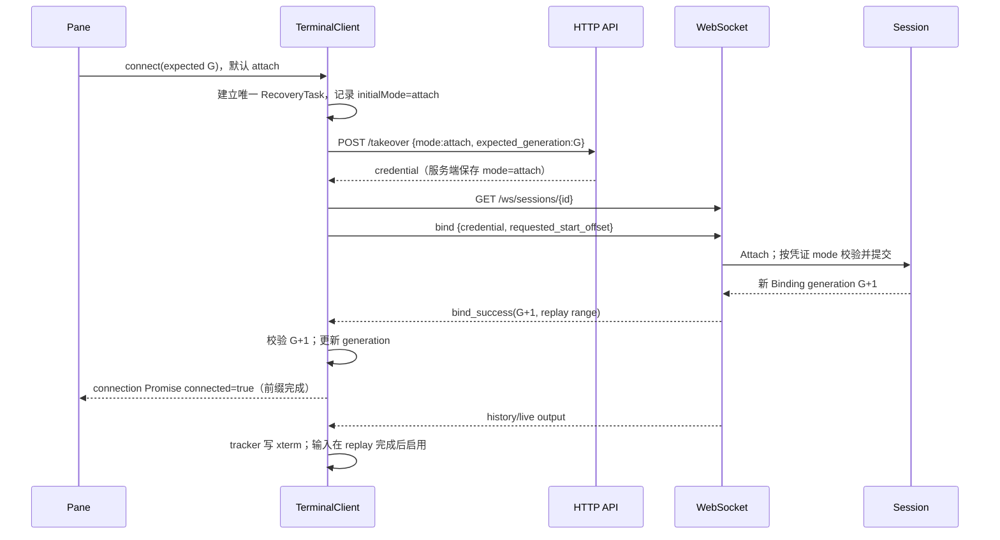
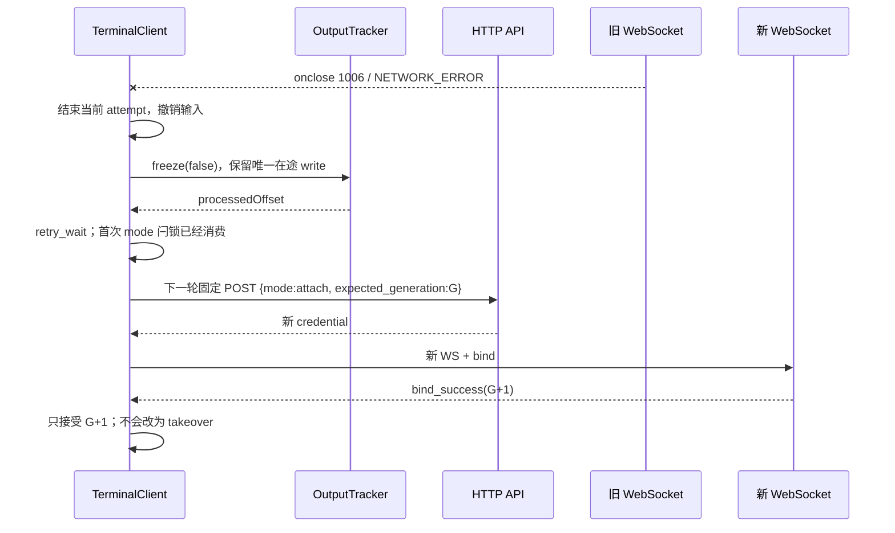
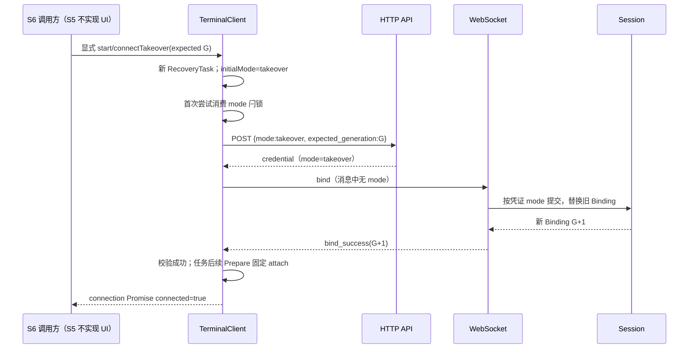
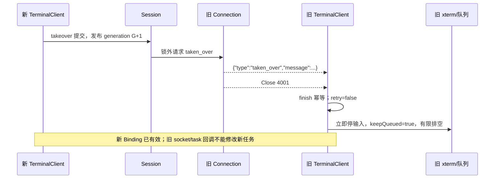
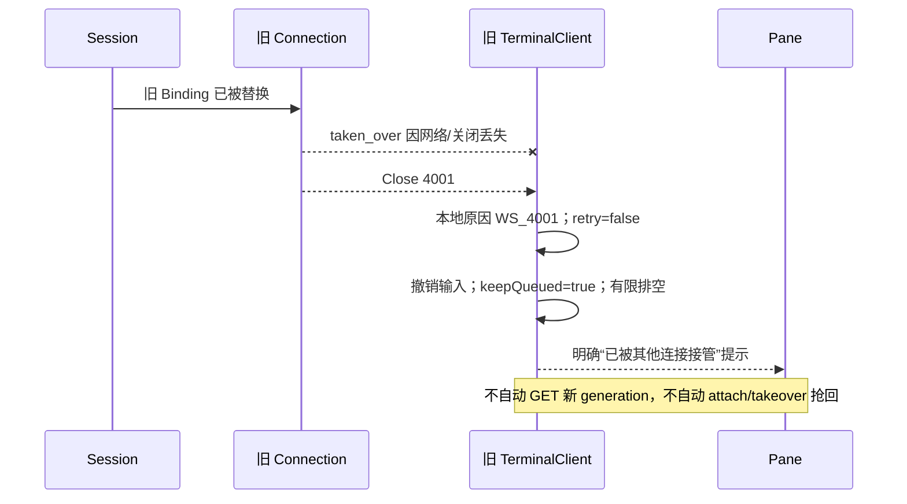
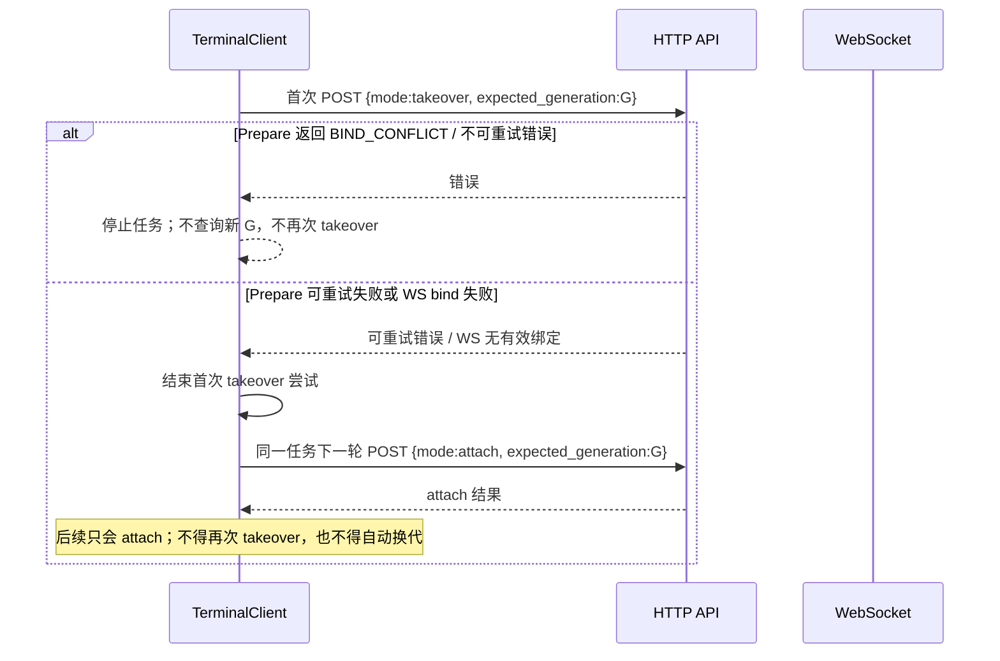

# Web SSH 第五阶段 S5 设计审查报告

## 1. 范围、基线与结论

- 审查分支：`codex/第五阶段`
- 审查基线 HEAD：`b1cb6d4306f5a19639ccfe45ff3a087a0b9880ae`
- 审查对象：第五阶段 S5，即 `TerminalClient` 的 attach/takeover mode、连接代次、终止通知和异步生命周期。
- 本次只读取、分析和新增本报告；未修改业务代码、API、WebSocket 协议、冻结设计或阶段计划，未开始 S5 编码，未提交、推送或部署。
- 开工时工作区已有用户修改 `M luan-qi-ba-zao.txt`；本报告未触碰该文件。

结论：S5 可以在当前后端 S2/S3 契约和前端第四阶段恢复机制上实现，不需要修改后端、冻结协议或 S4 已验收代码。当前主要实现缺口是：

1. `TerminalClient` 的 Prepare 请求固定发送 `mode: "attach"`，没有由调用方显式指定初始 mode 的连接入口。
2. 每个长期恢复任务没有独立的“首次尝试已消费”标记。增加 takeover 后，若用 `retries === 0` 判断 mode，稳定资格重置重试次数时可能再次发送 takeover。
3. Close `4001` 已经停止输入和自动恢复，并保留有限队列，但当前只显示通用“连接已结束（4001）”；S5 应明确提示其接管关闭语义，同时保持 `WS_4001` 本地原因，不伪造收到 `taken_over` 业务消息。
4. `taken_over`、4001、旧 socket、旧 Prepare、stop/dispose 隔离已有基础实现，S5 应保留这些机制并用 takeover 场景补齐确定性测试。

S5 只提供连接层能力。用户如何选择 Session、确认接管、定位/停止 Pane、建立待接管标签，属于 S6；因此 S5 完成后可独立验证 TerminalClient，但用户无法通过页面完成端到端主动接管，直到 S6 接入。

## 2. 阅读的文档清单

本次核对以下文档及其相关章节、交叉引用和 D1–D3 裁决落点：

| 文档 | 核对内容 |
|---|---|
| `doc/web-ssh-design-development-plan.md` | Session 生命周期、API、attach/takeover 语义、错误码、关闭原因、前端所有权边界。重点核对 §6、§11.4、§11.6、§11.7、§14。 |
| `doc/web-ssh-websocket-protocol.md` | Prepare 与 bind、mode 由凭证决定、bind_success、输出顺序、错误与 Close code、`taken_over`/`closed`、Reader/Writer、单任务恢复协调器、必须验证时序。重点核对 §2、§3、§4.4、§4.5、§5、§7、§8。 |
| `doc/web-ssh-architecture-implementation-plan.md` | 锁顺序、Connection/Binding 生命周期、凭证和唯一提交点、操作准入、输出与终止槽、物理回收。重点核对 §3.1、§4、§5、§6、§7。 |
| `doc/web-ssh-implementation-stages.md` | 第四阶段恢复边界和第五阶段 S5 范围。重点核对 §6、§7。 |
| `doc/stage-5-implementation-plan.md` | S5 前后依赖、前端完整接管流程、后端交接、并发矩阵、关闭/登出、S5 文件职责、U11/F04、D1–D3 裁决。重点核对 §3、§8、§9、§10、§11、§12、§13、§15、§16、§17、§21。 |
| `doc/stage-4-implementation-plan.md` | 第四阶段 TerminalClient 单任务恢复、Promise、稳定资格、输出 tracker、stop/dispose、Close 回退和人工恢复边界。 |
| `doc/stage-4-implementation-report.md` | 已落地并验收的 attach、重试预算、旧回调隔离、列表与 Pane 生命周期行为。 |

冻结要求与本报告新增建议已分开标注。D1=A、D2=A、D3=A 是已确认裁决，本报告没有重新裁决或改变它们。S5 没有发现需要新增 D4 之类的用户语义裁决。

## 3. 阅读的源码与测试清单

### 3.1 前端

- `frontend/src/terminal/client.ts`
  - `RecoveryTask`、`start`、`loop`、`prepareCredential`、`attempt`、`stop`、`dispose`。
- `frontend/src/terminal/output.ts`
  - `TerminalOutputTracker`、控制消息解析、`taken_over`/`closed` DTO、输入启用、冻结和有限排空。
- `frontend/src/terminal/recovery.ts`
  - `SessionRecovery.refresh`、`recover`、人工 attach 候选和旧查询隔离。
- `frontend/src/components/terminal/TerminalPane.vue`
  - TerminalClient/SessionRecovery 创建、连接状态、输入、停止、销毁和迟到 UI 回调隔离。
- `frontend/src/pages/HomePage.vue`
  - Pane 集合、页面生命周期、登出停止/销毁、S4 会话管理视图。
- `frontend/src/api/sessions.ts`
  - SessionView、Session 详情、关闭 Session 和活动列表 API。
- `frontend/src/api/management.ts`
  - 同源 Cookie、`no-store`、AbortSignal、API 错误解析和 `AUTH_REQUIRED` 回调。
- `frontend/src/stores/auth.ts`
  - 登录身份、`logoutPending`、过期处理。
- `frontend/src/session/list.ts`
  - S4 列表请求序号、Abort、身份和卸载隔离。
- `frontend/src/components/session/SessionManager.vue`
  - S4 列表生命周期；确认其不拥有 TerminalClient。
- `frontend/tests/terminal.test.mjs`
  - TerminalOutputTracker、TerminalClient、SessionRecovery、恢复预算、4001/4002、迟到回调和 stop/dispose。
- `frontend/tests/client.test.mjs`
  - 基础 HTTP 请求封装回归。
- `frontend/tests/terminal-pane.test.mjs`
  - 实际 Pane 的旧 socket 隔离、4001、`taken_over`、恢复和网络状态。
- `frontend/tests/session-list.test.mjs`
  - S4 列表生命周期和 TerminalPane 保持挂载的回归边界。

### 3.2 后端

- `backend/internal/session/binding.go`
  - `Prepare`、`canBind`、`Attach`、唯一提交点、旧 Binding 逻辑撤权、`CommitResult`、`Detach`。
- `backend/internal/session/send_admission.go`
  - `BindingDisposition`、`WithSendAdmission`。
- `backend/internal/session/session.go`
  - Session 状态、generation、快照和生命周期辅助。
- `backend/internal/websocket/connection.go`
  - Reader、Writer、发送准入、提交登记、统一 `Terminate`、`taken_over`、Close 和物理回收。
- `backend/internal/websocket/protocol.go`
  - 客户端 bind/resize DTO、严格解码、Close code 映射和 `taken_over` DTO。
- `backend/internal/websocket/service.go`
  - 连接登记、槽位和统一终止调用。
- `backend/internal/httpapi/sessions.go`
  - Prepare 请求、Session 列表、详情、关闭和 WebSocket 路由。
- `backend/internal/session/takeover_test.go`
  - U05–U09、R01–R05、凭证和原子替换。
- `backend/internal/websocket/takeover_test.go`
  - S3 的 W/R/T 真实 WS、Writer 准入、终止首因和资源回收。
- `backend/internal/websocket/connection_test.go`
  - bind、Reader/Writer、Close 和并发终止回归。
- `backend/internal/httpapi/sessions_test.go`
  - Prepare 请求形状、HTTP 错误和 Session API。

## 4. 当前 TerminalClient 连接与恢复流程

### 4.1 对象与所有权

`TerminalPane.vue` 为每个 Pane 创建一个 `TerminalClient` 和一个 `TerminalOutputTracker`。HomePage 只保存 Pane 引用，S4 `SessionListController` 不创建或驱动 TerminalClient。TerminalClient 当前持有一个长期 `RecoveryTask`，其字段包括：

- 任务 ID 和 `stopped`；
- `retries`；
- 首次连接 Promise；
- 长期 completion Promise。

`connect(expected)` 和 `run(expected)` 都进入同一个 `start(expected)`；已有活动任务时返回同一任务，不允许同一 Client 同时启动第二条恢复链。

### 4.2 单次尝试

`loop(task)` 当前按以下顺序执行：

1. `output.settle(false)`，等待上一轮输出写回调。
2. 读取 `processedOffset` 作为 `requested_start_offset`。
3. 发布 `preparing`。
4. `prepareCredential(task)` 请求一次性凭证。
5. 建立 WebSocket，发送首条 `bind`。
6. 校验 `bind_success.binding_generation === expected + 1`。
7. 校验回放范围和输出顺序。
8. 前缀完成后将 `generation` 更新为服务端确认的新代次，并结束首次 connection Promise。
9. 前缀完成且历史处理完成后允许输入。

当前 `prepareCredential` 固定发送：

```json
{
  "mode": "attach",
  "expected_generation": 0
}
```

这里的 `0` 是示意值；实际发送 `this.generation`。源码位置为 `frontend/src/terminal/client.ts:340-369`。

### 4.3 重试

当前 `retryCodes` 允许有限重试的 HTTP/WS 业务错误，包括 `BIND_BUSY`、`INVALID_CREDENTIAL`、`BIND_TIMEOUT`、`OUTPUT_GAP`、`SLOW_CLIENT`、`SERVER_SHUTTING_DOWN`、`INTERNAL_ERROR`、本地过载/终端失败、网络错误和容量类错误。

可重试结果发生后：

- 先冻结/丢弃或保留输出队列；
- 等待唯一在途终端写回调；
- 从排空完成开始计算 `reconnect_delay`；
- 同一任务最多执行配置数量的自动重试；
- 每次重试重新申请凭证，不复用旧凭证；
- 只有已通过校验的 `bind_success` 才更新 generation。

稳定资格只重置一次重试计数。当前逻辑不能使用 `retries === 0` 判断是否首次尝试，因为稳定资格可以把 `retries` 重新置零。

### 4.4 终止、输入和迟到回调隔离

`attempt()` 为每次 socket 建立独立闭包，并以以下条件判断回调是否仍有效：

- 本 attempt 未结束；
- 任务仍是当前任务且未停止；
- 当前 Client 未被销毁且页面/登录仍允许；
- `this.socket === socket`。

`finish()` 是单次尝试幂等结束入口。它会：

- 标记 attempt 结束；
- 消费稳定资格；
- 清除 bind timer；
- 冻结输出；
- 移除所有 socket handler；
- 清除当前 socket 和 finish 引用；
- 立即 `changed(false)`；
- 结束首次 connection Promise（若尚未结束）；
- 关闭旧 socket。

旧 xterm 回调另有 `terminalEpoch` 隔离。旧任务完成时还会检查任务身份，不能覆盖新任务 UI 状态。

### 4.5 SessionRecovery

`SessionRecovery` 当前只执行人工 attach：

1. 用户主动查询 Session 详情；
2. 仅接受本次查询的新 SessionView 作为候选；
3. 候选只能消费一次；
4. 先 `client.stop()`，完成后以候选的 `binding_generation` 调用 `client.connect()`；
5. 不自行创建 WebSocket，不维护第二套重试循环，不根据 Session 状态选择 takeover。

这与第四阶段职责一致。S5 应保持 `SessionRecovery.recover()` 默认 attach，不把主动 takeover 塞进这个入口。

## 5. 后端 takeover 契约核对

### 5.1 HTTP Prepare

`backend/internal/httpapi/sessions.go:21-24,72-86` 和 `backend/internal/session/binding.go:59-95` 确认：

- 请求体为 `{mode, expected_generation}`，两项必填；
- `mode` 只允许 `attach` 和 `takeover`；
- `expected_generation` 必须为安全非负整数；
- Prepare 只签发凭证，不替换旧 Binding，不改变 Session 状态或离线期限；
- 凭证内部保存登录 ID、Session ID、mode、expected generation 和到期时间。

### 5.2 WebSocket bind

`backend/internal/websocket/protocol.go:12-16` 的 bind DTO 只有：

```json
{
  "type": "bind",
  "credential": "一次性凭证",
  "requested_start_offset": 0
}
```

bind 没有 mode 字段，且解码器拒绝未知字段。因此浏览器不能在 WebSocket 阶段覆盖凭证中的 mode。实际提交行为由 `Session.Attach()` 读取凭证中的 `credential.mode` 决定。

### 5.3 提交与 generation

`backend/internal/session/binding.go:117-211` 确认：

- attach 在当前已绑定/在线时返回 `BIND_BUSY`；
- takeover 可针对 CONNECTED 或 DISCONNECTED；
- 两种 mode 都要求 `expected_generation` 等于提交时的当前 generation；
- 唯一提交点持操作门、登录读锁、Session 锁、Buffer 锁和凭证锁；
- 提交成功时消费同一 Session 的全部待用凭证；
- 旧 Binding 在 Session 锁内只标记 `active=false/superseded=true`，不提前取消 context；
- 新 Binding 的 generation 固定为旧 generation + 1；
- 旧 Connection 的终止和 Detach 在事务锁释放后执行。

### 5.4 taken_over 与 Close 4001

`backend/internal/websocket/protocol.go:68-84,120-124` 和 `connection.go:79-157,440-604` 确认：

- `taken_over` DTO 精确为 `{"type":"taken_over","message":string}`；
- 正常接管最终发送一次 `taken_over`，随后 Close `4001`；
- `taken_over` 由唯一 Writer 的独立终止槽发送；
- 如果旧端独立真实故障先固定首因，则故障原因优先，通知可能丢失；
- 通知可能因断网丢失，不能把收到 4001 当作已经收到业务消息；
- 客户端不得根据 4001 自动查询新 generation 并抢回。

### 5.5 当前前后端契约结论

后端已经满足 S5 所需契约，S5 不需要新增 API、错误码、WS 字段或 Close code。前端需要落实的是：

- 显式选择首次 mode；
- 同一任务首次尝试后固定使用 attach；
- 保持 generation 只由 `bind_success` 自动更新；
- 保持 `taken_over`/4001 停止恢复；
- 补齐裸 4001 的明确提示语义和确定性测试。

## 6. S5-1 至 S5-7 逐项审查

### 6.1 S5-1：mode 的来源与传递

**冻结要求**

- 调用方显式指定 `attach` 或 `takeover`；
- 不能根据 Session 状态猜 mode；
- HTTP Prepare 携带 mode；
- 凭证保存 mode；
- bind 不携带 mode；
- 客户端不能覆盖服务端凭证中的 mode。

**当前实现**

- HTTP 与后端契约正确；
- TerminalClient 固定发送 attach；
- 没有显式 takeover 入口。

**S5 需要实现**

- 增加类型明确的初始 mode；
- 保持 `connect(expected)`/`run(expected)` 默认 attach；
- 另增明确的主动 takeover 连接入口，或增加受字面量类型限制的 mode 参数；
- 初始 mode 固定在 RecoveryTask；
- 只有第一次 Prepare 使用任务初始 mode，后续全部 attach；
- WebSocket bind 仍只发送 credential 和 offset。

**连接结果如何区分**

`ConnectionResult` 不需要新增服务端错误码或 wire 字段。调用方在启动任务时已经知道初始 mode：从默认 `connect/run` 启动就是 attach，从显式 takeover 入口启动就是 takeover。该任务返回的 `connected=true` 只表示本次首次绑定前缀已经完成，不另外证明某个新的后端结果类型。若 S6 需要展示或记录动作种类，应由发起 takeover 的 Pane/页面动作上下文保存 mode，不能从 Session 状态猜测，也不能为 UI 方便新增协议字段。

**Agent 建议，尚未批准为具体 API**

保留现有 attach 外观，增加类似 `connectTakeover(expectedGeneration)`/`runTakeover(expectedGeneration)` 的显式入口，内部仍调用唯一的 `start(expected, mode)`。具体命名不是冻结协议，可在 S5 编码前由实现审查确定。

### 6.2 S5-2：expected_generation

**当前实现**

- `start(expected)` 设置任务 generation；
- 每次 Prepare 发送当前 generation；
- 每次 WS attempt 捕获 expected，只有 `bind_success === expected + 1` 才接受并更新；
- `BIND_CONFLICT` 不在 retryCodes 中，会停止；
- SessionRecovery 只使用用户最新查询详情中的 generation；
- 列表数据和旧 props 不反向更新 TerminalClient。

**结论**

当前 generation 机制基本完整。S5 只改变 mode，不应改变 generation 来源、校验或重试策略。

S5 必须禁止：

- 自动 GET 详情并替换 generation；
- 自动把 SessionView 最新 generation 用于 takeover；
- 在 `bind_success` 丢失时猜测已提交并自增；
- 把 `BIND_CONFLICT` 当网络错误重试。

### 6.3 S5-3：attach 与 takeover 恢复策略

**Attach**

保持第四阶段行为：网络断开、OUTPUT_GAP 和其他冻结可重试错误继续在同一个有限任务中重新申请 attach，并只使用已成功获知的 generation。

**Takeover**

- 只能由调用方在用户授权后启动；
- 第一次 Prepare 使用 takeover；
- 该次 attempt 本身不能中途改成 attach；
- 同一任务的后续自动尝试必须是新的 attach 尝试；
- 不得再次自动发送 takeover；
- 不得在 bind_success 丢失后自动查询新代次；
- takeover 成功后才把 connection Promise 视为首次绑定前缀成功。

这里需要区分两句话：

- “takeover 失败不能把该次请求静默降级为 attach”；
- 第五阶段计划同时规定“同一任务的下一轮自动重试固定 attach”。

后者是已经写入 `doc/stage-5-implementation-plan.md` §8.1 和 F04 的明确恢复策略，不构成设计冲突。用户不会看到一次 takeover 请求被改写；下一次 Prepare 是独立的新尝试，并明确使用 attach。

### 6.4 S5-4：taken_over 与 Close 4001

**当前已实现**

- `parseControl()` 严格校验 `taken_over` DTO；
- 收到 `taken_over` 后 `keepQueued=true`，`retry=false`；
- 收到裸 4001 后 `keepQueued=true`，不进入 retryCodes；
- `finish()` 立即清除 socket、撤销输入和发布权限；
- 已接受队列在 `write_drain_timeout` 内有限排空；
- 后续旧 close/message 因 handler 已移除、attempt 已结束、socket 身份不匹配而被忽略；
- `taken_over` 与后续 close 竞争时，首个 `finish()` 固定结果。

**仍需 S5 补齐**

- 裸 4001 的 `RecoveryState.message` 目前是通用“连接已结束（4001）”，没有明确告诉用户“已被其他连接接管”；
- 应保留本地原因 `WS_4001`，只补充明确、稳定的用户提示；
- 不应把裸 4001 改成 `taken_over` 业务 code，也不能伪造服务端消息已到达。

### 6.5 S5-5：连接代次与异步回调隔离

当前隔离机制足以作为 S5 基线：

- 一个 TerminalClient 同时只有一个活动 RecoveryTask；
- 一个任务同时只有一个活动 attempt；
- 一个 attempt 同时只有一个 socket 和 finish；
- 所有异步回调检查 task/socket/sequence/allowed/disposed；
- 旧 Prepare 响应在 Abort 后不创建 WS；
- stop 同步标记任务 stopped；
- dispose 同步封闭后续 run；
- output tracker 用 terminalEpoch 隔离旧 write 回调。

S5 不得用新的全局任务管理器替换这些机制。新增 mode 只能成为任务局部不可变初始值和一个一次消费闩锁，不能成为第二套 socket/恢复状态。

### 6.6 S5-6：状态机和错误语义

当前状态集合为：

`idle → preparing → connecting → replaying/online → retry_wait → stopping → stopped/disposed`

S5 增加的是任务级“初始 mode”和“首次尝试是否已消费”，不需要增加服务端错误码或新的全局状态框架。

关键规则：

- 首次 Prepare 使用任务初始 mode；
- 首次尝试在 Prepare 前消费 mode 闩锁；
- 所有后续 Prepare 使用 attach；
- `bind_success` 才更新 generation；
- `taken_over` 和裸 4001 停止自动恢复；
- `OUTPUT_GAP`/4002 仍有限恢复；
- `BIND_CONFLICT` 停止；
- stop/dispose 覆盖迟到网络结果；
- 认证/权限错误按现有错误表显示，不改成 NETWORK_ERROR。

### 6.7 S5-7：TerminalClient 与 SessionRecovery 职责

建议并符合当前设计的所有权如下：

| 能力 | 所有者 |
|---|---|
| 初始 mode | 发起任务的调用方显式传入；TerminalClient 固定到 RecoveryTask。 |
| attach 自动恢复 | TerminalClient 的单一 loop。 |
| 每次凭证、socket、generation 和重试预算 | TerminalClient。 |
| 用户主动 takeover 的意图/确认 | S6 Pane/页面控制器；不属于 S5。 |
| 人工 attach 候选与详情查询 | SessionRecovery。 |
| `taken_over`/4001 连接层处理 | TerminalClient。 |
| 被接管后的 Pane 展示 | TerminalPane 读取 TerminalClient 的 RecoveryState；S6 不另建连接状态。 |
| 是否允许重新接管 | 只由用户新的主动操作和 S6 流程决定；任何自动恢复都不得 takeover。 |

SessionRecovery 不需要识别 `taken_over` 控制消息，也不需要保存“被接管”状态。它只需知道当前 TerminalClient 已不 running，并在用户再次明确查询/人工 attach 时按原有候选流程工作。S6 的主动接管必须调用 TerminalClient 的显式 takeover 入口，不能复用 SessionRecovery 的默认 recover。

## 7. 六个时序图

### 7.1 T1：正常 attach



### 7.2 T2：attach 网络断开与恢复



### 7.3 T3：显式 takeover 的连接层流程



### 7.4 T4：旧 TerminalClient 被 takeover



### 7.5 T5：taken_over 通知丢失，只收到 4001



### 7.6 T6：takeover 失败



## 8. 状态机与错误处理表

### 8.1 状态转换

| 当前状态 | 事件 | 下一状态 | 约束 |
|---|---|---|---|
| idle | 用户/调用方启动 | preparing | 显式 attach 或 takeover；同一 Client 不能启动第二任务。 |
| preparing | 凭证成功 | connecting | 迟到/取消响应不创建 WS。 |
| connecting | bind_success 前缀完成 | replaying/online | 只接受 expected+1；replay 未完成时禁用输入。 |
| replaying | tracker 完成回放 | online | 不提前启用输入。 |
| online | 可重试 HTTP/WS/网络错误 | retry_wait | 下一轮固定 attach。 |
| retry_wait | delay 结束 | preparing | 稳定资格可重置 retries，但不能重置 mode 闩锁。 |
| online/replaying | taken_over/4001 | 停止流程 | 不重试；立即禁输入；有限保留队列。 |
| online/replaying | OUTPUT_GAP/4002 | retry_wait | 丢未提交输出；有限 attach 恢复。 |
| preparing/connecting | BIND_CONFLICT | stopped | 不自动查询或更换 generation。 |
| preparing/connecting/online | AUTH_REQUIRED/PERMISSION_DENIED | stopped | 认证/权限语义，不伪装网络错误。 |
| 任意活动态 | stop | stopping | 同步封闭新请求和新 socket。 |
| 任意活动态 | dispose | stopping/disposed | 阻止所有迟到回调和后续 run。 |

### 8.2 错误处理

| 错误/关闭 | 当前动作 | S5 目标 | 说明 |
|---|---|---|---|
| `BIND_BUSY`、`INVALID_CREDENTIAL`、`BIND_TIMEOUT` | 有限重试 | 下一轮 attach | 不重用旧凭证，不自动换代。 |
| `OUTPUT_GAP` / 4002 | 丢未提交输出，有限重试 | 下一轮 attach | 不与 4001 混淆。 |
| `SLOW_CLIENT` / 1013 | 有限重试 | 下一轮 attach | 保持原队列/预算规则。 |
| `SERVER_SHUTTING_DOWN` / 1012 | 有限重试 | 下一轮 attach | 最终由用户重试。 |
| `INTERNAL_ERROR` / 1011 | 有限重试 | 下一轮 attach | 不重放旧凭证。 |
| `CLIENT_OVERLOAD`、`CLIENT_TERMINAL_ERROR`、`CLIENT_BIND_TIMEOUT`、`NETWORK_ERROR` | 有限重试 | 下一轮 attach | 保持 tracker 清理/重建规则。 |
| `CREDENTIAL_LIMIT`、`CONNECTION_LIMIT_REACHED` | 有限重试 | 下一轮 attach | 容量错误不改变 generation。 |
| `BIND_CONFLICT` | 停止 | 停止 | 不得自动 GET 新 generation。 |
| `AUTH_REQUIRED` | 停止并通知认证过期 | 停止 | 保持现有 auth 行为。 |
| `PERMISSION_DENIED` | 停止 | 停止 | 不得变成网络重试。 |
| `INPUT_BACKPRESSURE` | 停止 | 停止 | 明确输入可能未全部发送，不补发。 |
| `INVALID_MESSAGE`、`INVALID_OFFSET`、`INVALID_SIZE`、`ALREADY_BOUND`、`MESSAGE_TOO_LARGE` | 停止 | 停止 | 协议错误不重试。 |
| `SESSION_NOT_FOUND`、`SESSION_NOT_READY` | 停止并保留诊断 | 停止 | Pane 可查询一次状态；不自动 takeover。 |
| `taken_over` 业务消息 | 停止、保留有限队列 | 明确接管提示 | 不重试。 |
| Close 4001 | 停止、保留有限队列 | 明确接管关闭提示，保留 `WS_4001` 本地原因 | 不伪造业务消息。 |
| `closed` 业务消息 | 停止、保留有限队列 | 保持 | 表示 SSH Session 实际关闭。 |
| Close 1000 | 停止 | 保持 | 不能单凭 1000 推断 Session 状态。 |
| Close 1006/1011/1012/1013 | 有限重试 | 下一轮 attach | 不自动 takeover。 |

## 9. 设计风险审查

### 9.1 attach 恢复被 takeover mode 污染

- 当前代码是否存在：当前没有 takeover，因此无现有污染；增加 mode 后有实现风险。
- 相关位置：`TerminalClient.start/loop/prepareCredential`。
- 风险时序：一个 takeover 任务成功后断网，下一轮仍读取任务初始 takeover。
- 处理：初始 mode 和“首次尝试已消费”分开保存；后续固定 attach。
- 是否 S5 必修：是。

### 9.2 自动重复 takeover

- 当前代码是否存在：当前固定 attach，因此不会重复 takeover，但 takeover 能力缺失。
- 相关位置：`RecoveryTask`、`loop`、`prepareCredential`。
- 风险时序：首次 takeover 返回 INVALID_CREDENTIAL/BIND_TIMEOUT 或 bind_success 丢失，循环再次读取 takeover。
- 处理：首次 Prepare 前消费 mode 闩锁；后续只 attach。
- 是否 S5 必修：是。

### 9.3 Close 4001 被当普通网络故障

- 当前代码是否存在：基础分类已正确，4001 不进入自动恢复；提示语义不足。
- 相关位置：`client.ts:507-516`、`TerminalPane.vue:stoppedState`。
- 风险时序：通知丢失，只剩 4001，用户看到通用关闭码，难以判断已被接管。
- 处理：保留 `WS_4001`，将消息改为明确接管关闭原因；不重试。
- 是否 S5 必修：是，作为最小状态反馈修正。

### 9.4 taken_over 后仍允许输入

- 当前代码是否存在：否。
- 相关位置：`TerminalClient.finish`、`canInput`、`send`。
- 风险时序：`taken_over` 到达后旧队列尚在排空，用户继续输入。
- 处理：`finish` 先清 socket 和 `changed(false)`，再排空；测试立即断言 `canInput=false`、send 不产生网络写。
- 是否 S5 必修：保留并补 takeover 测试。

### 9.5 旧 WebSocket 回调污染新连接

- 当前代码是否存在：受 socket 身份、attempt ended、task identity 和 handler 清理保护，当前不存在已知缺陷。
- 相关位置：`TerminalClient.attempt/start/publish`。
- 风险时序：旧 close/error/message 在新 socket 建立后迟到。
- 处理：保持现有闭包和身份校验；S5 增加 takeover 成功后旧回调测试。
- 是否 S5 必修：保留机制，测试必须覆盖。

### 9.6 Prepare 迟到后创建过期 WebSocket

- 当前代码是否存在：已受 AbortSignal、controller identity、task admitted 检查保护。
- 相关位置：`prepareCredential`、`loop`、`attempt`。
- 风险时序：stop/dispose/旧任务取消后 fetch 才返回。
- 处理：保持现有检查；mode 只影响请求体，不改变该边界。
- 是否 S5 必修：回归测试。

### 9.7 generation 被列表或详情自动刷新

- 当前代码是否存在：否。列表控制器与 TerminalClient 独立；SessionRecovery 只在用户明确 recover 时传候选代次。
- 相关位置：`session/list.ts`、`SessionRecovery.recover`、`TerminalClient.attempt`。
- 风险时序：takeover 失败后为了“帮助”用户自动查询并换代。
- 处理：禁止。generation 自动更新只能来自已验证的 `bind_success`。
- 是否 S5 必修：作为不可越界约束。

### 9.8 takeover 失败后被自动恢复机制重复 takeover

- 当前代码是否存在：无 takeover，故尚未发生；S5 实现时是主要风险。
- 相关位置：`retry_wait`、`loop`、`prepareCredential`。
- 风险时序：稳定资格重置 `retries=0`，实现误把零值当首次尝试。
- 处理：独立 `initialModeConsumed` 闩锁，不能依赖 retry 数。
- 是否 S5 必修：是。

### 9.9 TerminalClient 与 SessionRecovery 双重恢复

- 当前代码是否存在：否。TerminalClient 拥有唯一循环；SessionRecovery 只在人工 attach 时启动一个新任务。
- 相关位置：`client.ts:270-339`、`recovery.ts:96-119`。
- 风险时序：S6 为了 takeover 另起一个 socket/重试循环。
- 处理：S5 只扩展 TerminalClient；S6 必须调用同一 Client，不能创建第二套连接所有者。
- 是否 S5 必修：定义边界并在 S5 API 中支持；完整 UI 留 S6。

### 9.10 S4 管理列表生命周期影响 TerminalClient

- 当前代码是否存在：否。
- 相关位置：`SessionListController`、`SessionManager.vue`、HomePage `v-show` Pane。
- 风险时序：列表刷新/卸载错误停止终端，或列表数据直接替换 Pane 对象。
- 处理：S5 不修改 S4 控制器；列表只能提供后续 S6 动作数据。
- 是否 S5 必修：只做回归，不修改。

### 9.11 replay、processedOffset、OUTPUT_GAP 和预算被破坏

- 当前代码是否存在：现有 tracker/恢复测试已覆盖主要行为，但尚无 takeover 场景。
- 相关位置：`TerminalOutputTracker`、`TerminalClient.loop`。
- 风险时序：新增 mode 时顺手重构恢复循环或输出状态。
- 处理：只增加任务 mode 字段和闩锁；不改 tracker、offset、稳定资格、重试预算和 4002 分类。
- 是否 S5 必修：通过回归测试证明未破坏。

### 9.12 stop/dispose 与连接建立竞争

- 当前代码是否存在：已有多项保护和测试。
- 相关位置：`stop`、`dispose`、`prepareCredential`、`attempt`、`finish`。
- 风险时序：takeover Prepare/WS 建立时用户停止、登出或销毁 Pane。
- 处理：保持同步停止标志、Abort、finish、output dispose 和 allowed/disposed 检查；补 takeover 专项测试。
- 是否 S5 必修：回归并扩展。

## 10. 编码拆分方案

S5 不应拆成多个会产生“可创建 takeover 凭证但客户端没有安全 mode 闩锁”之类的中间版本。建议采用一个完整实现单元加一个验证收口单元。

### 10.1 S5-C1：TerminalClient 完整连接层单元

必须同时完成：

- 显式初始 mode 类型和入口；
- 默认 attach 外观；
- RecoveryTask 初始 mode；
- 首次尝试已消费闩锁；
- Prepare body 的 mode；
- 后续自动 Prepare 固定 attach；
- generation 来源和 `bind_success` 校验不变；
- `taken_over`/4001 停止和有限排空不变；
- 裸 4001 明确提示；
- 任务/socket/Prepare 迟到回调隔离不变。

完成后的运行状态：

- 所有现有 attach 调用行为保持不变；
- 代码层可以显式发起一次 takeover；
- 首次 takeover 后不会自动重复 takeover；
- 没有 S6 UI 也能通过 TerminalClient 单测验证；
- 不修改 SessionRecovery 默认 attach。

建议改动集中在 `frontend/src/terminal/client.ts` 和 `frontend/tests/terminal.test.mjs`。若类型必须从 `client.ts` 导出，仍属于同一单元，不新增生产文件。

### 10.2 S5-C2：确定性与回归验证单元

只增加测试和验证，不扩展 S6/S7 行为：

- attach 全量回归；
- takeover 首轮/后续 attach；
- Prepare/WS 失败和 bind_success 丢失；
- `taken_over`、裸 4001、连续/重复通知；
- stop/dispose、旧 socket/Prepare 迟到；
- 稳定资格重置不重置 mode 闩锁；
- 实际 Pane 状态回归。

如果 C2 发现生产缺陷，应回到 C1 的最小实现修正并重跑全部测试，不能把修复分散到无关文件。

### 10.3 验收顺序

1. 基线：记录 Git 状态，确认只有用户已有的 `luan-qi-ba-zao.txt` 修改。
2. 完成 S5-C1 与核心测试。
3. 执行前端完整测试和类型检查/生产构建。
4. 完成 S5-C2 的竞争与终止测试。
5. 再次执行前端完整测试、生产构建和必要的后端回归。
6. 审查 diff 仅含 S5 允许文件。
7. 停止并提交审查报告；不自动进入 S6。

## 11. 测试矩阵

测试应继续使用可控 fetch、Mock WebSocket、可控 Promise、显式 resolve/reject 和 mock timers，不使用固定 sleep。

### 11.1 Attach 回归

| ID | 场景 | 关键断言 |
|---|---|---|
| A01 | 正常 attach | 首个 POST body 为 `{mode:"attach", expected_generation:G}`；WS bind 无 mode；只接受 G+1；connection Promise 在前缀完成时 true。 |
| A02 | attach 网络断开恢复 | 1006 后同一任务有限 retry_wait；下一次 POST 仍 attach；使用已确认 generation；不新增 Session/SSH。 |
| A03 | OUTPUT_GAP/4002 | 丢未提交队列，等待在途 write，下一轮 attach；预算耗尽后停止。 |
| A04 | attach 被他人 takeover 后冲突 | 原代次 attach 得到 BIND_CONFLICT；停止；不自动查询新 generation，不发起 takeover。 |
| A05 | 默认入口与 SessionRecovery | `connect()/run()` 和 `SessionRecovery.recover()` 仍只 attach。 |

### 11.2 Takeover

| ID | 场景 | 关键断言 |
|---|---|---|
| T01 | 正常 takeover | 首次且仅首次 POST mode=takeover；WS bind 不含 mode；接受 G+1；connection Promise true；后续 Prepare 固定 attach。 |
| T02 | takeover Prepare 不可重试失败 | BIND_CONFLICT 等停止；请求数不增加；无自动 GET generation。 |
| T03 | takeover Prepare 可重试失败 | 首次 takeover 结束；下一轮 POST 为 attach、同 G；不再出现 takeover。 |
| T04 | WS bind BIND_BUSY/BIND_TIMEOUT/INVALID_CREDENTIAL | 结束 takeover attempt；后续 attach；不重用旧凭证。 |
| T05 | takeover 成功但 bind_success 丢失 | generation 保持 G；后续 attach 使用 G；冲突后停止；不猜测 G+1。 |
| T06 | 稳定资格重置 | takeover 成功后断网、稳定资格被消费/重置 retries，后续仍 attach；mode 闩锁不受 retries 影响。 |
| T07 | takeover 成功后再次断网 | 同一个长期任务继续，但下一轮 attach；不得重新 takeover。 |

### 11.3 taken_over 与 Close 4001

| ID | 场景 | 关键断言 |
|---|---|---|
| D01 | 只收到 `taken_over` | 立即 canInput=false；后续 send 无网络写；retry=false；保留有限队列；提示服务端 message。 |
| D02 | 只收到 Close 4001 | 本地 code 为 `WS_4001`；提示明确接管关闭；retry=false；有限保留队列。 |
| D03 | 先 `taken_over` 再 4001 | 只完成一次；原因不被 4001 覆盖；不重试；不重复排空。 |
| D04 | 重复 `taken_over`/重复 close | handler 清空和 attempt 幂等使后到事件无效；请求/socket 数不增加。 |
| D05 | taken_over 到达时存在已接受队列 | keepQueued=true；在途 write 完成或 drain timeout 后结束；不联网抢回。 |
| D06 | 4001 通知丢失 | 仍停止自动恢复；不自动 GET generation；不自动 attach/takeover 抢回。 |
| D07 | taken_over 先于 bind_success | connection Promise false 且 code 为 taken_over；不重试；不伪造绑定成功。 |

### 11.4 异步竞争与资源隔离

| ID | 场景 | 关键断言 |
|---|---|---|
| C01 | Prepare 迟到 | stop/abort 后即使 fetch 返回，也不创建 WS；旧 controller 不清理新 controller。 |
| C02 | 多次 connect | 同一任务返回同一 Promise/完成态；只产生一个 POST 链和一个活动 socket。 |
| C03 | 旧 onopen/message/close 迟到 | 旧 attempt 和新任务均不被修改；旧 socket 不再发送 bind/input。 |
| C04 | 旧任务 completion 迟到 | sequence/task identity 阻止覆盖新任务状态。 |
| C05 | dispose 与连接建立竞争 | 不创建替代 socket/terminal；后续回调不更新 notice/state；重复 dispose 幂等。 |
| C06 | 旧 xterm write 回调迟到 | terminalEpoch 阻止推进新实例 offset。 |
| C07 | S4 列表刷新与 Pane | 列表请求不创建 TerminalClient、不停止 Pane、不修改 generation。 |

### 11.5 实际 Pane 集成

| ID | 场景 | 关键断言 |
|---|---|---|
| P01 | Pane 收到 taken_over | 输入禁用，状态提示明确，socket 数不因自动恢复增加。 |
| P02 | Pane 收到裸 4001 | 输入禁用，提示接管关闭语义，不自动重连。 |
| P03 | 旧 Pane socket 事件在新任务后迟到 | 当前 Pane 状态、notice、socket 和 generation 不变。 |
| P04 | stop/dispose 后请求返回 | 页面无新提示、无新连接、无终端重建。 |

## 12. 需要用户裁决的问题

本次审查没有发现新的用户语义裁决：

- D1=A、D2=A、D3=A 已在冻结计划中确认；
- 首次 mode 显式由调用方指定；
- 同一任务后续自动尝试固定 attach；
- `taken_over` 和 4001 停止恢复；
- 1006 等异常断线只 attach，不升级 takeover；
- generation 只由已验证的 `bind_success` 更新。

仍需后续用户明确授权的是“开始 S5 编码”。具体 TypeScript 方法命名（例如 `connectTakeover` 与 mode 参数的取舍）是实现细节，不改变协议或产品语义；建议在编码审查时采用最小、明确的接口。

## 13. 明确的 S5 实施范围

S5 编码获准后只应实现：

1. TerminalClient 接收显式初始 attach/takeover mode。
2. 保持 `connect/run` 默认 attach。
3. 首次 Prepare 使用任务初始 mode，之后固定 attach。
4. 首次尝试闩锁独立于 retries/稳定资格。
5. expected_generation 来源、传递和 `bind_success` 校验不变。
6. `taken_over` 和 Close 4001 停止输入/自动恢复，有限排空。
7. 裸 4001 的明确用户提示。
8. 旧 socket、旧 Prepare、旧任务和 dispose 后迟到回调隔离。
9. 必要的 TerminalClient、SessionRecovery 回归和 Pane 状态测试。

S5 不需要：

- 修改后端；
- 修改 API、协议 DTO、错误码或 Close code；
- 修改 output tracker 算法；
- 修改 SessionRecovery 默认人工 attach；
- 修改 S4 列表控制器；
- 增加全局 store、事件总线、轮询或第二套恢复循环。

## 14. S6–S8 禁止越界范围

### S6

S5 不实现：

- Session 列表“主动接管”按钮；
- 接管确认弹窗；
- HomePage 的 Pane 预占/定位；
- 停止恢复中任务并等待收尾的 UI 协调；
- 创建待接管 Pane、确认后任务归属和跨标签协调；
- 接管完成后的列表刷新触发；
- 用户从 SessionManager 到 TerminalClient 的端到端接线。

S5 只提供连接层 API 和状态能力；S6 才能发起真实用户 takeover 操作。

### S7

S5 不修改：

- Session 关闭流程；
- 登出流程；
- `logoutPending`；
- HomePage 退出资源回收；
- 第四阶段 stop/dispose 生命周期；
- 跨页面异步任务转移。

### S8

S5 不进行：

- 第五阶段整体集成；
- 全链路真实部署验收；
- 冻结文档重写；
- 与 S5 无关的重构。

## 15. 预计修改文件清单与建议验收顺序

### 15.1 预计修改

| 文件 | 预期用途 | 是否确定 |
|---|---|---|
| `frontend/src/terminal/client.ts` | 显式初始 mode、首次尝试闩锁、后续 attach、4001 提示、保持现有生命周期。 | 必需 |
| `frontend/tests/terminal.test.mjs` | TerminalClient/tracker 的 S5 单元、失败和竞争测试。 | 必需 |
| `frontend/tests/terminal-pane.test.mjs` | 实际 Pane 的 taken_over/4001/迟到回调/状态测试。 | 很可能需要 |
| `doc/测试报告/stage-5-s5-test-report.md` | S5 编码后的实施/测试报告。 | 编码阶段新增 |

不预计修改：

- `frontend/src/terminal/output.ts`；
- `frontend/src/terminal/recovery.ts`；
- `frontend/src/components/terminal/TerminalPane.vue` 的业务结构；
- `frontend/src/pages/HomePage.vue`；
- `frontend/src/api/*`；
- `frontend/src/session/list.ts`；
- `frontend/src/components/session/SessionManager.vue`；
- `backend/**`；
- 冻结设计/协议/阶段计划。

如果实现时发现必须修改上述“不预计”文件，应先说明触发条件、最小变更和阶段边界，再取得相应授权。

### 15.2 建议验收顺序

1. 先锁定 attach 基线，证明默认入口和 SessionRecovery 不回归。
2. 完成显式 takeover 入口和首次 mode 闩锁。
3. 验证 takeover 成功、失败、bind_success 丢失和后续 attach。
4. 验证 taken_over/4001、有限排空、输入禁用和旧回调隔离。
5. 验证 stop/dispose、Prepare 迟到、多次 connect 和稳定资格重置。
6. 运行前端完整测试、类型检查和生产构建。
7. 运行必要的后端回归、Go Race、Vet 和 Build，确认 S5 没有意外后端影响。
8. 检查 diff 仅属于 S5；保存原始日志和测试报告。
9. 停止，等待人工审查；不得自动开始 S6。

## 16. 设计冲突与剩余空白

未发现阻塞 S5 的冻结设计冲突：

- 后端 mode、凭证、WS bind 和原子替换契约一致；
- 前端 4001/4002 分类与冻结协议一致；
- TerminalClient 单任务恢复、SessionRecovery 人工 attach 和 S4 列表所有权可分离；
- S5 不依赖 S6 才能保证连接层安全；
- S5 依赖 S6 才能提供用户可操作的端到端接管流程，这是阶段边界而非设计冲突。

仍需在 S5 编码时闭合的实现空白：

1. 初始 mode API 尚未存在；
2. 首次 mode 闩锁尚未存在；
3. 裸 4001 的用户提示尚未明确；
4. 现有测试没有 takeover 首轮/后续 attach、bind_success 丢失和稳定重置后的 mode 回归；
5. S6 尚未接入，因此不能宣称第五阶段主动接管功能已完整可用。

## 17. Git 与操作状态

审查开始时：

```text
 M luan-qi-ba-zao.txt
```

- 暂存区为空；
- 本报告之外未修改业务文件；
- 未执行 commit、push、merge、rebase、reset、clean 或部署；
- 未触碰用户已有的 `luan-qi-ba-zao.txt`。

本报告完成后应仅新增：

```text
doc/测试报告/stage-5-s5-design-review.md
```

本次审查不代表 S5 编码授权。S5 实施必须等待用户对报告和后续编码范围作出明确授权。
